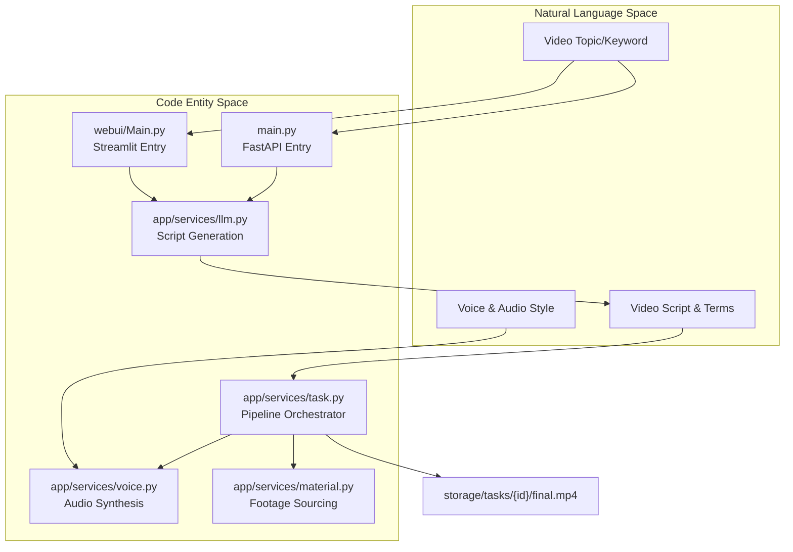
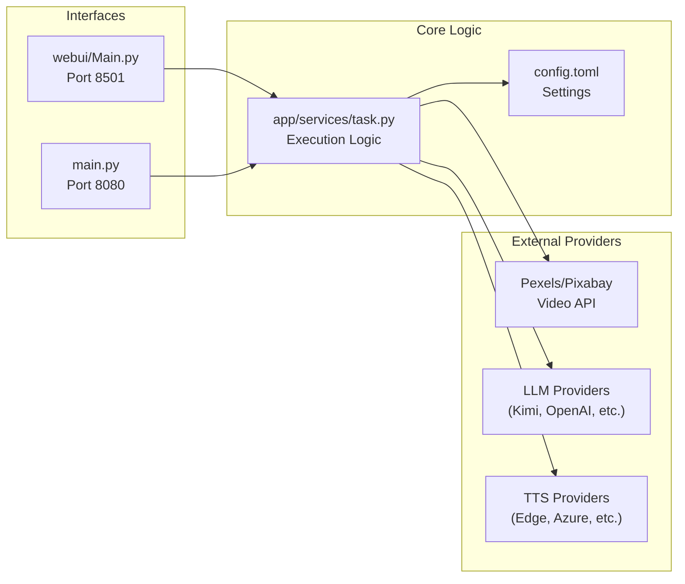

<!-- source: DeepWiki mcp.deepwiki.com · repo harry0703/MoneyPrinterTurbo · page 2 Getting Started · fetched 2026-10-30 -->

# Getting Started

<details>
<summary>Relevant source files</summary>

The following files were used as context for generating this wiki page:

- [Dockerfile](Dockerfile)
- [Dockerfile.gpu](Dockerfile.gpu)
- [README-en.md](README-en.md)
- [README-ja.md](README-ja.md)
- [README.md](README.md)
- [config.example.toml](config.example.toml)
- [docker-compose.gpu.yml](docker-compose.gpu.yml)
- [docker-compose.yml](docker-compose.yml)
- [webui.bat](webui.bat)
- [webui.sh](webui.sh)

</details>


This guide provides an overview of setting up and running MoneyPrinterTurbo for the first time. It covers system requirements, deployment options, and the basic workflow needed to generate your first AI-powered video.

For detailed installation instructions, see [Installation & Setup](#2.1). For configuration details, see [Configuration](#2.2). For a step-by-step walkthrough of generating your first video, see [Quick Start Guide](#2.3).

**Sources:** [README.md:5-7](), [README-en.md:5-7]()

---

## Prerequisites and System Requirements

Before installing MoneyPrinterTurbo, ensure your system meets the following requirements:

### Minimum System Requirements

| Component | Requirement | Recommended |
|-----------|-------------|-------------|
| CPU | 4 cores | 6 to 8 cores |
| Memory | 4GB RAM | 8GB to 16GB+ |
| GPU | Not required | 4GB+ VRAM (for local transcription/faster processing) |
| OS | Windows 10+, macOS 11.0+, or Linux | Same |

[README.md:10-11](), [README-en.md:10-11]()

### Critical Prerequisites

1.  **Path Requirements**: Avoid using Chinese characters, special characters, or spaces in installation paths to prevent unpredictable issues.
2.  **Network Access**: Ensure stable internet connectivity. If using a proxy, verify the `[proxy]` settings in `config.toml` [config.example.toml:1-9]().
3.  **External Tools**: 
    *   **FFmpeg**: Essential for video processing and encoding [Dockerfile:32-32](), [Dockerfile.gpu:19-19]().
    *   **ImageMagick**: Required for subtitle rendering and text effects.
    *   **Python**: Version 3.11 or higher is required [README.md:11-11](), [Dockerfile:2-2]().

**Sources:** [README.md:10-12](), [README-en.md:10-12](), [Dockerfile:32-33](), [Dockerfile.gpu:16-26]()

---

## Deployment Methods Overview

MoneyPrinterTurbo supports several primary deployment strategies depending on your technical comfort level and hardware availability:

### 1. Google Colab (Cloud Trial)
Best for users who want to try the system immediately without local hardware requirements.
*   **Sources**: [README.md:17-17](), [README-en.md:17-17]()

### 2. Windows One-Click / Batch Setup
Simplified local setup for Windows users.
*   **Startup**: The `webui.bat` script handles environment variable setup, port detection (searching 8501-8599), and launches the Streamlit interface [webui.bat:5-52]().
*   **Sources**: [webui.bat:1-52]()

### 3. Docker & Docker Compose (Containerized)
Recommended for consistent environments and production-like setups.
*   **Standard (CPU)**: Uses `Dockerfile` with `python:3.11-slim-bullseye` [Dockerfile:1-2]().
*   **GPU Accelerated**: Uses `Dockerfile.gpu` based on `nvidia/cuda:12.1.1-cudnn8-runtime-ubuntu22.04` for faster video processing and AI tasks [Dockerfile.gpu:1-2]().
*   **Orchestration**: `docker-compose.yml` manages both the WebUI (port 8501) and the API (port 8080) services [docker-compose.yml:5-24]().
*   **Sources**: [Dockerfile:1-102](), [Dockerfile.gpu:1-55](), [docker-compose.yml:1-24](), [docker-compose.gpu.yml:1-35]()

### 4. Manual Installation
Full control using standard Python tools.
*   **Launch Scripts**: Use `webui.sh` for Unix-like systems [webui.sh:1-81]() or `webui.bat` for Windows [webui.bat:1-52](). Both scripts prioritize a local `.venv` if present [webui.sh:19-21](), [webui.bat:13-14]().
*   **Sources**: [webui.sh:1-81](), [webui.bat:1-52]()

---

## High-Level Workflow

The following diagram bridges natural language concepts to the code entities that handle them during the video generation lifecycle.

**Workflow: From Subject to Final Video**


**Sources:** [webui/Main.py:1-52](), [docker-compose.yml:12-22](), [config.example.toml:36-78]()

---

## Core Components and File Structure

The system separates user interaction from the core processing pipeline.

**System Component Map**


### Key Files and Directories

| Path | Purpose |
|------|---------|
| `config.toml` | Active configuration (copy from `config.example.toml`) [config.example.toml:1-3]() |
| `main.py` | Entry point for the FastAPI REST server [docker-compose.yml:22-22]() |
| `webui/Main.py` | Entry point for the Streamlit Web interface [Dockerfile:102-102]() |
| `requirements.txt` | Python dependency list [Dockerfile:83-83]() |
| `storage/` | Default directory for generated tasks and assets [Dockerfile:109-111]() |

**Sources:** [config.example.toml:1-14](), [docker-compose.yml:1-24](), [Dockerfile:83-102]()

---

## Minimal Configuration

Before generating your first video, you must set up your `config.toml`. The system defaults to `pexels` for video sourcing and expects API keys for LLM services.

```toml
# config.toml (Essential snippet)
log_level = "DEBUG"
listen_port = 8080

[app]
# Select your video material source
video_source = "pexels" # Options: pexels, pixabay, coverr, etc.
pexels_api_keys = ["YOUR_KEY_HERE"]

# Script generation settings
script_generation_backend = "local"
```

For detailed configuration of all 13+ LLM providers and various TTS services, see [Configuration](#2.2).

**Sources:** [config.example.toml:9-12](), [config.example.toml:78-85](), [config.example.toml:39-39]()

---

## Next Steps

1.  **Installation**: Follow the detailed guide in [Installation & Setup](#2.1) to prepare your environment.
2.  **Configuration**: Obtain your API keys and set up your `config.toml` as described in [Configuration](#2.2).
3.  **Generate**: Use the [Quick Start Guide](#2.3) to create your first video using the WebUI.

---

