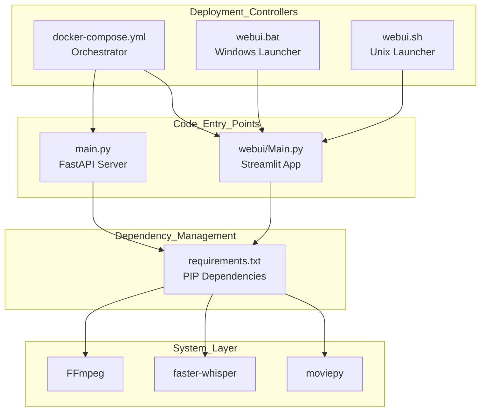
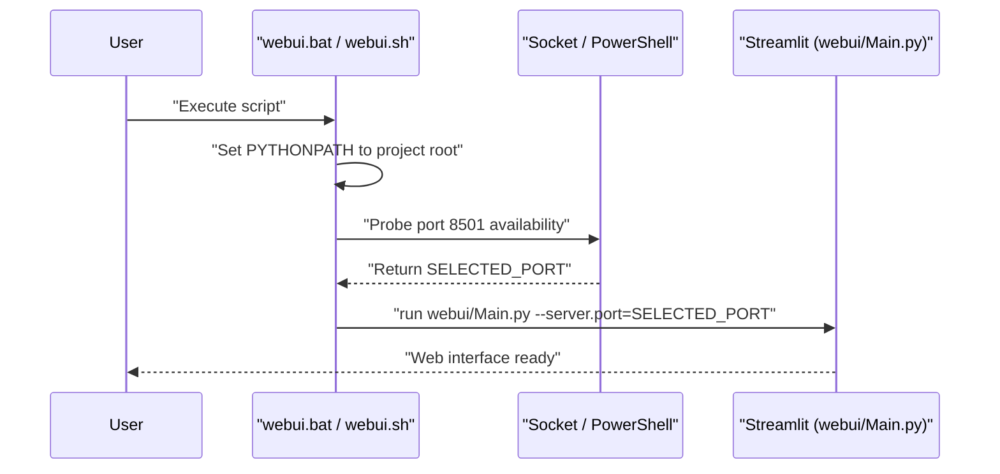

<!-- source: DeepWiki mcp.deepwiki.com · repo harry0703/MoneyPrinterTurbo · page 2.1 Installation & Setup · fetched 2026-10-30 -->

# Installation & Setup

<details>
<summary>Relevant source files</summary>

The following files were used as context for generating this wiki page:

- [.dockerignore](.dockerignore)
- [.github/workflows/docker-ghcr.yml](.github/workflows/docker-ghcr.yml)
- [Dockerfile](Dockerfile)
- [Dockerfile.gpu](Dockerfile.gpu)
- [README-en.md](README-en.md)
- [README-ja.md](README-ja.md)
- [README.md](README.md)
- [docker-compose.gpu.yml](docker-compose.gpu.yml)
- [docker-compose.release.yml](docker-compose.release.yml)
- [docker-compose.yml](docker-compose.yml)
- [webui.bat](webui.bat)
- [webui.sh](webui.sh)

</details>


This document provides comprehensive installation instructions for MoneyPrinterTurbo, covering all supported deployment methods including Docker (CPU/GPU), Windows one-click packages, manual installation, and Google Colab. For configuration details after installation, see [Configuration](). For your first video generation walkthrough, see [Quick Start Guide]().

## System Requirements

MoneyPrinterTurbo requires specific hardware and software prerequisites for optimal performance.

### Hardware Requirements
- **CPU**: Minimum 4 cores recommended.
- **RAM**: 4GB or higher recommended.  
- **GPU**: Optional. Required for local `faster-whisper` acceleration or GPU-based video encoding.
- **Disk**: Sufficient space for video assets and the `storage/` directory.

### Software Requirements
- **Python**: Version 3.11 or higher is required [README.md:11-11]().
- **FFmpeg**: Required for video processing and synthesis [Dockerfile:32-32]().
- **ImageMagick**: Required for subtitle rendering and image processing.
- **Docker**: Recommended for containerized deployment.

Sources: [README.md:11-11](), [Dockerfile:32-32](), [Dockerfile.gpu:19-19]()

## Installation Architecture Overview

The following diagram illustrates how the different installation components relate to the core application structure and code entities.



Sources: [docker-compose.yml:5-24](), [webui.bat:52-52](), [webui.sh:73-81](), [Dockerfile:83-92](), [docker-compose.release.yml:7-21]()

## Docker Deployment (Recommended)

Docker is the preferred method as it encapsulates complex system dependencies like FFmpeg and Python environments.

### CPU Deployment
This is the default configuration suitable for most users.

1. **Clone and Enter**:
   ```bash
   git clone https://github.com/harry0703/MoneyPrinterTurbo.git
   cd MoneyPrinterTurbo
   ```
2. **Launch Services**:
   ```bash
   docker compose up -d
   ```
   This command starts two containers: `moneyprinterturbo-webui` on port 8501 and `moneyprinterturbo-api` on port 8080 [docker-compose.yml:9-21]().

### GPU Deployment (NVIDIA Only)
Utilizes NVIDIA GPU to accelerate `faster-whisper` and video rendering.

1. **Prerequisites**: NVIDIA Container Toolkit installed and `nvidia-smi` functional.
2. **Launch with GPU override**:
   ```bash
   docker compose -f docker-compose.yml -f docker-compose.gpu.yml up -d --build
   ```
   The `docker-compose.gpu.yml` file overrides the build to use `Dockerfile.gpu` (based on `nvidia/cuda:12.1.1-cudnn8-runtime-ubuntu22.04`) and reserves 1 GPU device for both the WebUI and API services [docker-compose.gpu.yml:13-35](), [Dockerfile.gpu:2-2]().

### Docker Internal Implementation
The `Dockerfile` uses a multi-mirror fallback strategy (Aliyun -> Tsinghua -> Debian) to ensure system package installation stability for users in different regions [Dockerfile:22-79](). It installs `git` and `ffmpeg` as core system dependencies [Dockerfile:32-32]().

Sources: [Dockerfile:1-102](), [Dockerfile.gpu:1-55](), [docker-compose.yml:1-24](), [docker-compose.gpu.yml:1-35]()

## Windows & Unix One-Click Setup

The repository provides scripts to automate the environment check and launch sequence.

### Execution Logic
1. **Environment Detection**: Both `webui.bat` and `webui.sh` check for a local `.venv` or a system-wide `uv` installation [webui.bat:13-20](), [webui.sh:19-32]().
2. **Port Arbitration**: The scripts dynamically search for an available port between 8501 and 8600 if the default 8501 is occupied [webui.bat:36-49](), [webui.sh:34-64]().
3. **Execution**: Launches the Streamlit app using `webui/Main.py` with optimized server flags [webui.bat:52-52](), [webui.sh:73-81]().



Sources: [webui.bat:1-52](), [webui.sh:1-81]()

## Manual Installation

Manual installation is recommended for developers.

### 1. Python Environment
The project requires Python 3.11+ [README.md:11-11]().
```bash
# Install dependencies
pip install -r requirements.txt
```

### 2. System Dependencies
- **FFmpeg**: Must be available in the system PATH [Dockerfile:32-32]().
- **ImageMagick**: Required for certain `moviepy` text operations.

### 3. Running
- **WebUI**: `streamlit run ./webui/Main.py` [docker-compose.yml:12-12]()
- **API**: `python main.py` [docker-compose.yml:22-22]()

Sources: [README.md:11-11](), [Dockerfile:83-92](), [docker-compose.yml:12-22]()

## Installation Verification

| Component | Verification Command | Expected Output |
| :--- | :--- | :--- |
| **Python** | `python --version` | `Python 3.11.x` (or higher) |
| **FFmpeg** | `ffmpeg -version` | Version info including configuration |
| **WebUI** | `curl -I http://localhost:8501` | `HTTP/1.1 200 OK` |
| **API** | `curl -I http://localhost:8080/docs` | `HTTP/1.1 200 OK` |

Sources: [Dockerfile:102-102](), [docker-compose.yml:11-21](), [README.md:11-11]()

---

