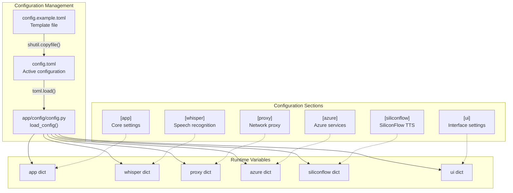
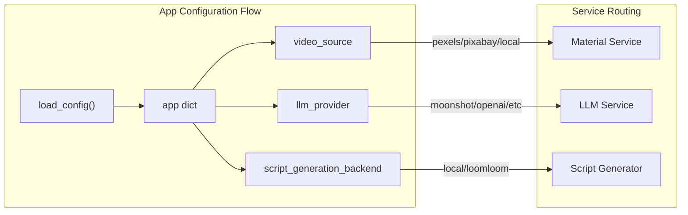
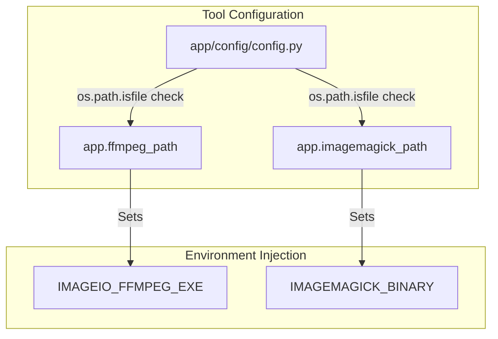

<!-- source: DeepWiki mcp.deepwiki.com · repo harry0703/MoneyPrinterTurbo · page 2.2 Configuration · fetched 2026-10-30 -->

# Configuration

Relevant source files

The following files were used as context for generating this wiki page:

- [app/__init__.py](app/__init__.py)
- [app/config/config.py](app/config/config.py)
- [config.example.toml](config.example.toml)
- [pyproject.toml](pyproject.toml)
- [requirements.txt](requirements.txt)
- [test/services/test_config.py](test/services/test_config.py)
- [uv.lock](uv.lock)

This page provides a comprehensive guide to configuring MoneyPrinterTurbo, covering all configuration options including API keys, service providers, and system settings. The configuration system uses a TOML file format and supports multiple providers for each service type to ensure flexibility and redundancy.

For installation and setup procedures, see [Installation & Setup](). For quick start instructions after configuration, see [Quick Start Guide]().

## Configuration File Structure

MoneyPrinterTurbo uses a centralized configuration approach through the `config.toml` file located in the project root directory. The system automatically creates this file from `config.example.toml` on the first run [config.example.toml:1-3]().

### Configuration Loading Process

The configuration loader in `app/config/config.py` handles file creation, character encoding detection (supporting `utf-8-sig` for Windows compatibility), and provides fallback mechanisms. It utilizes a `_SynchronizedConfig` class [app/config/config.py:29-84]() to ensure thread-safe operations during runtime updates.

The `load_config` function at [app/config/config.py:236-258]() is responsible for initializing the configuration state. It checks for the existence of `config.toml` and copies the example if necessary [app/config/config.py:241-246]().

Sources: [config.example.toml:1-3](), [app/config/config.py:29-84](), [app/config/config.py:236-258]()

## Core Application Settings

The `[app]` section contains fundamental system configuration options that control video generation behavior and service selection.

| Setting | Type | Description | Default |
|---------|------|-------------|---------|
| `video_source` | string | Material provider ("pexels", "pixabay", "coverr", "wavespeed", "volcengine_seedance", "ofox", "metaso_minimax", "loomloom", "openai_image", "local") | "pexels" |
| `hide_config` | boolean | Hide configuration panel in UI | false |
| `llm_provider` | string | LLM service provider (e.g., "moonshot", "openai") | "moonshot" |
| `script_generation_backend` | string | Backend for scripts ("local" or "loomloom") | "local" |
| `edge_tts_timeout` | integer | Timeout in seconds for Edge TTS requests | 30 |
| `tls_verify` | boolean | Verify TLS certificates for API and downloads | true |
| `api_key` | string | Optional protection for API routes and /tasks files | "" |

Sources: [config.example.toml:14-78](), [app/config/config.py:236-258](), [test/services/test_config.py:32-53]()

## LLM Provider Configuration

MoneyPrinterTurbo supports a wide array of LLM providers for script generation and keyword extraction. The provider registry and default models are maintained in `app/models/llm_provider.py`.

### Configuration Parameters by Provider

The system uses a standardized naming convention for provider settings within the `[app]` section of `config.toml`. For example, a provider named `moonshot` will look for `moonshot_api_key`, `moonshot_base_url`, and `moonshot_model_name` [test/services/test_config.py:68-80]().

| Provider | Key Suffix | Default Model (Example) |
|----------|------------|-------------------------|
| Moonshot (Kimi) | `moonshot` | `kimi-k3` [test/services/test_config.py:121]() |
| OpenAI | `openai` | `gpt-4o-mini` |
| DeepSeek | `deepseek` | `deepseek-chat` |
| SiliconFlow | `siliconflow` | `deepseek-ai/DeepSeek-V3` |

Sources: [config.example.toml:1-146](), [test/services/test_config.py:68-80](), [test/services/test_config.py:116-121]()

## Media Source Configuration

The system acquires video materials from multiple providers. API key lists support rotation by using an array format [config.example.toml:80-82]().

### Video Material Sources
- **Stock Footage**: `pexels_api_keys`, `pixabay_api_keys`, `coverr_api_keys` [config.example.toml:85-91]().
- **AI Video Generation**: 
    - **WaveSpeed**: Generates clips via `wavespeed_api_keys` [config.example.toml:93-95]().
    - **Volcano Engine (Seedance)**: Official asynchronous API via `volcengine_seedance_api_key` [config.example.toml:106-113]().
    - **OFox**: Multi-model API (Seedance, Wan) via `ofox_api_key` [config.example.toml:125-130]().
- **AI Image Generation**: `openai_image` generates images from keywords and renders them as clips [config.example.toml:75-77]().

Sources: [config.example.toml:62-143]()

## Social Media Distribution (Upload-Post)

MoneyPrinterTurbo integrates with the `Upload-Post` service for automated video distribution. These settings must be located under the `[app]` section [test/services/test_config.py:123-138]().

| Setting | Description |
|---------|-------------|
| `upload_post_enabled` | Enable/Disable social media posting |
| `upload_post_api_key` | API Key for the distribution service |
| `upload_post_platforms` | List of platforms (e.g., `["tiktok", "instagram"]`) |
| `upload_post_auto_upload` | Automatically trigger upload after video generation |

Sources: [test/services/test_config.py:123-138]()

## Infrastructure & Tooling

### Tool Integration (FFmpeg & ImageMagick)
The system attempts to auto-detect these binaries. Manual paths can be provided in `config.toml`, which are then injected into environment variables.

### Persistence and Atomic Saves
To prevent configuration corruption, the system uses an atomic save mechanism. The `save_config` function writes to a temporary file before replacing the original `config.toml` [app/config/config.py:202](), [test/services/test_config.py:139-164]().

### Non-blocking Updates
The WebUI utilizes `update_config_nonblocking` [app/config/config.py:91-125]() to update settings without freezing the interface. If a video task is currently running and holds the `_config_save_lock`, updates are queued in `_pending_config_updates` and applied once the lock is released [app/config/config.py:95-118]().

Sources: [app/config/config.py:91-165](), [test/services/test_config.py:139-164]()

---

