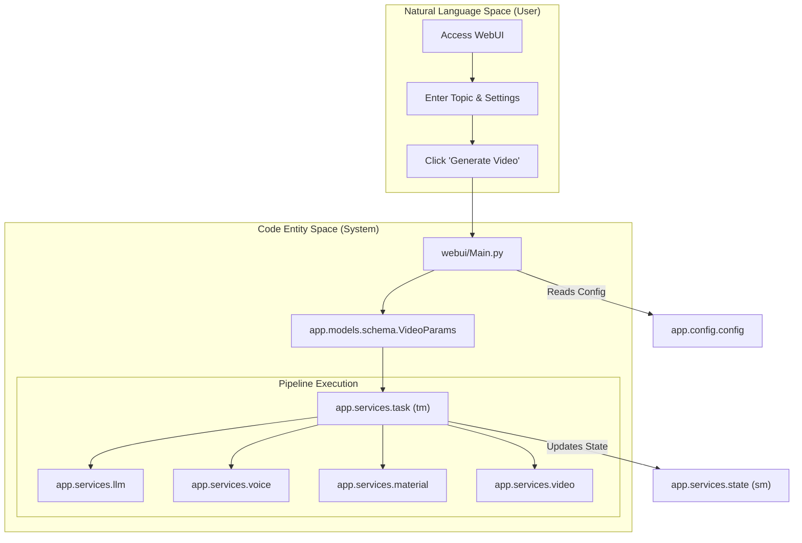
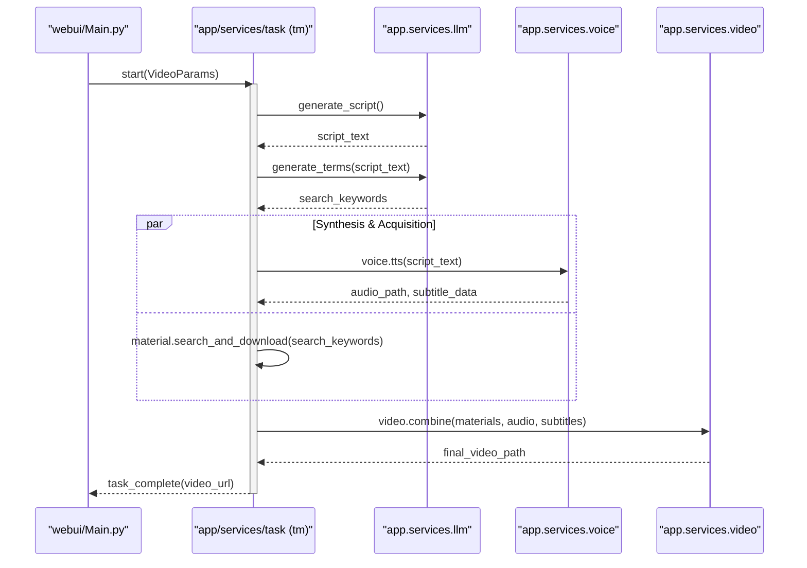

<!-- source: DeepWiki mcp.deepwiki.com · repo harry0703/MoneyPrinterTurbo · page 2.3 Quick Start Guide · fetched 2026-10-30 -->

# Quick Start Guide

Relevant source files

The following files were used as context for generating this wiki page:

- [docs/api.jpg](docs/api.jpg)
- [docs/webui-en.jpg](docs/webui-en.jpg)
- [docs/webui.jpg](docs/webui.jpg)
- [webui/Main.py](webui/Main.py)
- [webui/i18n/en.json](webui/i18n/en.json)

This guide provides a technical walkthrough for generating your first video using the MoneyPrinterTurbo WebUI. It focuses on the data flow from the Streamlit interface to the backend task orchestration system.

For installation instructions, see **2.1 Installation & Setup**. For detailed configuration of API keys, see **2.2 Configuration**.

## Prerequisites

Before starting, ensure the following conditions are met:
- The application is running (e.g., via `python webui/Main.py` or Docker) [webui/Main.py:25-30]().
- A valid LLM provider is configured in `config.toml` (e.g., SiliconFlow, OpenAI, or DeepSeek) [webui/Main.py:175-184]().
- API keys for video sources (Pexels, Pixabay, or Shengsuan Cloud) are provided in the settings [webui/Main.py:28-32]().

## Starting Your First Video Generation

### Access the Web Interface
The WebUI is built using Streamlit [webui/Main.py:19](). By default, it is accessible at `http://localhost:8501`. The interface uses a custom stylesheet `styles.css` to hide standard Streamlit headers and optimize the layout for video production [webui/Main.py:86-88]().

### Basic Video Generation Workflow

The following diagram maps user actions in the WebUI to internal code entities and service calls.

**Title: WebUI to Backend Service Mapping**

Sources: [webui/Main.py:30-65](), [app/services/task.py:1-50](), [app/models/schema.py:38-44]()

### Step 1: Video Script Settings
In the left column, users define the content of the video:
1.  **Video Subject**: The core topic (e.g., "How AI is changing everyday life") [webui/i18n/en.json:13-15]().
2.  **Script Language**: Determines the output language for the LLM and TTS.
3.  **Generate Script**: Clicking this triggers the `llm` service to populate the script and keyword fields before full generation begins [webui/Main.py:49]().

### Step 2: Video & Audio Configuration
The middle column configures the aesthetic and auditory properties:
- **Video Source**: Selection between `stock_video` (Pexels, Pixabay, Coverr), `ai_video` (Metaso, LoomLoom), or `local` materials [webui/Main.py:110-121]().
- **Video Aspect**: Defines `VideoAspect` (e.g., `portrait` 9:16 or `landscape` 16:9) [app/models/schema.py:40]().
- **Voiceover Mode**: Selection between `Automatic Voiceover` (TTS), `Upload`, or `None` [webui/i18n/en.json:115-118]().
- **Background Music**: Handled by `bgm_service` to fetch or assign audio files [webui/Main.py:46]().

### Step 3: Subtitle Settings
The right column defines the visual style of subtitles, which are mapped to the `VideoParams` object:
- **Font**: Defaulted to `MicrosoftYaHeiBold.ttc` [webui/Main.py:133]().
- **Position**: Controlled by `subtitle_position` (default: bottom) [webui/Main.py:134]().
- **Style**: Includes `text_fore_color`, `font_size`, `stroke_color`, and `stroke_width` [webui/Main.py:136-139]().

### Step 4: Execution and Data Flow
When the user clicks **"Generate Video"**, the following sequence occurs:
1. The UI gathers all form data into a `VideoParams` Pydantic model [webui/Main.py:43]().
2. The `tm.start()` function is invoked with these parameters [webui/Main.py:62]().
3. The task is assigned a unique `task_id` (UUID4) [webui/Main.py:16]().

**Title: Generation Pipeline Sequence**

Sources: [webui/Main.py:54-62](), [app/services/task.py:1-100](), [app/services/llm.py:1-40]()

## Understanding the Generated Output

### Storage Structure
The system organizes output by `task_id`. All files generated during the process are stored in the local file system.

| File/Folder | Description |
| :--- | :--- |
| `storage/tasks/{task_id}/` | Root directory for the specific generation task. |
| `final-1.mp4` | The synthesized video output (pattern-matched) [webui/Main.py:155-158](). |
| `audio.mp3` | The generated TTS narration. |
| `subtitle.srt` | The generated subtitle file. |
| `resource/songs/` | Directory for background music [webui/Main.py:91](). |
| `resource/fonts/` | Directory for subtitle fonts [webui/Main.py:90](). |

### Configuration Persistence
WebUI settings are managed via `_RUNTIME_CONFIG_SECTIONS` which maps UI fields to the `config` singleton [webui/Main.py:175-184](). Users can export these settings as a JSON preset, excluding local file paths to ensure portability [webui/Main.py:187-201]().

## Troubleshooting First Generation

### Common Validations
- **API Keys**: The UI checks for credential suffixes (e.g., `api_key`, `access_key`) to ensure providers are ready [webui/Main.py:204-211]().
- **Task Lock**: The system uses `webui_task` to manage task lifecycle and prevent UI blocking during long-running MoviePy operations [webui/Main.py:57]().
- **Logs**: Real-time logs are configured via `configure_terminal_logger` and `loguru` to capture pipeline errors [webui/Main.py:20, 64]().

Sources: [webui/Main.py:1-215](), [webui/i18n/en.json:1-119](), [app/models/schema.py:38-44]()

---

