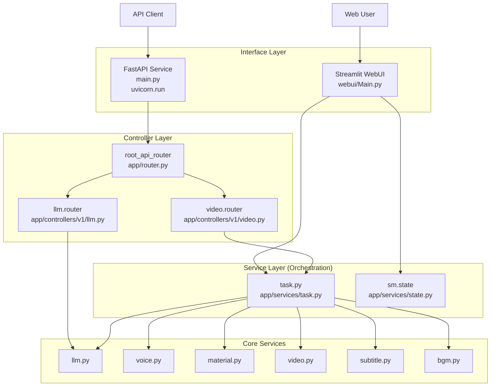
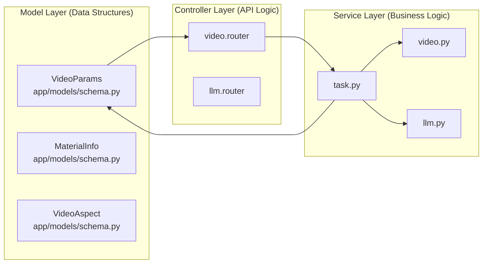

<!-- source: DeepWiki mcp.deepwiki.com · repo harry0703/MoneyPrinterTurbo · page 3 System Architecture · fetched 2026-10-30 -->

# System Architecture

Relevant source files

The following files were used as context for generating this wiki page:

- [README-en.md](README-en.md)
- [README-ja.md](README-ja.md)
- [README.md](README.md)
- [app/__init__.py](app/__init__.py)
- [app/config/config.py](app/config/config.py)
- [app/models/schema.py](app/models/schema.py)
- [app/router.py](app/router.py)
- [app/services/task.py](app/services/task.py)
- [main.py](main.py)
- [pyproject.toml](pyproject.toml)
- [requirements.txt](requirements.txt)
- [test/services/test_controller_ping.py](test/services/test_controller_ping.py)
- [test/services/test_task.py](test/services/test_task.py)
- [test/services/test_utils_ffmpeg_check.py](test/services/test_utils_ffmpeg_check.py)
- [uv.lock](uv.lock)

## Purpose and Scope

This document provides a high-level overview of MoneyPrinterTurbo's system architecture, explaining the design patterns, core components, and how they interact. This page focuses on structural organization and component relationships. For specific subsystem details, see:

- Core implementation details: [Core Architecture](#3.1)
- Provider abstraction mechanism: [Multi-Provider Architecture](#3.2)
- Task execution and state management: [Task Management](#3.3)
- Data persistence and file organization: [Data Flow & Storage](#3.4)
- Installation and runtime configurations: [Deployment Options](#3.5)

## System Overview

MoneyPrinterTurbo is an automated video generation system built on a **dual-interface architecture** with clear separation between presentation (WebUI/API), business logic (services), and data (storage/state). The system follows an **MVC pattern** with configuration-driven provider selection, enabling flexible integration with 13+ LLM providers, 4+ TTS providers, and multiple video sources.

The architecture consists of five primary layers:

| Layer | Responsibility | Key Components |
|-------|---------------|----------------|
| **Interface Layer** | User interaction and API endpoints | Streamlit WebUI, FastAPI service |
| **Controller Layer** | Request routing and validation | `app/router.py`, `app/controllers/` |
| **Service Layer** | Business logic and orchestration | `app/services/task.py`, `app/services/video.py` |
| **Integration Layer** | External API communication | `app/services/llm.py`, `app/services/voice.py` |
| **Storage Layer** | Data persistence and configuration | `app/config/config.py`, `app/services/state.py` |

**Sources:** [README.md:5-7](), [app/services/task.py:17-33](), [app/config/config.py:15-16]()

## Dual-Interface Architecture

The system exposes two independent but functionally equivalent interfaces, both backed by the same service layer. The WebUI is built with Streamlit, while the API is a FastAPI application served via Uvicorn.

### WebUI Interface
The web interface is implemented using Streamlit, providing a visual way to configure video parameters and monitor generation progress.
- **Direct Service Access:** Calls `app.services.task` directly to initiate video generation.
- **State Management:** Interacts with `app.services.state` to track task progress and logs.

### API Interface
The API interface uses FastAPI, initialized in `app/asgi.py` and served via Uvicorn in `main.py`.
- **Port:** Configured via `config.listen_port` [main.py:15]().
- **Documentation:** Auto-generated OpenAPI docs at `/docs` [main.py:8]().
- **Routing:** Uses `root_api_router` to include versioned controllers for video and LLM operations [app/router.py:14-17]().

**Sources:** [main.py:12-18](), [app/router.py:1-17](), [app/services/task.py:14-34]()

## MVC Architecture Pattern

The codebase follows a structured approach to separate data models, logic, and presentation.

### Model Layer
The system uses Pydantic models in `app/models/schema.py` to define data structures for requests and internal state:
- `VideoParams`: Defines all settings for a video generation task, including aspect ratio, voice, and BGM [app/models/schema.py:73-138]().
- `MaterialInfo`: Represents metadata for video clips sourced from providers [app/models/schema.py:62-71]().
- `VideoAspect`: Handles resolution mapping for different ratios like 16:9 and 9:16 [app/models/schema.py:34-46]().

### Service Layer
Located in `app/services/`, this layer implements the core logic:
- **Task Orchestration:** `app/services/task.py` manages the high-level workflow, including calling LLMs for scripts and coordinating video assembly [app/services/task.py:104-121]().
- **Specialized Services:** Services like `voice.py`, `subtitle.py`, and `material.py` handle specific domain tasks.

**Sources:** [app/models/schema.py:34-138](), [app/services/task.py:17-34]()

## Task Orchestration and Pipeline

The generation process is a multi-stage pipeline managed by the `TaskService`. It handles complex logic such as background music (BGM) provider selection and cross-platform social media posting.

- **Music Providers:** Supports multiple providers like `sonilo` and `elevenlabs`, handled via a `_VIDEO_MUSIC_PROVIDERS` registry [app/services/task.py:73-88]().
- **Cross-Posting:** Includes a dedicated `ThreadPoolExecutor` (`_cross_post_executor`) for uploading finished videos to platforms like TikTok and Instagram without blocking the main generation queue [app/services/task.py:41-44]().
- **Task State:** Tracks whether a task is "busy" (processing or uploading) via `is_task_busy` to prevent premature deletion [app/services/task.py:104-121]().

For details, see [Task Management](#3.3).

**Sources:** [app/services/task.py:41-88](), [app/services/task.py:104-121]()

## Data Flow & Configuration

The system uses a centralized configuration object `config` managed by a synchronized dictionary to handle concurrent updates.

1. **Initialization:** `main.py` loads configuration to start the Uvicorn server [main.py:4-18]().
2. **Dynamic Configuration:** The `_SynchronizedConfig` class ensures that runtime configuration changes (like switching LLM providers) are thread-safe [app/config/config.py:29-41]().
3. **Non-blocking Updates:** WebUI updates are handled via `update_config_nonblocking` to prevent the UI from freezing during long-running tasks [app/config/config.py:91-110]().
4. **Execution:** Services read `config` to determine API keys and model preferences (e.g., `config.ui.get("subtitle_position")`) [app/models/schema.py:122-125]().

For details, see [Data Flow & Storage](#3.4).

**Sources:** [app/config/config.py:29-110](), [app/models/schema.py:122-125](), [main.py:4-18]()

---

