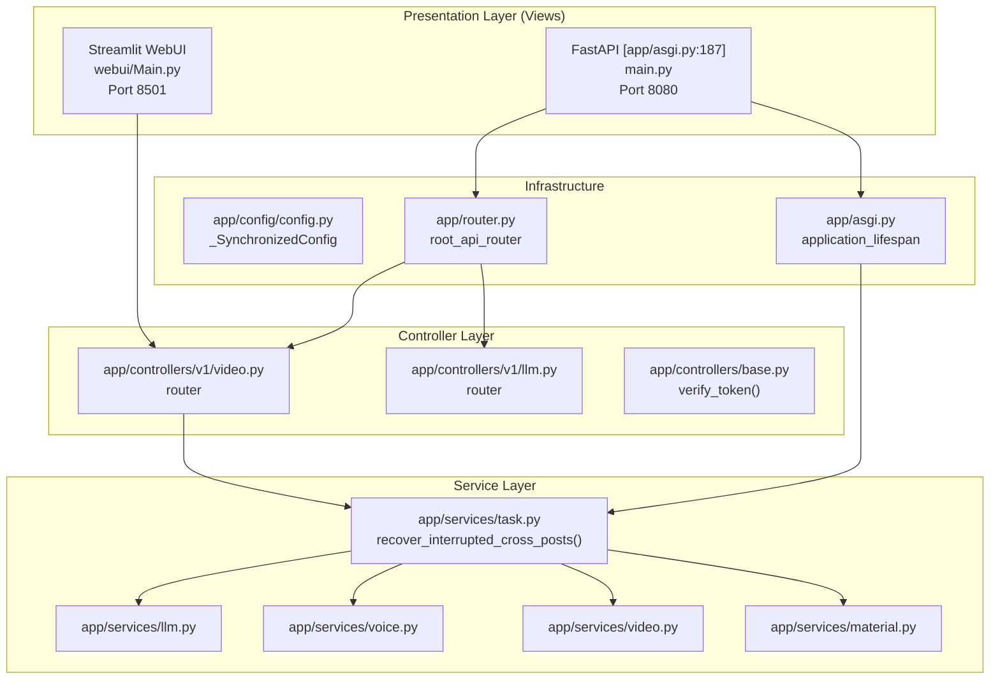
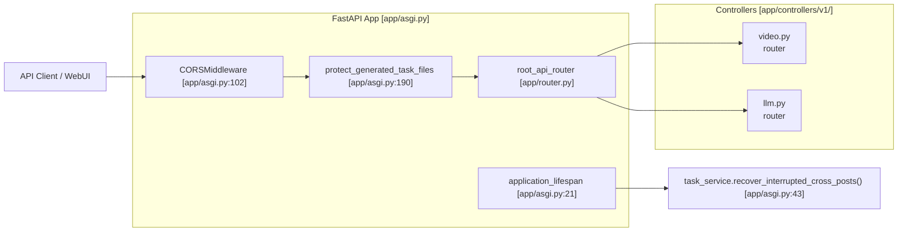
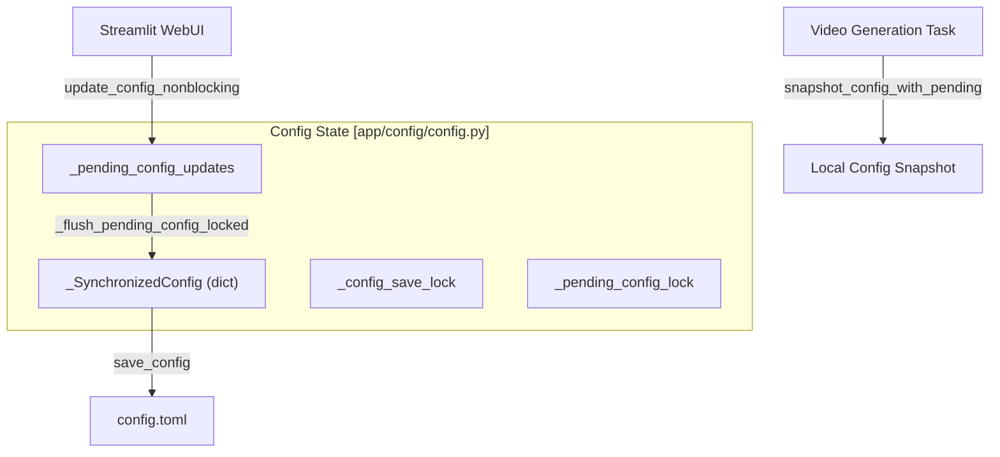

<!-- source: DeepWiki mcp.deepwiki.com · repo harry0703/MoneyPrinterTurbo · page 3.1 Core Architecture · fetched 2026-10-30 -->

# Core Architecture

Relevant source files

The following files were used as context for generating this wiki page:

- [app/__init__.py](app/__init__.py)
- [app/asgi.py](app/asgi.py)
- [app/config/config.py](app/config/config.py)
- [app/router.py](app/router.py)
- [main.py](main.py)
- [pyproject.toml](pyproject.toml)
- [requirements.txt](requirements.txt)
- [test/services/test_asgi_cors.py](test/services/test_asgi_cors.py)
- [test/services/test_asgi_static_files.py](test/services/test_asgi_static_files.py)
- [test/services/test_controller_ping.py](test/services/test_controller_ping.py)
- [test/services/test_utils_ffmpeg_check.py](test/services/test_utils_ffmpeg_check.py)
- [uv.lock](uv.lock)

This document describes the core architectural design of MoneyPrinterTurbo, focusing on its MVC pattern implementation, dual-interface design (WebUI and API), and how major components interact at runtime. For information about specific subsystems like task management and state persistence, see [Task Management](#3.3). For provider abstraction details, see [Multi-Provider Architecture](#3.2). For storage organization, see [Data Flow & Storage](#3.4).

## Architectural Pattern

MoneyPrinterTurbo implements a **Model-View-Controller (MVC) architecture** with clear separation of concerns:

- **Models**: Define data structures, schemas, and persistence logic.
- **Views**: Dual user interfaces (Streamlit WebUI and FastAPI endpoints).
- **Controllers**: Handle request routing, validation, and response formatting [app/router.py:12-13]().
- **Services**: Implement core business logic such as script generation, TTS, and video editing.

The architecture follows a layered pattern where each layer communicates only with adjacent layers, ensuring modularity and maintainability.

### System Entity Map

The following diagram bridges the conceptual system components to their specific implementation entities in the codebase.

**Sources**: [app/asgi.py:167-187](), [app/router.py:10-20](), [main.py:6-18](), [app/config/config.py:29-85]()

## Dual-Interface Design

MoneyPrinterTurbo provides two independent user interfaces that share the same backend services, allowing flexible deployment scenarios.

### Interface Comparison

| Feature | WebUI (Streamlit) | API (FastAPI) |
|---------|-------------------|---------------|
| **Entry Point** | `webui/Main.py` | `main.py` [main.py:12-18]() |
| **Default Port** | 8501 | Configured via `config.listen_port` [main.py:15]() |
| **Implementation** | Streamlit Framework | FastAPI [app/asgi.py:174-184]() |
| **Primary Router** | Component-based | `root_api_router` [app/router.py:15]() |
| **Authentication** | Shared config key | `verify_token` middleware [app/asgi.py:190-204]() |

### API Architecture (FastAPI)

The API is built using FastAPI and served via Uvicorn [main.py:12-18](). It serves both as the backend for the WebUI and as a standalone REST interface.

**Key characteristics**:
- **Lifespan Management**: Handles startup recovery for interrupted cross-post tasks by cleaning up Redis states [app/asgi.py:21-47]().
- **CORS Support**: Configurable via `CORS_ALLOWED_ORIGINS` to support independent web frontends while preventing untrusted browser access [app/asgi.py:66-115, 139-164]().
- **Security**: Implements `verify_token` to protect generated task artifacts in the `/tasks` static directory, ensuring only authorized clients can download results [app/asgi.py:190-204]().
- **Validation**: Global exception handlers for `HttpException` and `RequestValidationError` ensure consistent JSON responses [app/asgi.py:50-63]().

**Sources**: [app/asgi.py:1-204](), [app/router.py:1-20](), [main.py:1-18]()

## Configuration Management

The system uses a synchronized configuration mechanism to handle concurrent access from both the long-running video generation tasks and the reactive Streamlit WebUI.

**Key Logic**:
- **Non-blocking Updates**: The WebUI uses `update_config_nonblocking` to queue changes without waiting for long-running tasks to release the configuration lock, preventing UI freezes [app/config/config.py:91-125]().
- **Config Snapshots**: Tasks use `snapshot_config_with_pending` to get a stable view of the configuration at the start of a request, ensuring that mid-task UI changes do not cause inconsistent behavior [app/config/config.py:168-186]().
- **Thread Safety**: Access is mediated by `_config_save_lock` and `_pending_config_lock` to prevent race conditions during TOML serialization [app/config/config.py:19-23, 29-85]().

**Sources**: [app/config/config.py:19-186]()

## Core Component Interactions

### Request Flow and Error Handling

When a request enters the system, it is routed through the `root_api_router` [app/router.py:15]() to specific controllers. 

1. **Authentication**: Token verification is performed via `base.verify_token` [app/asgi.py:203]().
2. **Lifespan Recovery**: On startup, `recover_interrupted_cross_posts` is called to reconcile task states [app/asgi.py:43]().
3. **Execution**: The controller invokes functional services (LLM, Voice, Video).
4. **Response**: Standardized via `utils.get_response` [app/asgi.py:53, 60]().

**Sources**: [app/asgi.py:21-63, 190-204](), [app/router.py:1-20]()

## Dependency Management

The project uses `pyproject.toml` and `uv.lock` for strict dependency management, ensuring reproducible environments across Docker, manual, and Colab deployments.

| Category | Key Libraries |
| :--- | :--- |
| **Web Framework** | `fastapi`, `uvicorn`, `streamlit` [pyproject.toml:17-21]() |
| **Media Processing** | `moviepy`, `edge-tts`, `faster-whisper`, `pydub` [pyproject.toml:16-33]() |
| **AI Integration** | `openai`, `google-genai`, `dashscope`, `litellm` [pyproject.toml:22-37]() |
| **Infrastructure** | `redis`, `toml`, `loguru` [pyproject.toml:24-29]() |

**Sources**: [pyproject.toml:15-37](), [requirements.txt:1-22]()

---

