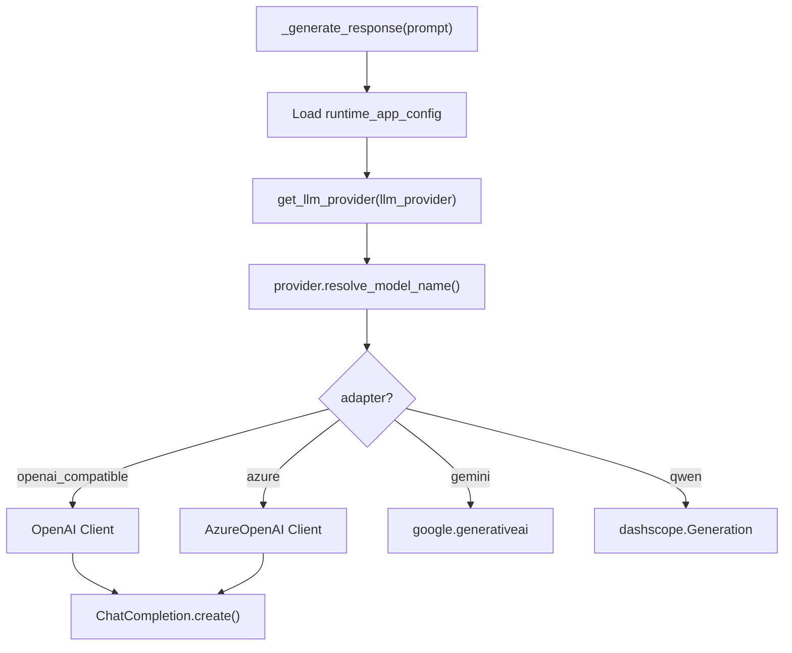

<!-- source: DeepWiki mcp.deepwiki.com · repo harry0703/MoneyPrinterTurbo · page 3.2 Multi-Provider Architecture · fetched 2026-10-30 -->

# Multi-Provider Architecture

Relevant source files

The following files were used as context for generating this wiki page:

- [app/models/llm_provider.py](app/models/llm_provider.py)
- [app/services/llm.py](app/services/llm.py)
- [config.example.toml](config.example.toml)
- [docs/MoneyPrinterTurbo.ipynb](docs/MoneyPrinterTurbo.ipynb)
- [test/services/test_llm.py](test/services/test_llm.py)
- [test/services/test_webui_i18n.py](test/services/test_webui_i18n.py)

## Purpose and Scope

This document explains MoneyPrinterTurbo's multi-provider architecture, which enables the system to support multiple external service providers for each major component (LLM, TTS, video materials, subtitles) through configuration-driven selection. This architecture allows users to switch between 13+ LLM providers, 4+ TTS providers, multiple video sources, and 2 subtitle providers without modifying code.

For information about the overall system architecture, see [Core Architecture](#3.1). For details on specific provider implementations, see [LLM Integration](#5.2) and [Voice Synthesis (TTS)](#5.3).

## Overview

The multi-provider architecture is built on three core principles:

1.  **Configuration-driven selection**: Providers are selected via `config.toml` settings, not code changes.
2.  **Uniform interfaces**: Each provider type implements a consistent interface despite diverse underlying APIs.
3.  **Provider-specific adaptation**: The system handles different authentication schemes, parameter formats, and response structures transparently.

### Provider Mapping Diagram

```mermaid
graph TB
    subgraph "Configuration Layer"
        ConfigFile["config.toml<br/>Provider Settings"]
    end
    
    subgraph "Application Layer"
        RouterLLM["LLM Router<br/>_generate_response()"]
        RouterTTS["TTS Router<br/>tts()"]
        RouterVideo["Video Router<br/>search_videos()"]
    end
    
    subgraph "LLM Providers"
        LLM1["Moonshot (Kimi)<br/>Default Provider"]
        LLM2["OpenAI<br/>Standard Adapter"]
        LLM3["Azure OpenAI<br/>Azure Adapter"]
        LLM4["Gemini<br/>Gemini Adapter"]
        LLM5["Qwen<br/>Qwen Adapter"]
        LLM6["Ollama<br/>Local Adapter"]
        LLM7["DeepSeek<br/>OpenAI Compatible"]
        LLM8["Cloudflare<br/>Gateway Adapter"]
        LLM9["ModelScope<br/>ModelScope Adapter"]
    end
    
    subgraph "TTS Providers"
        TTS1["Edge TTS<br/>Default WebSocket"]
        TTS2["Azure TTS V2<br/>REST API"]
        TTS3["SiliconFlow<br/>REST API"]
        TTS4["Gemini TTS<br/>SDK"]
        TTS5["Xiaomi MiMo<br/>REST API"]
    end
    
    subgraph "Video Sources"
        VS1["Pexels API"]
        VS2["Pixabay API"]
        VS3["Coverr API"]
        VS4["LoomLoom Market"]
        VS5["WaveSpeed AI"]
        VS6["OFox Multi-model"]
        VS7["Local Files"]
    end
    
    ConfigFile --> RouterLLM
    ConfigFile --> RouterTTS
    ConfigFile --> RouterVideo

    RouterLLM --> LLM1
    RouterLLM --> LLM2
    RouterLLM --> LLM3
    RouterLLM --> LLM4
    RouterLLM --> LLM5
    RouterLLM --> LLM6
    RouterLLM --> LLM7
    RouterLLM --> LLM8
    RouterLLM --> LLM9
    
    RouterTTS --> TTS1
    RouterTTS --> TTS2
    RouterTTS --> TTS3
    RouterTTS --> TTS4
    RouterTTS --> TTS5
    
    RouterVideo --> VS1
    RouterVideo --> VS2
    RouterVideo --> VS3
    RouterVideo --> VS4
    RouterVideo --> VS5
    RouterVideo --> VS6
    RouterVideo --> VS7
```

**Sources:** [config.example.toml:65-78](), [config.example.toml:93-95](), [config.example.toml:125-130](), [app/models/llm_provider.py:187-200](), [app/services/llm.py:142-153]()

## Configuration-Driven Provider Selection

All provider selections are controlled through the `config.toml` file, which serves as the central configuration registry. The system uses a registry-based approach to define provider metadata.

### LLM Provider Registry
The `LLMProviderSpec` class defines the requirements for each provider, including their adapter type, default models, and whether they require an API key or Base URL [app/models/llm_provider.py:30-55]().

| Configuration Key | Purpose | Default / Supported Values |
|------------------|---------|-----------------------------|
| `llm_provider` | Active LLM backend | `moonshot` (Default), `openai`, `deepseek`, `ollama` |
| `video_source` | Primary video source | `pexels`, `pixabay`, `coverr`, `wavespeed`, `ofox`, `local` |
| `script_generation_backend`| Script engine type | `local` (standard LLM), `loomloom` |

**Sources:** [app/models/llm_provider.py:4-4](), [app/models/llm_provider.py:187-192](), [config.example.toml:39-39](), [config.example.toml:78-78]()

## LLM Provider Architecture

MoneyPrinterTurbo supports a wide array of LLM providers by abstracting the request logic into specific adapters.

### LLM Routing and Resolution
The system resolves the provider settings at runtime using the `get_llm_provider` function [app/services/llm.py:147-151](). It handles deprecated model names and base URLs automatically to ensure backward compatibility [app/models/llm_provider.py:83-96]().

**Sources:** [app/services/llm.py:142-177](), [app/models/llm_provider.py:39-55]()

### Reasoning Model Handling
For models like DeepSeek R1 or MiniMax M3 that return reasoning blocks, the system uses `_normalize_text_response` to strip `<think>` tags using regex `_THINK_BLOCK_RE` [app/services/llm.py:19-20](), [app/services/llm.py:47-65]().

**Sources:** [app/services/llm.py:19-20](), [app/services/llm.py:47-69]()

## TTS Provider Architecture

TTS providers are selected based on the `voice_name` identifier provided in the generation request. The logic resides primarily in `app/services/voice.py`.

### Provider Detection Logic
The system identifies the target service by checking for specific prefixes or suffixes in the voice name. For example, SiliconFlow voices start with `siliconflow:`, while Gemini voices start with `gemini:`.

### TTS Data Flow
The `tts` function in `app/services/voice.py` acts as the primary entry point, routing the request to the appropriate sub-service based on the detection logic.

## Video Material Provider Architecture

The system supports multiple video sources defined in `config.toml` under `video_source` [config.example.toml:65-78]().

### API Key Rotation
For stock providers like Pexels, Pixabay, and Coverr, the system supports a list of API keys to facilitate rotation and bypass rate limits [config.example.toml:80-91]().

### Material Sources
1.  **Stock APIs**: Pexels, Pixabay, and Coverr [config.example.toml:84-91]().
2.  **AI Generation**: WaveSpeed AI, OFox, and Volcano Engine Seedance generate brand-new clips based on keywords [config.example.toml:93-143]().
3.  **Image-to-Video**: `openai_image` generates images from keywords and renders them into clips [config.example.toml:75-77]().
4.  **Local**: User-provided files in the `resource/video_materials` directory [config.example.toml:78-78]().

**Sources:** [config.example.toml:65-143]()

## Subtitle Provider Architecture

The architecture supports two distinct methods for subtitle generation:

1.  **Edge TTS (Word Boundaries)**: Captures timing events directly from the Edge TTS WebSocket stream to create precise subtitles.
2.  **Faster-Whisper (ASR)**: Transcribes the generated audio file using a local Whisper model for higher accuracy or non-Edge voices.

**Sources:** [config.example.toml:53-55](), [test/services/test_llm.py:35-45]()

---

