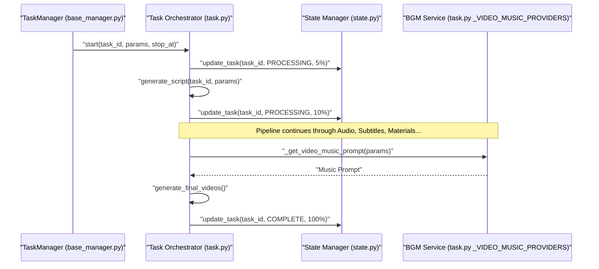

<!-- source: DeepWiki mcp.deepwiki.com · repo harry0703/MoneyPrinterTurbo · page 3.3 Task Management · fetched 2026-10-30 -->

# Task Management

<details>
<summary>Relevant source files</summary>

The following files were used as context for generating this wiki page:

- [app/controllers/manager/base_manager.py](app/controllers/manager/base_manager.py)
- [app/controllers/manager/memory_manager.py](app/controllers/manager/memory_manager.py)
- [app/controllers/manager/redis_manager.py](app/controllers/manager/redis_manager.py)
- [app/models/const.py](app/models/const.py)
- [app/models/schema.py](app/models/schema.py)
- [app/services/state.py](app/services/state.py)
- [app/services/task.py](app/services/task.py)
- [app/utils/file_security.py](app/utils/file_security.py)
- [test/README.md](test/README.md)
- [test/services/test_schema.py](test/services/test_schema.py)
- [test/services/test_state.py](test/services/test_state.py)
- [test/services/test_task.py](test/services/test_task.py)
- [test/services/test_task_manager.py](test/services/test_task_manager.py)

</details>


This document covers the task management system that orchestrates video generation workflows in MoneyPrinterTurbo. The system handles task creation, execution, state persistence, progress tracking, and concurrent processing through both in-memory and Redis-backed implementations.

## Task Orchestration Architecture

The task management system is built around a central orchestrator that coordinates the entire video generation pipeline through discrete, trackable stages.

### Core Task Orchestrator

```mermaid
graph TB
    subgraph "Task Orchestration (app/services/task.py)"
        [start] --> [generate_script]
        [generate_script] --> [generate_terms]
        [generate_terms] --> [generate_audio]
        [generate_audio] --> [generate_subtitle]
        [generate_subtitle] --> [get_video_materials]
        [get_video_materials] --> [generate_final_videos]
    end
    
    subgraph "Service Layer"
        [llm_service] -- "app/services/llm.py"
        [voice_service] -- "app/services/voice.py"
        [material_service] -- "app/services/material.py"
        [video_service] -- "app/services/video.py"
        [subtitle_service] -- "app/services/subtitle.py"
        [bgm_service] -- "app/services/bgm.py"
    end
    
    subgraph "State Management (app/services/state.py)"
        [state_update] -- "sm.state.update_task()"
        [progress_tracking] -- "Progress: 5% to 100%"
    end
    
    [generate_script] --> [llm_service]
    [generate_terms] --> [llm_service]
    [generate_audio] --> [voice_service]
    [generate_subtitle] --> [subtitle_service]
    [get_video_materials] --> [material_service]
    [generate_final_videos] --> [video_service]
    [generate_final_videos] --> [bgm_service]
    
    [start] --> [state_update]
    [generate_script] --> [state_update]
    [generate_terms] --> [state_update]
    [generate_audio] --> [state_update]
    [generate_subtitle] --> [state_update]
    [get_video_materials] --> [state_update]
    [generate_final_videos] --> [state_update]
    
    [state_update] --> [progress_tracking]
```

Sources: [app/services/task.py:17-32](), [app/services/state.py:24-41]()

### Task Pipeline Stages

The orchestrator supports partial execution through the `stop_at` parameter in `tm.start`, allowing clients to generate only specific components.

| Stage | Function | Progress | Output |
|-------|----------|----------|---------|
| `script` | `generate_script()` | 10% | Video script text |
| `terms` | `generate_terms()` | 20% | Search keywords for materials |
| `audio` | `generate_audio()` | 30% | Audio file and duration |
| `subtitle` | `generate_subtitle()` | 40% | Subtitle file (.srt) |
| `materials` | `get_video_materials()` | 50% | Video clip file paths |
| `video` | `generate_final_videos()` | 100% | Final assembled videos |

Sources: [app/services/task.py:104-121]() (busy checks), [app/services/state.py:57-74]() (progress logic)

## Task Lifecycle and Pipeline

### Task Execution Flow



Sources: [app/services/task.py:38-88](), [app/services/task.py:91-101](), [app/controllers/manager/base_manager.py:22-52]()

### Cross-Posting Tasks
After video generation, tasks can enter a cross-posting phase. This is handled by a separate `ThreadPoolExecutor` called `_cross_post_executor` to avoid blocking the main video generation slots [app/services/task.py:41-44](). The system tracks cross-post state separately using `CROSS_POST_STATE_PENDING` and `CROSS_POST_STATE_PROCESSING` constants [app/services/task.py:53-56]().

### Busy State Management
The function `is_task_busy` determines if a task is currently in generation or cross-posting [app/services/task.py:104-121](). A task is considered busy if its state is `TASK_STATE_PROCESSING` or if its `cross_post_state` is in `_ACTIVE_CROSS_POST_STATES` [app/services/task.py:118-121]().

## State Management

The system supports dual persistence strategies through an abstract `BaseState` interface defined in `app/services/state.py`.

### State Management Architecture

```mermaid
graph TB
    subgraph "State Interface (app/services/state.py)"
        [BaseState] -- "BaseState (ABC)"
        [BaseState] --> [update_task_def]
        [BaseState] --> [get_task_def]
        [BaseState] --> [patch_task_def]
    end
    
    subgraph "Memory Implementation"
        [MemoryState] -- "self._tasks (dict)"
        [MemoryState] -- "self._lock (RLock)"
    end
    
    subgraph "Redis Implementation"
        [RedisState] -- "self._redis (StrictRedis)"
        [RedisState] -- "Lua Script (_PATCH_EXISTING_TASK_SCRIPT)"
    end
    
    [MemoryState] -- "implements" --> [BaseState]
    [RedisState] -- "implements" --> [BaseState]
    [RedisState] -- "uses" --> [ast.literal_eval]
```

Sources: [app/services/state.py:10-20](), [app/services/state.py:24-41](), [app/services/state.py:44-96](), [app/services/state.py:98-222]()

### State Operations

| Operation | Memory Implementation | Redis Implementation |
|-----------|----------------------|---------------------|
| `update_task()` | Updates `self._tasks` with `RLock` [app/services/state.py:57-74]() | Uses `hset` for each field [app/services/state.py:153-172]() |
| `patch_task()` | Updates existing task fields only [app/services/state.py:81-90]() | Atomic update via Lua script `_PATCH_EXISTING_TASK_SCRIPT` [app/services/state.py:185-202]() |
| `get_all_tasks()` | List slicing of dict values [app/services/state.py:49-55]() | `SCAN` with type filter "HASH" [app/services/state.py:114-151]() |

Sources: [app/services/state.py:44-222]()

## Concurrent Task Execution

### Task Manager Implementations

The system provides two `TaskManager` implementations for handling concurrent video generation.

- **InMemoryTaskManager**: Uses Python's `queue.Queue` for local task buffering [app/controllers/manager/memory_manager.py:7-21]().
- **RedisTaskManager**: Uses Redis lists (`rpush`/`lpop`) for distributed task queuing [app/controllers/manager/redis_manager.py:20-99](). It performs `VideoParams` validation during `dequeue` to handle schema changes [app/controllers/manager/redis_manager.py:69-91]().

### Concurrency Control
The `TaskManager` base class ensures concurrency limits are respected by incrementing `current_tasks` before starting the worker thread [app/controllers/manager/base_manager.py:24-36]().

```mermaid
graph TD
    [add_task] --> [Check_Concurrent]
    [Check_Concurrent] -- "Below Limit" --> [execute_task]
    [Check_Concurrent] -- "At Limit" --> [queue_size]
    [queue_size] -- "Below max_queued_tasks" --> [enqueue]
    [queue_size] -- "Queue Full" --> [TaskQueueFullError]
    [execute_task] --> [threading.Thread.start]
    [threading.Thread.start] --> [run_task]
    [run_task] --> [task_done]
    [task_done] --> [check_queue]
```

Sources: [app/controllers/manager/base_manager.py:11-95]()

## Data Models

Task parameters are encapsulated in the `VideoParams` Pydantic model, which includes settings for LLM scripts, TTS voices, BGM, and video assembly [app/models/schema.py:73-138]().

### Key Parameters
- `video_subject`: The primary topic for generation [app/models/schema.py:88]().
- `video_aspect`: Aspect ratio (e.g., 9:16, 16:9) [app/models/schema.py:91]().
- `bgm_type`: Music provider (e.g., "sonilo", "elevenlabs", "random") [app/models/schema.py:113]().
- `video_materials`: List of `MaterialInfo` objects for assembly [app/models/schema.py:101-103]().

Sources: [app/models/schema.py:62-138]()

---

