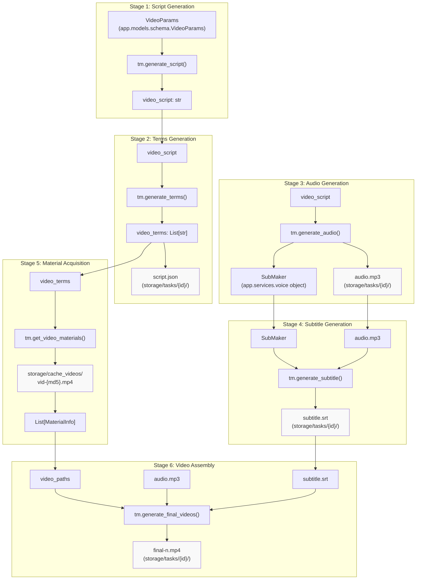
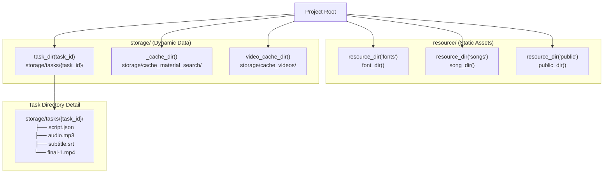

<!-- source: DeepWiki mcp.deepwiki.com · repo harry0703/MoneyPrinterTurbo · page 3.4 Data Flow & Storage · fetched 2026-10-30 -->

# Data Flow & Storage

Relevant source files

The following files were used as context for generating this wiki page:

- [app/models/schema.py](app/models/schema.py)
- [app/services/cache_manager.py](app/services/cache_manager.py)
- [app/services/material_cache.py](app/services/material_cache.py)
- [app/services/task.py](app/services/task.py)
- [app/services/task_artifacts.py](app/services/task_artifacts.py)
- [test/services/test_material.py](test/services/test_material.py)
- [test/services/test_material_cache.py](test/services/test_material_cache.py)
- [test/services/test_task.py](test/services/test_task.py)
- [test/services/test_task_artifacts.py](test/services/test_task_artifacts.py)

This document describes how data flows through the MoneyPrinterTurbo video generation pipeline and how the system organizes file storage. It covers the 5-stage pipeline data flow, file system organization, state management strategies, and data persistence patterns.

For information about task state transitions and queue management, see [Task Management](). For details about the video generation pipeline stages, see [Task Orchestration]().

---

## Pipeline Data Flow

The video generation pipeline is a linear process where each stage produces data that feeds into subsequent stages. The system persists intermediate outputs to disk at each checkpoint, enabling early termination via the `stop_at` parameter.

### Code Entity Space: Video Generation Pipeline
The following diagram bridges the natural language pipeline stages to the specific functions and file entities in the codebase.

**Sources:** [app/services/task.py:16-35](), [app/services/task.py:82-91](), [app/models/schema.py:73-138](), [app/services/task_artifacts.py:16-19]()

### Stage-by-Stage Data Outputs

| Stage | Logic Entity | Disk Outputs | Data Format | Purpose |
|-------|-------------|--------------|-------------|---------|
| **Script** | `generate_script` | None | Plain text | Content for TTS and keyword extraction |
| **Terms** | `generate_terms` | `script.json` | JSON | Search keywords for video sources |
| **Audio** | `generate_audio` | `audio.mp3` | MP3 audio | Voice narration + timing metadata |
| **Subtitle** | `generate_subtitle` | `subtitle.srt` | SRT format | Timestamped text for video overlay |
| **Materials**| `get_video_materials`| `vid-{md5}.mp4`| MP4 video | Raw material clips in `cache_videos` |
| **Assembly** | `generate_final_videos`| `final-n.mp4` | MP4 video | Final rendered video output |

**Sources:** [app/services/task.py:82-91](), [app/services/task_artifacts.py:16-19](), [app/services/task.py:107-121](), [app/services/cache_manager.py:51-55]()

---

## File Storage Architecture

The system employs a hierarchical storage strategy with clear separation between static resources and dynamic task outputs, managed by utility functions.

### Directory Structure & Code Identifiers

**Sources:** [app/services/material_cache.py:102-109](), [app/services/task_artifacts.py:16-19](), [app/services/cache_manager.py:51-55]()

### Material Search Caching
Online material search results are cached to disk to respect provider TTLs (24 hours by default). [app/services/material_cache.py:22-22]()
1.  **Cache Key**: A SHA-256 hash of `provider`, `search_term`, `minimum_duration`, and `video_aspect`. [app/services/material_cache.py:112-136]()
2.  **Storage**: Saved as JSON files in `storage/cache_material_search/`. [app/services/material_cache.py:139-151]()
3.  **Persistence**: Uses atomic writes via `os.replace` to prevent corrupted cache files during crashes. [app/services/material_cache.py:27-30]()
4.  **Validation**: Expired or corrupted cache files are automatically removed during the load process. [app/services/material_cache.py:170-179](), [app/services/material_cache.py:181-194]()

**Sources:** [app/services/material_cache.py:22-194](), [test/services/test_material_cache.py:94-120]()

### Video Material Caching
Downloaded video materials are stored in `storage/cache_videos/` using a filename pattern `vid-{md5}.mp4`. [app/services/cache_manager.py:16-18]()
*   **Cleanup**: The `clean_video_cache` function allows deleting files older than a specific `max_age_days`. [app/services/cache_manager.py:158-165]()
*   **Safety**: The cleanup logic uses `os.path.realpath` and pattern matching to ensure no files outside the managed directory are deleted. [app/services/cache_manager.py:191-196]()

**Sources:** [app/services/cache_manager.py:16-215]()

---

## State Management & Persistence

MoneyPrinterTurbo supports state management via `app.services.state`. [app/services/task.py:34-34]()

### Artifact Persistence Patterns
The system uses an atomic writing pattern for `script.json` to ensure data integrity.
*   **Atomic Write**: `_write_json_atomic` creates a hidden `.tmp` file in the target directory, flushes and syncs to disk using `os.fsync`, then performs an `os.replace`. [app/services/task_artifacts.py:21-57]()
*   **Patching**: `patch_script_data` allows updating specific fields (like `material_sources`) without overwriting existing script or parameter data. [app/services/task_artifacts.py:64-96]()

### Data Flow Security
*   **URL Redaction**: Sensitive API keys and user credentials are removed from cached URLs using `_safe_public_url`. [app/services/material_cache.py:35-50]()
*   **White-listing**: Only specific fields (e.g., `asset_id`, `provider`, `rendition`) are allowed into the disk cache to prevent internal metadata leakage. [app/services/material_cache.py:53-99]()

**Sources:** [app/services/task_artifacts.py:21-96](), [app/services/material_cache.py:35-99]()

---

## Configuration Management

Configuration is loaded from `config.toml` into a global `config` object. [app/models/schema.py:8-8]()

### State Field Schema
Task objects stored in the state manager contain fields for tracking both generation and distribution status:
| Field | Type | Description |
|-------|------|-------------|
| `state` | `int` | Current status (e.g., `TASK_STATE_PROCESSING`). [app/services/task.py:109-121]() |
| `cross_post_state`| `str` | Status of social media distribution (e.g., `PENDING`). [app/services/task.py:120-120]() |
| `cross_post_owner`| `str` | Hostname and PID of the process handling the upload. [app/services/task.py:199-213]() |

**Sources:** [app/services/task.py:53-69](), [app/services/task.py:104-121](), [app/services/task.py:199-213]()

---

