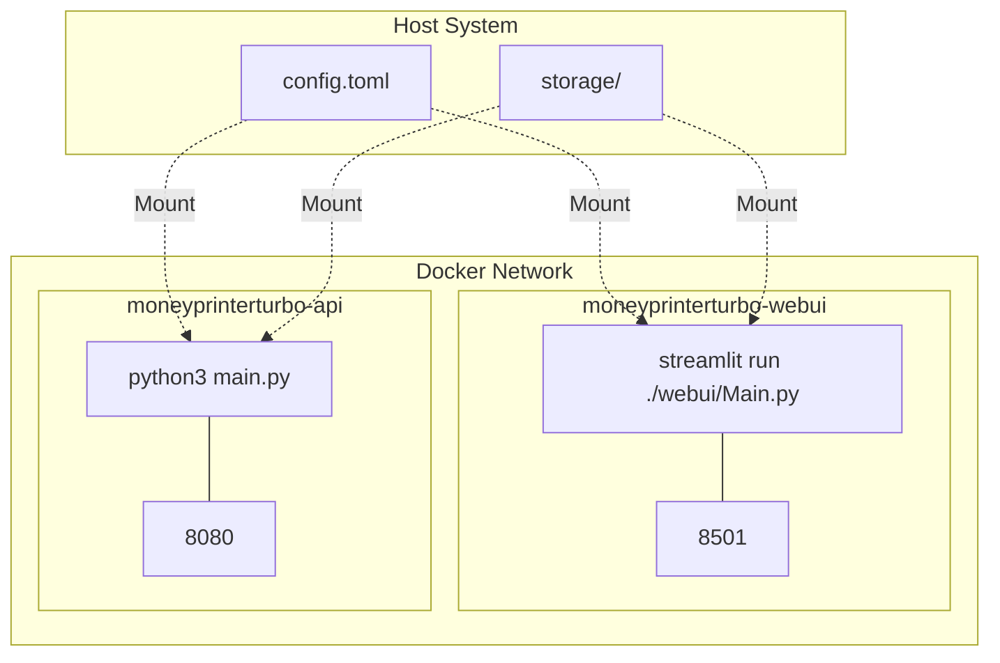
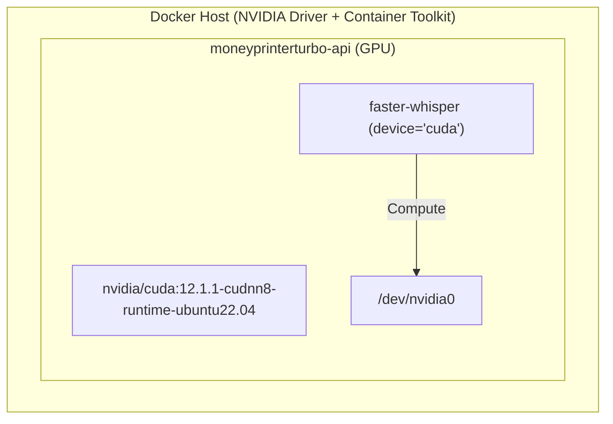
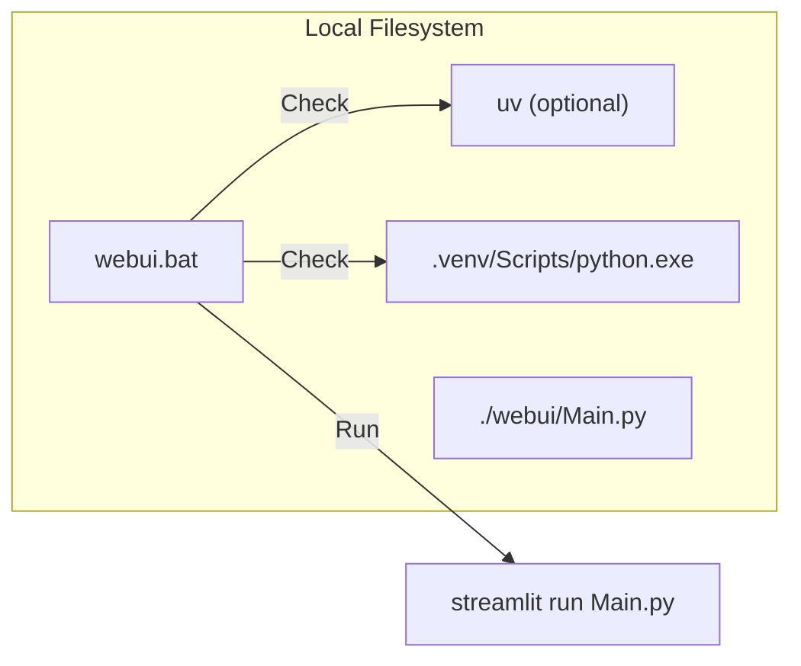
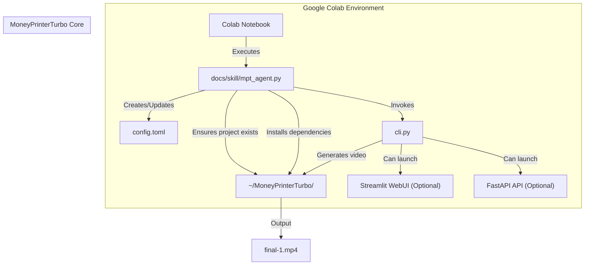
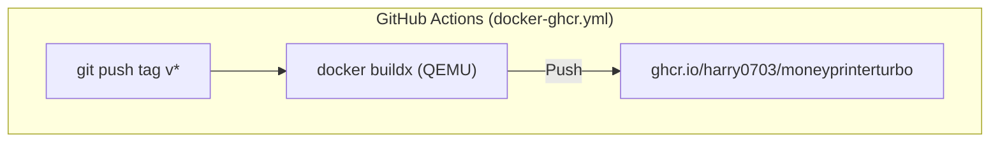

<!-- source: DeepWiki mcp.deepwiki.com · repo harry0703/MoneyPrinterTurbo · page 3.5 Deployment Options · fetched 2026-10-30 -->

# Deployment Options

<details>
<summary>Relevant source files</summary>

The following files were used as context for generating this wiki page:

- [.dockerignore](.dockerignore)
- [.github/workflows/docker-ghcr.yml](.github/workflows/docker-ghcr.yml)
- [Dockerfile](Dockerfile)
- [Dockerfile.gpu](Dockerfile.gpu)
- [docker-compose.gpu.yml](docker-compose.gpu.yml)
- [docker-compose.release.yml](docker-compose.release.yml)
- [docker-compose.yml](docker-compose.yml)
- [docs/skill/SKILL.md](docs/skill/SKILL.md)
- [docs/skill/mpt_agent.py](docs/skill/mpt_agent.py)
- [test/services/test_mpt_agent_skill.py](test/services/test_mpt_agent_skill.py)
- [webui.bat](webui.bat)
- [webui.sh](webui.sh)

</details>


This document provides a comprehensive technical reference for deploying MoneyPrinterTurbo across different environments. It covers five primary deployment strategies: Docker Compose (CPU), Docker Compose (GPU), manual installation, Windows one-click package, and Google Colab. Each method is analyzed with architecture diagrams, configuration details, and implementation specifics.

---

## Overview

MoneyPrinterTurbo supports multiple deployment strategies targeting different operational requirements and hardware capabilities.

| Method | Target Use Case | Skill Level | Isolation | Portability |
|--------|----------------|-------------|-----------|-------------|
| **Docker Compose (CPU)** | Production, multi-user | Intermediate | Container-level | High |
| **Docker Compose (GPU)** | High-speed transcription | Intermediate | Container-level | High |
| **Manual Installation** | Development, customization | Advanced | Python venv | Medium |
| **Windows One-Click** | End users, testing | Beginner | None | Low |
| **Google Colab** | Cloud experimentation | Beginner | Notebook runtime | N/A |

All deployment methods converge on a dual-service architecture: a Streamlit WebUI (port `8501`) and a FastAPI service (port `8080`).

**Sources:** [docker-compose.yml:1-24](), [Dockerfile:1-65](), [webui.bat:1-52]()

---

## System Requirements

### Hardware Specifications

- **CPU**: 4 cores minimum.
- **RAM**: 4 GB minimum (8 GB recommended for `faster-whisper` models).
- **GPU**: Optional. NVIDIA GPU (6GB+ VRAM) is recommended for accelerating the `faster-whisper` transcription stage by 5-10x.

### Software Dependencies

Docker deployments pre-bundle these, while manual deployments require:
- **ImageMagick**: Required for subtitle rendering.
- **FFmpeg**: Required for video and audio processing [Dockerfile:29]().
- **Python 3.11**: The tested runtime environment [Dockerfile:2]().

**Sources:** [Dockerfile:18-51](), [Dockerfile.gpu:14-29]()

---

## Docker Deployment Options

### Standard CPU Architecture

Docker Compose deploys the system as two isolated services sharing a common filesystem via volume mounts.



**Implementation Details:**
- **Base Image**: `python:3.11-slim-bullseye` [Dockerfile:2]().
- **Mirror Logic**: The build process uses a fallback mechanism for Aliyun and Tsinghua mirrors to ensure stability in different network environments [Dockerfile:18-51]().
- **Entrypoints**: The WebUI is launched via `streamlit` [docker-compose.yml:12](), while the API runs `main.py` [docker-compose.yml:22]().
- **Persistence**: The `.dockerignore` file excludes `storage/` and `config.toml` from the image build [ .dockerignore:29-30](), ensuring these are supplied via volume mounts at runtime [docker-compose.release.yml:2-3]().

**Sources:** [docker-compose.yml:1-24](), [Dockerfile:1-73](), [.dockerignore:29-30](), [docker-compose.release.yml:1-21]()

---

### GPU-Accelerated Deployment

For users with NVIDIA hardware, a specialized `Dockerfile.gpu` and `docker-compose.gpu.yml` enable CUDA acceleration for `faster-whisper`.



**Implementation Details:**
- **Base Image**: Uses `nvidia/cuda:12.1.1-cudnn8-runtime-ubuntu22.04` [Dockerfile.gpu:2]().
- **Python Setup**: Installs Python 3.11 via `ppa:deadsnakes/ppa` inside the Ubuntu-based CUDA image [Dockerfile.gpu:19-25]().
- **Deployment Command**: 
  ```bash
  docker compose -f docker-compose.yml -f docker-compose.gpu.yml up -d
  ```
- **Resource Allocation**: The `docker-compose.gpu.yml` uses the `deploy.resources.reservations` syntax to expose the host GPU to both the `webui` and `api` containers [docker-compose.gpu.yml:18-35]().

**Sources:** [Dockerfile.gpu:1-52](), [docker-compose.gpu.yml:1-35]()

---

## Manual and One-Click Deployment

### Windows One-Click Deployment

The Windows deployment utilizes `webui.bat` to manage the environment and launch the application.



**Port Logic:**
`webui.bat` includes a PowerShell snippet that dynamically checks for available ports in the `8501-8599` range if the default port is occupied [webui.bat:37-49](). It sets `PYTHONPATH` to the current directory to ensure module resolution [webui.bat:5]().

### Linux/macOS Shell Script

A similar logic is implemented in `webui.sh`, which uses a Python-based port probe (`find_available_port`) to ensure cross-platform compatibility without relying on `lsof` or `nc` [webui.sh:34-59]().

**Sources:** [webui.bat:1-52](), [webui.sh:1-81]()

---

## Google Colab Deployment

The Google Colab deployment leverages the `docs/skill/mpt_agent.py` script, designed for automated installation and video generation within an AI agent environment. This script handles project setup, dependency installation, configuration, and execution of the video generation process.



**Implementation Details:**
- **`mpt_agent.py`**: This script is the core of the Colab deployment. It's designed to be executed by an AI agent or directly in a Colab notebook.
    - **Project Installation**: If MoneyPrinterTurbo is not found at the specified `root` directory (default `~/MoneyPrinterTurbo`), it downloads the project archive from GitHub and extracts it [docs/skill/mpt_agent.py:121-156]().
    - **Configuration Management**: It ensures `config.toml` exists, copying from `config.example.toml` if necessary [docs/skill/mpt_agent.py:159-165](). It can also apply API keys and other settings from environment variables [docs/skill/mpt_agent.py:200-201]().
    - **Dependency Management**: The script implicitly relies on `uv` for dependency installation, as indicated by the `SKILL.md` documentation [docs/skill/SKILL.md:62]().
    - **Video Generation**: It executes the `cli.py` script with the provided subject and other arguments to initiate video generation [docs/skill/mpt_agent.py:290-291]().
- **Environment Variables**: API keys and other sensitive configurations can be passed as environment variables (e.g., `MPT_LLM_API_KEY`, `MPT_PEXELS_API_KEY`) to `mpt_agent.py` [docs/skill/SKILL.md:107-115]().
- **Output**: Upon successful completion, the script outputs the path to the generated video file (`final-1.mp4`) and other relevant logs [docs/skill/SKILL.md:76-81]().

**Sources:** [docs/skill/mpt_agent.py:1-740](), [docs/skill/SKILL.md:1-135](), [test/services/test_mpt_agent_skill.py:1-179]()

---

## Automated Image Publishing

The project uses GitHub Actions to automatically build and publish multi-platform images (`linux/amd64`, `linux/arm64`) to the GitHub Container Registry (GHCR).



**Build Arguments:**
During CI, the build process sets `DOCKER_BUILD_MIRROR=default` and `PIP_USE_OFFICIAL=1` to avoid using Chinese mirrors, which are slower for overseas GitHub runners [ .github/workflows/docker-ghcr.yml:68-69]().

**Sources:** [.github/workflows/docker-ghcr.yml:1-73](), [Dockerfile:12-15]()

---

## Deployment Comparison Summary

| Feature | Docker (CPU/GPU) | Manual/One-Click | Google Colab |
|---------|------------------|------------------|--------------|
| **FFmpeg** | Pre-installed [Dockerfile:29]() | Manual Install Required | Handled by `mpt_agent.py` |
| **Persistence** | Volume Mounts [docker-compose.release.yml:12]() | Local Filesystem | Colab runtime (ephemeral) |
| **Portability** | High (Any Docker host) | Low (System dependent) | High (Cloud-based) |
| **Port Handling** | Static Mapping [docker-compose.yml:11]() | Dynamic Probing [webui.bat:37]() | N/A (typically headless) |
| **Acceleration** | CUDA Supported [Dockerfile.gpu:2]() | Manual CUDA Setup | GPU available in Colab |

**Sources:** [Dockerfile:29](), [docker-compose.release.yml:1-21](), [webui.bat:37-49](), [Dockerfile.gpu:1-10](), [docs/skill/mpt_agent.py:1-740]()

---

