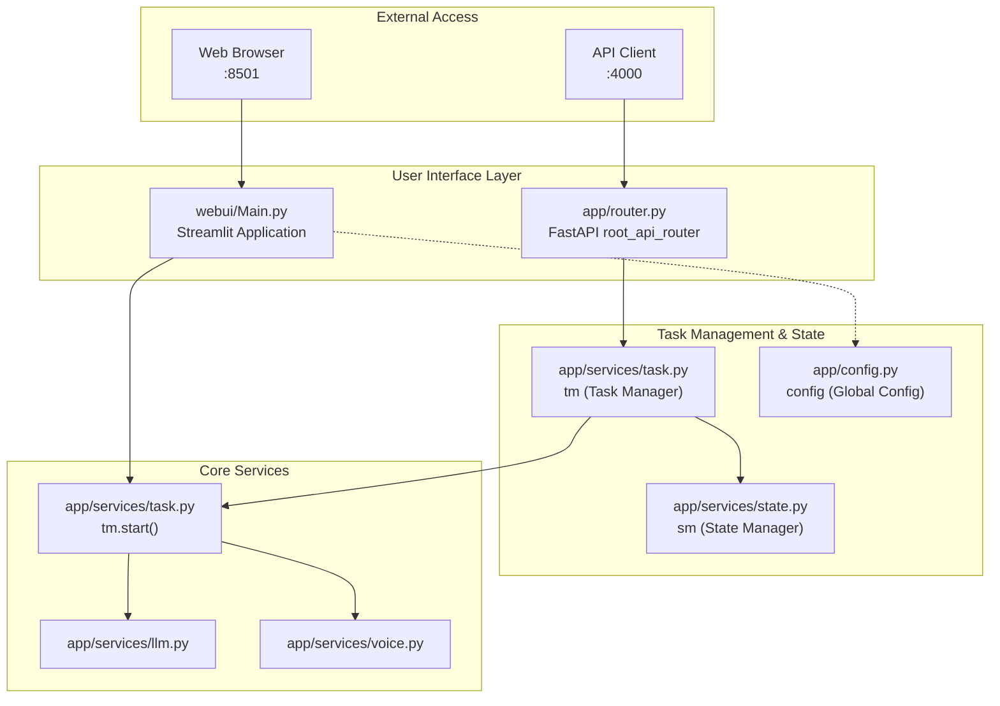

<!-- source: DeepWiki mcp.deepwiki.com · repo harry0703/MoneyPrinterTurbo · page 4 User Interfaces · fetched 2026-10-30 -->

# User Interfaces

<details>
<summary>Relevant source files</summary>

The following files were used as context for generating this wiki page:

- [app/router.py](app/router.py)
- [main.py](main.py)
- [test/services/test_controller_ping.py](test/services/test_controller_ping.py)
- [test/services/test_utils_ffmpeg_check.py](test/services/test_utils_ffmpeg_check.py)
- [webui/Main.py](webui/Main.py)
- [webui/i18n/en.json](webui/i18n/en.json)

</details>


MoneyPrinterTurbo provides two primary interfaces for user interaction: a **Streamlit-based web interface** for interactive use and a **FastAPI-based REST API** for programmatic access. Both interfaces communicate with the same backend task orchestration system but differ in their execution models and configuration persistence strategies.

## Dual-Interface Architecture

The system exposes functionality through two distinct server processes. While they share the same core logic, the WebUI is designed for synchronous, interactive sessions with deferred configuration updates, whereas the API is built for asynchronous task management with immediate state persistence.

| Interface | Technology | Default Port | Primary Use Case | Entry Point |
|-----------|-----------|--------------|------------------|-------------|
| **Web UI** | Streamlit | 8501 | Interactive video generation for end users | [webui/Main.py:67-79]() |
| **API** | FastAPI | 4000 | Programmatic access for automation and integration | [main.py:12-18]() |

Both interfaces share access to the same configuration file via the `config` object [webui/Main.py:30](), [main.py:4](), and resource directories for fonts and music [webui/Main.py:90-91]().

### Dual-Interface System Architecture



Sources: [webui/Main.py:57-65](), [main.py:12-18](), [app/router.py:15-20]()

## Web Interface (Streamlit)

The web interface provides a localized, form-based UI for video generation. It utilizes `streamlit` to build a reactive frontend that manages complex user inputs like video aspect ratios, subtitle styling, and provider-specific LLM settings [webui/Main.py:38-45]().

### WebUI Logic and Configuration Handling
The WebUI implements a sophisticated interface for managing the video generation lifecycle:
*   **Dynamic Grouping**: Video sources are grouped by capability (e.g., `stock_video`, `ai_video`, `local`) to simplify user selection while maintaining backend compatibility [webui/Main.py:110-121]().
*   **Resource Management**: The UI dynamically scans for local resources, such as fonts in `resource/fonts` and local video materials with specific extensions like `.mp4` or `.mov` [webui/Main.py:90-91](), [webui/Main.py:144-153]().
*   **Backup & Presets**: Includes mechanisms for exporting and importing settings presets and API key backups using versioned JSON schemas [webui/Main.py:187-192]().
*   **Onboarding**: Integrates `streamlit_tour` to guide new users through the interface [webui/Main.py:21](), [webui/Main.py:100]().

**For detailed WebUI documentation, see [Web Interface (Streamlit)](#4.1).**

Sources: [webui/Main.py:110-121](), [webui/Main.py:187-192](), [webui/Main.py:144-153]()

## API Interface (FastAPI)

The REST API enables headless operation and integration. It routes requests through the `root_api_router` defined in `app/router.py`, which includes versioned routes for video and LLM services [app/router.py:15-20]().

### API Task Management
The API is designed for high-throughput and programmatic control:
*   **Routing**: The main entry point `main.py` starts a `uvicorn` server hosting the FastAPI application [main.py:12-18]().
*   **Endpoints**: Core functionality is split into controllers, such as `ping` for health checks and `v1.video` for task orchestration [app/router.py:12-20]().
*   **Task Flow**: API requests typically initialize a task state via `app.services.state` and delegate the heavy lifting to the task pipeline in `app.services.task`.

### API Task Flow (Code Entity Mapping)

```mermaid
sequenceDiagram
    participant Client
    participant Router["app/router.py<br/>root_api_router"]
    participant VideoController["app/controllers/v1/video.py"]
    participant TaskService["app/services/task.py<br/>tm.start()"]
    participant StateService["app/services/state.py<br/>sm.update_task()"]
    
    Client->>Router: POST /v1/videos
    Router->>VideoController: Route to create_task()
    VideoController->>StateService: sm.init_task()
    VideoController->>TaskService: tm.start(task_id, params)
    TaskService-->>VideoController: Task Started
    VideoController-->>Client: {"task_id": "..."}
    
    Note over TaskService,StateService: Asynchronous Pipeline
    TaskService->>StateService: sm.update_task(progress=20)
    
    Client->>VideoController: GET /v1/tasks/{id}
    VideoController->>StateService: sm.get_task(id)
    StateService-->>Client: Task Status JSON
```

Sources: [app/router.py:15-20](), [webui/Main.py:61-62](), [main.py:12-18]()

**For detailed API documentation, see [API Interface (FastAPI)](#4.2).**

## Internationalization (i18n)

The system supports a robust localization framework to serve a global user base.

*   **Loading**: Locales are discovered in the `webui/i18n` directory using `utils.load_locales(i18n_dir)` [webui/Main.py:92-96]().
*   **Translation Keys**: UI text is mapped to keys in JSON files (e.g., `webui/i18n/en.json`), supporting complex features like "Video Script Settings" and "LoomLoom Batch Script Generation" [webui/i18n/en.json:12-36]().
*   **Subtitle Localization**: The UI handles specific font settings (e.g., `MicrosoftYaHeiBold.ttc`) and positions to ensure multi-language subtitles render correctly across different cultures [webui/Main.py:131-143]().

**For detailed i18n documentation, see [Internationalization](#4.3).**

Sources: [webui/Main.py:92-96](), [webui/i18n/en.json:1-50](), [webui/Main.py:131-143]()

---

