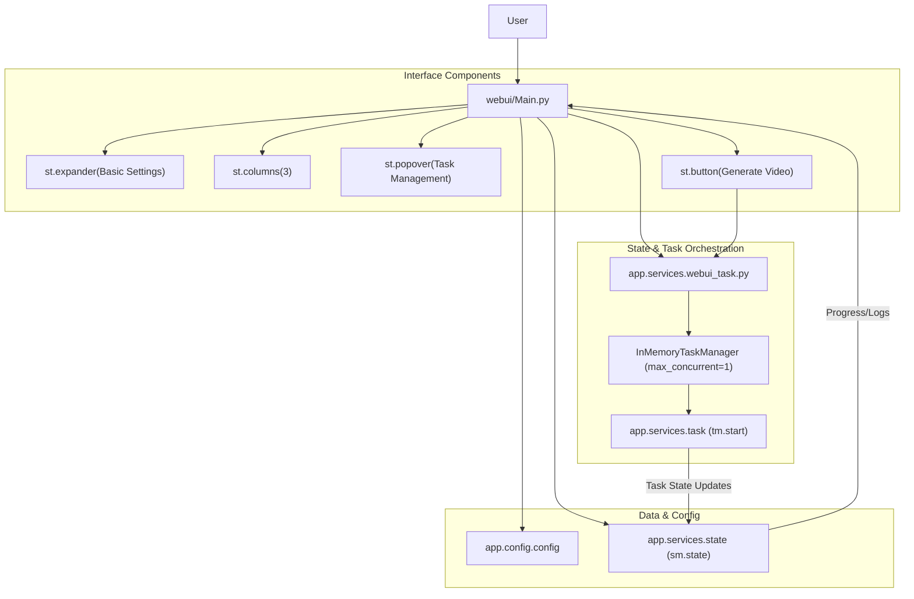
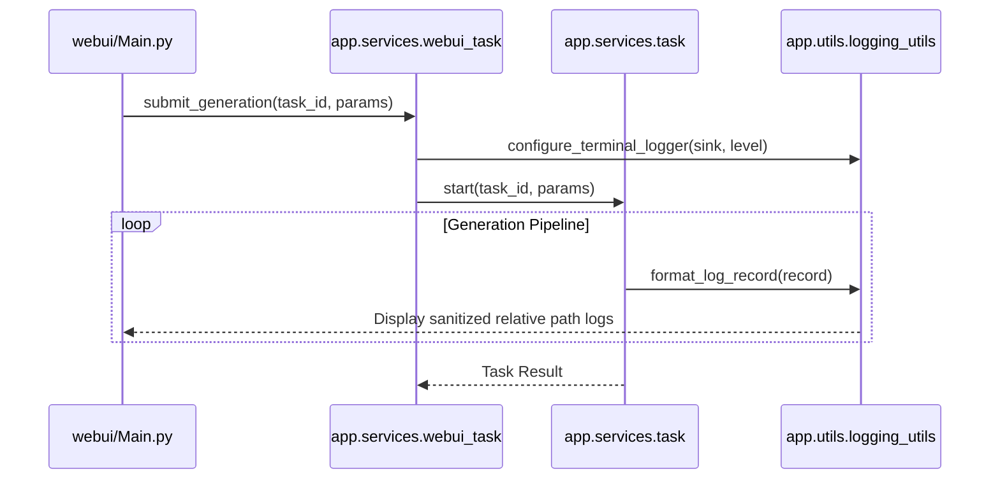

<!-- source: DeepWiki mcp.deepwiki.com · repo harry0703/MoneyPrinterTurbo · page 4.1 Web Interface (Streamlit) · fetched 2026-10-30 -->

# Web Interface (Streamlit)

Relevant source files

The following files were used as context for generating this wiki page:

- [.github/workflows/ci.yml](.github/workflows/ci.yml)
- [app/utils/logging_utils.py](app/utils/logging_utils.py)
- [test/services/test_webui_generation_defaults.py](test/services/test_webui_generation_defaults.py)
- [test/services/test_webui_grouped_select.py](test/services/test_webui_grouped_select.py)
- [test/services/test_webui_llm_settings.py](test/services/test_webui_llm_settings.py)
- [test/services/test_webui_loomloom.py](test/services/test_webui_loomloom.py)
- [test/services/test_webui_ofox.py](test/services/test_webui_ofox.py)
- [test/services/test_webui_task.py](test/services/test_webui_task.py)
- [webui/Main.py](webui/Main.py)
- [webui/i18n/en.json](webui/i18n/en.json)
- [webui/i18n/zh.json](webui/i18n/zh.json)
- [webui/styles.css](webui/styles.css)

The Web UI is the primary user interface for the MoneyPrinterTurbo system, providing a browser-based environment for creating automated videos. It leverages Streamlit to provide a reactive, configuration-driven interface that orchestrates the entire video generation pipeline.

## Overview

The Web UI is built using Streamlit and serves as the main entry point for users to interact with the MoneyPrinterTurbo system. It allows users to input video subjects, generate scripts, configure video and audio settings, and generate complete videos through an intuitive interface. The UI is designed to be self-contained, including custom CSS to hide standard Streamlit branding and optimize the layout for video production workflows [webui/Main.py:82-88]().

### Web UI Architecture

The interface is organized into a top bar for global settings (Language, Version) followed by an optional configuration expander and three main vertical columns for parameter tuning.

Sources: [webui/Main.py:25-65](), [webui/Main.py:82-88]()

## User Interface Components

The Web UI is structured into several key sections defined in `webui/Main.py`:

1.  **Top Bar & Brand**: Displays the version and provides access to the task management popover. It includes a custom brand style defined in CSS [webui/styles.css:96-136]().
2.  **Configuration Section**: For setting up LLM providers, API keys, and language settings. This section uses `_RUNTIME_CONFIG_SECTIONS` to map UI inputs to the global config [webui/Main.py:175-184]().
3.  **Left Panel (Scripting)**: For script generation, paragraph count, and custom prompt management. It supports specialized backends like Shengsuan Cloud (LoomLoom) for batch generation [webui/i18n/en.json:26-51]().
4.  **Middle Panel (Media)**: For video source selection, aspect ratio, and audio/BGM configuration. Video sources are grouped into Stock, AI Video, AI Image, and Local [webui/Main.py:110-121]().
5.  **Right Panel (Subtitles)**: For subtitle styling, font selection, and positioning based on `DEFAULT_SUBTITLE_SETTINGS` [webui/Main.py:131-143]().

### Task Management and Logging

Unlike standard Streamlit apps that run synchronously, MoneyPrinterTurbo uses a dedicated background worker for WebUI tasks to prevent UI freezes, a core protection verified in unit tests [test/services/test_webui_task.py:44-66]().

*   **Task Manager**: Managed via `webui_task.submit_generation`, which ensures the main Streamlit thread is not blocked by the long-running `tm.start` process [test/services/test_webui_task.py:64-65]().
*   **Log Capture**: Logs are formatted using `logging_utils.format_log_record`, which converts absolute paths to project-relative paths (e.g., `./app/utils`) for cleaner UI display [app/utils/logging_utils.py:45-60]().
*   **Real-time Feedback**: The UI utilizes `configure_terminal_logger` to safely replace the terminal handler while preserving task-specific handlers during hot-reloads [app/utils/logging_utils.py:63-88]().

Sources: [app/services/webui_task.py](), [app/utils/logging_utils.py:45-88](), [test/services/test_webui_task.py:44-66]()

## User Workflow

The typical workflow for creating a video using the Web UI follows these steps:

1.  **Scripting**: Enter a subject and click "Generate Script" or "Extract Keywords". Users can also use LoomLoom for batch script generation, which requires a quote and confirmation [webui/i18n/en.json:27-44]().
2.  **Audio Selection**: Choose a TTS provider or upload a custom voiceover. Supported extensions include `.mp3`, `.wav`, and `.flac` [webui/Main.py:154]().
3.  **Material Setup**: Select video sources. AI video sources like `ofox` require an explicit charge confirmation before submission [test/services/test_webui_ofox.py:22-59]().
4.  **Styling**: Configure subtitle fonts. The UI scans `resource/fonts` for available `.ttc` or `.ttf` files [webui/Main.py:90]().
5.  **Generation**: Click "Generate Video", which triggers the background task. Upon completion, the UI can automatically open the task folder if configured [test/services/test_webui_task.py:143-154]().

## Parameters and Configuration

### Video Parameters

The Web UI collects all necessary parameters through the `VideoParams` Pydantic model [webui/Main.py:43]().

| Parameter | Description | UI Component / Source |
| :--- | :--- | :--- |
| `video_subject` | Main topic of the video | Text Area [webui/i18n/en.json:13]() |
| `video_source` | Material source (Pexels, AI, etc.) | Grouped Select [webui/Main.py:110]() |
| `video_aspect` | Aspect ratio (9:16, 16:9) | Selectbox [webui/i18n/en.json:100]() |
| `voice_mode` | TTS, Upload, or None | Segmented Control [webui/Main.py:102-104]() |
| `bgm_type` | Music source (Random, Sonilo, etc.) | Selectbox [webui/i18n/en.json:140-144]() |
| `video_concat_mode`| Random or Sequential | Selectbox [webui/i18n/en.json:88-90]() |

Sources: [webui/Main.py:38-45](), [webui/i18n/en.json:12-153]()

## Technical Implementation Details

### Configuration Persistence
The WebUI manages settings via `webui.toml` and `config.toml`. It supports exporting settings presets and backing up API keys. Keys are identified by suffixes like `api_key` or `access_key` [webui/Main.py:202-211](). To prevent UI deadlocks, the codebase enforces that no blocking writes (`config.save_config`) occur during the main rendering loop [test/services/test_webui_task.py:68-110]().

### Local Material Handling
For local materials, the system filters files based on `LOCAL_MATERIAL_EXTENSIONS` [webui/Main.py:144-153](). This ensures only compatible video and image formats are passed to the MoviePy processing pipeline.

### Kimi (Moonshot) Integration
The UI provides a specialized endpoint selector for Moonshot, allowing users to switch between Global, China, and Custom base URLs, with the China endpoint (`api.moonshot.cn`) acting as the registry default [test/services/test_webui_llm_settings.py:23-86]().

Sources: [webui/Main.py:187-215](), [test/services/test_webui_task.py:68-110](), [test/services/test_webui_llm_settings.py:23-86]()

---

