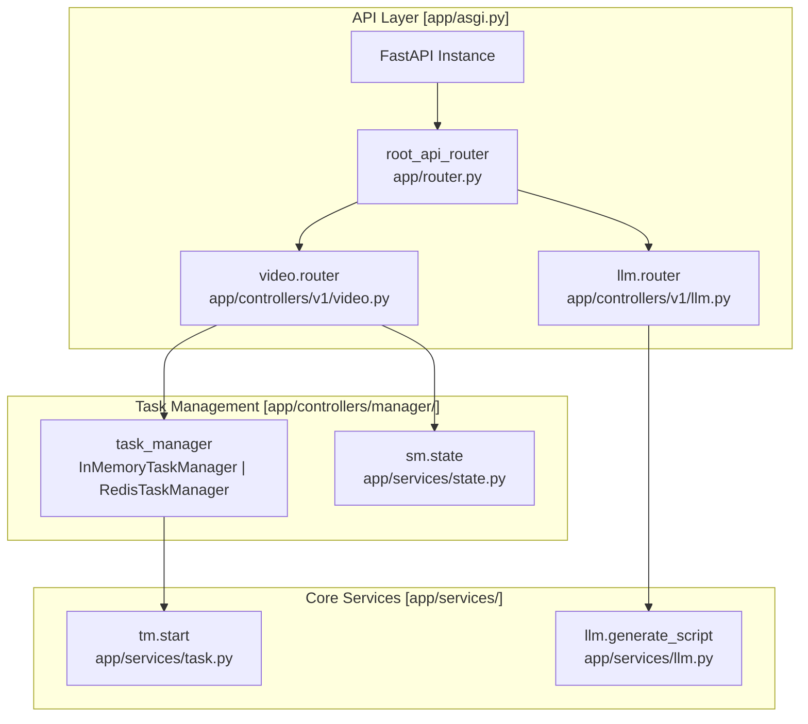
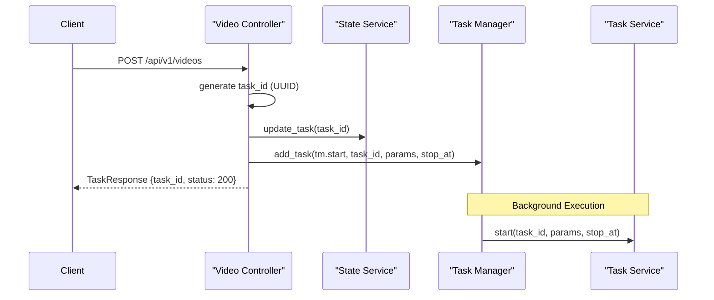

<!-- source: DeepWiki mcp.deepwiki.com · repo harry0703/MoneyPrinterTurbo · page 4.2 API Interface (FastAPI) · fetched 2026-10-30 -->

# API Interface (FastAPI)

Relevant source files

The following files were used as context for generating this wiki page:

- [app/asgi.py](app/asgi.py)
- [app/config/__init__.py](app/config/__init__.py)
- [app/controllers/base.py](app/controllers/base.py)
- [app/controllers/ping.py](app/controllers/ping.py)
- [app/controllers/v1/base.py](app/controllers/v1/base.py)
- [app/controllers/v1/llm.py](app/controllers/v1/llm.py)
- [app/controllers/v1/video.py](app/controllers/v1/video.py)
- [app/models/exception.py](app/models/exception.py)
- [app/router.py](app/router.py)
- [app/services/material_upload.py](app/services/material_upload.py)
- [main.py](main.py)
- [test/services/test_api_authentication.py](test/services/test_api_authentication.py)
- [test/services/test_asgi_cors.py](test/services/test_asgi_cors.py)
- [test/services/test_asgi_static_files.py](test/services/test_asgi_static_files.py)
- [test/services/test_controller_base.py](test/services/test_controller_base.py)
- [test/services/test_controller_ping.py](test/services/test_controller_ping.py)
- [test/services/test_controller_video.py](test/services/test_controller_video.py)
- [test/services/test_material_upload.py](test/services/test_material_upload.py)
- [test/services/test_utils_ffmpeg_check.py](test/services/test_utils_ffmpeg_check.py)

This page documents the FastAPI REST API that provides programmatic access to MoneyPrinterTurbo's video generation capabilities. The API runs on the port specified in `config.toml` (defaulting to 8080) and offers endpoints for creating videos, managing tasks, and standalone script generation.

For information about the web-based user interface, see [Web Interface (Streamlit)](#4.1). For details about the underlying service architecture, see [Core Services](#5).

## Overview

The MoneyPrinterTurbo API is built using FastAPI and provides both synchronous and asynchronous operations for AI-powered video generation. The API supports three main generation modes: full video creation, audio-only generation, and subtitle-only generation.

### API Architecture

Sources: [app/router.py:12-20](), [app/controllers/v1/video.py:59-69](), [main.py:12-18]()

## Authentication & Security

The API implements a token-based authentication system using the `x-api-key` header.

*   **Mechanism**: Authentication is handled by `verify_token` [app/controllers/base.py:47-56](), which is injected as a dependency into the V1 routers [app/controllers/v1/video.py:41]().
*   **Configuration**: If `app.api_key` in `config.toml` is empty or null, authentication is disabled for local ease of use [app/controllers/base.py:58-60]().
*   **Security Measures**: 
    *   Uses `secrets.compare_digest` for constant-time comparison to prevent timing attacks [app/controllers/base.py:89-96]().
    *   Rejects requests with duplicate `x-api-key` headers to prevent ambiguity [app/controllers/base.py:78-83]().
    *   Protects generated task files in the `/tasks` static route via a dedicated middleware [app/asgi.py:190-204]().

Sources: [app/controllers/base.py:47-98](), [app/asgi.py:190-204]()

## API Endpoints

### Video Generation Endpoints

The core video generation endpoints accept different request types and execute background tasks using the task management system.

| Endpoint | Method | Purpose | Stop Point (`stop_at`) |
|----------|--------|---------|------------|
| `/api/v1/videos` | POST | Generate complete video | `video` |
| `/api/v1/subtitle` | POST | Generate subtitles only | `subtitle` |
| `/api/v1/audio` | POST | Generate audio only | `audio` |

Sources: [app/controllers/v1/video.py:181-194](), [app/controllers/v1/base.py:8-9]()

#### Task Creation Workflow

When a generation endpoint is called, the system follows this sequence:

Sources: [test/services/test_controller_video.py:122-146](), [app/controllers/v1/video.py:59-69]()

### LLM & Script Endpoints

These endpoints allow for standalone AI generation without triggering the full video pipeline.

| Endpoint | Method | Purpose |
|----------|--------|---------|
| `/api/v1/scripts` | POST | Generate a video script based on a subject [app/controllers/v1/llm.py:21-35]() |
| `/api/v1/terms` | POST | Extract search terms/keywords from a script [app/controllers/v1/llm.py:38-51]() |
| `/api/v1/social-metadata` | POST | Generate social publishing metadata (titles, tags) [app/controllers/v1/llm.py:54-68]() |

Sources: [app/controllers/v1/llm.py:21-68]()

### Task Management Endpoints

*   **Querying Tasks**: The API provides endpoints to list and retrieve specific task statuses. It uses `_public_task_data` to strip internal fields like `cross_post_owner` before returning to the client [app/controllers/v1/video.py:100-104]().
*   **URL Transformation**: Internal storage paths are converted to external URIs using `_task_file_to_uri`. This function uses `file_security.resolve_path_within_directory` to ensure generated links are safe and contained within the task directory [app/controllers/v1/video.py:107-129]().
*   **Streaming**: The `/api/v1/stream` endpoint supports HTTP Range requests, allowing video players to seek through generated content. The range parsing logic is strictly validated in `_parse_byte_range` [app/controllers/v1/video.py:132-178]().

## Task Concurrency Control

The API manages task execution limits through a `task_manager` instance, initialized as either `InMemoryTaskManager` or `RedisTaskManager` [app/controllers/v1/video.py:59-69]().

*   **Queue Management**: If the task queue is full, the controller raises a `429` error and rolls back the task state to prevent "stuck" tasks [test/services/test_controller_video.py:147-167]().
*   **Concurrency Limits**: Controlled by `max_concurrent_tasks` and `max_queued_tasks` settings in the configuration [app/controllers/v1/video.py:48-49]().

## Resource Management

The API provides endpoints for managing media assets:
*   **Material Uploads**: Files are sanitized via `_sanitize_upload_filename` to prevent directory traversal attacks [app/controllers/v1/video.py:72-82]().
*   **Path Resolution**: The `_resolve_path_within_directory` helper ensures that any file access (BGM, materials, or tasks) is restricted to the permitted base directory [app/controllers/v1/video.py:85-97]().

## Data Models & Exceptions

The API uses Pydantic models for request validation and a custom exception class for error handling.

| Model / Class | Purpose |
|-------|--------|
| `TaskVideoRequest` | Defines parameters for video generation [app/controllers/v1/video.py:29]() |
| `HttpException` | Custom exception that captures stack traces and logs errors with appropriate severity (WARNING for 400/401, ERROR for 500) [app/models/exception.py:7-27]() |
| `RequestValidationError` | Handled globally in `asgi.py` to return formatted JSON responses for schema mismatches [app/asgi.py:57-63]() |

Sources: [app/models/exception.py:7-27](), [app/asgi.py:50-63]()

---

