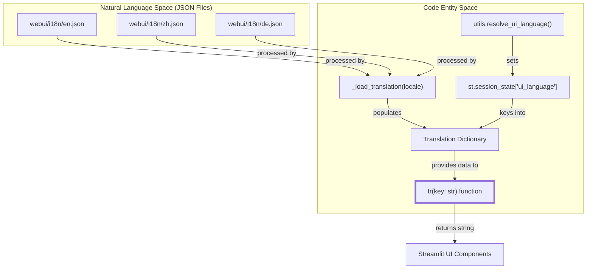
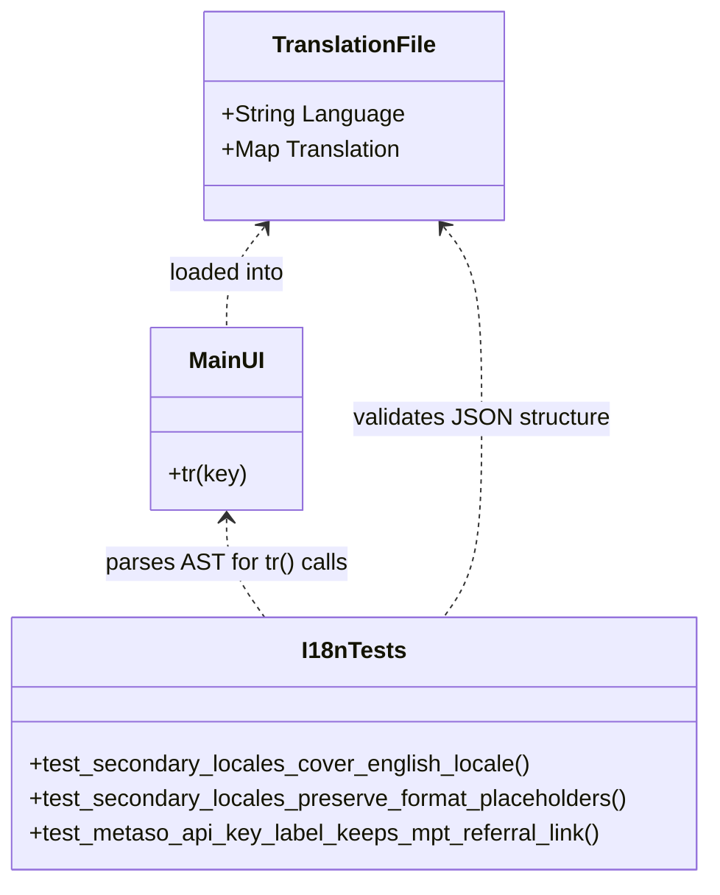

<!-- source: DeepWiki mcp.deepwiki.com · repo harry0703/MoneyPrinterTurbo · page 4.3 Internationalization · fetched 2026-10-30 -->

# Internationalization

<details>
<summary>Relevant source files</summary>

The following files were used as context for generating this wiki page:

- [app/models/llm_provider.py](app/models/llm_provider.py)
- [docs/MoneyPrinterTurbo.ipynb](docs/MoneyPrinterTurbo.ipynb)
- [test/services/test_webui_i18n.py](test/services/test_webui_i18n.py)
- [webui/i18n/de.json](webui/i18n/de.json)
- [webui/i18n/en.json](webui/i18n/en.json)
- [webui/i18n/es.json](webui/i18n/es.json)
- [webui/i18n/fr.json](webui/i18n/fr.json)
- [webui/i18n/id.json](webui/i18n/id.json)
- [webui/i18n/it.json](webui/i18n/it.json)
- [webui/i18n/ko.json](webui/i18n/ko.json)
- [webui/i18n/pt.json](webui/i18n/pt.json)
- [webui/i18n/ru.json](webui/i18n/ru.json)
- [webui/i18n/tr.json](webui/i18n/tr.json)
- [webui/i18n/vi.json](webui/i18n/vi.json)
- [webui/i18n/zh.json](webui/i18n/zh.json)

</details>


## Purpose and Scope

This document explains how MoneyPrinterTurbo implements internationalization (i18n) to support multiple languages in the Streamlit WebUI. It covers the translation file structure, language detection, the translation function, and the technical validation process for ensuring localization consistency across secondary languages.

For information about the WebUI's overall structure and features, see [Web Interface (Streamlit)](). For API interface documentation, see [API Interface (FastAPI)]().

---

## Supported Languages

MoneyPrinterTurbo currently supports 11 languages with complete translation files. The system is designed to be easily extensible by adding JSON files to the `webui/i18n/` directory.

| Language Code | Language Name | Translation File |
|--------------|---------------|------------------|
| `en` | English | [webui/i18n/en.json:2]() |
| `zh` | 简体中文 (Simplified Chinese) | [webui/i18n/zh.json:2]() |
| `de` | Deutsch (German) | [webui/i18n/de.json:2]() |
| `vi` | Tiếng Việt (Vietnamese) | [webui/i18n/vi.json:2]() |
| `tr` | Türkçe (Turkish) | [webui/i18n/tr.json:2]() |
| `pt` | Português (Portuguese) | [webui/i18n/pt.json:2]() |
| `ru` | Русский (Russian) | [webui/i18n/ru.json:2]() |
| `es` | Español (Spanish) | [webui/i18n/es.json:2]() |
| `id` | Bahasa Indonesia (Indonesian) | [webui/i18n/id.json:2]() |
| `it` | Italiano (Italian) | [webui/i18n/it.json:2]() |
| `fr` | Français (French) | [webui/i18n/fr.json:2]() |

**Sources:** [webui/i18n/en.json:1-3](), [webui/i18n/zh.json:1-3](), [webui/i18n/de.json:1-3](), [webui/i18n/vi.json:1-3](), [webui/i18n/tr.json:1-3](), [webui/i18n/pt.json:1-3](), [webui/i18n/ru.json:1-3](), [webui/i18n/es.json:1-3](), [webui/i18n/id.json:1-3](), [webui/i18n/it.json:1-3](), [webui/i18n/fr.json:1-3]()

---

## File Structure and Organization

### Directory Layout

```
webui/
├── i18n/
│   ├── en.json          # English translations (Source of Truth)
│   ├── zh.json          # Chinese translations
│   ├── de.json          # German translations
│   ├── es.json          # Spanish translations
│   ├── fr.json          # French translations
│   ├── id.json          # Indonesian translations
│   ├── it.json          # Italian translations
│   ├── pt.json          # Portuguese translations
│   ├── ru.json          # Russian translations
│   ├── tr.json          # Turkish translations
│   └── vi.json          # Vietnamese translations
└── Main.py              # WebUI entry point with i18n implementation
```

### Translation File Schema

Each JSON translation file follows a standard schema where the `Language` key defines the display name in the UI selector, and the `Translation` object contains the mapping of static keys to localized strings.

```json
{
  "Language": "English",
  "Translation": {
    "Login Required": "Login Required",
    "Video Subject": "Video Subject",
    "LoomLoom Run Progress": "LoomLoom is generating: {completed}/{total} completed"
  }
}
```

**Sources:** [webui/i18n/en.json:1-46](), [test/services/test_webui_i18n.py:99-101]()

---

## Translation Logic and Implementation

### Core Translation Function (`tr`)

The WebUI utilizes a central `tr()` function to perform lookups against the loaded locale dictionary. If a key is missing in the current language, it defaults to returning the key itself. The `_TrKeyVisitor` class in the test suite is used to identify all calls to this function in the source code.

**Sources:** [test/services/test_webui_i18n.py:83-97](), [test/services/test_webui_i18n.py:153-161]()

### Language Resolution Order

The system resolves the UI language using a specific priority sequence implemented in `utils.resolve_ui_language`:
1.  **Saved Preference:** The language explicitly selected by the user.
2.  **Browser Locale:** Normalized browser-sent locale (e.g., `pt_BR` normalized to `pt`).
3.  **Fallback:** English (`en`).

**Sources:** [test/services/test_webui_i18n.py:125-151](), [app/utils/utils.py]()

---

## Technical Data Flow

The following diagram bridges the "Natural Language Space" (JSON files) to the "Code Entity Space" (the `tr` function and Streamlit state).

### Localization Lookup Process



**Sources:** [test/services/test_webui_i18n.py:99-101](), [test/services/test_webui_i18n.py:125-132](), [webui/Main.py]()

---

## Technical Validation and Fallbacks

MoneyPrinterTurbo maintains strict automated tests to ensure localization quality. The validation logic is defined in `test/services/test_webui_i18n.py`.

### English Fallback Mechanism

For certain complex provider-specific instructions and brand names (e.g., `Shengsuan Cloud`, `Metaso MiniMax`, or `LoomLoom` quotes), the system uses an `ENGLISH_FALLBACK_KEYS` list. These keys are maintained only in English and Chinese to prevent synchronization issues and duplication of technical URLs across secondary locales.

**Sources:** [test/services/test_webui_i18n.py:23-78](), [test/services/test_webui_i18n.py:104-111]()

### Placeholder and URL Preservation

The system validates that runtime placeholders (e.g., `{completed}`, `{total}`, `{amount}`) and Markdown URLs are preserved in all translations to prevent `KeyError` or broken links.

| Language | Placeholder Example | File:Line |
|----------|---------------------|-----------|
| English | `LoomLoom is generating: {completed}/{total} completed` | [webui/i18n/en.json:46]() |
| Chinese | `LoomLoom 正在生成：已完成 {completed}/{total}` | [webui/i18n/zh.json:46]() |
| German | `LoomLoom erstellt: {completed}/{total} abgeschlossen` | [webui/i18n/de.json:36]() |
| Vietnamese | `LoomLoom đang tạo: hoàn tất {completed}/{total}` | [webui/i18n/vi.json:36]() |

**Sources:** [test/services/test_webui_i18n.py:79-80](), [test/services/test_webui_i18n.py:114-121](), [test/services/test_webui_i18n.py:162-188]()

---

## Maintenance and Expansion

### Adding a New Language

1.  **File Creation:** Create `webui/i18n/{locale}.json`.
2.  **Key Synchronization:** Copy all keys from `en.json`. Secondary locales must cover all static labels except those in `ENGLISH_FALLBACK_KEYS` or starting with `PROVIDER_TIPS_PREFIXES`.
3.  **Markdown Integrity:** Maintain Markdown URL patterns for links like `https://metaso.cn/minimax-h3/?s=MPT`.

**Sources:** [test/services/test_webui_i18n.py:14-20](), [test/services/test_webui_i18n.py:180-188]()

### Localization Coverage Map



**Sources:** [test/services/test_webui_i18n.py:83-97](), [test/services/test_webui_i18n.py:153-161](), [test/services/test_webui_i18n.py:180-188]()

---

