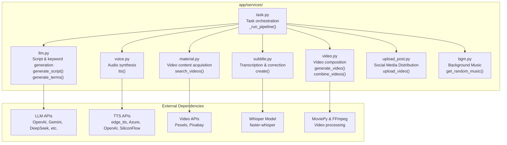
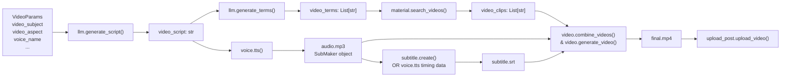

<!-- source: DeepWiki mcp.deepwiki.com · repo harry0703/MoneyPrinterTurbo · page 5 Core Services · fetched 2026-10-30 -->

# Core Services

Relevant source files

The following files were used as context for generating this wiki page:

- [app/models/schema.py](app/models/schema.py)
- [app/services/llm.py](app/services/llm.py)
- [app/services/task.py](app/services/task.py)
- [app/services/video.py](app/services/video.py)
- [app/services/voice.py](app/services/voice.py)
- [app/utils/utils.py](app/utils/utils.py)
- [test/services/test_llm.py](test/services/test_llm.py)
- [test/services/test_task.py](test/services/test_task.py)
- [test/services/test_video.py](test/services/test_video.py)
- [test/services/test_voice.py](test/services/test_voice.py)
- [test/services/test_webui_tts_settings.py](test/services/test_webui_tts_settings.py)

The core services are the processing engines that power MoneyPrinterTurbo's video generation pipeline. Each service module handles a distinct stage of video creation, from content generation to final rendering and distribution. This document provides an overview of the service architecture and introduces each major component.

For overall system context, see [System Architecture](#3). For API-level interaction, see [API Reference](#7).

## Service Architecture Overview

MoneyPrinterTurbo implements several core service modules organized under `app/services/`. Each service exposes functions that are orchestrated by the task manager to produce the final video output.

### Service Module Organization

Sources: [app/services/task.py:17-33](), [app/services/video.py:16-41]()

## Service Data Flow

The services pass data through a sequential pipeline, with each stage producing artifacts consumed by subsequent stages. The task orchestrator manages this flow and tracks progress through state updates.

### Inter-Service Data Dependencies

Sources: [app/services/task.py:18-35](), [app/models/schema.py:73-138]()

## Individual Service Overview

### Task Orchestration Service
The task orchestration service (`app/services/task.py`) coordinates the entire video generation pipeline. It manages the 5-stage sequential process, handles the `stop_at` parameter for partial execution, and updates task state through `app.services.state`. It also manages cross-posting tasks using a dedicated `ThreadPoolExecutor` [app/services/task.py:41-44]().

**Key Functions:**
- `is_task_busy()`: Utility to check if a task is currently generating or uploading [app/services/task.py:104-121]().
- `_VIDEO_MUSIC_PROVIDERS`: Registry for AI background music services like Sonilo and ElevenLabs [app/services/task.py:73-88]().

**See [Task Orchestration](#5.1) for detailed implementation.**

### LLM Integration Service
The LLM service (`app/services/llm.py`) provides unified access to 13+ providers. It handles script generation and keyword extraction. It includes logic to strip reasoning "think" blocks from models like DeepSeek R1 [app/services/llm.py:59-63]().

**Key Functions:**
- `_generate_response()`: Core router for LLM provider requests [app/services/llm.py:142-155]().
- `_normalize_text_response()`: Cleans and validates raw LLM output [app/services/llm.py:47-69]().

**See [LLM Integration](#5.2) for detailed implementation.**

### Voice Synthesis Service
The voice service (`app/services/voice.py`) handles text-to-speech conversion. It supports multiple providers including `edge-tts`, `Azure`, `OpenAI`, `SiliconFlow`, `Gemini`, `MiMo`, and `Chatterbox` [app/services/voice.py:102-211]().

**Key Functions:**
- `mktimestamp()`: Formats 100ns units into SRT-compatible timestamps [app/services/voice.py:88-99]().
- `get_elevenlabs_voices()`: Fetches available voices for the ElevenLabs provider [app/services/voice.py:176-199]().

**See [Voice Synthesis (TTS)](#5.3) for detailed implementation.**

### Video Processing Service
The video service (`app/services/video.py`) handles all video manipulation using MoviePy and FFmpeg. It manages clip resolution, aspect ratios, and hardware-accelerated encoding fallbacks [app/services/video.py:84-92]().

**Key Functions:**
- `_get_required_video_duration()`: Calculates target material length with a safety margin [app/services/video.py:96-104]().
- `is_material_resolution_acceptable()`: Validates source clip dimensions against project requirements [app/services/video.py:107-115]().
- `_prioritize_unique_source_clips()`: Logic to reduce repetitive material in the final output [app/services/video.py:118-158]().

**See [Video Processing](#5.4) for detailed implementation.**

### Material Acquisition Service
The material service (`app/services/material.py`) handles acquiring video content from external APIs or local files. It validates material duration and filters for appropriate aspect ratios.

**Key Components:**
- `MaterialInfo`: Data model for tracking material source and duration [app/models/schema.py:62-70]().
- `VideoConcatMode`: Enum for `random` or `sequential` material ordering [app/models/schema.py:18-20]().

**See [Material Acquisition](#5.5) for detailed implementation.**

### Subtitle Generation Service
The subtitle service (`app/services/subtitle.py`) provides audio transcription using Whisper and subtitle formatting.

**Key Components:**
- `SubtitleRequest`: Schema defining parameters for standalone subtitle tasks [app/models/schema.py:140-159]().
- `VideoParams` subtitle fields: Configuration for font, color, and positioning [app/models/schema.py:121-133]().

**See [Subtitle Generation](#5.6) for detailed implementation.**

### Social Media Distribution
The social media service (`app/services/upload_post.py`) manages cross-posting finished videos to TikTok and Instagram. It includes robust process monitoring to track upload status across restarts [app/services/task.py:199-213]().

**Key Functions:**
- `_register_cross_post_future()`: Tracks active upload jobs in the current process [app/services/task.py:124-128]().
- `_is_windows_process_alive()`: Platform-specific process check using Win32 API [app/services/task.py:146-197]().

**See [Social Media Distribution](#5.7) for detailed implementation.**

Sources: [app/services/task.py:38-88](), [app/services/llm.py:47-69](), [app/services/video.py:73-158](), [app/services/voice.py:88-211](), [app/models/schema.py:18-159]()

---

