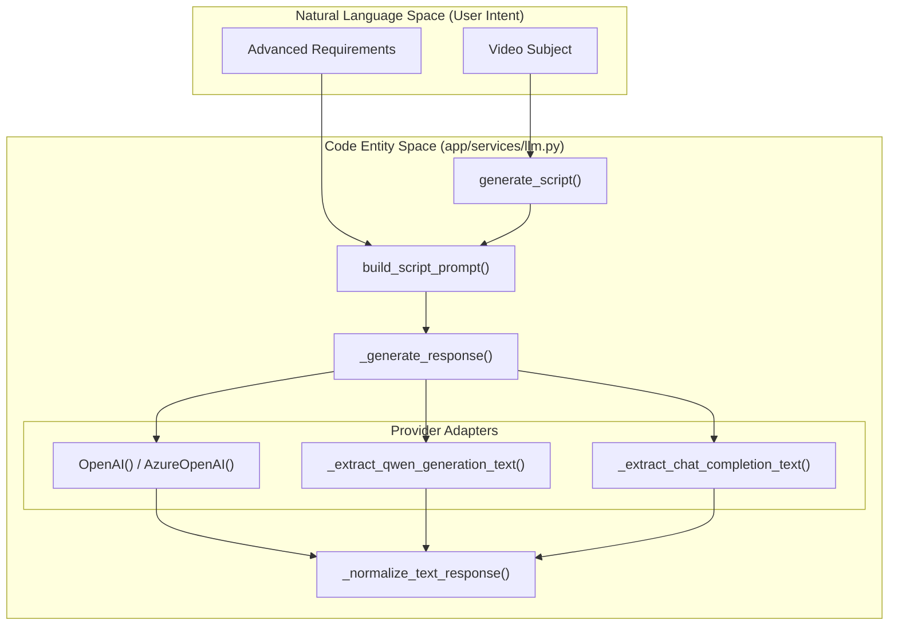
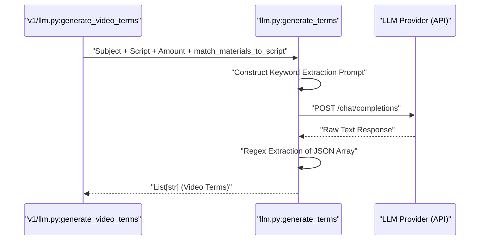

<!-- source: DeepWiki mcp.deepwiki.com · repo harry0703/MoneyPrinterTurbo · page 5.2 LLM Integration · fetched 2026-10-30 -->

# LLM Integration

Relevant source files

The following files were used as context for generating this wiki page:

- [app/controllers/ping.py](app/controllers/ping.py)
- [app/controllers/v1/base.py](app/controllers/v1/base.py)
- [app/controllers/v1/llm.py](app/controllers/v1/llm.py)
- [app/models/exception.py](app/models/exception.py)
- [app/models/llm_provider.py](app/models/llm_provider.py)
- [app/services/llm.py](app/services/llm.py)
- [docs/MoneyPrinterTurbo.ipynb](docs/MoneyPrinterTurbo.ipynb)
- [test/services/test_llm.py](test/services/test_llm.py)
- [test/services/test_webui_i18n.py](test/services/test_webui_i18n.py)

This document covers the Large Language Model (LLM) integration system in MoneyPrinterTurbo, which provides script generation, keyword extraction, and social metadata generation for automated video creation. The LLM service acts as a unified interface to multiple AI providers, enabling flexible and redundant content generation.

For information about the overall task orchestration that coordinates LLM usage with other services, see [Task Orchestration](#5.1). For details about how generated scripts are converted to speech, see [Voice Synthesis (TTS)](#5.3).

## Supported LLM Providers

MoneyPrinterTurbo supports 13+ LLM providers through a unified interface. The system uses a registry-based approach to define provider metadata and an adapter pattern to handle specific API requirements. The registry is defined in `LLM_PROVIDER_REGISTRY` [app/models/llm_provider.py:187]().

| Provider | ID (`provider_id`) | Adapter Type | Default Model |
|----------|--------------------|--------------|---------------|
| Moonshot AI | `moonshot` | `openai_compatible` | `kimi-k3` |
| OpenAI | `openai` | `openai_compatible` | `gpt-4o-mini` |
| DeepSeek | `deepseek` | `openai_compatible` | `deepseek-chat` |
| Alibaba Qwen | `qwen` | `qwen` | `qwen-max` |
| Azure OpenAI | `azure` | `azure` | `gpt-4o-mini` |
| MiniMax | `minimax` | `openai_compatible` | `abab6.5s-chat` |
| SiliconFlow | `siliconflow` | `openai_compatible` | `deepseek-ai/DeepSeek-V3` |
| Groq | `groq` | `openai_compatible` | `llama-3.3-70b-versatile` |
| Ollama | `ollama` | `openai_compatible` | `llama3.1` |

**Sources:** [app/models/llm_provider.py:4-200](), [app/services/llm.py:148-175]()

## LLM Service Architecture

The LLM integration follows a provider-agnostic architecture. The core logic is encapsulated in `app/services/llm.py`, which handles prompt construction, provider routing, and response normalization.

### System-to-Code Mapping

The following diagram maps high-level LLM operations to specific functions and classes within the codebase.

**Sources:** [app/services/llm.py:87-103](), [app/services/llm.py:116-139](), [app/services/llm.py:142-177]()

## Script Generation Process

The `generate_script` function is the primary entry point for creating video content. It utilizes structured prompt engineering to ensure the output is suitable for Text-to-Speech (TTS) and video synthesis.

### Prompt Engineering & Constraints

The system uses a default system prompt `DEFAULT_SCRIPT_SYSTEM_PROMPT` to enforce strict formatting rules.

*   **Role**: Video Script Generator [app/services/llm.py:30]()
*   **Constraints**: 
    *   No markdown or formatting (titles, bolding) [app/services/llm.py:39]()
    *   No meta-talk (e.g., "Welcome to this video") [app/services/llm.py:38]()
    *   No narrator indicators (e.g., "Voiceover:") [app/services/llm.py:41]()
    *   Match the language of the subject [app/services/llm.py:43]()

### Advanced Prompt Options

Users can customize the generation through `VideoScriptRequest` parameters:
1.  `video_script_prompt`: Appends additional requirements to the prompt [test/services/test_llm.py:83-91]().
2.  `custom_system_prompt`: Completely replaces the default system prompt while maintaining runtime context (subject, language, paragraphs) [test/services/test_llm.py:102-109]().

**Sources:** [app/services/llm.py:29-44](), [app/controllers/v1/llm.py:26-33](), [test/services/test_llm.py:74-110]()

## Data Flow: Script to Search Terms

Once a script is generated, it must be decomposed into keywords for video material acquisition. This is handled by `generate_video_terms` in the controller and `generate_terms` in the service.

### Keyword Extraction Logic
The system requests a list of keywords based on the script. If `match_materials_to_script` is enabled, the prompt is modified to ensure the keywords follow the chronological order of the script [app/controllers/v1/llm.py:48-49]().

**Sources:** [app/controllers/v1/llm.py:43-51](), [test/services/test_llm.py:193-195]()

## Response Normalization and Security

To ensure the video generation pipeline does not break due to malformed LLM outputs or expose sensitive data, the system applies several layers of processing:

### Reasoning Block Removal
Reasoning models (e.g., DeepSeek R1, MiniMax M3) often include internal thoughts inside `<think>` tags. The `_normalize_text_response` function uses `_THINK_BLOCK_RE` and `_UNCLOSED_THINK_BLOCK_RE` to strip these blocks [app/services/llm.py:19-20](), [app/services/llm.py:62-63]().

### Security Sanitization
The `_sanitize_error_message` function prevents credential leakage. It uses `_URL_USERINFO_RE` and `_SENSITIVE_QUERY_RE` to mask passwords and API keys in error messages that might be returned to the WebUI or API [app/services/llm.py:21-27](), [app/services/llm.py:72-84]().

### Content Validation
The system performs type and content checks in `_normalize_text_response` to ensure the provider returned a valid string and not an empty response, raising `ValueError` or `TypeError` if validation fails [app/services/llm.py:51-65]().

**Sources:** [app/services/llm.py:19-27](), [app/services/llm.py:47-69](), [app/services/llm.py:72-84](), [test/services/test_llm.py:47-72]()

## Implementation Details

### Provider Resolution
The system uses `LLMProviderSpec` to manage provider-specific defaults. The `resolve_model_name` and `resolve_base_url` methods handle migrating deprecated settings to current defaults [app/models/llm_provider.py:83-96]().

### Configuration Snapshots
The `_generate_response` function accepts an optional `app_config`. This allows the WebUI to pass a snapshot of the configuration at the moment the task was submitted, preventing mid-task configuration changes from affecting retries [app/services/llm.py:142-150]().

**Sources:** [app/services/llm.py:142-150](), [app/models/llm_provider.py:30-55](), [test/services/test_llm.py:132-157]()

---

