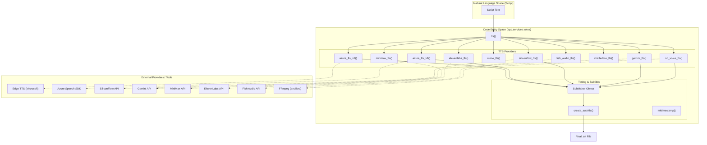
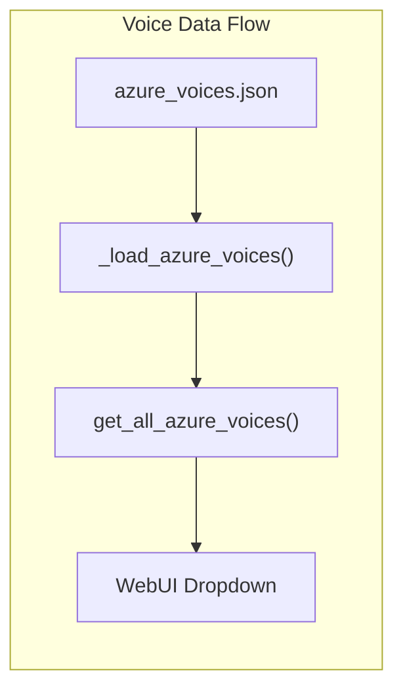
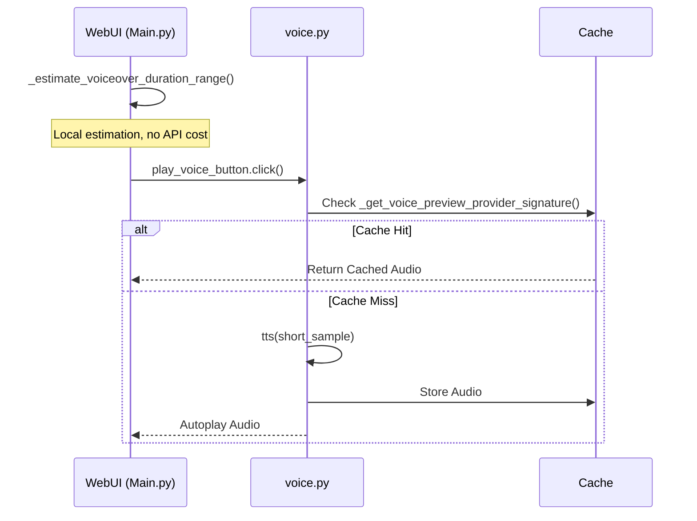

<!-- source: DeepWiki mcp.deepwiki.com · repo harry0703/MoneyPrinterTurbo · page 5.3 Voice Synthesis (TTS) · fetched 2026-10-30 -->

# Voice Synthesis (TTS)

Relevant source files

The following files were used as context for generating this wiki page:

- [app/services/data/azure_voices.json](app/services/data/azure_voices.json)
- [app/services/voice.py](app/services/voice.py)
- [app/utils/utils.py](app/utils/utils.py)
- [test/services/test_fish_audio.py](test/services/test_fish_audio.py)
- [test/services/test_voice.py](test/services/test_voice.py)
- [test/services/test_webui_tts_settings.py](test/services/test_webui_tts_settings.py)
- [test/services/test_webui_voice_preview.py](test/services/test_webui_voice_preview.py)

The Voice Synthesis service provides text-to-speech (TTS) conversion and subtitle generation capabilities for the MoneyPrinterTurbo video generation pipeline. This service converts script text into speech audio files and generates synchronized subtitle files that are used during video assembly.

## Architecture Overview

The voice synthesis system supports multiple TTS providers through a unified interface, allowing the system to leverage different AI services based on availability, cost, or quality requirements.

### TTS System Components

The following diagram maps the logical TTS process to specific code entities within the `app.services.voice` module, including the specialized "No Voice" mode for silent videos.

**Sources:** [app/services/voice.py:20-22](), [test/services/test_voice.py:105-122](), [test/services/test_fish_audio.py:121-128]()

## TTS Provider Integration

### Provider Detection and Routing

The system determines the provider by inspecting the `voice_name` prefix or suffix. The routing logic is centralized to allow the WebUI and API to share a unified voice identification format.

| Detection Helper | Logic | Target Implementation |
|--------------------|-------|-----------------------|
| `is_no_voice()` | Matches `no-voice` or `none` | `no_voice_tts()` |
| `is_azure_v2_voice()` | Checks if name ends with `-V2` | `azure_tts_v2()` |
| `is_siliconflow_voice()` | Checks for `siliconflow:` prefix | `siliconflow_tts()` |
| `is_gemini_voice()` | Checks for `gemini:` prefix | `gemini_tts()` |
| `is_mimo_voice()` | Checks for `mimo:` prefix | `mimo_tts()` |
| `is_minimax_voice()` | Checks for `minimax:` prefix | `minimax_tts()` |
| `is_elevenlabs_voice()` | Checks for `elevenlabs:` prefix | `elevenlabs_tts()` |
| `is_chatterbox_voice()` | Checks for `chatterbox:` prefix | `chatterbox_tts()` |
| `is_fish_audio_voice()` | Checks for `fish_audio:` prefix | `fish_audio_tts()` |
| Default | Fallback for standard names | `azure_tts_v1()` (Edge TTS) |

**Sources:** [app/services/voice.py:75-79](), [app/services/voice.py:102-125](), [test/services/test_fish_audio.py:38-44](), [test/services/test_voice.py:149-157]()

### Provider-Specific Features

#### No Voice (Silent Mode)
The `no_voice_tts()` function generates silent audio using FFmpeg's `anullsrc` filter [test/services/test_voice.py:105-108](). Since there is no actual speech, duration is estimated based on character count using `estimate_no_voice_duration()` [test/services/test_voice.py:158-171]().

#### Edge TTS (Azure V1)
Uses the `edge_tts` library [app/services/voice.py:20]() to stream audio and capture `WordBoundary` events. It is the default provider for standard voice names.

#### SiliconFlow TTS
Interfaces with the `FunAudioLLM/CosyVoice2-0.5B` model series [app/services/voice.py:110-119](). Voices are formatted as `siliconflow:{model}:{voice}-{gender}` [app/services/voice.py:122-125]().

#### Gemini TTS
Supports 30 official preset voices including `Zephyr`, `Puck`, and `Charon` [app/services/voice.py:42-73](). The `get_gemini_voices()` function formats these for the dispatcher using a `gemini:` prefix [app/services/voice.py:128-139]().

#### MiniMax TTS
Supports high-definition models like `speech-2.8-hd` and `speech-2.8-turbo` [app/services/voice.py:38-41](). It uses either `MINIMAX_TTS_GLOBAL_URL` or `MINIMAX_TTS_CN_URL` based on configuration [app/services/voice.py:34-35]().

#### ElevenLabs TTS
Fetches user-specific voices from the ElevenLabs API [app/services/voice.py:176-199](). The system requires an API key and filters for "favorite" voices to populate the selection list [app/services/voice.py:181-195]().

#### Fish Audio TTS
Supports model selection (e.g., `s2.1-pro-free`) via `config.toml` [test/services/test_fish_audio.py:143-167](). It uses a `reference_id` for custom voices [test/services/test_fish_audio.py:130-138]().

## Voice Selection and Discovery

The system maintains static and dynamic lists of voices. Azure voices are loaded from a JSON data file `azure_voices.json` [test/services/test_voice.py:56-58]().

**Sources:** [app/services/data/azure_voices.json:1-10](), [test/services/test_voice.py:55-63]()

## Audio Generation and Timing

### The SubMaker Object
The `SubMaker` object (imported from `edge_tts`) is the core data structure for timing [app/services/voice.py:22](). It stores the relationship between specific words and their start/end offsets in the audio stream. 

For providers that do not natively return timing data (like Gemini or SiliconFlow), the system manually constructs a `SubMaker`-compatible structure. This requires `mktimestamp()` to convert 100-nanosecond units into the standard `HH:MM:SS.mmm` format [app/services/voice.py:88-99]().

### Subtitle Creation
The `create_subtitle()` function takes the `SubMaker` data and the original text to produce an SRT file. It relies on `mktimestamp()` to format the time units used by the internal timing engine into standard SRT timestamps [app/services/voice.py:88-99]().

### Audio Duration Handling
The system uses `AudioFileClip` from `moviepy` to accurately determine the duration of generated audio files, supporting multiple formats including `.mp3`, `.wav`, and `.m4a` [test/services/test_voice.py:131-143]().

**Sources:** [app/services/voice.py:25](), [test/services/test_voice.py:131-148]()

## WebUI Integration and Preview

The WebUI provides tools for voice selection and previewing, ensuring users can hear the voice before committing to a full video generation.

**Sources:** [test/services/test_webui_voice_preview.py:24-36](), [test/services/test_webui_voice_preview.py:39-55](), [test/services/test_webui_voice_preview.py:159-198]()

### Configuration Persistence
The WebUI handles API key restoration to prevent browser refreshes from clearing sensitive configuration [test/services/test_webui_tts_settings.py:102-131](). It also supports environment variable fallbacks (e.g., `ELEVENLABS_API_KEY`) which are used for voice loading but not persisted to `config.toml` automatically [test/services/test_webui_tts_settings.py:133-158]().

---

