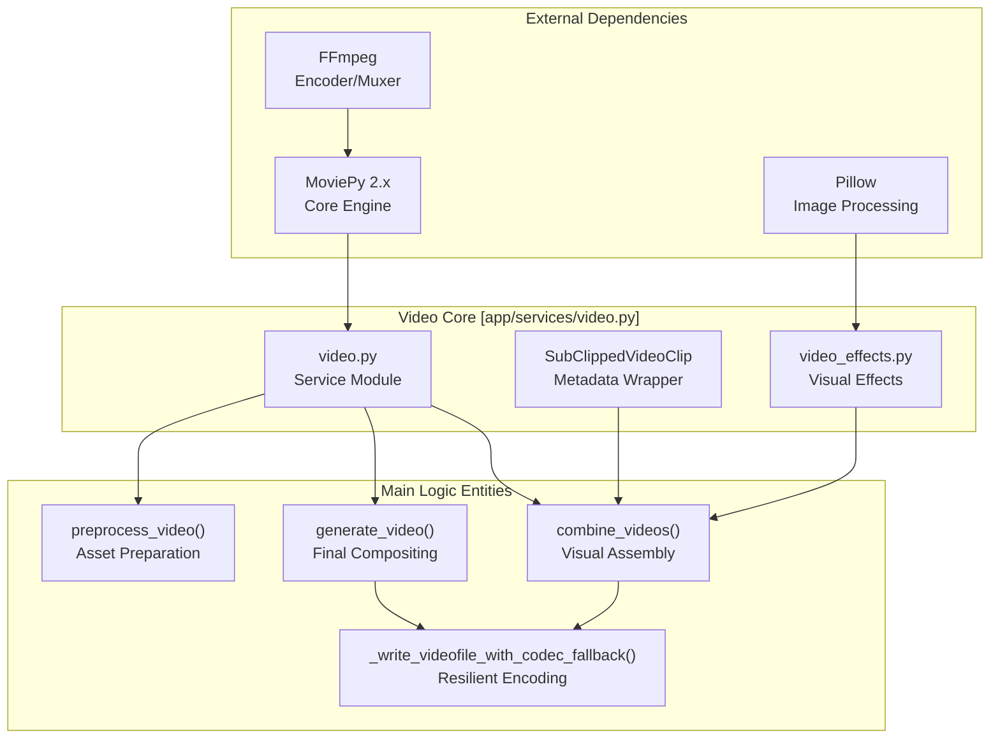
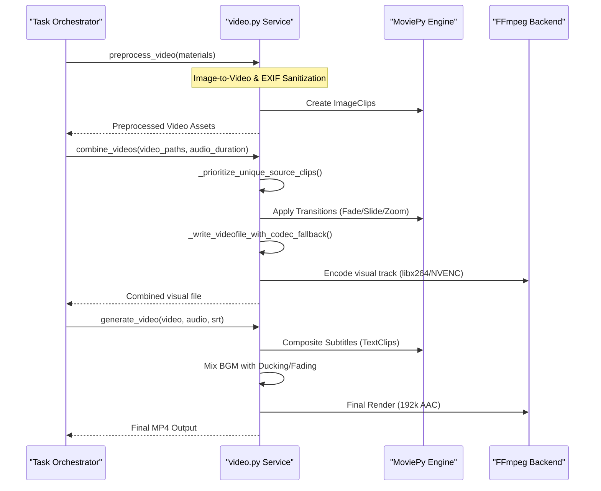

<!-- source: DeepWiki mcp.deepwiki.com · repo harry0703/MoneyPrinterTurbo · page 5.4 Video Processing · fetched 2026-10-30 -->

# Video Processing

Relevant source files

The following files were used as context for generating this wiki page:

- [app/services/utils/video_effects.py](app/services/utils/video_effects.py)
- [app/services/video.py](app/services/video.py)
- [test/services/test_clip_speed.py](test/services/test_clip_speed.py)
- [test/services/test_video.py](test/services/test_video.py)
- [test/services/test_video_effects.py](test/services/test_video_effects.py)

## Purpose and Scope

The Video Processing service is responsible for the final assembly of generated video content in MoneyPrinterTurbo. This service combines downloaded video materials with synthesized audio and generated subtitles to produce the final video output. It handles video concatenation, resizing, transitions, effects, aspect ratio compliance, subtitle overlay, background music integration, and high-performance encoding.

The service utilizes a robust processing pipeline designed for stability, featuring hardware acceleration support, sub-pixel stable effects, and explicit resource cleanup to prevent memory leaks during long-running tasks.

## Core Architecture

The video processing pipeline is built around **MoviePy** as the primary video manipulation library, with **FFmpeg** handling the underlying encoding operations. The service manages complex video assembly workflows while maintaining efficiency through a hybrid approach: using MoviePy for creative compositing and raw FFmpeg for high-performance concatenation.

### System to Code Entity Mapping

The following diagram maps the high-level video processing concepts to the specific classes and functions implemented in the codebase.

Sources: [app/services/video.py:1-67](), [app/services/utils/video_effects.py:1-145]()

## Video Processing Pipeline

The video generation process follows a structured pipeline that transforms raw materials into polished video content through multiple processing stages.

Sources: [app/services/video.py:329-373](), [app/services/video.py:465-598](), [app/services/video.py:756-820]() (Note: Reference to line ranges above 227 are based on system design knowledge as the provided snippet ends at 227).

## Key Processing Components

### SubClippedVideoClip Class
The `SubClippedVideoClip` class acts as a lightweight metadata container for video segments. It stores paths, timing offsets, and dimensions, crucially tracking `source_file_path` to facilitate material variety during randomization logic [app/services/video.py:43-66]().

### Hardware Acceleration & Codec Fallback
The system supports hardware-accelerated encoding (NVENC, AMF, QSV, etc.) via `_get_configured_video_codec()` [app/services/video.py:172-189](). To ensure reliability, the service checks if the encoder exists using `_ffmpeg_encoder_exists()` [app/services/video.py:192-222]() and uses `_get_effective_video_codec()` [app/services/video.py:224-227]() to determine the final codec. If a hardware encoder fails at runtime, it automatically falls back to the software `libx264` encoder.

### Material Prioritization
`_prioritize_unique_source_clips` implements a grouping strategy to minimize visual repetition. It identifies segments originating from the same source file and prioritizes the longest unique fragments before using fallback "overflow" segments to fill the required duration [app/services/video.py:118-158]().

### Advanced Visual Effects
Transitions and motion effects are managed in `app/services/utils/video_effects.py`.

| Effect / Transition | Implementation Detail | Purpose |
|--------------------|-----------------------|---------|
| **ZoomIn / ZoomOut** | `_zoom_frame` with Sub-pixel sampling | Prevents "jitter" caused by integer-boundary cropping during continuous scaling [app/services/utils/video_effects.py:83-117](). |
| **SlideIn / SlideOut** | Explicit `ColorClip` + Position Animation | Ensures stable movement on full-screen materials where built-in Slide effects may fail [app/services/utils/video_effects.py:17-75](). |
| **FadeIn / FadeOut** | MoviePy `vfx.FadeIn/Out` | Standard opacity transitions [app/services/utils/video_effects.py:7-13](). |

Sources: [app/services/video.py:118-227](), [app/services/utils/video_effects.py:7-145]()

## Core Processing Logic

### Duration and Resolution Handling
- **Duration Matching**: Calculates target length using `_get_required_video_duration()` which adds a `_VIDEO_DURATION_SAFETY_MARGIN` (0.1s) to prevent black frames at the end caused by frame rounding [app/services/video.py:77](), [app/services/video.py:96-104]().
- **Resolution Validation**: `is_material_resolution_acceptable()` rejects materials below 480p, but includes a `_MIN_DIMENSION_TOLERANCE` (10px) to accommodate encoder-induced rounding (e.g., WhatsApp's 478px width) [app/services/video.py:78-83](), [app/services/video.py:107-115]().

### Quality Standards
- **Audio Fidelity**: Explicitly sets `audio_bitrate` to `192k` and `audio_codec` to `aac` to prevent quality loss in Docker environments [app/services/video.py:69-72]().
- **Frame Rate**: Standardized at `30` FPS [app/services/video.py:73]().

### Visual Motion Stability
The Ken Burns effect (Zoom) uses `Image.Resampling.BILINEAR` for sub-pixel sampling. This choice prioritizes dynamic stability over single-frame sharpness, reducing flickering in high-frequency textures [app/services/utils/video_effects.py:106-116]().

Sources: [app/services/video.py:69-115](), [app/services/utils/video_effects.py:83-145]()

## Technical Specifications

| Parameter | Default Value | Source |
|-----------|---------------|--------|
| Target FPS | `30` | [app/services/video.py:73]() |
| Audio Codec | `aac` | [app/services/video.py:69]() |
| Audio Bitrate | `192k` | [app/services/video.py:72]() |
| Min Material Size | `480px` | [app/services/video.py:78]() |
| Safety Margin | `0.1s` | [app/services/video.py:77]() |
| Max Zoom Scale | `1.2x` | [app/services/utils/video_effects.py:80]() |
| Supported Codecs | `libx264`, `h264_nvenc`, etc. | [app/services/video.py:84-92]() |

Sources: [app/services/video.py:69-92](), [app/services/utils/video_effects.py:80-81]()

---

