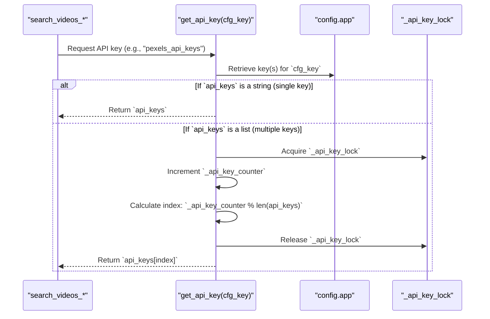

<!-- source: DeepWiki mcp.deepwiki.com · repo harry0703/MoneyPrinterTurbo · page 5.5 Material Acquisition · fetched 2026-10-30 -->

# Material Acquisition

<details>
<summary>Relevant source files</summary>

The following files were used as context for generating this wiki page:

- [app/services/loomloom.py](app/services/loomloom.py)
- [app/services/material.py](app/services/material.py)
- [app/services/material_cache.py](app/services/material_cache.py)
- [app/services/metaso_minimax.py](app/services/metaso_minimax.py)
- [app/services/ofox.py](app/services/ofox.py)
- [app/services/task_artifacts.py](app/services/task_artifacts.py)
- [app/services/volcengine_seedance.py](app/services/volcengine_seedance.py)
- [docs/loomloom/moneyprinterturbo-ai-video-materials.template.json](docs/loomloom/moneyprinterturbo-ai-video-materials.template.json)
- [docs/loomloom/moneyprinterturbo-script-candidates.template.json](docs/loomloom/moneyprinterturbo-script-candidates.template.json)
- [docs/sponsors/shengsuanyun-logo.jpg](docs/sponsors/shengsuanyun-logo.jpg)
- [test/services/test_material.py](test/services/test_material.py)
- [test/services/test_material_cache.py](test/services/test_material_cache.py)
- [test/services/test_material_openai_image.py](test/services/test_material_openai_image.py)
- [test/services/test_metaso_minimax.py](test/services/test_metaso_minimax.py)
- [test/services/test_ofox.py](test/services/test_ofox.py)
- [test/services/test_task_artifacts.py](test/services/test_task_artifacts.py)

</details>


The Material Acquisition service is responsible for sourcing video content from external providers (Pexels, Pixabay, Coverr, OFox, Metaso MiniMax, VolcEngine Seedance) or local files to use as raw material in generated videos. This service handles API integration, intelligent disk caching, API key rotation, and metadata persistence.

For information about the video processing pipeline that uses these materials, see [Video Processing](#5.4). For details about the overall task orchestration, see [Task Orchestration](#5.1).

## Purpose and Architecture

The material acquisition system provides a unified interface for obtaining video content while optimizing for performance and security. It abstracts provider-specific APIs behind a common interface and implements caching to minimize redundant downloads and API usage.

### Provider Integration Architecture

```mermaid
graph TB
    subgraph "Material Service Interface [material.py]"
        MaterialService["material.py"]
        ApiKeyManager["get_api_key()"]
        DownloadManager["download_videos()"]
        TLSVerify["_get_tls_verify()"]
        RedactError["_redact_request_error()"]
    end
    
    subgraph "Video Providers"
        PexelsAPI["Pexels API"]
        PixabayAPI["Pixabay API"]
        CoverrAPI["Coverr API"]
        OFoxAPI["OFox API"]
        MetasoMiniMaxAPI["Metaso MiniMax API"]
        VolcEngineSeedanceAPI["VolcEngine Seedance API"]
        OpenAIImageAPI["OpenAI Image API"]
    end
    
    subgraph "Search & Cache [material_cache.py]"
        SearchCache["load_material_search_cache()"]
        PersistCache["save_material_search_cache()"]
        CacheLock["get_material_search_cache_lock()"]
    end
    
    subgraph "Storage & Artifacts"
        CacheDir["storage/cache_material_search/"]
        TaskArtifacts["task_artifacts.patch_script_data()"]
        SaveVideo["save_video()"]
    end
    
    subgraph "TwelveLabs Integration [twelvelabs.py]"
        Rerank["rerank_terms_by_subject()"]
    end
    
    MaterialService --> ApiKeyManager
    MaterialService --> TLSVerify
    MaterialService --> RedactError

    DownloadManager --> Rerank
    DownloadManager --> SearchCache
    DownloadManager --> SaveVideo
    DownloadManager --> TaskArtifacts
    
    SearchCache -- Miss --> PexelsAPI
    SearchCache -- Miss --> PixabayAPI
    SearchCache -- Miss --> CoverrAPI
    SearchCache -- Miss --> OFoxAPI
    SearchCache -- Miss --> MetasoMiniMaxAPI
    SearchCache -- Miss --> VolcEngineSeedanceAPI
    SearchCache -- Miss --> OpenAIImageAPI

    PexelsAPI -- Uses --> RedactError
    PixabayAPI -- Uses --> RedactError
    CoverrAPI -- Uses --> RedactError
    OFoxAPI -- Uses --> OFox.get_api_key()
    OFoxAPI -- Uses --> OFox._redact_secret()
    MetasoMiniMaxAPI -- Uses --> MetasoMiniMax.get_api_key()
    MetasoMiniMaxAPI -- Uses --> MetasoMiniMax._redact_secret()
    VolcEngineSeedanceAPI -- Uses --> VolcEngineSeedance.get_api_key()
    VolcEngineSeedanceAPI -- Uses --> VolcEngineSeedance._redact_secret()
    OpenAIImageAPI -- Uses --> ApiKeyManager

    SearchCache --> CacheLock
    PersistCache --> CacheLock
    PersistCache --> CacheDir
    SearchCache --> CacheDir
```

Sources: [app/services/material.py:1-2352](), [app/services/material_cache.py:1-445](), [app/services/ofox.py:1-471](), [app/services/metaso_minimax.py:1-461](), [app/services/volcengine_seedance.py:1-441]()

## API Key Management and Rotation

The system implements automatic API key rotation to distribute requests across multiple keys, preventing rate limit violations.

### Key Rotation Mechanism

The `get_api_key()` function implements round-robin rotation across configured API keys using a thread-safe counter `_api_key_counter` protected by `_api_key_lock` [app/services/material.py:31-32](). This mechanism is used for providers configured directly under `config.app` that support multiple keys.



Sources: [app/services/material.py:174-190]()

Some providers, like OFox, Metaso MiniMax, and VolcEngine Seedance, have their own `get_api_key()` implementations that prioritize specific configuration keys and environment variables [app/services/ofox.py:63-73](), [app/services/metaso_minimax.py:59-70](), [app/services/volcengine_seedance.py:56-68](). These provider-specific functions do not use the global `_api_key_counter` for rotation but rather retrieve a single key based on a defined hierarchy.

Sources: [app/services/material.py:174-190](), [app/services/ofox.py:63-73](), [app/services/metaso_minimax.py:59-70](), [app/services/volcengine_seedance.py:56-68]()

## Material Search and Caching

To comply with provider terms (e.g., Pixabay's 24-hour result reuse limit) and improve performance, the system uses a disk-based cache for search results [app/services/material_cache.py:22]().

### Search Cache Implementation
*   **Key Generation**: The `_cache_key()` generates a SHA-256 hash based on `provider`, `search_term`, `minimum_duration`, and `video_aspect` [app/services/material_cache.py:112-136](). This ensures a stable and unique identifier for each search query.
*   **TTL Enforcement**: Results are cached for 24 hours. `load_material_search_cache()` validates the file modification time against `MATERIAL_SEARCH_CACHE_TTL_SECONDS` [app/services/material_cache.py:181-236](). Expired or corrupted cache files are automatically removed [app/services/material_cache.py:170-178](), [app/services/material_cache.py:95-166]().
*   **Concurrency Control**: `get_material_search_cache_lock()` provides a thread-safe mechanism using a fixed number of lock shards to prevent race conditions when multiple concurrent requests attempt to access or modify the same cache entry [app/services/material_cache.py:154-167]().
*   **Security**: Cached files use an allow-list of fields (e.g., `asset_id`, `source_page`, `creator`). Sensitive data like API keys or temporary download tokens (for Coverr) are never cached [app/services/material_cache.py:35-100](). Coverr search results are explicitly not cached due to their signed download URLs [app/services/material_cache.py:195-212]().
*   **Empty Results**: Empty search results are not cached to avoid solidifying temporary network issues or provider outages [app/services/material_cache.py:167-183]().

### TwelveLabs Reranking
If `twelvelabs_api_keys` is configured, the system can semantically reorder search terms using the Marengo model. This ensures that the most relevant footage is prioritized when the video duration budget is limited [app/services/twelvelabs.py:97-132]().

Sources: [app/services/material_cache.py:22-136](), [app/services/material_cache.py:154-167](), [app/services/material_cache.py:170-178](), [app/services/material_cache.py:195-212](), [app/services/twelvelabs.py:7-14]()

## Video Download and Validation

The `save_video()` function handles the physical acquisition of MP4 files.

### Download Flow
1.  **Deduplication**: Uses an MD5 hash of the URL to generate a unique filename, preventing redundant downloads [app/services/material.py:298-301]().
2.  **Validation**: After download, `VideoFileClip` is used to verify that the file is a valid video with a duration greater than zero [app/services/material.py:327-336]().
3.  **Security**:
    *   **TLS Verification**: Enabled by default via `_get_tls_verify()` to prevent MITM attacks. This can be disabled via `config.app.tls_verify` for specific environments like corporate proxies with self-signed certificates [app/services/material.py:140-154]().
    *   **Log Redaction**: `_redact_request_error()` removes API keys and proxy credentials from error logs to prevent sensitive information leakage [app/services/material.py:194-206](). Provider-specific redaction functions (`ofox._redact_secret()`, `metaso_minimax._redact_secret()`, `volcengine_seedance._redact_secret()`) are also used for their respective APIs.

Sources: [app/services/material.py:140-154](), [app/services/material.py:194-206](), [app/services/material.py:293-346](), [app/services/ofox.py:163-174](), [app/services/metaso_minimax.py:136-146](), [app/services/volcengine_seedance.py:148-159]()

## Metadata Persistence

For every task, the system records the exact source of every downloaded clip in `script.json` via `task_artifacts.patch_script_data()` [app/services/material.py:110-138](). This ensures traceability and allows for debugging or auditing the material sources used for a generated video.

### Source Record Schema
The `_material_source_record()` function generates a lightweight source record for successfully downloaded materials [app/services/material.py:86-124](). This record is then persisted. It includes:
*   `provider`: The source service (e.g., "pexels", "pixabay", "ofox", "openai_image").
*   `local_file`: The filename within the task directory, avoiding full paths.
*   `duration`: The duration of the material in seconds.
*   `search_term`: The original search query.
*   `asset_id`: A unique identifier from the provider.
*   `source_page`: A sanitized public URL to the material page (stripped of auth tokens and query parameters) [app/services/material.py:39-61]().
*   `creator`: Information about the original videographer, including `id`, `name`, and `profile_page` (sanitized public URL) [app/services/material.py:64-83]().
*   `rendition`: Details about the video's rendition, such as `id`, `width`, and `height`.

The `patch_script_data()` function ensures that this information is added to the `script.json` file atomically, without overwriting existing script data [app/services/task_artifacts.py:64-96](). If `script.json` does not exist (e.g., when `download_videos` is called independently), the update is skipped without error [app/services/task_artifacts.py:82-89]().

Sources: [app/services/material.py:39-61](), [app/services/material.py:64-83](), [app/services/material.py:86-124](), [app/services/material.py:110-138](), [app/services/task_artifacts.py:64-96]()

## Configuration Reference

| Key | Type | Description |
|-----|------|-------------|
| `pexels_api_keys` | str \| list | API keys for Pexels [app/services/material.py:175]() |
| `pixabay_api_keys` | str \| list | API keys for Pixabay [app/services/material.py:175]() |
| `ofox_api_key` | str | API key for OFox [app/services/ofox.py:71]() |
| `ofox_base_url` | str | Base URL for OFox API (default: `https://api.ofox.ai/v1`) [app/services/ofox.py:81]() |
| `ofox_text_to_video_model` | str | Model ID for OFox text-to-video (default: `bytedance/seedance-2.0-fast`) [app/services/ofox.py:87]() |
| `ofox_resolution` | str | Resolution for OFox generated videos (default: `720p`) [app/services/ofox.py:101]() |
| `ofox_provider` | str | Provider routing for OFox (default: `byteplus`) [app/services/ofox.py:119]() |
| `ofox_min_duration` | int | Minimum duration for OFox videos (default: 4 seconds) [app/services/ofox.py:147]() |
| `ofox_max_duration` | int | Maximum duration for OFox videos (default: 15 seconds) [app/services/ofox.py:148]() |
| `metaso_minimax_api_key` | str | API key for Metaso MiniMax [app/services/metaso_minimax.py:68]() |
| `metaso_minimax_base_url` | str | Base URL for Metaso MiniMax API (default: `https://metaso.cn/api/minimax`) [app/services/metaso_minimax.py:81]() |
| `metaso_minimax_resolution` | str | Resolution for Metaso MiniMax generated videos (default: `2K`) [app/services/metaso_minimax.py:96]() |
| `volcengine_seedance_api_key` | str | API key for VolcEngine Seedance [app/services/volcengine_seedance.py:65]() |
| `volcengine_seedance_base_url` | str | Base URL for VolcEngine Seedance API (default: `https://ark.cn-beijing.volces.com/api/v3`) [app/services/volcengine_seedance.py:77]() |
| `volcengine_seedance_model` | str | Model ID for VolcEngine Seedance (default: `doubao-seedance-1-0-pro-250528`) [app/services/volcengine_seedance.py:85]() |
| `volcengine_seedance_resolution` | str | Resolution for VolcEngine Seedance generated videos (default: `1080p`) [app/services/volcengine_seedance.py:90]() |
| `volcengine_seedance_min_duration` | int | Minimum duration for VolcEngine Seedance videos (default: 2 seconds) [app/services/volcengine_seedance.py:129]() |
| `volcengine_seedance_max_duration` | int | Maximum duration for VolcEngine Seedance videos (default: 12 seconds) [app/services/volcengine_seedance.py:130]() |
| `openai_image_base_url` | str | Base URL for OpenAI-compatible image generation API [test/services/test_material_openai_image.py:45]() |
| `openai_image_api_keys` | str \| list | API keys for OpenAI-compatible image generation [test/services/test_material_openai_image.py:46]() |
| `openai_image_model` | str | Model ID for OpenAI-compatible image generation [test/services/test_material_openai_image.py:47]() |
| `openai_image_prompt_template` | str | Optional prompt template for OpenAI image generation [test/services/test_material_openai_image.py:50]() |
| `openai_image_size` | str | Image size for OpenAI image generation (e.g., `1024x1024`) [test/services/test_material_openai_image.py:51]() |
| `twelvelabs_api_keys` | str \| list | Optional keys for semantic reranking [app/services/twelvelabs.py:49]() |
| `material_directory` | str | Custom storage path or `"task"` for task-local storage [app/services/material.py:382]() |
| `tls_verify` | bool | Enable/disable SSL cert validation (default `True`) [app/services/material.py:161]() |

Sources: [app/services/material.py:175](), [app/services/material.py:382](), [app/services/material.py:161](), [app/services/ofox.py:71](), [app/services/ofox.py:81](), [app/services/ofox.py:87](), [app/services/ofox.py:101](), [app/services/ofox.py:119](), [app/services/ofox.py:147](), [app/services/ofox.py:148](), [app/services/metaso_minimax.py:68](), [app/services/metaso_minimax.py:81](), [app/services/metaso_minimax.py:96](), [app/services/volcengine_seedance.py:65](), [app/services/volcengine_seedance.py:77](), [app/services/volcengine_seedance.py:85](), [app/services/volcengine_seedance.py:90](), [app/services/volcengine_seedance.py:129](), [app/services/volcengine_seedance.py:130](), [test/services/test_material_openai_image.py:45-51]()

---

