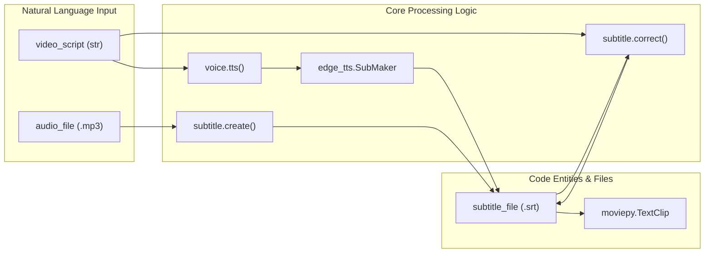
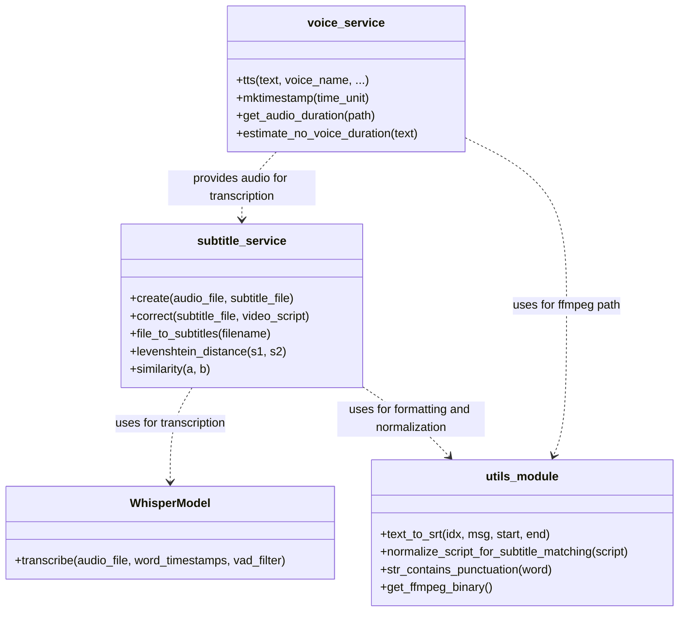

<!-- source: DeepWiki mcp.deepwiki.com · repo harry0703/MoneyPrinterTurbo · page 5.6 Subtitle Generation · fetched 2026-10-30 -->

# Subtitle Generation

Relevant source files

The following files were used as context for generating this wiki page:

- [app/services/subtitle.py](app/services/subtitle.py)
- [app/services/voice.py](app/services/voice.py)
- [app/utils/utils.py](app/utils/utils.py)
- [test/services/test_subtitle.py](test/services/test_subtitle.py)
- [test/services/test_subtitle_background_settings.py](test/services/test_subtitle_background_settings.py)
- [test/services/test_voice.py](test/services/test_voice.py)
- [test/services/test_webui_tts_settings.py](test/services/test_webui_tts_settings.py)

## Purpose and Overview

The subtitle generation system in MoneyPrinterTurbo is responsible for transforming spoken audio into accurately timed text overlays. It utilizes a multi-stage pipeline involving **Faster Whisper** for transcription, **edge-tts** for word-boundary synchronization, and a custom **correction algorithm** to align transcriptions with original scripts. The system ensures that subtitles are not only accurate but also formatted and positioned correctly within the final video frame.

Sources: [app/services/subtitle.py:6-26](), [app/services/voice.py:22-29]()

## Subtitle Generation Data Flow

The system bridges "Natural Language Space" (scripts and audio) to "Code Entity Space" (SRT files and MoviePy objects) through the following data flow:

Sources: [app/services/voice.py:117-122](), [app/services/subtitle.py:22-62](), [app/services/subtitle.py:202-211]()

## Transcription and Synchronization Methods

MoneyPrinterTurbo employs several methods for generating subtitle timing, depending on the TTS provider used or whether a fallback transcription is required.

### 1. Edge-TTS and SubMaker Synchronization
When using `edge-tts`, the system leverages the `SubMaker` object to capture real-time word boundaries directly from the speech synthesis engine.
- **Implementation**: The `voice.tts` function utilizes `edge_tts.SubMaker` to align text with audio chunks [app/services/voice.py:22-25]().
- **Timestamp Conversion**: The `mktimestamp` function converts the 100-nanosecond units used by `edge_tts` into standard SRT timestamps (`HH:MM:SS.mmm`) [app/services/voice.py:88-99]().

### 2. Faster Whisper Transcription
For providers that do not provide word-level timing (like some OpenAI-compatible TTS) or for local audio files, the system uses `faster-whisper`.
- **Model Configuration**: Configurable via `config.toml`, defaulting to `large-v3` on `cpu` with `int8` quantization [app/services/subtitle.py:15-18]().
- **Transcription Logic**: The `create` function initializes the `WhisperModel`, sets `word_timestamps=True`, and uses a Voice Activity Detection (VAD) filter to ignore silence [app/services/subtitle.py:55-62]().
- **Segment Grouping**: The `recognized` helper function groups transcribed words into sentences based on punctuation detected via `utils.str_contains_punctuation` [app/services/subtitle.py:71-118]().

### 3. No-Voice Duration Estimation
When "no-voice" is selected, the system generates silent audio and estimates subtitle duration based on character count to ensure the text remains on screen long enough to be read [test/services/test_voice.py:98-130]().
- **Multilingual Support**: The estimation logic covers non-ASCII languages (Russian, Arabic, etc.) to ensure adequate reading time for diverse scripts [test/services/test_voice.py:158-169]().

Sources: [app/services/subtitle.py:15-122](), [app/services/voice.py:88-122](), [test/services/test_voice.py:98-169]()

## Subtitle Correction and Alignment

The `subtitle.correct` function is a critical algorithm that aligns the generated SRT with the original script to fix transcription hallucinations or minor errors.

### Alignment Algorithm
1. **Normalization**: The script is cleaned using `utils.normalize_script_for_subtitle_matching` to remove Markdown separators (like `---`) and spoken-only artifacts [app/services/subtitle.py:204-205]().
2. **Similarity Scoring**: The system uses `levenshtein_distance` and a `similarity` ratio to compare transcribed segments against script lines [app/services/subtitle.py:176-199]().
3. **Fuzzy Matching**: If a subtitle line doesn't match the script exactly, the algorithm attempts to merge adjacent subtitle blocks if they collectively match a single script sentence [test/services/test_subtitle.py:117-137]().
4. **SRT Integrity**: The `file_to_subtitles` function includes a flush mechanism to ensure the final subtitle block is parsed even if the file lacks a trailing newline [app/services/subtitle.py:147-173]().

Sources: [app/services/subtitle.py:147-205](), [test/services/test_subtitle.py:117-178]()

## Visual Styling and Rendering

Subtitles are rendered using `moviepy.video.tools.subtitles`. The system supports advanced styling through `VideoParams`.

### Subtitle Background and Color
The system can render a colored background behind text to improve readability.
- **Background Logic**: Controlled by `text_background_color`. If enabled, the system calculates the visible bounds of the text mask to center the text accurately within the background block [test/services/test_subtitle_background_settings.py:12-62]().
- **Color Validation**: The `subtitle_colors_are_indistinguishable` function prevents users from setting foreground and background colors that are too similar [test/services/test_subtitle_background_settings.py:90-122]().
- **Positioning**: The `_get_visible_center_position` helper adjusts the Y-coordinate based on the actual visible pixel mask rather than the font's baseline to ensure visual centering [test/services/test_subtitle_background_settings.py:63-88]().

### Font and Text Wrapping
- **Glyph Support**: The system validates if a chosen font supports the script's characters (e.g., checking for Chinese glyphs in a Latin font) [test/services/test_subtitle_background_settings.py:123-143]().
- **Smart Wrapping**: The `wrap_text` function ensures that closing punctuation marks (like `。`) are not left hanging on a new line [test/services/test_subtitle_background_settings.py:144-164]().

Sources: [test/services/test_subtitle_background_settings.py:12-164](), [app/models/schema.py:7-18]()

## Technical Class Structure

The following diagram maps the service classes to their specific responsibilities in the subtitle lifecycle:

Sources: [app/services/subtitle.py:22-199](), [app/services/voice.py:88-169](), [app/utils/utils.py:146-180]()

## Performance and Hardware Requirements

- **Whisper Acceleration**: The system utilizes `faster-whisper`, which supports `cpu`, `cuda`, and various `compute_type` settings (e.g., `int8`, `float16`) to balance speed and VRAM usage [app/services/subtitle.py:15-18]().
- **Dependency Management**: `WhisperModel` is imported optionally; if `faster_whisper` is not installed, the system logs a warning and skips transcription [app/services/subtitle.py:6-10]().
- **FFmpeg Integration**: Audio duration and processing rely on `moviepy` and the configured FFmpeg binary path resolved via `utils.get_ffmpeg_binary()` [app/utils/utils.py:146-180]().

Sources: [app/services/subtitle.py:6-18](), [app/utils/utils.py:146-180]()

---

