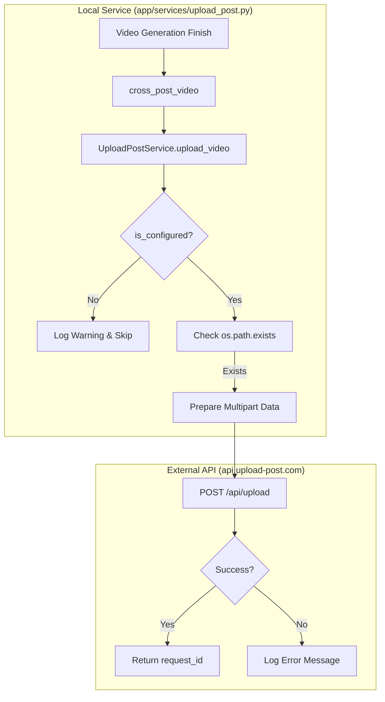
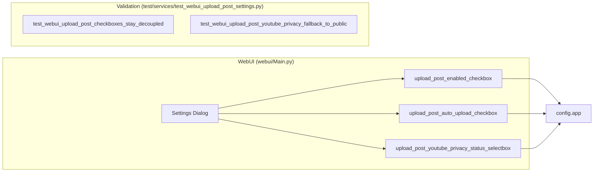

<!-- source: DeepWiki mcp.deepwiki.com · repo harry0703/MoneyPrinterTurbo · page 5.7 Social Media Distribution · fetched 2026-10-30 -->

# Social Media Distribution

Relevant source files

The following files were used as context for generating this wiki page:

- [app/services/llm.py](app/services/llm.py)
- [app/services/upload_post.py](app/services/upload_post.py)
- [test/services/test_llm.py](test/services/test_llm.py)
- [test/services/test_upload_post.py](test/services/test_upload_post.py)
- [test/services/test_webui_upload_post_settings.py](test/services/test_webui_upload_post_settings.py)

MoneyPrinterTurbo provides an integrated distribution mechanism for automatically cross-posting generated videos to social media platforms, including TikTok, Instagram, and YouTube Shorts. This functionality is powered by the **Upload-Post API**, allowing users to bridge the gap between video generation and content delivery within a single workflow.

## Overview

The distribution system is encapsulated within the `UploadPostService`, which handles authentication, file transmission, and status tracking for remote uploads. The integration supports multi-platform posting with customizable privacy levels and platform-specific metadata.

### Key Features
- **Cross-Platform Support**: Simultaneous posting to TikTok, Instagram, and YouTube Shorts [app/services/upload_post.py:2-5]().
- **Automatic Workflow**: Configurable auto-upload triggered upon completion of video generation [app/services/upload_post.py:34-35]().
- **YouTube Shorts Metadata**: Support for YouTube-specific fields like titles, descriptions, tags, and synthetic media labels [app/services/upload_post.py:78-87]().
- **Status Tracking**: Ability to poll for the status of asynchronous upload requests [app/services/upload_post.py:112-139]().

## Configuration

Distribution settings are managed in the `[app]` section of the configuration. The service requires an API key and a registered username from the Upload-Post service.

| Parameter | Description |
| :--- | :--- |
| `upload_post_enabled` | Boolean to enable/disable the service integration [app/services/upload_post.py:26-27](). |
| `upload_post_api_key` | API Key obtained from [Upload-Post](https://docs.upload-post.com) [app/services/upload_post.py:18-19](). |
| `upload_post_username` | Your registered username on the platform [app/services/upload_post.py:22-23](). |
| `upload_post_platforms` | List of target platforms, e.g., `["tiktok", "instagram"]` [app/services/upload_post.py:30-31](). |
| `upload_post_auto_upload` | If true, videos are sent to distribution immediately after generation [app/services/upload_post.py:34-35](). |
| `upload_post_youtube_privacy_status` | Default privacy for YouTube Shorts (`public`, `private`, `unlisted`) [app/services/upload_post.py:38-39](). |

**Sources:** [app/services/upload_post.py:14-42]()

## Implementation Detail

### Data Flow: Generation to Distribution

The distribution logic follows a linear path from the local file system to the Upload-Post API gateway. The system validates configuration and file existence before initiating a multipart form-data transfer.

"Social Media Distribution Flow"

**Sources:** [app/services/upload_post.py:41-106](), [app/services/upload_post.py:146-152]()

### Class: UploadPostService

The `UploadPostService` class in `app/services/upload_post.py` is the primary interface for distribution. It is implemented as a singleton instance `upload_post_service` [app/services/upload_post.py:143]().

#### Core Methods

1.  **`is_configured()`**: Validates that `api_key`, `username`, and `enabled` flag are all present in the configuration [app/services/upload_post.py:41-42]().
2.  **`upload_video(...)`**: 
    - Reads the video file from disk as a binary stream [app/services/upload_post.py:66-67]().
    - Constructs a multipart form-data request containing the video file, username, and title (truncated to 2200 characters for platform compatibility) [app/services/upload_post.py:69-76]().
    - **YouTube Integration**: If `youtube` is in the platform list, it appends `youtube_title` (max 100 chars), `youtube_description`, `tags[]`, and sets `containsSyntheticMedia` to `"true"` [app/services/upload_post.py:78-86]().
    - Sends a `POST` request to `https://api.upload-post.com/api/upload` with an `Authorization: Apikey ...` header and a 300-second timeout [app/services/upload_post.py:88-96]().
3.  **`check_status(request_id)`**: Performs a `GET` request to `https://api.upload-post.com/api/uploadposts/status` to retrieve the processing state [app/services/upload_post.py:112-139]().

**Sources:** [app/services/upload_post.py:14-143]()

## WebUI Integration and Validation

The WebUI includes a settings dialog to manage distribution. It ensures that critical links to the Upload-Post dashboard are provided to help users locate their API keys and usernames [test/services/test_webui_upload_post_settings.py:19-35]().

### Configuration Safety
- **Decoupled Settings**: The `enabled` and `auto_upload` flags are independent; a user can enable the service for manual API calls while keeping automatic posting disabled [test/services/test_webui_upload_post_settings.py:37-71]().
- **Privacy Fallbacks**: If an invalid YouTube privacy status is provided in the configuration, the UI defaults to `public` to prevent rendering crashes [test/services/test_webui_upload_post_settings.py:72-92]().

"WebUI Configuration Logic"

**Sources:** [test/services/test_webui_upload_post_settings.py:37-92]()

## Error Handling

- **File Validation**: The service checks `os.path.exists(video_path)` before attempting an upload to avoid unnecessary network calls [app/services/upload_post.py:59-61]().
- **Network Resilience**: `UploadPostService` catches `requests.exceptions.RequestException` to ensure network failures during upload do not crash the calling process [app/services/upload_post.py:108-110]().
- **Title Truncation**: General titles are truncated to 2200 characters [app/services/upload_post.py:71](), while YouTube titles are restricted to 100 characters [app/services/upload_post.py:80]().
- **Synthetic Media Disclosure**: For YouTube uploads, the `containsSyntheticMedia` flag is explicitly set to `"true"` as the content is AI-generated [app/services/upload_post.py:86]().

**Sources:** [app/services/upload_post.py:59-110](), [test/services/test_upload_post.py:51-82]()

---

