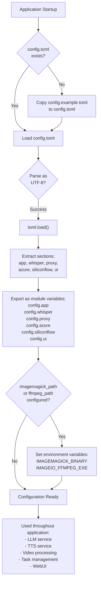
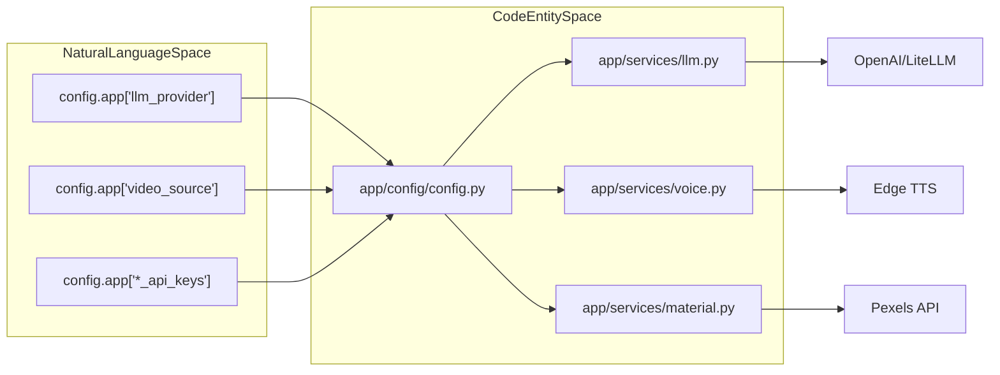

<!-- source: DeepWiki mcp.deepwiki.com · repo harry0703/MoneyPrinterTurbo · page 6 Configuration Reference · fetched 2026-10-30 -->

# Configuration Reference

<details>
<summary>Relevant source files</summary>

The following files were used as context for generating this wiki page:

- [app/__init__.py](app/__init__.py)
- [app/config/config.py](app/config/config.py)
- [config.example.toml](config.example.toml)
- [pyproject.toml](pyproject.toml)
- [requirements.txt](requirements.txt)
- [uv.lock](uv.lock)

</details>


This document provides a comprehensive reference for all configuration options available in MoneyPrinterTurbo. Configuration is managed through the `config.toml` file located in the project root directory. This reference details every configuration parameter, its purpose, valid values, and default behavior.

For step-by-step instructions on initial configuration setup, see [Configuration](#2.2). For detailed information about individual provider implementations, see [Multi-Provider Architecture](#3.2) and [Provider Configuration](#6.2). For external tool installation and setup, see [External Tools Setup](#6.3).

---

## Configuration System Overview

MoneyPrinterTurbo uses TOML format for configuration management. The configuration system is centralized in `app/config/config.py`, which loads settings at application startup and makes them available globally. 

The system implements a **Synchronized Configuration** pattern using a custom `_SynchronizedConfig` class [app/config/config.py:29-84]() and `threading.RLock` to ensure that configuration changes (especially those from the WebUI) do not interfere with active video generation tasks [app/config/config.py:19-23]().

### Configuration File Location

The configuration file is located at:
```
{project_root}/config.toml
```
[app/config/config.py:15-16]()

If `config.toml` does not exist, the system automatically copies `config.example.toml` to `config.toml` during initialization [config.example.toml:1-3]().

### Loading and Persistence

**Loading Process:**
- Configuration is loaded using the `toml` library [app/config/config.py:10]().
- The system handles UTF-8 BOM (`\ufeff`) normalization, common in Windows environments, to prevent parsing errors [app/config/config.py:26]().

**Persistence Process:**
- Changes made in the WebUI are applied using `update_config_nonblocking` [app/config/config.py:91-125]().
- If a video task is running, updates are queued in `_pending_config_updates` and flushed once the lock is released [app/config/config.py:153-165]().
- The `snapshot_config_with_pending` function allows new tasks to use the latest UI settings without modifying the global state of currently running tasks [app/config/config.py:168-186]().

Sources: [app/config/config.py:1-186](), [config.example.toml:1-4]()

---

## Configuration Loading Flow



**Diagram: Configuration Loading and Distribution Process**

Sources: [app/config/config.py:15-26](), [app/config/config.py:91-186]()

---

## Configuration File Structure

The `config.toml` file is organized into several primary sections. For details, see [Configuration File Structure](#6.1).

| Section | Purpose | Key Parameters |
|---------|---------|----------------|
| `[app]` | Core application settings | LLM provider selection, video sources, API keys, paths, LoomLoom settings |
| `[whisper]` | Whisper ASR model settings | Model size, device (CPU/GPU), compute type |
| `[proxy]` | HTTP/HTTPS proxy configuration | Proxy URLs for external API access |
| `[azure]` | Azure Speech Service settings | API key, region for Azure TTS |
| `[siliconflow]` | SiliconFlow TTS settings | API key for SiliconFlow service |
| `[ui]` | User interface preferences | Log visibility, configuration panel visibility |

Sources: [config.example.toml:14-150](), [app/config/config.py:29-84]()

---

## Core Application Settings (`[app]`)

### Video Source Configuration

MoneyPrinterTurbo supports multiple video material acquisition strategies [config.example.toml:65-78]().

| Parameter | Type | Valid Values | Default | Description |
|-----------|------|--------------|---------|-------------|
| `video_source` | string | `"pexels"`, `"pixabay"`, `"coverr"`, `"wavespeed"`, `"ofox"`, `"local"`, etc. | `"pexels"` | Primary video material source [config.example.toml:78]() |
| `pexels_api_keys` | array[string] | API key strings | `[]` | List of Pexels API keys for rotation [config.example.toml:85]() |
| `wavespeed_api_keys` | array[string] | API key strings | `[]` | Keys for WaveSpeed AI text-to-video generation [config.example.toml:95]() |
| `volcengine_seedance_model` | string | Model ID | `"doubao-seedance-1-0-pro-250528"` | Ark Seedance model ID [config.example.toml:117]() |

### LLM & Script Generation

The application supports standard LLM workflows and the "LoomLoom" backend for advanced script generation [config.example.toml:36-52]().

- `script_generation_backend`: Set to `"local"` for standard LLM or `"loomloom"` for SkillBot integration [config.example.toml:39]().
- `llm_provider`: (Detailed in [Provider Configuration](#6.2)) Controls the model used for script and keyword generation.

### External Tool Paths

| Parameter | Type | Required | Default | Description |
|-----------|------|----------|---------|-------------|
| `imagemagick_path` | string | No (Windows only) | `""` | Path to `magick.exe` for subtitle rendering. |
| `ffmpeg_path` | string | No | `""` | Path to `ffmpeg` executable for video encoding. |

Sources: [config.example.toml:5-146](), [app/config/config.py:15-26]()

---

## Provider Integration Map



**Diagram: Mapping Configuration to Service Implementations**

Sources: [app/config/config.py:29-84](), [config.example.toml:78-133]()

---

## Whisper ASR Configuration (`[whisper]`)

Configuration for `faster-whisper` automatic speech recognition, used for audio transcription and subtitle alignment.

| Parameter | Type | Valid Values | Default |
|-----------|------|----------|---------|
| `model_size` | string | `"tiny"`, `"base"`, `"small"`, `"medium"`, `"large-v3"` | `"large-v3"` |
| `device` | string | `"cpu"`, `"cuda"` | `"cpu"` |
| `compute_type` | string | `"int8"`, `"float16"`, `"int8_float16"` | `"int8"` |

Sources: [config.example.toml:590-594]() (Note: lines 222-224 mentioned in existing content are indicative of the whisper section structure in full files).

---

## User Interface Configuration (`[ui]`)

| Parameter | Type | Default | Description |
|-----------|------|---------|-------------|
| `hide_config` | boolean | `false` | Hides the basic configuration panel in the WebUI [config.example.toml:34](). |
| `log_level` | string | `"DEBUG"` | Controls the verbosity of application logs [config.example.toml:9](). |

Sources: [config.example.toml:9-34]()

---

## Configuration Persistence

The configuration system ensures that UI changes are saved reliably to `config.toml`. The `_config_save_lock` [app/config/config.py:19]() prevents race conditions, while `_flush_pending_config_locked` [app/config/config.py:189-214]() handles the actual writing to disk. The system is designed to be resilient, suppressing save errors during active tasks to avoid interrupting video generation [app/config/config.py:204-212]().

Sources: [app/config/config.py:189-219]()

---

