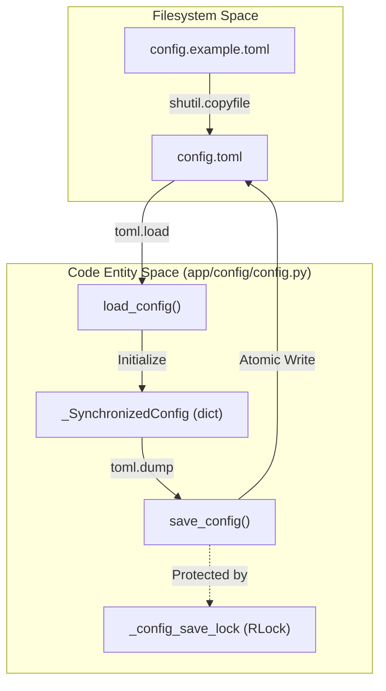
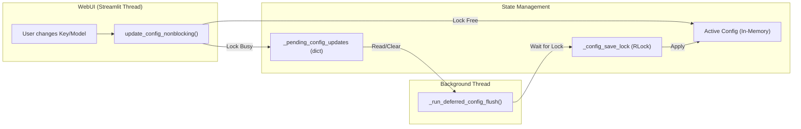

<!-- source: DeepWiki mcp.deepwiki.com · repo harry0703/MoneyPrinterTurbo · page 6.1 Configuration File Structure · fetched 2026-10-30 -->

# Configuration File Structure

Relevant source files

The following files were used as context for generating this wiki page:

- [app/__init__.py](app/__init__.py)
- [app/config/config.py](app/config/config.py)
- [config.example.toml](config.example.toml)
- [pyproject.toml](pyproject.toml)
- [requirements.txt](requirements.txt)
- [test/services/test_config.py](test/services/test_config.py)
- [uv.lock](uv.lock)

This page documents the structure and organization of `config.toml`, the central configuration file for MoneyPrinterTurbo. It covers the TOML sections, configuration loading/saving mechanisms, and the concurrency-safe update logic used by the WebUI.

## Configuration File Organization

MoneyPrinterTurbo uses the TOML (Tom's Obvious, Minimal Language) format for configuration. The file is located at the repository root as `config.toml`. On the first execution, if this file is missing, the system automatically copies `config.example.toml` to create it [app/config/config.py:16-16](), [app/config/config.py:249-253]().

The configuration is organized into the following primary sections:

| Section | Purpose | Key Settings |
|---------|---------|--------------|
| `[app]` | Core application settings | Provider selections, API keys, Video Sources, LLM configs, Social Media distribution |
| `[whisper]` | Whisper ASR configuration | Model size, device (CPU/GPU), compute type [config.example.toml:558-563]() |
| `[proxy]` | HTTP/HTTPS proxy settings | Proxy URLs for external API access [config.example.toml:545-551]() |
| `[azure]` | Azure Speech API credentials | Speech key and region [config.example.toml:572-575]() |
| `[siliconflow]` | SiliconFlow TTS credentials | API key [config.example.toml:582-583]() |
| `[ui]` | Web interface preferences | `hide_config` and visibility settings [config.example.toml:34-34]() |

**Configuration File Data Flow**

Sources: [app/config/config.py:16-41](), [app/config/config.py:249-258](), [config.example.toml:1-12]()

## [app] Section

The `[app]` section is the primary configuration block, containing logic for video materials, LLM providers, and external services.

### Material and Script Settings
- `video_source`: Defines where video materials are fetched. Values include `pexels`, `pixabay`, `coverr`, `wavespeed`, `volcengine_seedance`, `ofox`, `metaso_minimax`, `loomloom`, `openai_image`, or `local` [config.example.toml:65-78]().
- `script_generation_backend`: Set to `local` for standard LLM workflow or `loomloom` for market-based script candidates [config.example.toml:36-39]().
- `edge_tts_timeout`: Timeout in seconds for Edge TTS streaming requests [config.example.toml:53-55]().

### Video Material Providers
The system supports advanced text-to-video generation via specific providers:
- **Volcengine Seedance**: Configured via `volcengine_seedance_api_key`, `volcengine_seedance_model`, and resolution settings [config.example.toml:113-118]().
- **OFox**: Multi-model video API supporting Seedance and Wan models [config.example.toml:130-133]().
- **WaveSpeed**: AI text-to-video model generation [config.example.toml:93-95]().

### LLM Provider Registry
The system supports 13+ LLM providers. Provider definitions and defaults (models, base URLs) are maintained in the `LLM_PROVIDER_REGISTRY` [test/services/test_config.py:12-12](). Key overrides in `config.toml` include:
- `llm_provider`: Global selection (e.g., `moonshot`, `openai`, `deepseek`).
- Provider-specific keys: `{provider}_api_key`, `{provider}_base_url`, and `{provider}_model_name` [test/services/test_config.py:72-80]().

### Social Media Distribution
The `[app]` section contains settings for the `Upload-Post` integration, including `upload_post_enabled`, `upload_post_api_key`, and `upload_post_platforms` [test/services/test_config.py:126-134]().

Sources: [config.example.toml:65-143](), [test/services/test_config.py:68-80](), [test/services/test_config.py:123-138]()

## Configuration Loading Process

The `load_config()` function manages environment-specific pathing and provides robustness against encoding issues.

### Logic Flow
1. **BOM Handling**: The loader strips UTF-8 BOM markers (`\ufeff`) if present to ensure compatibility with `toml.load` [app/config/config.py:26](), [test/services/test_config.py:82-93]().
2. **Container Detection**: Detects if the process is inside a container (Docker/Podman) by checking markers like `docker` or `kubepods` [app/config/config.py:17-18]().
3. **Global Proxies**: Exposes configuration sub-sections as global variables (e.g., `app`, `whisper`) after loading [app/config/config.py:168-170]().

Sources: [app/config/config.py:17-26](), [test/services/test_config.py:82-93]()

## Concurrency and WebUI Updates

Because MoneyPrinterTurbo supports long-running video generation tasks, it implements a non-blocking configuration update mechanism.

### The `_SynchronizedConfig` Class
This class wraps a standard dictionary with `_config_save_lock`. It ensures that if a value is unchanged, the write is skipped, allowing Streamlit reruns to proceed without waiting for long task locks [app/config/config.py:29-41]().

### Non-blocking Updates
When a user changes a setting in the WebUI while a task is running:
1. `update_config_nonblocking()` is called [app/config/config.py:91]().
2. If the `_config_save_lock` is busy, the update is added to `_pending_config_updates` [app/config/config.py:105-110]().
3. A background thread (`_run_deferred_config_flush`) is scheduled to apply these changes once the lock is released [app/config/config.py:117](), [app/config/config.py:215-219]().
4. `snapshot_config_with_pending()` allows new tasks to start with the "intended" configuration (including pending changes) without modifying the config of currently running tasks [app/config/config.py:168-186]().

**UI Configuration Update Mechanism**

Sources: [app/config/config.py:29-83](), [app/config/config.py:91-125](), [app/config/config.py:168-186](), [app/config/config.py:215-219]()

## Persistence (Saving)

The `save_config()` function implements an atomic write strategy to prevent file corruption.

1. **Atomic Write**: It writes the TOML data to a temporary file and then uses `os.replace` to overwrite `config.toml` [test/services/test_config.py:139-158]().
2. **Docker Fallback**: If the file is a bind-mount (common in Docker) and `os.replace` fails with `EBUSY`, the system falls back to a standard file write with `truncate(0)` to maintain the same inode [test/services/test_config.py:165-165]().

Sources: [app/config/config.py:189-212](), [test/services/test_config.py:139-165]()

---

