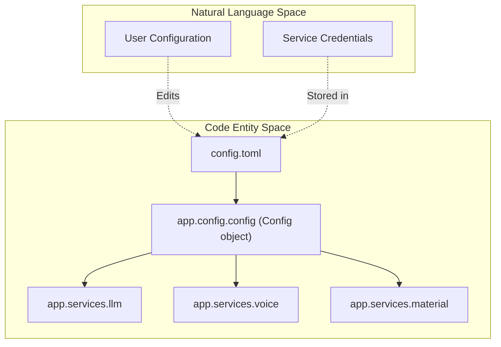
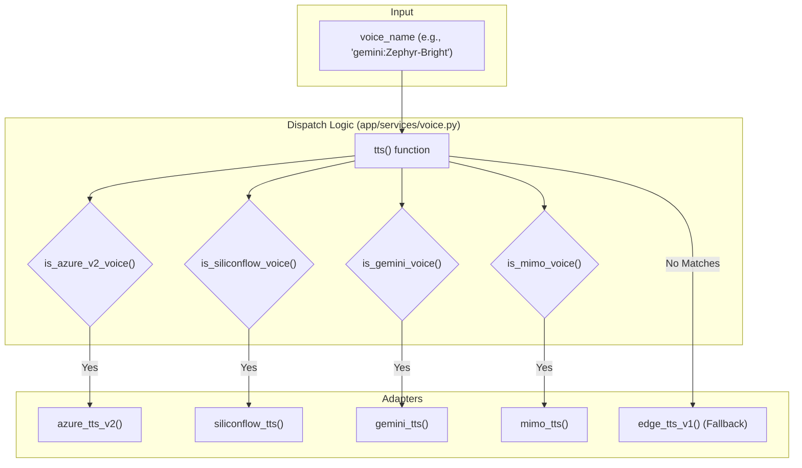

<!-- source: DeepWiki mcp.deepwiki.com · repo harry0703/MoneyPrinterTurbo · page 6.2 Provider Configuration · fetched 2026-10-30 -->

# Provider Configuration

<details>
<summary>Relevant source files</summary>

The following files were used as context for generating this wiki page:

- [app/models/llm_provider.py](app/models/llm_provider.py)
- [app/services/llm.py](app/services/llm.py)
- [config.example.toml](config.example.toml)
- [docs/MoneyPrinterTurbo.ipynb](docs/MoneyPrinterTurbo.ipynb)
- [test/services/test_llm.py](test/services/test_llm.py)
- [test/services/test_webui_i18n.py](test/services/test_webui_i18n.py)

</details>


This page provides a comprehensive reference for configuring the various external service providers used by MoneyPrinterTurbo. The system supports multiple providers for each service type, allowing users to choose based on availability, cost, quality, and regional access.

---

## Configuration File Overview

MoneyPrinterTurbo uses a centralized TOML configuration file located at `config.toml`. On first run, the application copies `config.example.toml` to `config.toml` [config.example.toml:1-3]().

### Configuration Structure and Data Flow

The configuration is managed by the `Config` class, which loads values from the TOML file and environment variables. These settings are then consumed by specialized service modules.

**Data Flow: Configuration to Service Logic**

Sources: [config.example.toml:1-13](), [app/services/llm.py:11-12](), [app/models/llm_provider.py:80-82]()

---

## LLM Provider Configuration

MoneyPrinterTurbo supports **13+ LLM providers** for script generation and keyword extraction. The primary selector is `llm_provider` in the `[app]` section [app/services/llm.py:148-150]().

### LLM Registry and Metadata
The system uses a centralized registry to define provider capabilities, default models, and required fields.

| Class/Entity | Role | Source |
|:---|:---|:---|
| `LLMProviderSpec` | Data class defining provider metadata (adapter, default model, base URL) | [app/models/llm_provider.py:30-56]() |
| `LLMProviderField` | Defines extra config fields like `account_id` for Cloudflare | [app/models/llm_provider.py:8-16]() |
| `LLMProviderEndpoint` | Describes regional API endpoints (e.g., China vs Global) | [app/models/llm_provider.py:19-27]() |
| `LLM_PROVIDER_REGISTRY` | The source of truth for all supported LLM providers | [app/models/llm_provider.py:187-200]() |

### Provider Setup Examples

#### Kimi / Moonshot AI (Default)
```toml
llm_provider = "moonshot"
moonshot_api_key = "sk-..."
moonshot_base_url = "https://api.moonshot.cn/v1"
moonshot_model_name = "kimi-k3"
```
Sources: [app/models/llm_provider.py:4-5](), [app/models/llm_provider.py:189-200]()

#### Reasoning Model Handling
The `llm.py` service includes logic to strip reasoning tokens (like ``) from models like DeepSeek R1 or MiniMax M3 before the script is passed to TTS [app/services/llm.py:19-20](), [app/services/llm.py:59-69]().

---

## TTS Provider Configuration

The system supports 4+ primary TTS backends. Selection is determined by the `voice_name` prefix or the `tts_server` parameter.

### Voice Synthesis Dispatching
The `tts()` function in `app/services/voice.py` acts as the central dispatcher, identifying the provider from the voice string format.

**Logic Flow: TTS Provider Selection**

Sources: [app/services/voice.py:205-255]()

### Provider Details

| Provider | Config Key | Implementation Detail | Source |
|:---|:---|:---|:---|
| **Edge TTS** | `edge_tts_timeout` | Default fallback; supports 30s timeout | [config.example.toml:53-55]() |
| **SiliconFlow** | `siliconflow_api_key` | Uses `FunAudioLLM/CosyVoice2-0.5B` | [app/services/voice.py:110-120]() |
| **Gemini TTS** | `gemini_api_key` | Supports stylistic voice names | [app/services/voice.py:42-73]() |
| **VolcEngine** | `volcengine_api_key` | Volcano Engine (ByteDance) TTS | [app/services/voice.py:230-235]() |

---

## Video Material Configuration

Materials are sourced based on the `video_source` setting [config.example.toml:78]().

### API Key Rotation
For stock footage providers (Pexels, Pixabay, Coverr), the system supports lists for key rotation to circumvent rate limits.
```toml
pexels_api_keys = ["key-1", "key-2"]
pixabay_api_keys = ["key-a", "key-b"]
```
Sources: [config.example.toml:80-91]()

### AI Video Generation Sources
MoneyPrinterTurbo can generate brand-new clips instead of searching stock footage:
*   **WaveSpeed AI**: `video_source = "wavespeed"` [config.example.toml:93-95]()
*   **Volcano Engine Seedance**: `video_source = "volcengine_seedance"`. Configures resolution (e.g., `1080p`) and duration (2-12s) [config.example.toml:113-123]().
*   **OFox**: `video_source = "ofox"`. Supports models like `bytedance/seedance-2.0-fast` [config.example.toml:125-143]().

---

## External Tools Setup

MoneyPrinterTurbo relies on system-level binaries for heavy processing.

| Tool | Config Path Key | Purpose |
|:---|:---|:---|
| **FFmpeg** | `ffmpeg_path` | Audio/Video encoding and duration probing |
| **ImageMagick** | `imagemagick_path` | Subtitle rendering via MoviePy |

The `utils.get_ffmpeg_binary()` function is used to resolve the path for `pydub` and `moviepy` integrations [app/services/voice.py:83-85]().

Sources: [app/services/voice.py:82-85](), [test/services/test_voice.py:111-115]()

---

