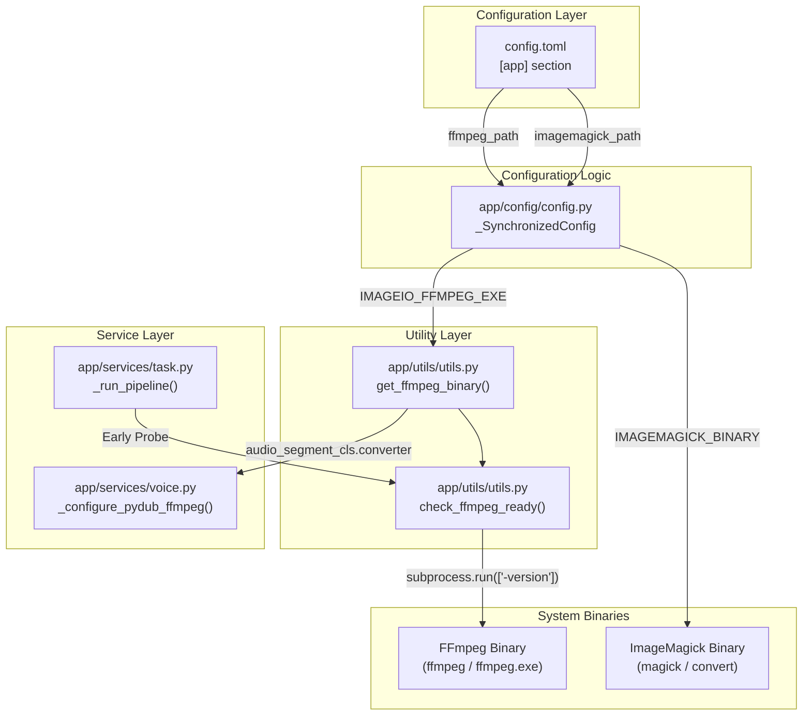

<!-- source: DeepWiki mcp.deepwiki.com · repo harry0703/MoneyPrinterTurbo · page 6.3 External Tools Setup · fetched 2026-10-30 -->

# External Tools Setup

<details>
<summary>Relevant source files</summary>

The following files were used as context for generating this wiki page:

- [app/__init__.py](app/__init__.py)
- [app/config/config.py](app/config/config.py)
- [app/services/voice.py](app/services/voice.py)
- [app/utils/utils.py](app/utils/utils.py)
- [config.example.toml](config.example.toml)
- [pyproject.toml](pyproject.toml)
- [requirements.txt](requirements.txt)
- [test/services/test_voice.py](test/services/test_voice.py)
- [test/services/test_webui_tts_settings.py](test/services/test_webui_tts_settings.py)
- [uv.lock](uv.lock)

</details>


This page documents the configuration and installation of external system tools required by MoneyPrinterTurbo. These tools are native binaries that the system executes as subprocesses during video generation.

For general application configuration, see [6.1 Configuration File Structure](). For provider-specific settings (LLM, TTS, video sources), see [6.2 Provider Configuration]().

## Overview

MoneyPrinterTurbo depends on two external command-line tools that must be installed on the host system. While the Python environment manages libraries like `moviepy` and `fastapi`, the heavy lifting of media processing is delegated to native binaries.

| Tool | Purpose | Primary Code Consumer | Required |
|------|---------|---------|----------|
| **ImageMagick** | Subtitle rendering and text overlay compositing | `moviepy.video.TextClip` | Yes |
| **FFmpeg** | Video encoding, decoding, audio extraction, and format conversion | `moviepy`, `pydub`, `edge_tts` | Yes |

These tools are not Python packages and must be installed separately. The system locates them via centralized utility functions or environment variables injected during configuration loading.

**Sources:** [app/utils/utils.py:146-180](), [pyproject.toml:15-37]()

## Tool Integration Architecture

The following diagram illustrates how configuration values from `config.toml` flow into the application logic and eventually to the system binaries.

**Figure 1: External Tool Resolution and Data Flow**


**Sources:** [app/utils/utils.py:146-180](), [app/utils/utils.py:189-225](), [app/services/voice.py:82-86](), [app/config/config.py:29-41]()

## ImageMagick Configuration

### Purpose
ImageMagick is used by the `moviepy` library's `TextClip` class to render text overlays (subtitles) onto video frames. The system requires ImageMagick's static library version to avoid runtime DLL dependencies on Windows.

### Installation by Platform

#### Windows
1. **Download:** ImageMagick-7.x.x-Q16-x64-**static**.exe from the official site.
2. **Critical:** You must select the **static** library version to ensure all dependencies are bundled.
3. **Configure:** Edit `config.toml` to point to the `magick.exe` location.

#### macOS / Linux
Install via system package managers. `moviepy` typically detects these automatically if they are in the system PATH.
```bash
# macOS
brew install imagemagick

# Ubuntu/Debian
sudo apt-get install imagemagick
```

**Sources:** [config.example.toml:1-10]() (General config usage), [app/config/config.py:15-26]()

## FFmpeg Configuration

### Purpose
FFmpeg is the backbone of the media pipeline. It is used for:
- **Audio Generation:** `edge_tts` and `pydub` use it for stream conversion [app/services/voice.py:82-86]().
- **Video Assembly:** `moviepy` uses it for concatenating clips and encoding the final MP4.
- **Duration Probing:** `app.services.voice.get_audio_duration` uses `AudioFileClip` (which wraps FFmpeg) to determine timing for non-MP3 files [app/services/voice.py:131-143]().

### Centralized Resolution Logic
The function `get_ffmpeg_binary()` in `app/utils/utils.py` implements a 4-tier priority system to locate the FFmpeg executable:

1. **Explicit Environment Variable:** Checks `IMAGEIO_FFMPEG_EXE` (often set via `config.toml` or system env).
2. **System PATH:** Uses `shutil.which("ffmpeg")` to find a globally installed version.
3. **Bundled Binary:** Attempts to use the binary provided by the `imageio-ffmpeg` package.
4. **Fallback:** Returns the string `"ffmpeg"`, letting the operating system attempt execution.

**Sources:** [app/utils/utils.py:146-180]()

### Readiness Probing
To prevent tasks from failing midway through a 10-minute generation process, the system performs an early probe via `check_ffmpeg_ready()`. This function executes `ffmpeg -version` with a 10-second timeout to verify the binary is functional.

**Sources:** [app/utils/utils.py:189-225]()

## Code Entity Mapping

The following diagram maps natural language requirements to specific code entities and environment variables used for tool discovery.

**Figure 2: Tool Discovery Mapping**
| System Requirement | Code Entity / Variable | Logic Location |
|:---:|:---:|:---:|
| FFmpeg Path | `IMAGEIO_FFMPEG_EXE` | [app/utils/utils.py:162]() |
| ImageMagick Path | `IMAGEMAGICK_BINARY` | `os.environ` injection |
| Audio Conversion | `pydub.AudioSegment.converter` | [app/services/voice.py:85]() |
| Binary Validation | `check_ffmpeg_ready` | [app/utils/utils.py:189]() |
| Bundled Fallback | `imageio_ffmpeg.get_ffmpeg_exe()` | [app/utils/utils.py:173]() |

**Sources:** [app/utils/utils.py:146-225](), [app/services/voice.py:82-86]()

## Network and Security (TLS)

External tools often interact with remote resources (e.g., downloading video materials or calling TTS APIs). The system provides a global `tls_verify` setting.

- **Configuration:** `tls_verify = true` in `config.toml` [config.example.toml:59]().
- **Usage:** This setting is respected during material downloads and external API requests to prevent Man-in-the-Middle (MITM) attacks.

**Sources:** [config.example.toml:57-59]()

## Platform-Specific Considerations

### Windows
- **Path Separators:** Use double backslashes (`\\`) in `config.toml` paths (e.g., `"C:\\Tools\\ffmpeg.exe"`) to ensure proper TOML parsing.
- **One-Click Package:** The Windows one-click version typically bundles these tools, setting the environment variables automatically.

### Docker
In the official Docker environment, FFmpeg is pre-installed. The `get_ffmpeg_binary` utility will prioritize the system-installed version found via `shutil.which("ffmpeg")`.

**Sources:** [app/utils/utils.py:166-168](), [app/config/config.py:17-18]()

---

