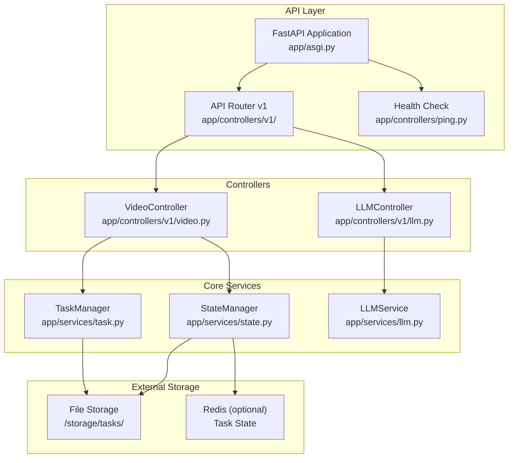
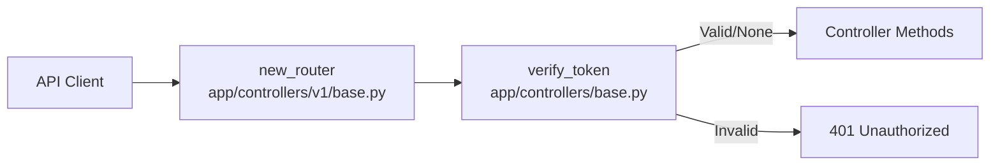
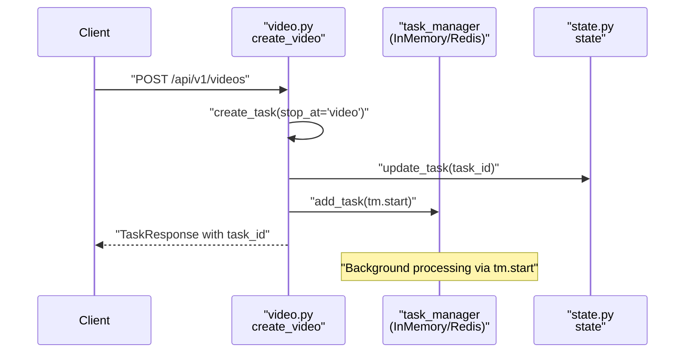
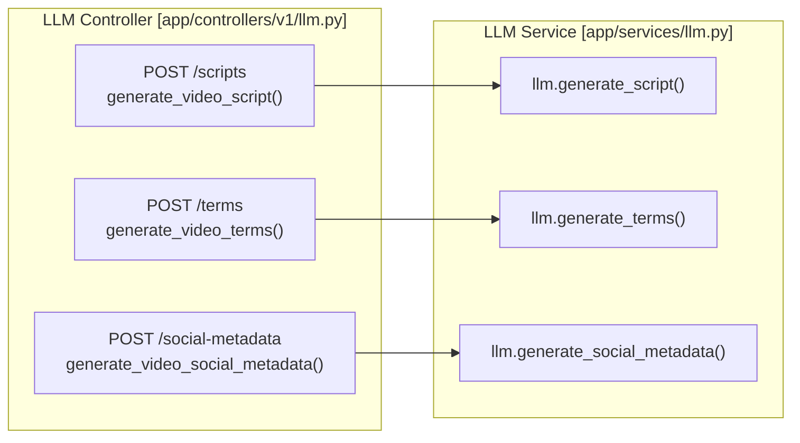

<!-- source: DeepWiki mcp.deepwiki.com · repo harry0703/MoneyPrinterTurbo · page 7 API Reference · fetched 2026-10-30 -->

# API Reference

Relevant source files

The following files were used as context for generating this wiki page:

- [app/controllers/ping.py](app/controllers/ping.py)
- [app/controllers/v1/base.py](app/controllers/v1/base.py)
- [app/controllers/v1/llm.py](app/controllers/v1/llm.py)
- [app/controllers/v1/video.py](app/controllers/v1/video.py)
- [app/models/exception.py](app/models/exception.py)
- [app/router.py](app/router.py)
- [app/services/material_upload.py](app/services/material_upload.py)
- [main.py](main.py)
- [test/services/test_controller_ping.py](test/services/test_controller_ping.py)
- [test/services/test_controller_video.py](test/services/test_controller_video.py)
- [test/services/test_material_upload.py](test/services/test_material_upload.py)
- [test/services/test_utils_ffmpeg_check.py](test/services/test_utils_ffmpeg_check.py)

This document provides comprehensive documentation for the MoneyPrinterTurbo REST API. The API enables programmatic access to all video generation functionality including script creation, material acquisition, voice synthesis, and video assembly. 

For information about using the web interface, see [Web Interface (Streamlit)](#4.1). For details about the underlying service architecture, see [Core Services](#5).

## API Architecture Overview

The MoneyPrinterTurbo API is built on FastAPI and provides a RESTful interface to the core video generation pipeline. The API supports both synchronous operations for immediate results and asynchronous task-based operations for long-running video generation processes.

Title: API Routing and Controller Architecture

**Sources:** [app/router.py:10-20](), [app/controllers/v1/video.py:59-69](), [app/controllers/v1/llm.py:1-68](), [app/controllers/ping.py:1-13]()

## Authentication

The API implements a token-based authentication mechanism. If an `api_key` is configured in the system settings, the `verify_token` dependency enforces authorization for all V1 routes. If no key is configured, the API remains open for local use.

Title: Request Authentication Flow

**Sources:** [app/controllers/v1/video.py:39-41](), [app/controllers/v1/llm.py:16-18](), [app/controllers/v1/base.py:4-11]()

## Video Generation Endpoints

For detailed request/response schemas, see [Video Generation Endpoints](#7.1).

### Core Video Operations

The primary video generation endpoints support creating videos, audio, and subtitles through a unified task-based system managed by `InMemoryTaskManager` or `RedisTaskManager`.

| Endpoint | Method | Purpose | Response Model |
|----------|--------|---------|----------------|
| `/api/v1/videos` | POST | Generate complete video | `TaskResponse` |
| `/api/v1/audio` | POST | Generate audio only | `TaskResponse` |
| `/api/v1/subtitle` | POST | Generate subtitle only | `TaskResponse` |

Title: Video Task Creation Sequence

**Sources:** [app/controllers/v1/video.py:181-192](), [app/controllers/v1/video.py:59-69](), [app/controllers/manager/base_manager.py:14-15]()

### Task Management

The API provides comprehensive task monitoring and management capabilities. For details, see [Task Management Endpoints](#7.2).

| Endpoint | Method | Purpose | Parameters |
|----------|--------|---------|------------|
| `/api/v1/tasks` | GET | List all tasks | `page`, `page_size` |
| `/api/v1/tasks/{task_id}` | GET | Get task details | `task_id` (path) |
| `/api/v1/tasks/{task_id}` | DELETE | Delete task | `task_id` (path) |

**Sources:** [app/controllers/v1/video.py:19-32]()

### Resource Management

The API supports management of background music and video materials. For details, see [Resource Management Endpoints](#7.3).

| Endpoint | Method | Purpose | Content Type |
|----------|--------|---------|--------------|
| `/api/v1/musics` | GET | List BGM files | `application/json` |
| `/api/v1/musics` | POST | Upload BGM file | `multipart/form-data` |
| `/api/v1/video_materials` | GET | List local materials | `application/json` |
| `/api/v1/video_materials` | POST | Upload local video/image | `multipart/form-data` |
| `/api/v1/stream` | GET | Stream video file | `video/mp4` |

**Sources:** [app/controllers/v1/video.py:30-34](), [app/services/material_upload.py:171-180]()

## Content Generation Endpoints

The LLM controller provides endpoints for generating video scripts, search terms, and social metadata. For details, see [LLM & Script Endpoints](#7.5).

| Endpoint | Method | Purpose | Request Model |
|----------|--------|---------|---------------|
| `/api/v1/scripts` | POST | Generate video script | `VideoScriptRequest` |
| `/api/v1/terms` | POST | Generate search terms | `VideoTermsRequest` |
| `/api/v1/social-metadata` | POST | Generate social tags | `VideoSocialMetadataRequest` |

Title: LLM Service Integration

**Sources:** [app/controllers/v1/llm.py:21-68]()

## Error Handling

The API implements structured error handling through the custom `HttpException` class.

- **400 Bad Request:** Validation errors or invalid filenames (e.g., in `_sanitize_upload_filename`).
- **401 Unauthorized:** Missing or invalid API key when `api_key` is configured.
- **403 Forbidden:** File path escapes base directory during resolution.
- **404 Not Found:** Requested task or file does not exist.
- **416 Range Not Satisfiable:** Invalid byte range requested for video streaming.
- **429 Too Many Requests:** Task queue is full (throws `TaskQueueFullError`).

**Sources:** [app/models/exception.py:7-25](), [app/controllers/v1/video.py:72-97](), [app/controllers/v1/video.py:132-178](), [app/controllers/manager/base_manager.py:14-15]()

## Health Check

A simple health check endpoint is available for service monitoring:

- **Endpoint:** `GET /ping`
- **Response:** `"pong"`
- **Implementation:** `app/controllers/ping.py`

**Sources:** [app/controllers/ping.py:6-13]()

---

