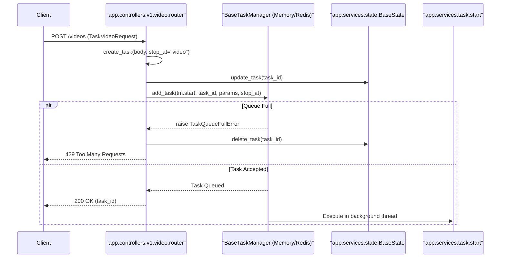
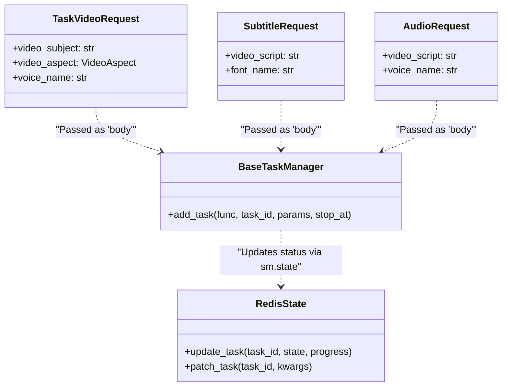

<!-- source: DeepWiki mcp.deepwiki.com · repo harry0703/MoneyPrinterTurbo · page 7.1 Video Generation Endpoints · fetched 2026-10-30 -->

# Video Generation Endpoints

<details>
<summary>Relevant source files</summary>

The following files were used as context for generating this wiki page:

- [app/controllers/v1/video.py](app/controllers/v1/video.py)
- [app/services/material_upload.py](app/services/material_upload.py)
- [test/services/test_controller_video.py](test/services/test_controller_video.py)
- [test/services/test_material_upload.py](test/services/test_material_upload.py)

</details>


This page documents the primary REST API endpoints used to initiate video, subtitle, and audio generation tasks. These endpoints serve as the entry point for programmatically interacting with the MoneyPrinterTurbo generation pipeline.

## Overview

The video generation process is asynchronous. When a request is made to these endpoints, the system validates the input, generates a unique `task_id` using `utils.get_uuid()`, and queues the task for background processing [app/controllers/v1/video.py:128, 195-208](). The endpoints return a success response containing the `task_id`, which must then be used to poll for status via the Task Management endpoints.

### Request Flow

The following diagram illustrates the flow from an API request to the task being queued in the system.

**API Task Creation Flow**

**Sources:** [app/controllers/v1/video.py:195-225](), [test/services/test_controller_video.py:128-152](), [app/services/task.py:36]()

---

## Endpoint: POST /videos

Generates a complete short video including script, voiceover, background music, materials, and subtitles.

### Request Schema
The request body is a `TaskVideoRequest` [app/models/schema.py:29]().

| Field | Type | Description |
| :--- | :--- | :--- |
| `video_subject` | `str` | The main topic of the video (required) |
| `video_aspect` | `VideoAspect` | Ratio: `16:9`, `9:16`, or `1:1` |
| `voice_name` | `str` | TTS voice identifier (e.g., `zh-CN-XiaoxiaoNeural-Female`) |
| `video_source` | `str` | Material source: `pexels`, `pixabay`, or `local` |
| `video_script` | `str` | Optional. If provided, LLM script generation is skipped |
| `paragraph_number` | `int` | Number of paragraphs for generated scripts (1-10) |

### Response Schema
Returns a `TaskResponse` containing the unique identifier for the generation job [app/models/schema.py:28]().

```json
{
  "status": 200,
  "message": "success",
  "data": {
    "task_id": "6c85c8cc-a77a-42b9-bc30-947815aa0558"
  }
}
```
**Sources:** [app/controllers/v1/video.py:181-186](), [app/models/schema.py:28-29]()

---

## Endpoint: POST /subtitle

Executes the pipeline but stops after generating the subtitle file and associated audio. This is useful for users who want to use the generated voiceover and SRT in their own video editor.

### Implementation Details
The internal `create_task` function is called with `stop_at="subtitle"` [app/controllers/v1/video.py:188-193](). This flag is passed to the task service `tm.start`, which truncates the execution loop after the subtitle generation stage.

### Request Schema (`SubtitleRequest`)
A subset of video parameters focused on audio and text rendering [app/models/schema.py:23]().

| Field | Type | Default |
| :--- | :--- | :--- |
| `video_script` | `str` | Required script text |
| `font_name` | `str` | Font family for subtitles |
| `font_size` | `int` | Size of the text |
| `voice_rate` | `float` | Speed of the TTS voice |

**Sources:** [app/controllers/v1/video.py:188-193](), [app/models/schema.py:23]()

---

## Endpoint: POST /audio

Generates only the voiceover audio file (including optional background music) based on the provided script.

### Request Schema (`AudioRequest`)
Focuses strictly on TTS and BGM parameters [app/models/schema.py:20]().

```json
{
  "video_script": "Hello world",
  "voice_name": "en-US-JennyNeural",
  "bgm_type": "random",
  "bgm_volume": 0.2
}
```
**Sources:** [app/controllers/v1/video.py:195-200](), [app/models/schema.py:20]()

---

## Data Mapping

The following diagram maps the API requests to the internal Pydantic models and the task management system.

**Request Data Mapping**

**Sources:** [app/models/schema.py:19-32](), [app/controllers/v1/video.py:60-69](), [app/services/state.py:35]()

---

## Task Management & Concurrency

The endpoints utilize a `task_manager` instance determined by the `enable_redis` configuration [app/controllers/v1/video.py:43-69]().

1.  **Memory Management**: Uses `InMemoryTaskManager` for local, single-instance deployments [app/controllers/v1/video.py:66-69]().
2.  **Redis Management**: Uses `RedisTaskManager` for distributed environments or persistence across restarts [app/controllers/v1/video.py:60-64]().
3.  **Concurrency Limits**: 
    *   `max_concurrent_tasks`: Controls how many videos are rendered simultaneously (Default: 5) [app/controllers/v1/video.py:48]().
    *   `max_queued_tasks`: Controls the size of the waiting list (Default: 100). If exceeded, the API returns a `429` error via `TaskQueueFullError` [app/controllers/v1/video.py:49, 158-165]().

### Safety and Validation
*   **Filename Sanitization**: Uploaded filenames are stripped of path segments and validated against supported extensions (`.mp4`, `.mov`, `.jpg`, etc.) to prevent directory traversal [app/controllers/v1/video.py:72-82](), [app/services/material_upload.py:76-88]().
*   **Path Resolution**: Internal file access is wrapped in `resolve_path_within_directory` to ensure files remain within the `storage/tasks` or `local_videos` boundaries [app/controllers/v1/video.py:85-97](), [app/services/material_upload.py:45-46]().

**Sources:** [app/controllers/v1/video.py:42-69](), [test/services/test_controller_video.py:153-174](), [app/services/material_upload.py:21-26]()

---

