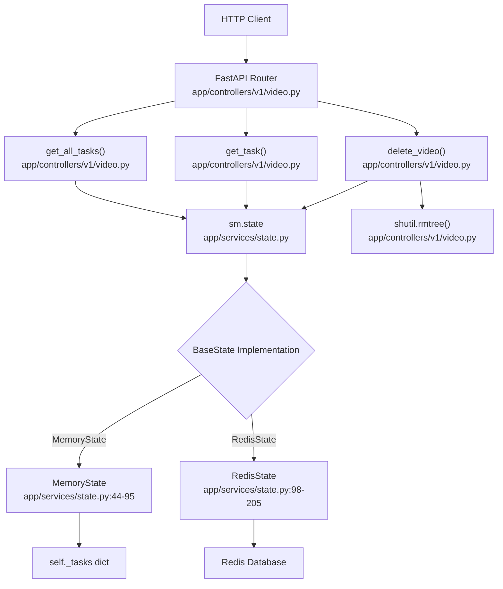
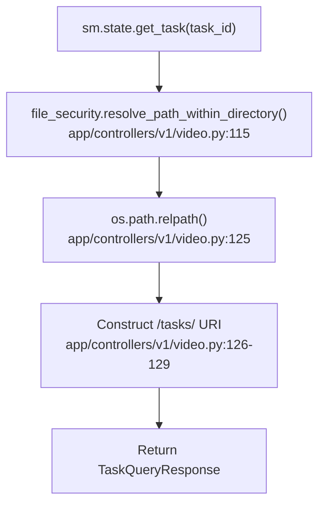
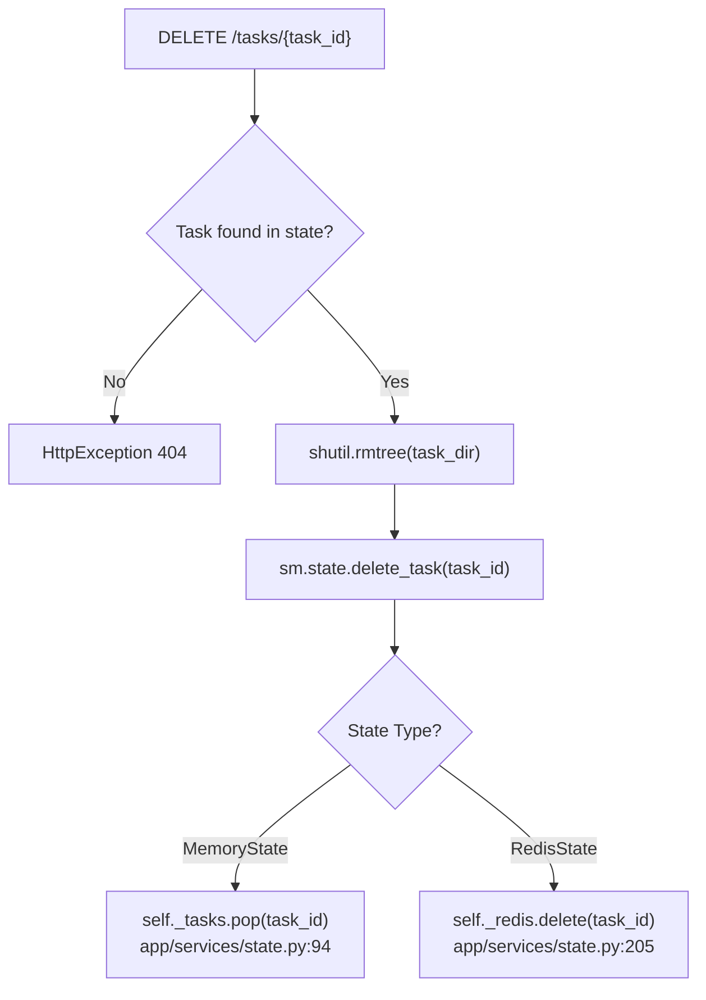

<!-- source: DeepWiki mcp.deepwiki.com · repo harry0703/MoneyPrinterTurbo · page 7.2 Task Management Endpoints · fetched 2026-10-30 -->

# Task Management Endpoints

<details>
<summary>Relevant source files</summary>

The following files were used as context for generating this wiki page:

- [app/controllers/manager/base_manager.py](app/controllers/manager/base_manager.py)
- [app/controllers/manager/memory_manager.py](app/controllers/manager/memory_manager.py)
- [app/controllers/manager/redis_manager.py](app/controllers/manager/redis_manager.py)
- [app/controllers/v1/video.py](app/controllers/v1/video.py)
- [app/models/const.py](app/models/const.py)
- [app/services/material_upload.py](app/services/material_upload.py)
- [app/services/state.py](app/services/state.py)
- [app/utils/file_security.py](app/utils/file_security.py)
- [test/README.md](test/README.md)
- [test/services/test_controller_video.py](test/services/test_controller_video.py)
- [test/services/test_material_upload.py](test/services/test_material_upload.py)
- [test/services/test_schema.py](test/services/test_schema.py)
- [test/services/test_state.py](test/services/test_state.py)
- [test/services/test_task_manager.py](test/services/test_task_manager.py)

</details>


The Task Management API provides endpoints for querying, listing, and deleting video generation tasks in MoneyPrinterTurbo. These endpoints enable clients to monitor task progress, retrieve task results, and manage task lifecycle through RESTful operations.

This page documents the task management endpoints exposed by the FastAPI service. For information about task orchestration and the video generation pipeline, see [Task Orchestration](#5.1). For video generation endpoints that create tasks, see [Video Generation Endpoints](#7.1).

## Task Management Overview

Task management endpoints provide read and delete operations on tasks stored in the system's state manager. Tasks are created by video generation endpoints and their state is managed through either in-memory storage or Redis, depending on configuration.

### Task Management Architecture



**Sources:** [app/controllers/v1/video.py:41-69](), [app/services/state.py:24-41]()

## GET /tasks - List All Tasks

Retrieves a paginated list of all tasks in the system.

### Endpoint Definition

```
GET /tasks?page=1&page_size=10
```

### Query Parameters

| Parameter | Type | Required | Default | Description |
|-----------|------|----------|---------|-------------|
| `page` | integer | No | 1 | Page number (minimum: 1) |
| `page_size` | integer | No | 10 | Number of tasks per page (minimum: 1) |

### Implementation Details

The endpoint delegates to the active `BaseState` implementation's `get_all_tasks(page, page_size)` method.

**Memory State Implementation:**
- Stores tasks in a Python dictionary: `self._tasks` [app/services/state.py:46]()
- Calculates pagination: `start = (page - 1) * page_size` [app/services/state.py:50]()
- Returns deep-copied snapshots to prevent external mutation of the state [app/services/state.py:53]().

**Redis State Implementation:**
- Uses `SCAN` with `_type="HASH"` to iterate through task records [app/services/state.py:124-128]().
- Correctly calculates pagination slices across multiple Redis scan batches to ensure consistent page sizes [app/services/state.py:136-145]().
- Converts byte strings back to original types using `ast.literal_eval()` [app/services/state.py:221]() via `_convert_to_original_type` [app/services/state.py:208]().

**Sources:** [app/services/state.py:49-55](), [app/services/state.py:114-151](), [app/services/state.py:208-222]()

## GET /tasks/{task_id} - Query Task Status

Retrieves the current status and details of a specific task, including generated video URLs.

### Endpoint Definition

```
GET /tasks/{task_id}
```

### Path Parameters

| Parameter | Type | Required | Description |
|-----------|------|----------|-------------|
| `task_id` | string | Yes | Unique identifier for the task |

### URL Conversion Logic

The endpoint converts local file system paths to HTTP URLs for client access using `_task_file_to_uri` [app/controllers/v1/video.py:107-130](). This ensures that internal storage paths like `storage/tasks/...` are mapped to accessible endpoints like `/tasks/...`.



**Sources:** [app/controllers/v1/video.py:107-130](), [app/services/state.py:76-80](), [app/services/state.py:174-183]()

## DELETE /tasks/{task_id} - Delete Task

Deletes a task and its associated files from the system.

### Deletion Process

The deletion operation performs two actions:

1. **File System Cleanup**: Removes the task directory and all contained files using `shutil.rmtree()` in the controller.
2. **State Cleanup**: Removes task from the state manager via `delete_task(task_id)`.

### Implementation Flow



**Sources:** [app/services/state.py:92-95](), [app/services/state.py:204-205]()

## State Management Architecture

Task state persistence is handled through a pluggable architecture. The system selects an implementation at runtime based on the `enable_redis` configuration [app/controllers/v1/video.py:59-69]().

### Concurrency and Consistency

*   **MemoryState**: Uses `threading.RLock` [app/services/state.py:47]() to ensure thread-safety during task updates and deletions.
*   **RedisState**: Uses Lua scripts (`_PATCH_EXISTING_TASK_SCRIPT`) [app/services/state.py:10-20]() for atomic `patch_task` operations. This prevents race conditions where a background process might recreate a task that was just deleted by a user [app/services/state.py:193-202]().

### State Manager Comparison

| Feature | MemoryState | RedisState |
|---------|-------------|------------|
| **Storage** | `self._tasks` dict [app/services/state.py:46]() | Redis Hash sets [app/services/state.py:172]() |
| **Persistence** | Volatile (lost on restart) | Persistent (survives restarts) |
| **Atomic Patch** | RLock protected [app/services/state.py:85]() | Lua Script (`eval`) [app/services/state.py:196]() |
| **Pagination** | List slicing [app/services/state.py:55]() | `SCAN` iteration [app/services/state.py:124]() |

**Sources:** [app/services/state.py:44-205](), [app/controllers/v1/video.py:59-69]()

## Error Handling & Security

### Path Security
The system prevents directory traversal attacks when resolving task files. The `file_security.resolve_path_within_directory` function ensures that any requested path remains within the designated `base_dir` [app/controllers/v1/video.py:85-98]().

### Task Queue Limits
The `TaskManager` [app/controllers/manager/base_manager.py:11]() enforces limits to prevent resource exhaustion:
- `max_concurrent_tasks`: Limits active processing threads [app/controllers/manager/base_manager.py:24]().
- `max_queued_tasks`: Limits the number of tasks waiting in the queue [app/controllers/manager/base_manager.py:41]().

If the queue is full, a `TaskQueueFullError` [app/controllers/manager/base_manager.py:7]() is raised, resulting in a `429 Too Many Requests` response in the task creation flow.

**Sources:** [app/controllers/manager/base_manager.py:11-46](), [app/controllers/v1/video.py:85-98](), [app/controllers/v1/video.py:48-49]()

---

