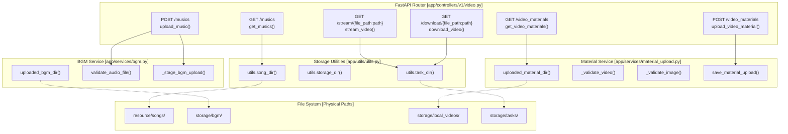
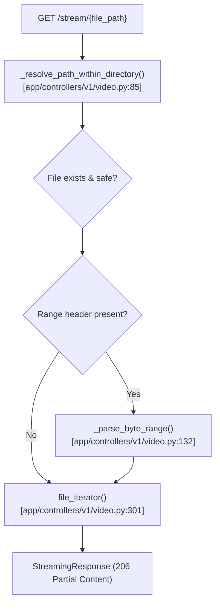

<!-- source: DeepWiki mcp.deepwiki.com · repo harry0703/MoneyPrinterTurbo · page 7.3 Resource Management Endpoints · fetched 2026-10-30 -->

# Resource Management Endpoints

Relevant source files

The following files were used as context for generating this wiki page:

- [app/controllers/v1/video.py](app/controllers/v1/video.py)
- [app/services/bgm.py](app/services/bgm.py)
- [app/services/material_upload.py](app/services/material_upload.py)
- [test/services/test_controller_video.py](test/services/test_controller_video.py)
- [test/services/test_material_upload.py](test/services/test_material_upload.py)

## Purpose and Scope

This page documents the resource management endpoints in the MoneyPrinterTurbo API, which handle file management operations for background music (BGM), video materials, and generated content. These endpoints provide functionality to upload, retrieve, stream, and download media files used in video generation.

The system distinguishes between **built-in resources** (e.g., songs in `resource/songs`) and **runtime storage** (e.g., user uploads in `storage/bgm` and task outputs in `storage/tasks`).

**Sources:** [app/controllers/v1/video.py:1-133](), [app/services/bgm.py:65-72]()

---

## Resource Types Overview

The API manages three primary resource categories with specific validation rules:

| Resource Type | Storage Directory | Supported Formats | Primary Use |
|--------------|------------------|-------------------|-------------|
| **Background Music (BGM)** | `storage/bgm/` (User)   `resource/songs/` (Built-in) | `.mp3`, `.m4a`, `.aac`, `.wav`, `.flac`, `.ogg`, `.opus`, `.wma` | Audio overlays for generated videos |
| **Video Materials** | `storage/local_videos/` | `.mp4`, `.mov`, `.avi`, `.flv`, `.mkv`, `.jpg`, `.jpeg`, `.png` | Source footage for video assembly when using `video_source=local` |
| **Generated Content** | `storage/tasks/{task_id}/` | `.mp4`, `.mp3`, `.srt`, `.json` | Task outputs (videos, audio, subtitles, scripts) |

**Sources:** [app/services/bgm.py:28-37](), [app/services/bgm.py:65-72](), [app/services/material_upload.py:21-26](), [app/services/material_upload.py:45-46]()

---

## Resource Management Architecture

The following diagram maps the API endpoints to their underlying implementation functions and storage utilities.

**Code Entity Mapping: Endpoints to Storage**

**Sources:** [app/controllers/v1/video.py:41-508](), [app/services/bgm.py:65-72](), [app/services/material_upload.py:45-46](), [app/utils/utils.py:1-50]()

---

## Background Music (BGM) Management

### GET /musics

Retrieves a list of available background music files. The system checks both the built-in `resource/songs/` directory and the user-uploaded `storage/bgm/` directory.

**Implementation Details:**
- Uses `glob.glob()` to find files matching `SUPPORTED_BGM_EXTENSIONS` [app/services/bgm.py:28-37]().
- Returns metadata including filename, size, and type (built-in vs. uploaded).

### POST /musics

Uploads a new background music file to the `storage/bgm/` directory.

**Validation and Security:**
- **Filename Sanitization**: `sanitize_upload_filename` strips directory components, checks for Windows reserved names (e.g., `CON`, `PRN`), and prevents path traversal [app/services/bgm.py:90-117]().
- **Size Limit**: Enforces a 30MB limit via `MAX_BGM_UPLOAD_BYTES` [app/services/bgm.py:16]().
- **Audio Integrity**: Uses `_validate_audio` which invokes FFmpeg with `-map 0:a:0 -f null` to ensure a valid, decodable audio stream exists [app/services/bgm.py:120-155]().
- **Atomic Persistence**: Files are written to a temporary file with prefix `.bgm-upload-` and then moved to the final destination using `os.replace` to ensure atomicity [app/services/bgm.py:193-206]().

**Sources:** [app/services/bgm.py:16-206](), [test/services/test_controller_video.py:85-115]()

---

## Video Material Management

### GET /video_materials

Retrieves a list of available video and image materials in the `storage/local_videos/` directory.

**Supported Formats:**
- **Video**: `.mp4`, `.mov`, `.avi`, `.flv`, `.mkv` [app/services/material_upload.py:21]().
- **Image**: `.jpg`, `.jpeg`, `.png` [app/services/material_upload.py:22]().

**Sources:** [app/services/material_upload.py:21-26]()

### POST /video_materials

Uploads a new video or image material to `storage/local_videos/`.

**Validation:**
- **Kind Detection**: `_material_kind` determines if the file is a video or image based on extension [app/services/material_upload.py:61-73]().
- **Size Limits**: 200MB for videos, 20MB for images [app/services/material_upload.py:17-18]().
- **Image Validation**: Uses Pillow (`Image.open`) to verify content and prevent "Decompression Bomb" attacks [app/services/material_upload.py:91-117]().
- **Video Validation**: Uses FFmpeg to ensure the video stream is completely decodable [app/services/material_upload.py:140-168](). It explicitly rejects images renamed to video extensions [app/services/material_upload.py:125-137]().

**Sources:** [app/services/material_upload.py:15-180](), [test/services/test_material_upload.py:32-167]()

---

## File Serving Endpoints

### GET /stream/{file_path:path}

Streams a video file with HTTP range request support, enabling browser video players to seek.

**Range Request Logic Mapping**

**Implementation Details:**
- **Path Security**: `file_security.resolve_path_within_directory` ensures the request does not escape the `storage/tasks/` directory [app/controllers/v1/video.py:85-97]().
- **Byte Range Parsing**: `_parse_byte_range` handles `bytes=start-end`, `bytes=start-`, and `bytes=-suffix` formats. Invalid ranges return a `416 Range Not Satisfiable` error [app/controllers/v1/video.py:132-178]().

**Sources:** [app/controllers/v1/video.py:85-178](), [test/services/test_controller_video.py:85-115]()

---

## Task State and URI Mapping

When a task status is queried, local file paths are converted into accessible URIs using `_task_file_to_uri`.

**URI Conversion Logic:**
- Absolute URLs (http/https) are returned unchanged [app/controllers/v1/video.py:111-112]().
- Local paths are validated to be within the task directory [app/controllers/v1/video.py:115]().
- The relative path is prefixed with `tasks/` and the application's base endpoint [app/controllers/v1/video.py:125-129]().

**Sources:** [app/controllers/v1/video.py:107-130]()

---

## Task Management Integration

The resource endpoints interact with the task manager to track task lifecycles.

| Manager Class | Responsibility |
|---------------|----------------|
| `InMemoryTaskManager` | Default manager for single-instance deployments [app/controllers/v1/video.py:66-69](). |
| `RedisTaskManager` | Distributed manager for scaled deployments, enabled via `enable_redis` [app/controllers/v1/video.py:59-64](). |

**Sources:** [app/controllers/v1/video.py:43-69](), [test/services/test_controller_video.py:122-167]()

---

