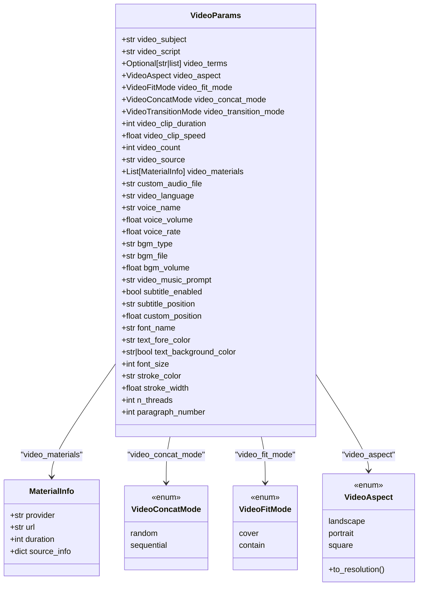
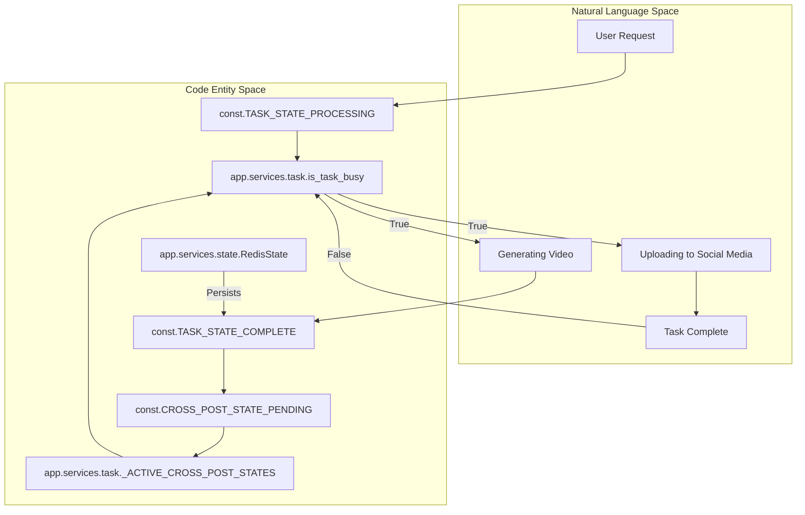

<!-- source: DeepWiki mcp.deepwiki.com · repo harry0703/MoneyPrinterTurbo · page 7.4 Data Models & Schemas · fetched 2026-10-30 -->

# Data Models & Schemas

<details>
<summary>Relevant source files</summary>

The following files were used as context for generating this wiki page:

- [app/models/__init__.py](app/models/__init__.py)
- [app/models/const.py](app/models/const.py)
- [app/models/schema.py](app/models/schema.py)
- [app/services/state.py](app/services/state.py)
- [app/services/task.py](app/services/task.py)
- [test/README.md](test/README.md)
- [test/services/test_schema.py](test/services/test_schema.py)
- [test/services/test_state.py](test/services/test_state.py)
- [test/services/test_task.py](test/services/test_task.py)

</details>


This page provides a complete reference for all Pydantic models and data structures used in MoneyPrinterTurbo. These schemas define the contract between API clients and the system, as well as internal data representations for video generation tasks, state management, and cross-platform distribution.

All Pydantic models are primarily defined in [app/models/schema.py:1-541](). For API endpoint usage, see [7.1](), [7.2](), and [7.3](). For how these models are used in the video generation pipeline, see [5.1]().

## Model Index

| Model | Type | Location | Purpose |
|-------|------|----------|---------|
| `VideoParams` | Request/Config | [app/models/schema.py:73-138]() | Primary video generation configuration |
| `MaterialInfo` | Data Class | [app/models/schema.py:62-71]() | Video material metadata and source info |
| `SubtitleRequest` | Request | [app/models/schema.py:140-159]() | Subtitle-only generation request |
| `AudioRequest` | Request | [app/models/schema.py:161-171]() | Audio-only generation request |
| `VideoScriptParams` | Request | [app/models/schema.py:173-189]() | Standalone script generation request |
| `VideoTermsParams` | Request | [app/models/schema.py:191-207]() | Standalone keyword extraction request |
| `VideoConcatMode` | Enum | [app/models/schema.py:18-20]() | Video clip ordering mode |
| `VideoTransitionMode` | Enum | [app/models/schema.py:23-31]() | Transition effect type |
| `VideoAspect` | Enum | [app/models/schema.py:34-46]() | Video aspect ratio and resolution mapping |
| `VideoFitMode` | Enum | [app/models/schema.py:49-54]() | Material scaling mode (cover/contain) |

Sources: [app/models/schema.py:18-207]()

## Primary Configuration Model: VideoParams

The `VideoParams` class (defined at [app/models/schema.py:73-138]()) is the main configuration model for video generation. It is used throughout the task lifecycle and validated during request ingestion.

### VideoParams Class Diagram



Sources: [app/models/schema.py:18-138]()

### VideoParams Field Reference

| Field | Type | Default | Description |
|-------|------|---------|-------------|
| `video_subject` | `str` | (required) | Video topic or title |
| `video_script` | `str` | `""` | Pre-written script (if empty, generated by LLM) |
| `video_terms` | `str \| list` | `None` | Keywords for material search |
| `video_aspect` | `VideoAspect` | `9:16` | Video aspect ratio (16:9, 9:16, 1:1) |
| `video_fit_mode` | `VideoFitMode` | `cover` | How clips fill the canvas [app/models/schema.py:92]() |
| `video_concat_mode` | `VideoConcatMode` | `random` | Clip ordering mode |
| `video_clip_duration` | `int` | `5` | Maximum clip duration in seconds (min 1) |
| `video_clip_speed` | `float` | `1.0` | Playback speed multiplier for clips [app/models/schema.py:96]() |
| `video_count` | `int` | `1` | Number of videos to generate (min 1) |
| `video_source` | `str` | `"pexels"` | Material source: pexels, pixabay, local |
| `video_materials` | `List[MaterialInfo]` | `None` | Pre-selected materials |
| `custom_audio_file` | `str` | `None` | Path to custom audio file (bypasses TTS) |
| `voice_name` | `str` | `""` | TTS voice identifier |
| `bgm_type` | `str` | `"random"` | BGM selection mode (random, sonilo, elevenlabs) |
| `video_music_prompt` | `str` | `""` | Prompt for AI BGM generation (Sonilo/ElevenLabs) |
| `subtitle_enabled` | `bool` | `True` | Enable subtitle generation |
| `subtitle_position` | `str` | `config.ui.subtitle_position` | Subtitle position: top, bottom, center, custom |
| `font_name` | `str` | `"STHeitiMedium.ttc"` | Font file name |
| `font_size` | `int` | `60` | Subtitle font size in pixels |
| `paragraph_number` | `int` | `1` | Number of script paragraphs to generate (1-10) |

Sources: [app/models/schema.py:73-138](), [app/services/task.py:91-101]()

### MaterialInfo Structure

`MaterialInfo` is a dataclass used to represent video material metadata, specifically for manual material selection and material caching.

```python
@pydantic.dataclasses.dataclass(config=_Config)
class MaterialInfo:
    provider: str = "pexels"
    url: str = ""
    duration: int = 0
    source_info: Optional[dict[str, Any]] = None
```

Sources: [app/models/schema.py:62-71]()

## Task State Management

Task states are managed either in memory or via Redis, depending on the configuration. The state determines if a task is "busy" (processing or cross-posting) and prevents premature deletion.

### Task State Flow Diagram



Sources: [app/services/task.py:104-121](), [app/services/state.py:153-172](), [app/models/const.py:25-32]()

### State Constants Reference

| Constant | Value | Description |
|----------|-------|-------------|
| `TASK_STATE_FAILED` | `-1` | Task encountered an unrecoverable error |
| `TASK_STATE_COMPLETE` | `1` | Video generation finished successfully |
| `TASK_STATE_PROCESSING` | `4` | Task is currently in the pipeline |
| `CROSS_POST_STATE_PENDING` | `"pending"` | Waiting for social media distribution slot |
| `CROSS_POST_STATE_PROCESSING`| `"processing"`| Uploading/Posting in progress |

Sources: [app/models/const.py:25-32]()

## Data Persistence & Validation

The system uses `BaseState` to abstract the underlying storage for these models.

### Data Entity Association

This table bridges common system terminology with the specific code classes defined in the schemas.

| System Concept | Code Entity | Implementation Detail |
|----------------|-------------|-----------------------|
| Video Parameters | `VideoParams` | Base class for all video settings [app/models/schema.py:73]() |
| Material Info | `MaterialInfo` | Metadata for clip selection [app/models/schema.py:62]() |
| Script Params | `VideoScriptParams` | Config for script-only generation [app/models/schema.py:173]() |
| Keyword Params | `VideoTermsParams` | Config for keyword extraction [app/models/schema.py:191]() |
| Aspect Ratio | `VideoAspect` | Enum for resolution mapping [app/models/schema.py:34]() |
| Task Persistence | `RedisState` | Redis-backed task state storage [app/services/state.py:98]() |

Sources: [app/models/schema.py:18-207](), [app/services/state.py:98-107]()

### Resolution Mapping

The `VideoAspect` enum includes a helper to map aspect ratios to standard resolutions used by the video processing service.

```python
def to_resolution(self):
    if self == VideoAspect.landscape:
        return 1920, 1080
    elif self == VideoAspect.portrait:
        return 1080, 1920
    elif self == VideoAspect.square:
        return 1080, 1080
    raise ValueError(f"unsupported video aspect: {self}")
```

Sources: [app/models/schema.py:39-46]()

---

