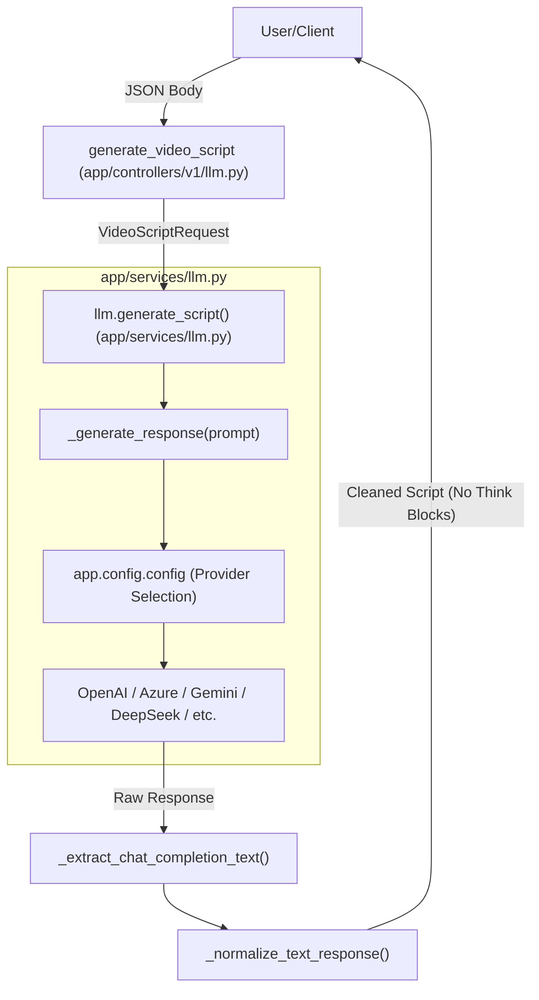
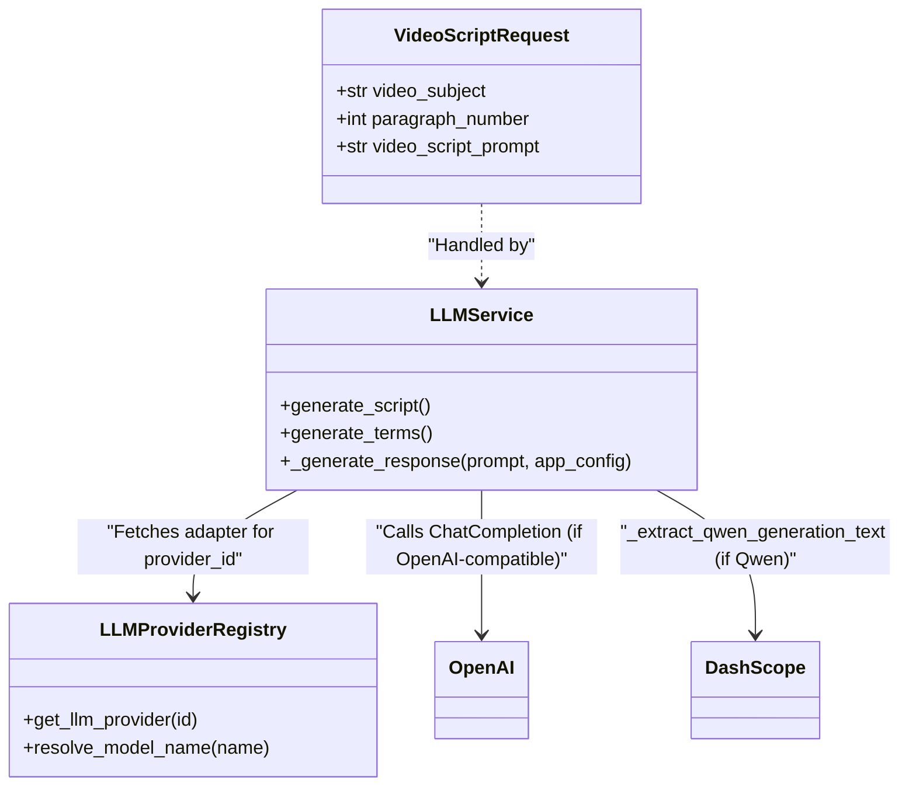

<!-- source: DeepWiki mcp.deepwiki.com · repo harry0703/MoneyPrinterTurbo · page 7.5 LLM & Script Endpoints · fetched 2026-10-30 -->

# LLM & Script Endpoints

Relevant source files

The following files were used as context for generating this wiki page:

- [app/controllers/ping.py](app/controllers/ping.py)
- [app/controllers/v1/base.py](app/controllers/v1/base.py)
- [app/controllers/v1/llm.py](app/controllers/v1/llm.py)
- [app/models/exception.py](app/models/exception.py)
- [app/services/llm.py](app/services/llm.py)
- [test/services/test_llm.py](test/services/test_llm.py)

This page documents the specialized REST API endpoints used for standalone video script generation, keyword extraction, and social metadata generation. These endpoints allow developers to leverage the system's LLM orchestration logic independently of the full video generation pipeline, enabling workflows such as script previewing, manual editing, or integration into external content management systems.

## 1. Overview
The LLM and Script endpoints provide a direct interface to the `app/services/llm.py` service. While the full video generation process (via `POST /videos`) automatically triggers these services if script or terms are missing, the `POST /scripts`, `POST /terms`, and `POST /social-metadata` endpoints allow for isolated execution [app/controllers/v1/llm.py:21-68]().

- **POST /scripts**: Generates a structured video narration script based on a subject and optional custom prompts [app/controllers/v1/llm.py:21-35]().
- **POST /terms**: Extracts search keywords (terms) from a generated script to facilitate video material searching [app/controllers/v1/llm.py:38-51]().
- **POST /social-metadata**: Generates platform-specific titles, descriptions, and hashtags for social media publishing [app/controllers/v1/llm.py:54-68]().

**Sources:** [app/controllers/v1/llm.py:21-68](), [app/services/llm.py:1-44]()

## 2. Technical Architecture & Data Flow

The flow of data from an API request to the LLM provider involves schema validation, prompt construction, reasoning block handling, and provider-specific execution.

### 2.1 Component Interaction Diagram
The following diagram bridges the "Natural Language Space" (User Input) to the "Code Entity Space" (System Functions).

**LLM Request Processing Flow**

**Sources:** [app/controllers/v1/llm.py:26-33](), [app/services/llm.py:142-153](), [app/services/llm.py:87-102](), [app/services/llm.py:47-69]()

### 2.2 Script Generation Implementation
The `generate_script` function is the primary entry point. It enforces constraints on paragraph count and utilizes a system prompt to ensure the output is suitable for Text-to-Speech (TTS) [app/services/llm.py:29-44]().

**Key Logic Entities:**
- **`DEFAULT_SCRIPT_SYSTEM_PROMPT`**: A rigorous system prompt that forbids markdown, titles, and narrator indicators (e.g., "Voiceover:") to ensure the raw text can be fed directly to TTS engines [app/services/llm.py:29-44]().
- **`_normalize_text_response`**: A critical utility that strips `<think>` blocks (common in reasoning models like DeepSeek R1 or MiniMax M3) and validates that the LLM did not return an empty or non-string object [app/services/llm.py:47-69]().
- **Provider Switching**: The `_generate_response` function dynamically routes the request based on `runtime_app_config`, supporting 13+ providers and handling deprecated model/URL fallbacks [app/services/llm.py:142-177]().

**Sources:** [app/services/llm.py:29-44](), [app/services/llm.py:47-69](), [app/services/llm.py:142-177]()

## 3. Endpoint Reference

### 3.1 POST /scripts
Generates a script for a video.

**Request Schema (`VideoScriptRequest`):**
| Field | Type | Default | Description |
| :--- | :--- | :--- | :--- |
| `video_subject` | `str` | Required | The core topic of the video. |
| `video_language` | `str` | "" | Target language; if empty, the system auto-detects. |
| `paragraph_number` | `int` | 1 | Number of paragraphs (Min: 1, Max: 10). |
| `video_script_prompt` | `str` | "" | Additional instructions for the LLM (Max: 2000 chars). |
| `custom_system_prompt`| `str` | "" | Overrides the default system behavior (Max: 8000 chars). |

**Sources:** [app/controllers/v1/llm.py:21-35](), [test/services/test_llm.py:74-110]()

### 3.2 POST /terms
Generates search keywords based on a provided script.

**Request Schema (`VideoTermsRequest`):**
| Field | Type | Default | Description |
| :--- | :--- | :--- | :--- |
| `video_subject` | `str` | Required | The topic of the video. |
| `video_script` | `str` | Required | The full text content of the script. |
| `amount` | `int` | 5 | Number of keywords to generate. |
| `match_materials_to_script` | `bool` | `False` | If true, keywords are generated in chronological order to match script narration. |

**Sources:** [app/controllers/v1/llm.py:38-51](), [test/services/test_llm.py:193-195]()

## 4. LLM Provider Integration

The system abstracts multiple LLM providers through a unified interface.

**Data Entity Space Diagram**
This diagram shows how the request models flow through the service layer to interact with provider adapters.

**Sources:** [app/services/llm.py:142-156](), [app/models/llm_provider.py:12-22](), [app/controllers/v1/llm.py:26-33](), [app/services/llm.py:116-139]()

## 5. Error Handling & Security
- **Retries**: The system implements a `_max_retries = 5` constant for LLM calls to handle transient network issues [app/services/llm.py:14]().
- **Credential Masking**: The `_sanitize_error_message` function uses regex to redact API keys and passwords from error messages before they are returned to the API caller or logged [app/services/llm.py:72-84]().
- **Reasoning Model Support**: The `_normalize_text_response` function explicitly removes `<think>` blocks to prevent internal model reasoning from appearing in video subtitles or voiceovers [app/services/llm.py:59-67]().
- **Exception Logging**: `HttpException` distinguishes between client errors (400/401, logged as WARNING) and server errors (logged as ERROR) to avoid polluting logs during public scans [app/models/exception.py:7-27]().

**Sources:** [app/services/llm.py:14](), [app/services/llm.py:72-84](), [app/services/llm.py:59-67](), [app/models/exception.py:7-27]()

---

