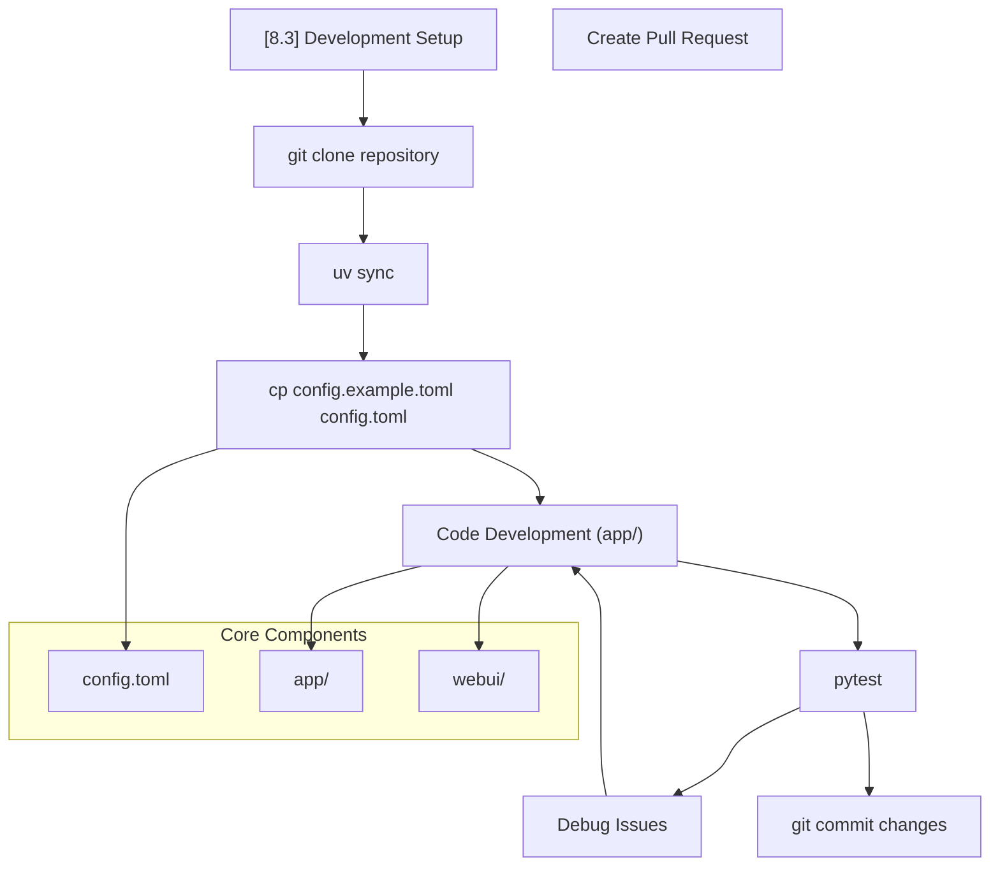
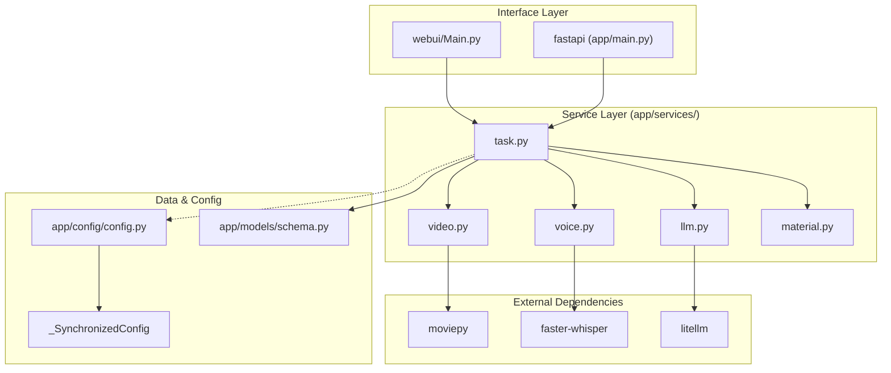
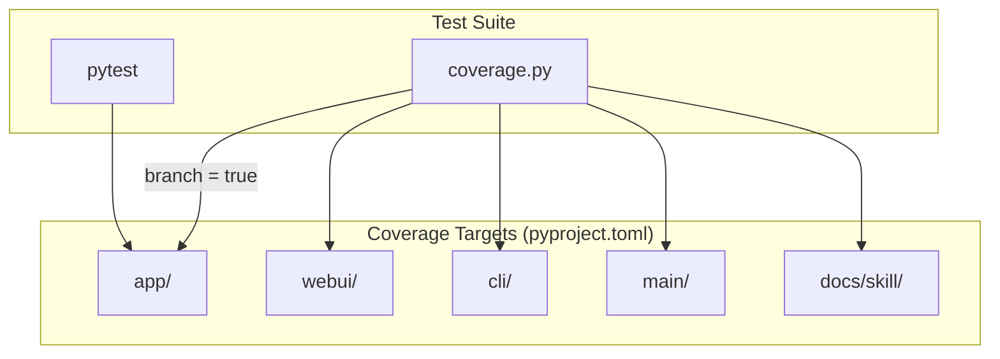

<!-- source: DeepWiki mcp.deepwiki.com · repo harry0703/MoneyPrinterTurbo · page 8 Development Guide · fetched 2026-10-30 -->

# Development Guide

<details>
<summary>Relevant source files</summary>

The following files were used as context for generating this wiki page:

- [.github/ISSUE_TEMPLATE/bug_report.yml](.github/ISSUE_TEMPLATE/bug_report.yml)
- [.github/ISSUE_TEMPLATE/config.yml](.github/ISSUE_TEMPLATE/config.yml)
- [.github/ISSUE_TEMPLATE/feature_request.yml](.github/ISSUE_TEMPLATE/feature_request.yml)
- [README-en.md](README-en.md)
- [README-ja.md](README-ja.md)
- [README.md](README.md)
- [app/__init__.py](app/__init__.py)
- [app/config/config.py](app/config/config.py)
- [pyproject.toml](pyproject.toml)
- [requirements.txt](requirements.txt)
- [uv.lock](uv.lock)

</details>


This document provides essential information for developers who want to contribute to, extend, or integrate with the MoneyPrinterTurbo system. It covers development workflows, code organization principles, testing approaches, and setup procedures.

For detailed project structure information, see [Project Structure](#8.1). For dependency details, see [Dependencies](#8.2). For environment setup, see [Development Setup](#8.3). To extend the system, see [Adding New Providers](#8.4). For quality assurance, see [Testing](#8.5).

## Development Overview

MoneyPrinterTurbo follows a modular architecture designed to separate user interfaces (Streamlit WebUI and FastAPI) from the core video generation logic. The system relies on `uv` for modern Python dependency management and locking [pyproject.toml:1-3](). Configuration management is handled via a thread-safe synchronized dictionary implementation to prevent race conditions during long-running video tasks [app/config/config.py:29-41]().

### Development Workflow

The development process involves setting up the environment, configuring providers, and iterating on service logic:

**Development Workflow Process**


Sources: [pyproject.toml:1-3](), [pyproject.toml:47-52](), [app/config/config.py:15-16]()

### Code Entity Mapping

The system maps high-level video generation concepts to specific service modules and data models. The `_SynchronizedConfig` class in `app/config/config.py` ensures that UI updates do not disrupt active video generation tasks [app/config/config.py:32-41]().

**Code Organization Architecture**


Sources: [pyproject.toml:15-37](), [pyproject.toml:74-75](), [app/config/config.py:29-41](), [webui/Main.py:56-56]()

## Development Environment

### Core Dependencies

The system requires specific Python versions and external libraries for media processing. Primary dependencies are managed in `pyproject.toml` [pyproject.toml:15-37]().

| Component | Requirement | Purpose |
|-----------|-------------|---------|
| Python | `>=3.11` | Primary runtime [pyproject.toml:13-13]() |
| MoviePy | `2.2.1` | Video composition [pyproject.toml:16-16]() |
| Streamlit | `1.59.1` | Web interface [pyproject.toml:17-17]() |
| FastAPI | `0.136.3` | API interface [pyproject.toml:20-20]() |
| LiteLLM | `1.86.2` | LLM provider abstraction [pyproject.toml:35-35]() |
| Faster-Whisper| `1.1.0` | Subtitle generation [pyproject.toml:23-23]() |
| Google GenAI | `2.11.0` | Native Gemini support [pyproject.toml:36-36]() |

### Environment Isolation

Developers should use `uv` to ensure a reproducible environment via the `uv.lock` file [pyproject.toml:1-3](). Development-specific tools like `ruff` for linting and `pytest` for testing are managed in the `dev` dependency group [pyproject.toml:47-52]().

## Testing Architecture

The testing framework utilizes `pytest` and `coverage` to ensure code quality. The project targets a minimum branch coverage of 70% for stable releases [pyproject.toml:63-70]().

**Testing Entity Space**


Sources: [pyproject.toml:48-52](), [pyproject.toml:63-64]()

### Test Execution

```bash
# Install development dependencies
uv sync --group dev

# Run tests with coverage
pytest

# View coverage report
coverage report
```

Sources: [pyproject.toml:47-52](), [pyproject.toml:66-72]()

## Issue Management

The project uses structured GitHub issue templates to maintain code quality and track requirements:

*   **Bug Reports**: Require Python version, OS, and specific error logs to facilitate reproduction [github/ISSUE_TEMPLATE/bug_report.yml:53-80]().
*   **Feature Requests**: Require a clear problem statement and a proposed solution [github/ISSUE_TEMPLATE/feature_request.yml:8-29]().

## Development Best Practices

1.  **Dependency Management**: Add new dependencies to `pyproject.toml` rather than `requirements.txt` to leverage `uv` locking [pyproject.toml:1-3]().
2.  **Linting**: Use `ruff` for code formatting and linting. Note that `webui/Main.py` has a specific ignore rule for `E402` due to necessary `sys.path` modifications [pyproject.toml:51-56]().
3.  **Optional Features**: Heavy integrations like `twelvelabs` (for video understanding) should be kept as optional dependencies to keep the base installation lightweight [pyproject.toml:39-45]().
4.  **Configuration Safety**: Use `update_config_nonblocking` when modifying configuration from the WebUI to avoid freezing the interface while tasks are running [app/config/config.py:91-110]().

Sources: [pyproject.toml:1-3](), [pyproject.toml:39-45](), [pyproject.toml:54-56](), [app/config/config.py:91-110]()

---

