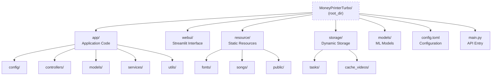
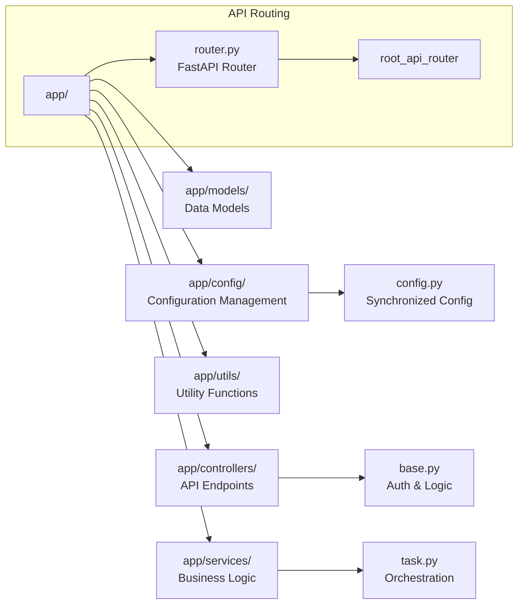
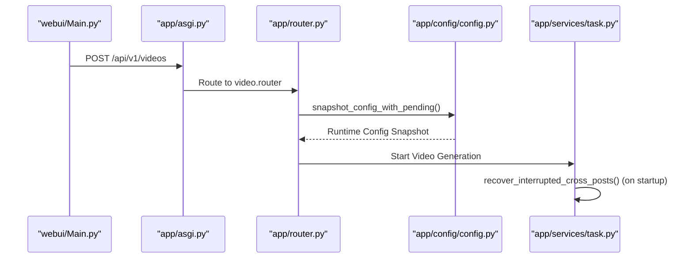

<!-- source: DeepWiki mcp.deepwiki.com · repo harry0703/MoneyPrinterTurbo · page 8.1 Project Structure · fetched 2026-10-30 -->

# Project Structure

Relevant source files

The following files were used as context for generating this wiki page:

- [app/__init__.py](app/__init__.py)
- [app/asgi.py](app/asgi.py)
- [app/config/config.py](app/config/config.py)
- [app/router.py](app/router.py)
- [app/services/__init__.py](app/services/__init__.py)
- [main.py](main.py)
- [pyproject.toml](pyproject.toml)
- [requirements.txt](requirements.txt)
- [test/services/test_asgi_cors.py](test/services/test_asgi_cors.py)
- [test/services/test_asgi_static_files.py](test/services/test_asgi_static_files.py)
- [test/services/test_controller_ping.py](test/services/test_controller_ping.py)
- [test/services/test_utils_ffmpeg_check.py](test/services/test_utils_ffmpeg_check.py)
- [uv.lock](uv.lock)

This page documents the organization and structure of the MoneyPrinterTurbo codebase, explaining the purpose of each major directory and how the modules are organized.

## Overview

MoneyPrinterTurbo follows an MVC (Model-View-Controller) architecture with clear separation between the web interface, API layer, business logic services, and data models. The codebase is organized into several top-level directories that separate application code, resources, storage, and configuration.

**Sources**: [app/config/config.py:15-16](), [pyproject.toml:9-12]()

## Directory Structure

### Root Directory Layout

The root directory contains the main entry points and configuration files. The project uses `pyproject.toml` as the primary dependency manifest, managed via `uv` [pyproject.toml:1-79]().

| Path | Type | Purpose |
|------|------|---------|
| `main.py` | File | FastAPI service entry point using `uvicorn` [main.py:1-18]() |
| `webui/Main.py` | File | Streamlit WebUI entry point [pyproject.toml:56-56]() |
| `config.toml` | File | Primary configuration file [app/config/config.py:16-16]() |
| `pyproject.toml` | File | Project metadata and dependency definitions [pyproject.toml:8-37]() |
| `requirements.txt` | File | Legacy dependency support for pip [requirements.txt:1-22]() |

**Sources**: [main.py:1-18](), [app/config/config.py:15-16](), [pyproject.toml:1-79]()

### Application Code (`app/`)

The `app/` directory contains the core logic, organized by responsibility. The application is initialized as a FastAPI instance in `app/asgi.py` [app/asgi.py:167-184]().

**Sources**: [app/asgi.py:167-187](), [app/router.py:10-20](), [app/config/config.py:29-85]()

#### `app/config/` - Configuration Management

This module handles the loading, saving, and runtime synchronization of the `config.toml` file. It implements a `_SynchronizedConfig` class to ensure thread-safe updates during active video generation tasks [app/config/config.py:29-85]().

*   **Non-blocking Updates**: `update_config_nonblocking` allows the WebUI to queue configuration changes without freezing while a long-running video task holds the configuration lock [app/config/config.py:91-125]().
*   **Snapshotting**: `snapshot_config_with_pending` provides a consistent view of settings for new tasks, merging current disk state with pending UI changes [app/config/config.py:168-186]().

**Sources**: [app/config/config.py:29-215]()

#### `app/asgi.py` - Application Lifecycle

The ASGI implementation defines the FastAPI instance and its middleware.

*   **Lifespan Management**: `application_lifespan` handles startup recovery for interrupted social media posts [app/asgi.py:21-48]().
*   **Security**: Includes `protect_generated_task_files` middleware to ensure static task artifacts in `/tasks` are protected by API key authentication [app/asgi.py:190-204]().
*   **CORS**: Implements granular Cross-Origin Resource Sharing (CORS) policies to allow or deny browser-based access to the API [app/asgi.py:82-164]().

**Sources**: [app/asgi.py:1-204]()

### Core Components and Data Flow

The system bridges high-level user requests to low-level media processing via a structured pipeline.

**Sources**: [app/asgi.py:167-187](), [app/router.py:15-20](), [app/config/config.py:168-186](), [app/asgi.py:41-43]()

### Dependency Management

The project uses `hatchling` as a build backend and specifies a wide array of media and AI libraries [pyproject.toml:4-37]().

| Library | Version | Purpose |
|---------|---------|---------|
| `moviepy` | 2.2.1 | Core video editing and composition [pyproject.toml:16-16]() |
| `fastapi` | 0.136.3 | REST API framework [pyproject.toml:20-20]() |
| `streamlit` | 1.59.1 | Web interface framework [pyproject.toml:17-17]() |
| `faster-whisper`| 1.1.0 | Local speech-to-text for subtitles [pyproject.toml:23-23]() |
| `litellm` | 1.86.2 | Unified interface for multiple LLM providers [pyproject.toml:35-35]() |

**Sources**: [pyproject.toml:15-37](), [requirements.txt:2-22]()

### Testing Infrastructure

The `test/` directory mirrors the application structure to provide unit and integration tests.

*   **Service Testing**: `test/services/test_asgi_static_files.py` validates the protection of task artifacts [test/services/test_asgi_static_files.py:12-114]().
*   **CORS Validation**: `test/services/test_asgi_cors.py` ensures security policies for cross-origin requests are correctly enforced [test/services/test_asgi_cors.py:10-177]().
*   **Utility Probes**: `test/services/test_utils_ffmpeg_check.py` mocks subprocesses to verify FFmpeg environment detection [test/services/test_utils_ffmpeg_check.py:13-67]().

**Sources**: [test/services/test_asgi_static_files.py:1-114](), [test/services/test_asgi_cors.py:1-177](), [test/services/test_utils_ffmpeg_check.py:1-67]()

---

