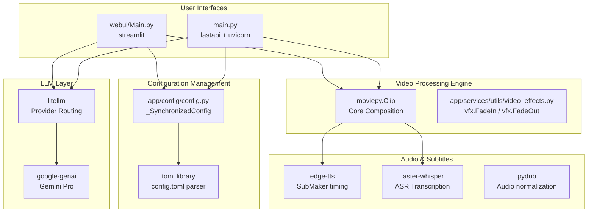
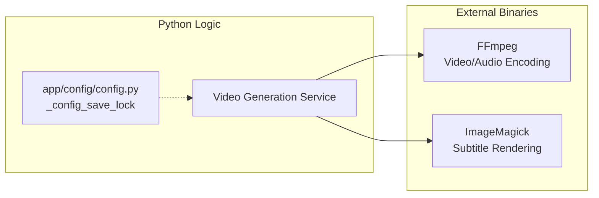

<!-- source: DeepWiki mcp.deepwiki.com · repo harry0703/MoneyPrinterTurbo · page 8.2 Dependencies · fetched 2026-10-30 -->

# 8.2 Dependencies

<details>
<summary>Relevant source files</summary>

The following files were used as context for generating this wiki page:

- [.python-version](.python-version)
- [app/__init__.py](app/__init__.py)
- [app/config/config.py](app/config/config.py)
- [pyproject.toml](pyproject.toml)
- [requirements.txt](requirements.txt)
- [uv.lock](uv.lock)

</details>


This document provides a technical reference for all dependencies required by MoneyPrinterTurbo, including Python packages, external system tools, and minimum system requirements. The project uses `pyproject.toml` and `uv` for modern dependency management, while maintaining a legacy `requirements.txt` for backward compatibility.

## Overview

MoneyPrinterTurbo manages three distinct layers of dependencies:

1.  **Python Packages**: Managed via `pyproject.toml` [pyproject.toml:15-37]() and pinned in `uv.lock` [uv.lock:1-10]().
2.  **External System Binaries**: `FFmpeg` and `ImageMagick`, which are invoked by the video processing engine.
3.  **Optional Dependencies**: Integration for `TwelveLabs` and specific Python versions.

The project requires Python version `>=3.11` [pyproject.toml:13]().

---

## Python Dependencies

### Dependency Management
The project utilizes `uv` for deterministic builds. `pyproject.toml` defines the abstract dependencies [pyproject.toml:1-15](), while `uv.lock` provides a fully resolved graph of sub-dependencies like `aiohttp` [uv.lock:21-33]() and `aiohappyeyeballs` [uv.lock:11-18](). The `app/config/config.py` module manages runtime configuration states, utilizing `toml` [app/config/config.py:10]() to parse the `config.toml` file located at the project root [app/config/config.py:15-16]().

### Dependency Categories

The following table categorizes Python dependencies by their primary function within the codebase:

| Category | Package | Version | Purpose |
| :--- | :--- | :--- | :--- |
| **Web Interface** | `streamlit` | 1.59.1 | Main UI framework [pyproject.toml:17]() |
| **Web Interface** | `streamlit-tour` | 1.1.0 | User onboarding guide [pyproject.toml:18]() |
| **API Service** | `fastapi` | 0.136.3 | REST API framework [pyproject.toml:20]() |
| **API Service** | `uvicorn` | 0.32.1 | ASGI server [pyproject.toml:21]() |
| **Video Processing** | `moviepy` | 2.2.1 | Core video assembly and effects [pyproject.toml:16]() |
| **Voice Synthesis** | `edge-tts` | 7.2.7 | Microsoft Edge TTS integration [pyproject.toml:19]() |
| **Voice Synthesis** | `azure-cognitiveservices-speech` | 1.41.1 | Azure Speech SDK [pyproject.toml:26]() |
| **LLM Integration** | `openai` | 2.24.0 | OpenAI, DeepSeek, and compatible providers [pyproject.toml:22]() |
| **LLM Integration** | `litellm` | 1.86.2 | Multi-provider LLM abstraction [pyproject.toml:35]() |
| **LLM Integration** | `google-genai` | 2.11.0 | Google Gemini API [pyproject.toml:36]() |
| **ASR / Subtitles** | `faster-whisper` | 1.1.0 | Optimized Whisper implementation [pyproject.toml:23]() |
| **State/Storage** | `redis` | 5.2.0 | Task state management [pyproject.toml:27]() |
| **Utilities** | `loguru` | 0.7.3 | Structured logging [pyproject.toml:24]() |
| **Utilities** | `pydub` | 0.25.1 | Audio processing [pyproject.toml:33]() |
| **Utilities** | `audioop-lts` | 0.2.2 | Audio support for Python 3.13+ [pyproject.toml:34]() |

Sources: [pyproject.toml:15-37](), [requirements.txt:1-22]()

---

### Core Dependencies by System Component

The following diagram bridges the high-level system components with the specific Python libraries and code entities that implement them.



**Diagram: Dependency Usage by Component**

Sources: [app/config/config.py:10-29](), [pyproject.toml:16-36]()

---

### Critical Dependencies Detail

#### Video Processing: MoviePy
**Package**: `moviepy==2.2.1`
MoviePy is used for high-level clip manipulation and assembly [pyproject.toml:16](). It serves as the primary engine for combining visual assets, audio tracks, and subtitles into the final output.

#### Voice Synthesis: Edge TTS
**Package**: `edge-tts==7.2.7`
Edge TTS is the primary free provider [pyproject.toml:19](). It is preferred for its ability to provide word-level timestamps, which are essential for generating synchronized subtitles.

#### Subtitle Generation: Faster-Whisper
**Package**: `faster-whisper==1.1.0`
Used for transcribing audio in the subtitle generation stage [pyproject.toml:23](). It is particularly important when users provide local audio files or when TTS providers do not return precise timing data.

#### LLM Abstraction: LiteLLM
**Package**: `litellm==1.86.2`
Acts as a unified interface for the 13+ supported LLM providers [pyproject.toml:35](), handling request formatting and response parsing for script generation and keyword extraction.

#### Configuration Management: Toml & Loguru
**Packages**: `toml==0.10.2` (via implicit dependency), `loguru==0.7.3`
The system uses `toml` for persistent configuration storage in `config.toml` [app/config/config.py:10-16](). `loguru` provides structured logging across all modules [app/config/config.py:11](). The `_SynchronizedConfig` class in `app/config/config.py` ensures thread-safe updates to configuration settings during active video tasks [app/config/config.py:29-41]().

---

## External System Dependencies

MoneyPrinterTurbo requires two external binary tools that must be installed on the host system:

### ImageMagick
**Purpose**: Required by MoviePy for rendering subtitle text into video frames.
**Requirement**: Version 7.1.1 or later. 
**Implementation Note**: MoviePy calls the `magick` binary. On Windows, the path to this binary must be correctly configured in the environment or application settings.

### FFmpeg
**Purpose**: The underlying engine for all video encoding, decoding, and audio/video merging.
**Requirement**: Latest stable release.
**Implementation Note**: Used extensively by MoviePy for reading source materials and writing the final `.mp4` output.

---

### External Tool Integration



**Diagram: External Tool Integration**

Sources: [app/config/config.py:19-40](), [pyproject.toml:16]()

---

## Minimum System Requirements

### Hardware Requirements

| Component | Minimum | Recommended |
| :--- | :--- | :--- |
| **CPU** | 4 Cores | 8+ Cores (Faster video encoding) |
| **RAM** | 4GB | 8GB+ (For Faster-Whisper models) |
| **Storage** | 10GB free | 50GB+ (For material caching and model storage) |
| **GPU** | Optional | NVIDIA GPU (8GB+ VRAM) for Whisper/PyTorch acceleration |

### Operating System Requirements

| OS | Minimum Version | Notes |
| :--- | :--- | :--- |
| **Windows** | Windows 10 | Static ImageMagick build required |
| **macOS** | 11.0 (Big Sur) | Fully compatible with M1/M2/M3 chips |
| **Linux** | Ubuntu 20.04 | Preferred for Docker-based production |

**Python Version**: `>=3.11` [pyproject.toml:13](), [.python-version:1]().

---

## Dependency Installation Methods

### Recommended: UV
```bash
# Installs all project dependencies into a virtual environment
uv sync
```

### Optional Dependencies
TwelveLabs integration is optional and can be installed via extras:
```bash
uv sync --extra twelvelabs
```
Sources: [pyproject.toml:39-45]()

### Legacy: Pip
```bash
pip install -r requirements.txt
```

Sources: [pyproject.toml:1-15](), [requirements.txt:1-22]()

---

