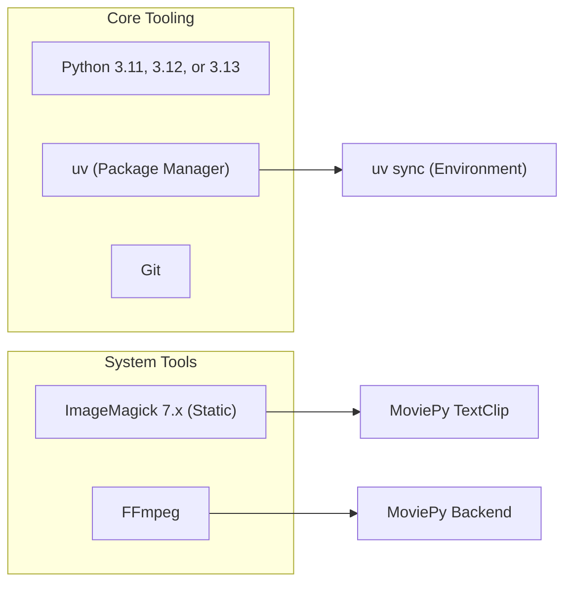
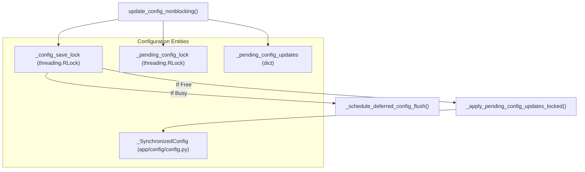
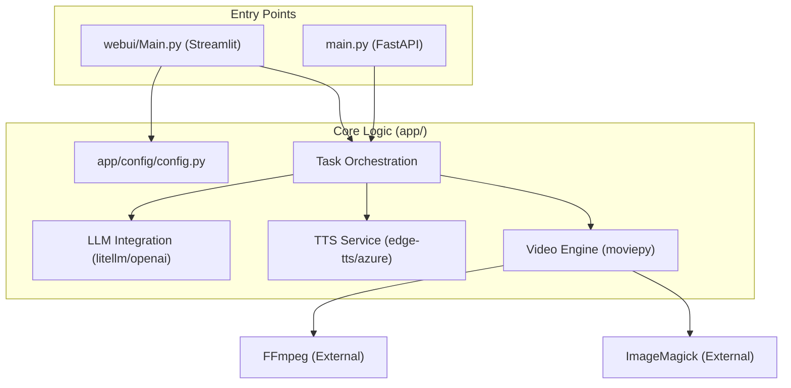

<!-- source: DeepWiki mcp.deepwiki.com · repo harry0703/MoneyPrinterTurbo · page 8.3 Development Setup · fetched 2026-10-30 -->

# Development Setup

<details>
<summary>Relevant source files</summary>

The following files were used as context for generating this wiki page:

- [.dockerignore](.dockerignore)
- [.github/workflows/docker-ghcr.yml](.github/workflows/docker-ghcr.yml)
- [app/__init__.py](app/__init__.py)
- [app/config/config.py](app/config/config.py)
- [docker-compose.release.yml](docker-compose.release.yml)
- [pyproject.toml](pyproject.toml)
- [requirements.txt](requirements.txt)
- [test/services/test_webui_startup.py](test/services/test_webui_startup.py)
- [uv.lock](uv.lock)
- [webui.bat](webui.bat)
- [webui.sh](webui.sh)

</details>


This document provides a comprehensive guide for setting up a local development environment for MoneyPrinterTurbo. It covers installation prerequisites using modern Python tooling (`uv`), environment configuration, and procedures for running and testing the system in development mode.

## Prerequisites

Before setting up the development environment, ensure your system meets the following requirements:

### System Requirements

| Requirement | Minimum | Recommended |
|------------|---------|-------------|
| CPU Cores | 4 cores | 8+ cores |
| RAM | 4 GB | 8+ GB |
| Disk Space | 10 GB free | 20+ GB free |
| GPU | Not required | Optional for Whisper acceleration |
| OS | Windows 10, macOS 11.0, Linux | Latest stable versions |

**Sources:** [pyproject.toml:13-13](), [uv.lock:3-9]()

### Required Software

The system uses `uv` for high-performance dependency management and project isolation.



*   **Python Support**: The project supports Python versions `>=3.11`. Specific handling for `audioop-lts` is included for Python 3.13+ [pyproject.toml:13-34]().
*   **uv**: Recommended for managing the virtual environment and locking dependencies via `uv.lock`. The project is configured as a non-package application for `uv` [pyproject.toml:1-4](), [pyproject.toml:77-79]().
*   **ImageMagick**: Required by `MoviePy` for rendering subtitles. On Windows, the **static library** version is required.
*   **FFmpeg**: Essential for video encoding/decoding.

**Sources:** [pyproject.toml:1-37](), [uv.lock:1-9](), [requirements.txt:1-22]()

## Environment Setup

### Clone and Initialize

Clone the repository and use `uv` to create a synchronized environment:

```bash
git clone https://github.com/harry0703/MoneyPrinterTurbo.git
cd MoneyPrinterTurbo
uv sync --frozen
```

The `uv sync --frozen` command ensures your local environment exactly matches the `uv.lock` file [pyproject.toml:1-4](). If you need TwelveLabs integration, use `uv sync --extra twelvelabs` [pyproject.toml:39-45]().

### Development Dependencies

Development tools such as `pytest`, `ruff`, and `coverage` are managed in a specific dependency group [pyproject.toml:47-52]().

**Sources:** [pyproject.toml:39-52](), [uv.lock:1-22]()

## Running Development Services

The project provides dual interfaces: a Streamlit-based WebUI and a FastAPI-based REST service.

### Starting the Web Interface

The WebUI is launched via `webui/Main.py`. Scripts are provided for both Windows (`webui.bat`) and Unix-like systems (`webui.sh`) to automate environment detection and port selection [webui.bat:12-34](), [webui.sh:19-32]().

```bash
# Windows
webui.bat

# macOS / Linux
./webui.sh
```

The startup logic performs the following:
1.  **Environment Check**: Looks for a `.venv` or system-wide `uv`/`streamlit` [webui.bat:13-20](), [webui.sh:19-32]().
2.  **Port Probing**: Dynamically searches for an available port starting from `8501` to `8599` to avoid `WinError 10013` or address-in-use conflicts [webui.bat:36-52](), [webui.sh:34-60]().
3.  **Streamlit Execution**: Runs `webui/Main.py` with specific flags like `--server.enableCORS=True` and `--client.toolbarMode=minimal` [webui.bat:52-52](), [webui.sh:73-81]().

**Sources:** [webui.bat:1-52](), [webui.sh:1-81]()

### Starting the API Service

The API service is built on `fastapi` and `uvicorn` [pyproject.toml:20-21]().

```bash
# Using uv
uv run python main.py
```

## Implementation Details

### Synchronized Configuration Management
The system uses a specialized `_SynchronizedConfig` class to manage runtime settings. This ensures that UI updates do not interfere with active video generation tasks.



**Key Configuration Functions:**
*   `update_config_nonblocking`: Updates configuration without blocking the Streamlit UI thread [app/config/config.py:91-118]().
*   `snapshot_config_with_pending`: Provides a consistent view of settings for new tasks, merging current disk state with unapplied UI changes [app/config/config.py:168-186]().
*   `_SynchronizedConfig.__setitem__`: Intercepts writes to ensure they respect the global `_config_save_lock` [app/config/config.py:32-41]().

**Sources:** [app/config/config.py:29-186]()

## Testing and Code Quality

### Testing Procedures
The project includes a suite of tests located in the `test/` directory. Developers should verify that startup logic remains intact, particularly path resolution.

*   **Startup Verification**: `TestWebuiStartup` ensures that the `app` package is correctly preferred over external site-packages during Streamlit execution [test/services/test_webui_startup.py:14-15]().
*   **Path Integrity**: The test checks that `app.config` is resolved within the project root [test/services/test_webui_startup.py:45-51]().

### Linting and Coverage
The project uses `ruff` for linting and `coverage` for verifying test depth. A minimum branch coverage of 70% is targeted for production-entry modules including `app`, `cli`, and `webui` [pyproject.toml:58-70]().

**Sources:** [pyproject.toml:47-73](), [test/services/test_webui_startup.py:1-72]()

## System Data Flow Diagram



**Sources:** [pyproject.toml:16-35](), [pyproject.toml:54-64](), [webui.bat:52-52](), [webui.sh:73-73](), [app/config/config.py:15-16]()

## Debugging Tips

1.  **Path Resolution**: The WebUI requires the project root to be in `sys.path`. This is handled by setting `PYTHONPATH` in the startup scripts [webui.bat:5-5](), [webui.sh:11-11]().
2.  **Logging**: The system uses `loguru` for structured logging [pyproject.toml:24-24](). Check console output for detailed error traces during task execution.
3.  **Dependency Conflicts**: If encountering version issues, ensure you are using `uv.lock` via `uv sync --frozen` to maintain consistency with the tested environment [pyproject.toml:1-3]().

**Sources:** [webui.bat:1-10](), [webui.sh:1-11](), [pyproject.toml:1-73]()

---

