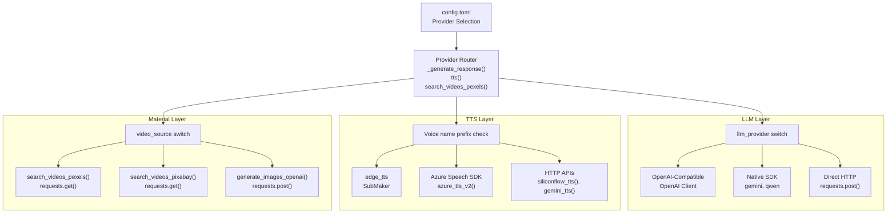

<!-- source: DeepWiki mcp.deepwiki.com · repo harry0703/MoneyPrinterTurbo · page 8.4 Adding New Providers · fetched 2026-10-30 -->

# Adding New Providers

<details>
<summary>Relevant source files</summary>

The following files were used as context for generating this wiki page:

- [app/models/llm_provider.py](app/models/llm_provider.py)
- [app/services/llm.py](app/services/llm.py)
- [app/services/material.py](app/services/material.py)
- [app/services/voice.py](app/services/voice.py)
- [app/utils/utils.py](app/utils/utils.py)
- [docs/MoneyPrinterTurbo.ipynb](docs/MoneyPrinterTurbo.ipynb)
- [test/services/test_llm.py](test/services/test_llm.py)
- [test/services/test_material_openai_image.py](test/services/test_material_openai_image.py)
- [test/services/test_voice.py](test/services/test_voice.py)
- [test/services/test_webui_i18n.py](test/services/test_webui_i18n.py)
- [test/services/test_webui_tts_settings.py](test/services/test_webui_tts_settings.py)

</details>


This document provides a comprehensive guide for developers who want to extend MoneyPrinterTurbo by adding new provider integrations. The multi-provider architecture supports three types of providers: **LLM providers** for script generation, **TTS providers** for voice synthesis, and **video material providers** for content sourcing. This guide covers the implementation patterns, configuration requirements, and integration steps for each provider type.

---

## Provider Architecture Overview

MoneyPrinterTurbo uses a configuration-driven provider abstraction that allows switching between providers without code changes in the business logic layer. The architecture consists of three main provider categories, each with distinct integration patterns.

### System-Level Provider Flow



**Sources:** [app/services/llm.py:142-177](), [app/services/voice.py:1186-1260](), [app/services/material.py:174-220](), [test/services/test_material_openai_image.py:78-115]()

### Provider Interface Contracts

| Provider Type | Input | Output | Error Handling |
|--------------|-------|--------|----------------|
| LLM | `prompt: str` | `content: str` | Raise `ValueError` or `TypeError` [app/services/llm.py:47-65]() |
| TTS | `text: str`, `voice_name: str`, `voice_rate: float`, `voice_file: str` | `SubMaker` object or `None` | Return `None` or log error [app/services/voice.py:1186-1192]() |
| Video Material | `search_term: str`, `minimum_duration: int`, `video_aspect: VideoAspect` | `List[MaterialInfo]` | Return `[]` on failure [app/services/material.py:19-19]() |

**Sources:** [app/services/llm.py:47-65](), [app/services/voice.py:1186-1192](), [app/services/material.py:19-19]()

---

## Adding a New LLM Provider

LLM providers generate video scripts and search keywords. The system currently supports 13+ providers defined in the `LLM_PROVIDER_REGISTRY`.

### Pattern A: OpenAI-Compatible Provider

This is the standard pattern for providers that expose an OpenAI-compatible `/v1/chat/completions` endpoint.

**Step 1: Register the Provider Spec**
Add a new `LLMProviderSpec` to the `LLM_PROVIDER_REGISTRY` in [app/models/llm_provider.py:187-200](). This declares the metadata used by both the WebUI and the service layer.

```python
LLMProviderSpec(
    "yourprovider",
    "Your Provider Name",
    api_key_url="https://platform.yourprovider.com/api-keys",
    default_model="your-default-model",
    default_base_url="https://api.yourprovider.com/v1",
)
```

**Step 2: Update Configuration**
Add the corresponding keys to `config.toml` following the naming convention: `{provider_id}_api_key`, `{provider_id}_model_name`, etc. These are resolved via `provider.config_key()` [app/models/llm_provider.py:80-81]().

**Step 3: Service Layer Integration**
The `_generate_response` function in [app/services/llm.py:142-177]() uses `get_llm_provider(llm_provider)` to retrieve the spec. For OpenAI-compatible providers, the `adapter="openai_compatible"` (default) will trigger the `OpenAI` client logic.

**Sources:** [app/models/llm_provider.py:30-55](), [app/models/llm_provider.py:187-200](), [app/services/llm.py:142-177]()

### Pattern B: Native SDK or Custom Adapter
If the provider requires a specific SDK (like `gemini` or `qwen`), you must implement a custom adapter block in `_generate_response`.

**Step 1: Define Adapter in Spec**
Set a unique `adapter` name in the `LLMProviderSpec` [app/models/llm_provider.py:41-41]().

**Step 2: Implement Adapter Logic**
In [app/services/llm.py:142-177](), add a conditional block for your adapter. Ensure you wrap the output in `_normalize_text_response` to strip reasoning blocks like `<think>` [app/services/llm.py:47-69]().

**Sources:** [app/services/llm.py:47-69](), [app/models/llm_provider.py:41-41]()

---

## Adding a New TTS Provider

TTS providers convert text into audio files. The system uses voice name prefixes (e.g., `siliconflow:`, `gemini:`, `mimo:`) to route requests.

### Implementing a New TTS Provider

**Step 1: Define Voice List**
Create a function to return the list of available voices with a unique prefix. This is used by the WebUI to populate the voice selection dropdown.
```python
def get_yourprovider_voices() -> list[str]:
    # format: "prefix:voice_id-Gender"
    return ["yourprovider:voice1-Female", "yourprovider:voice2-Male"]
```
**Sources:** [app/services/voice.py:102-125](), [app/services/voice.py:128-139](), [app/services/voice.py:142-163]()

**Step 2: Add Prefix Detection**
New providers should follow the pattern of checking the `voice_name` prefix in the `tts()` dispatcher.

**Step 3: Implement the TTS Function**
The function must save the audio to `voice_file`. If the provider does not return word-level timing, use `mktimestamp` at [app/services/voice.py:88-99]() to manually construct timing for the `SubMaker` object.

**Sources:** [app/services/voice.py:88-99](), [app/services/voice.py:102-125]()

---

## Adding a New Video Material Provider

Material providers search for and download video clips or generate images based on keywords.

### Implementation Pattern

**Step 1: Search/Generation Function**
Implement a function that returns a `List[MaterialInfo]`. For image generation, see `generate_images_openai` in [test/services/test_material_openai_image.py:78-115]().

**Step 2: API Key Rotation**
Use `get_api_key(cfg_key)` at [app/services/material.py:174-190]() to support multiple keys and handle thread-safe rotation.

**Step 3: Result Recording**
Use `_material_source_record()` at [app/services/material.py:86-124]() to create a lightweight record of the asset's origin, which is then persisted to the task directory via `_persist_material_sources()` [app/services/material.py:127-156]().

**Sources:** [app/services/material.py:86-124](), [app/services/material.py:127-156](), [app/services/material.py:174-190]()

---

## Configuration and Internationalization

New providers must be documented in `config.toml` and localized in the i18n files.

### WebUI and i18n
- **Labels**: Add translation keys for `llm_provider_label.{id}` and `llm_provider_tips.{id}` in [webui/i18n/en.json]().
- **Validation**: The test suite ensures that all registered providers have corresponding translations and official configuration links [test/services/test_webui_i18n.py:162-179](), [test/services/test_webui_tts_settings.py:56-64]().

**Sources:** [app/models/llm_provider.py:58-63](), [test/services/test_webui_i18n.py:162-179](), [test/services/test_webui_tts_settings.py:56-64]()

---

## Testing Checklist

- [ ] **LLM**: Verify `_normalize_text_response` removes `<think>` blocks and preserves internal newlines [app/services/llm.py:47-69](), [test/services/test_llm.py:35-57]().
- [ ] **TTS**: Ensure `voice_file` is written and `SubMaker` offsets are correctly formatted [app/services/voice.py:88-99]().
- [ ] **Material**: Verify that the provider respects the `video_aspect` and returns a valid `MaterialInfo` list [app/services/material.py:19-19](), [test/services/test_material_openai_image.py:98-131]().
- [ ] **Security**: Use `_sanitize_error_message` to prevent leaking API keys or credentials in error logs [app/services/llm.py:72-84]().

**Sources:** [app/services/llm.py:47-69](), [app/services/llm.py:72-84](), [app/services/voice.py:88-99](), [test/services/test_llm.py:35-57](), [test/services/test_material_openai_image.py:98-131]()

---

