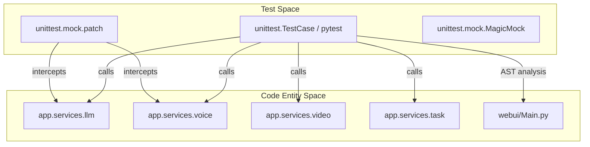
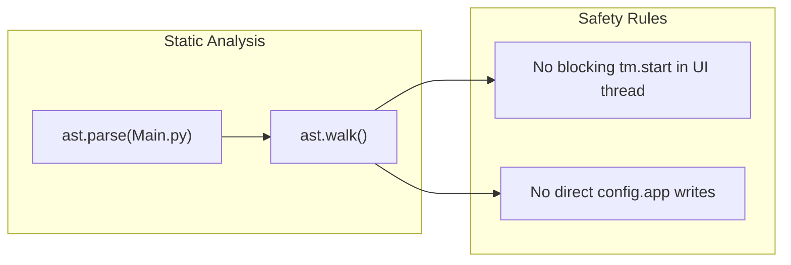

<!-- source: DeepWiki mcp.deepwiki.com · repo harry0703/MoneyPrinterTurbo · page 8.5 Testing · fetched 2026-10-30 -->

# Testing

<details>
<summary>Relevant source files</summary>

The following files were used as context for generating this wiki page:

- [.dockerignore](.dockerignore)
- [.github/workflows/ci.yml](.github/workflows/ci.yml)
- [.github/workflows/docker-ghcr.yml](.github/workflows/docker-ghcr.yml)
- [app/models/schema.py](app/models/schema.py)
- [app/services/llm.py](app/services/llm.py)
- [app/services/task.py](app/services/task.py)
- [app/services/video.py](app/services/video.py)
- [app/services/voice.py](app/services/voice.py)
- [app/utils/logging_utils.py](app/utils/logging_utils.py)
- [app/utils/utils.py](app/utils/utils.py)
- [docker-compose.release.yml](docker-compose.release.yml)
- [test/services/test_llm.py](test/services/test_llm.py)
- [test/services/test_task.py](test/services/test_task.py)
- [test/services/test_video.py](test/services/test_video.py)
- [test/services/test_voice.py](test/services/test_voice.py)
- [test/services/test_webui_task.py](test/services/test_webui_task.py)
- [test/services/test_webui_tts_settings.py](test/services/test_webui_tts_settings.py)

</details>


This page documents the test suite for MoneyPrinterTurbo, covering the structure of the test environment, implementation patterns for service-level testing, and the validation of core components like LLM integration, TTS services, and video processing.

## Test Suite Overview

The project utilizes the `pytest` runner, which is configured to execute both `unittest.TestCase` classes and standard `pytest` functions. Tests are organized within the `test/` directory, mirroring the structure of the `app/` service modules. The suite includes unit tests for individual functions and integration tests that mock external API dependencies to verify service logic.

### Test Directory Structure
- `test/services/`: Contains tests for core logic (LLM, Voice, Video, Task, State).
- `test/resources/`: Contains static assets (e.g., `1.png`) used for visual processing tests [test/services/test_video.py:25-26]().
- `.github/workflows/ci.yml`: Configuration for automated testing in CI/CD [ .github/workflows/ci.yml:1-113]().

Sources: [test/services/test_video.py:25-26](), [.github/workflows/ci.yml:1-112]()

## Testing Architecture

The testing architecture bridges the "Natural Language Space" (user requirements like "Generate a script with reasoning models") to the "Code Entity Space" (classes like `VideoParams` and functions like `_normalize_text_response`).

### Test Component Interaction
The following diagram illustrates how a test case interacts with the system components and mocks.

**Test Component Interaction**

Sources: [test/services/test_llm.py:10-25](), [test/services/test_voice.py:12-19](), [test/services/test_webui_task.py:25-51]()

## Service Testing Patterns

### 1. LLM Service Testing (`test_llm.py`)
LLM tests focus on response normalization and prompt construction.

- **Reasoning Model Support**: Validates that `_normalize_text_response` correctly strips `<think>` blocks (used by models like DeepSeek R1) to prevent internal reasoning from appearing in subtitles [test/services/test_llm.py:47-73]().
- **Prompt Integrity**: Ensures that custom system prompts still include runtime context like `video_subject` and `language` [test/services/test_llm.py:93-110]().
- **Snapshot Isolation**: Verifies that `generate_script` uses the configuration snapshot submitted at task start, preventing background config changes from affecting active retries [test/services/test_llm.py:132-157]().

### 2. Video Service Testing (`test_video.py`)
Video tests focus on resource cleanup, canvas fitting, and pipeline stability.

- **Canvas Fitting**: Validates `VideoFitMode.cover` and `VideoFitMode.contain` logic using `ImageClip` to ensure correct aspect ratio handling without visual artifacts [test/services/test_video.py:66-106]().
- **Cleanup Safety**: Tests verify that `delete_files` deduplicates paths (important for looped clips) and handles missing files gracefully [test/services/test_video.py:108-138]().
- **Codec Validation**: Validates the detection of FFmpeg encoders and the fallback mechanism to `libx264` [app/services/video.py:193-222]().

### 3. Voice & TTS Testing (`test_voice.py`)
- **No-Voice Mode**: Verifies that the `no-voice` sentinel generates silent audio via FFmpeg `anullsrc` and estimates duration based on text length for various languages [test/services/test_voice.py:98-169]().
- **Provider Catalogs**: Ensures hardcoded voice lists for Gemini and Azure match documented specifications [test/services/test_voice.py:55-90]().

### 4. Task Orchestration Testing (`test_task.py`)
- **Parameter Forwarding**: Ensures that high-level `VideoParams` (like `video_clip_speed` and `video_fit_mode`) are correctly propagated down to the `combine_videos` service [test/services/test_task.py:93-121]().
- **BGM Provider Logic**: Validates that both Sonilo and ElevenLabs music generation flows correctly integrate with the final video mixing stage [test/services/test_task.py:122-194]().

Sources: [test/services/test_llm.py:47-157](), [test/services/test_video.py:66-138](), [test/services/test_voice.py:98-169](), [test/services/test_task.py:93-194]()

## UI Logic Validation

MoneyPrinterTurbo uses AST (Abstract Syntax Tree) analysis to verify Streamlit UI behavior without requiring a full browser environment.

**WebUI Static Analysis Pattern**


- **Non-blocking Generation**: Tests confirm that `_render_generation_controls` calls `webui_task.submit_generation` (async) instead of `tm.start` (sync) to prevent WebUI white-screen issues [test/services/test_webui_task.py:44-66]().
- **Thread-Safe Config**: Ensures no direct writes to `config.app` or `config.ui` occur in the UI script, mandating the use of thread-safe helpers [test/services/test_webui_task.py:68-142]().

Sources: [test/services/test_webui_task.py:25-142]()

## Running Tests

The project uses `uv` for dependency management and test execution.

1. **Run All Tests**:
   ```bash
   uv run python -X utf8 -m pytest -q test
   ```

2. **Run with Coverage**:
   ```bash
   uv run python -X utf8 -m coverage run -m pytest -q test
   uv run python -m coverage report
   ```

3. **CI Environment**:
   The GitHub Actions workflow runs tests on Ubuntu (Python 3.11, 3.13) and Windows. It includes a Redis service container for state testing and a Windows smoke test job [ .github/workflows/ci.yml:10-113]().

### Test Fixtures
- **Fake Clips**: `_FakeMoviePyClip` provides a minimal MoviePy interface to test the mixing pipeline without real encoding [test/services/test_video.py:28-51]().
- **Integration Flag**: Integration tests that require external API access are guarded by the `MPT_RUN_INTEGRATION_TESTS` environment variable [test/services/test_llm.py:27-31]().

Sources: [.github/workflows/ci.yml:10-112](), [test/services/test_video.py:28-51](), [test/services/test_llm.py:27-31]()

---

