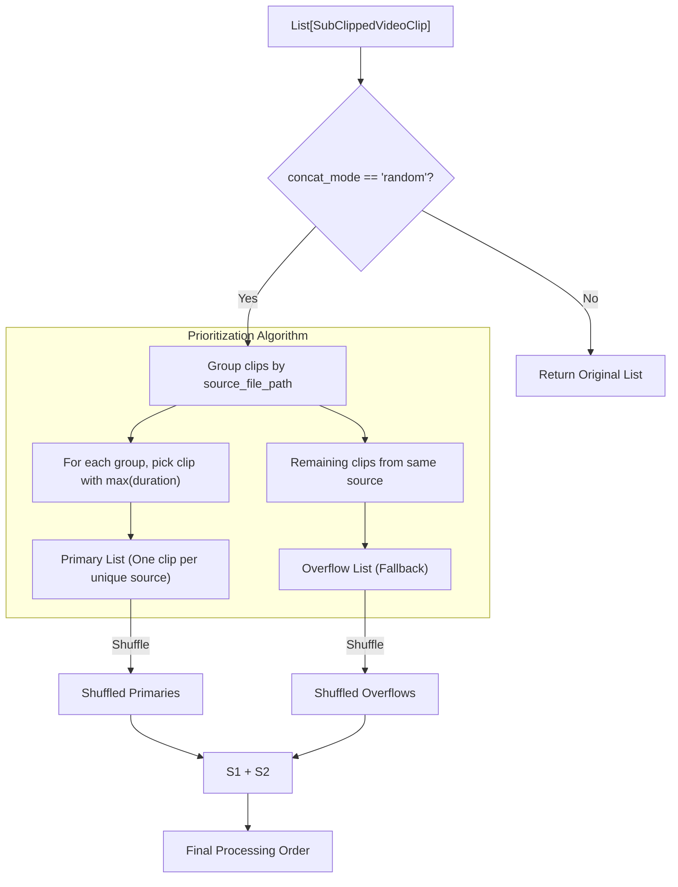

<!-- source: DeepWiki mcp.deepwiki.com · repo harry0703/MoneyPrinterTurbo · page 9 Glossary · fetched 2026-10-30 -->

# Glossary

<details>
<summary>Relevant source files</summary>

The following files were used as context for generating this wiki page:

- [README-en.md](README-en.md)
- [README-ja.md](README-ja.md)
- [README.md](README.md)
- [app/models/schema.py](app/models/schema.py)
- [app/services/llm.py](app/services/llm.py)
- [app/services/task.py](app/services/task.py)
- [app/services/video.py](app/services/video.py)
- [app/services/voice.py](app/services/voice.py)
- [app/utils/utils.py](app/utils/utils.py)
- [config.example.toml](config.example.toml)
- [test/services/test_llm.py](test/services/test_llm.py)
- [test/services/test_task.py](test/services/test_task.py)
- [test/services/test_video.py](test/services/test_video.py)
- [test/services/test_voice.py](test/services/test_voice.py)
- [test/services/test_webui_tts_settings.py](test/services/test_webui_tts_settings.py)
- [webui/Main.py](webui/Main.py)

</details>


This page defines codebase-specific terms, jargon, and domain concepts used within MoneyPrinterTurbo. It serves as a reference for onboarding engineers to understand the implementation details and data flow logic.

## Core Concepts & Domain Jargon

### 1. Task Pipeline & States
The system operates on a task-based asynchronous model. A "Task" represents the entire lifecycle of a video generation request.

*   **Task ID**: A unique UUID assigned to every generation request, used to create a dedicated storage directory [app/utils/utils.py:108-111]().
*   **Task State**: Represents the current phase of the video. States include `FAILED` (-1), `COMPLETE` (1), and `PROCESSING` (4) [app/models/const.py:25-27]().
*   **Stop At Checkpoint**: A mechanism allowing the pipeline to pause after specific stages (e.g., after script generation but before video synthesis) [app/services/task.py:270-275]().
*   **Cross-Platform Posting**: A background workflow that handles uploading finished videos to platforms like TikTok or Instagram, managed by a dedicated thread pool `_cross_post_executor` [app/services/task.py:41-46]().

### 2. LLM Entities
*   **Video Script**: The AI-generated text content that forms the narrative of the video [app/services/task.py:20-21]().
*   **Search Terms**: Keywords extracted from the script by an LLM, used to query video providers like Pexels or Pixabay [app/services/task.py:22-23]().
*   **Think Block**: Internal reasoning metadata returned by models like DeepSeek R1 or MiniMax M3, enclosed in `<think>` tags. The system explicitly strips these via `_THINK_BLOCK_RE` to avoid them appearing in narration or subtitles [app/services/llm.py:19-20](), [app/services/llm.py:62-63]().

### 3. Voice & Subtitles
*   **SubMaker**: A specific object from the `edge_tts` library used to generate timing metadata for subtitles [app/services/voice.py:22](). It is the primary bridge between audio generation and SRT creation [app/services/voice.py:92-95]().
*   **Voice Rate**: A multiplier for speech speed (e.g., 1.0 is normal, 1.2 is 20% faster) [app/models/schema.py:145]().
*   **Subtitle Provider**: The engine used for transcription. Options include `edge` (uses timing from TTS) or `whisper` (uses local/remote inference on the generated audio) [app/services/task.py:26-27]().
*   **No-Voice Mode**: A specialized mode (`no-voice`) that generates silent audio and estimates duration based on character count for subtitle timing [app/services/voice.py:75-79](), [test/services/test_voice.py:98-122]().

### 4. Video Composition
*   **Material**: A raw video clip or image sourced from a provider (Pexels, Pixabay, Local, or AI generators like Seedance) [app/models/schema.py:63-70]().
*   **SubClippedVideoClip**: A wrapper class in the service layer that manages metadata for a specific segment of a larger video file, including its start/end times and source path [app/services/video.py:43-66]().
*   **Concat Mode**: Determines the order of materials. `sequential` follows the order of search terms, while `random` shuffles them [app/models/schema.py:18-20]().
*   **Video Fit Mode**: Defines how source clips fill the canvas, either `cover` (crop to fill) or `contain` (letterbox) [app/models/schema.py:49-54]().

**Sources:** [app/models/schema.py:18-145](), [app/services/task.py:20-46](), [app/services/llm.py:19-63](), [app/services/video.py:43-66]()

---

## Technical Data Flow

The following diagram illustrates how a user request transforms from natural language prompts into code entities and final files.

### Natural Language to Code Entity Space
This diagram maps high-level concepts to the specific Pydantic models and service functions that handle them.

```mermaid
graph TD
    ["User Prompt (Subject/Topic)"] -- "POST /videos" --> VideoParams["app.models.schema.VideoParams"]
    
    subgraph "Script Generation Space"
        VideoParams -- "video_subject" --> LLMGen["app.services.llm.generate_script()"]
        LLMGen --> VideoScript["Video Script (String)"]
    end

    subgraph "Material Space"
        VideoScript -- "Extraction" --> TermsGen["app.services.llm.generate_terms()"]
        TermsGen --> SearchTerms["List[str] (video_terms)"]
        SearchTerms -- "Query" --> MaterialFetch["app.services.material.search_videos()"]
        MaterialFetch --> MaterialInfo["app.models.schema.MaterialInfo"]
    end

    subgraph "Synthesis Space"
        VideoScript -- "TTS" --> VoiceTTS["app.services.voice.tts()"]
        VoiceTTS --> SubMaker["edge_tts.SubMaker"]
        SubMaker -- "Formatting" --> SRT["subtitle.srt"]
        MaterialInfo -- "Processing" --> SubClip["app.services.video.SubClippedVideoClip"]
    end

    SRT --> FinalVideo["final.mp4"]
    SubClip --> FinalVideo
```
**Sources:** [app/models/schema.py:73-138](), [app/services/task.py:18-32](), [app/services/video.py:43-53](), [app/services/voice.py:20-25]()

---

## Code Entity Reference Table

| Term | Code Symbol | Description | File Pointer |
| :--- | :--- | :--- | :--- |
| **Task State Mgr** | `app.services.state` | Manages task lifecycle, progress, and persistent state using Memory or Redis. | [app/services/task.py:34]() |
| **Video Aspect** | `VideoAspect` | Enum for 16:9, 9:16, or 1:1 resolutions with `to_resolution()` helper. | [app/models/schema.py:34-46]() |
| **FFmpeg Binary** | `get_ffmpeg_binary` | Logic to locate FFmpeg in system PATH or custom config locations. | [app/services/video.py:161-169]() |
| **Audio Codec** | `audio_codec` | Defaulted to `aac` with `192k` bitrate to avoid Docker quality fluctuations. | [app/services/video.py:69-72]() |
| **Video Codec** | `_DEFAULT_VIDEO_CODEC` | Defaulted to `libx264` with fallback logic for hardware encoders like `h264_nvenc`. | [app/services/video.py:84-92]() |

---

## Implementation Details: Video Processing Logic

The system uses a "Unique Source Prioritization" algorithm to ensure high-quality, varied visual output.

### Concatenation Logic Flow
This diagram explains the internal logic of `_prioritize_unique_source_clips` which ensures variety in the final output by prioritizing distinct source files.


**Sources:** [app/services/video.py:118-158]()

### Key Technical Safeguards
*   **Resolution Tolerance**: The system allows a tolerance of 10 pixels below the 480p threshold (e.g., 478px) via `_MIN_DIMENSION_TOLERANCE` to accommodate codecs like WhatsApp that downscale slightly [app/services/video.py:81-83](), [app/services/video.py:107-115]().
*   **Duration Safety Margin**: A small offset `_VIDEO_DURATION_SAFETY_MARGIN` (0.1s) is added to material requests to prevent black frames at the end of clips caused by FFmpeg frame rounding [app/services/video.py:77](), [app/services/video.py:96-104]().
*   **Think Block Stripping**: Reasoning models (MiniMax M3, DeepSeek R1) are handled by `_normalize_text_response` to ensure only speakable text is processed [app/services/llm.py:47-69](), [test/services/test_llm.py:47-57]().
*   **Config Snapshots**: When a task starts, the system uses the submitted configuration to ensure that if a user changes settings in the UI while a task is running, the running task continues with its original parameters [app/services/llm.py:142-151](), [test/services/test_llm.py:132-157]().

**Sources:** [app/services/video.py:77-115](), [app/services/llm.py:47-151](), [test/services/test_llm.py:47-157]()