# Page: Overview

# Overview

<details>
<summary>Relevant source files</summary>

The following files were used as context for generating this wiki page:

- [README-en.md](README-en.md)
- [README-ja.md](README-ja.md)
- [README.md](README.md)
- [app/models/schema.py](app/models/schema.py)
- [app/services/task.py](app/services/task.py)
- [test/services/test_task.py](test/services/test_task.py)
- [webui/Main.py](webui/Main.py)

</details>


MoneyPrinterTurbo is an automated video generation system that produces high-definition short-form videos from a simple topic or keyword input. The system coordinates script generation, material acquisition, voice synthesis, subtitle generation, and video assembly through a multi-stage pipeline powered by a configuration-driven provider architecture.

## System Purpose

MoneyPrinterTurbo provides automated video creation through dual interfaces:
- **Web UI**: A Streamlit application serving as the primary user dashboard, located at [webui/Main.py:67-79]().
- **REST API**: A FastAPI service defined in [app/asgi.py:51-71]() and launched via `main.py` serving on port 8080.

Both interfaces invoke the core orchestration logic which handles the video generation pipeline. The system supports 13+ LLM providers (including Kimi, DeepSeek, and OpenAI), multiple TTS services, and various video sources via [app/config/config.py:1-10]().

Sources: [README.md:3-7](), [README-en.md:3-7](), [webui/Main.py:67-79](), [app/asgi.py:51-71](), [app/config/config.py:1-10]()

## System Architecture

### Complete System Architecture

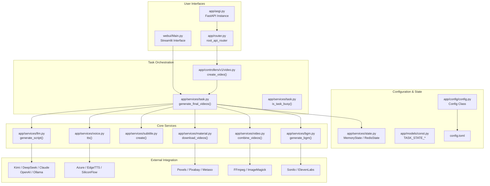

The architecture follows a clear separation between the presentation layer (Streamlit/FastAPI), the router layer [app/router.py:17](), and the service layer. Configuration is centralized in [app/config/config.py](), which manages the application's global state. Task state management is abstracted via `MemoryState` or `RedisState` in [app/services/state.py:16](). The system also includes complex cross-posting logic in [app/services/task.py:41-69]() for social media distribution.

Sources: [app/asgi.py:65-90](), [app/services/task.py:41-69](), [app/models/const.py:25-32](), [app/config/config.py:1-20](), [app/services/state.py:16](), [test/services/test_task.py:16]()

## Key Features

| Category | Features | Implementation |
|----------|----------|----------------|
| **Dual Interfaces** | Web UI and REST API | [webui/Main.py:67-79](), [app/asgi.py:51-71]() |
| **Script Generation** | AI-automated or custom scripts | [app/services/llm.py]() supporting 13+ providers |
| **Task Lifecycle** | Status tracking (Processing, Complete, Failed) | [app/models/const.py:25-27]() |
| **Voice Synthesis** | Multi-provider support (Edge, Azure, etc.) | [app/services/voice.py]() |
| **Cross-Posting** | Automated upload to TikTok/Instagram | [app/services/task.py:53-69]() |
| **Media Sourcing** | Pexels/Pixabay/Local/AI Video | [webui/Main.py:110-121](), [app/services/material.py]() |
| **Music Generation** | Sonilo/ElevenLabs AI BGM | [app/services/task.py:73-88]() |

Sources: [webui/Main.py:110-121](), [app/services/task.py:73-88](), [app/models/const.py:25-35](), [app/asgi.py:51-71]()

## Video Generation Pipeline

The generation process is a sequential pipeline managed by the task service. The core parameters are defined in the `VideoParams` model [app/models/schema.py:73-138]().

### Pipeline Data Flow


1.  **Scripting**: Uses LLM providers to generate video copy and extract keywords [test/services/test_task.py:65-91]().
2.  **Audio**: Converts text to speech. The system handles punctuation specifically to ensure TTS and subtitle synchronization [app/models/const.py:1-23]().
3.  **Subtitles**: Generates synchronized captions (SRT) using [app/services/subtitle.py]().
4.  **Materials**: Downloads clips or generates AI visuals based on terms [webui/Main.py:110-121]().
5.  **BGM**: Generates AI background music if configured (e.g., via Sonilo) [app/services/task.py:122-158]().
6.  **Assembly**: Combines assets into a final video file, respecting `VideoAspect` (16:9, 9:16, 1:1) [app/models/schema.py:34-46]() and `VideoFitMode` (cover/contain) [app/models/schema.py:49-53]().

Sources: [app/models/schema.py:34-138](), [app/models/const.py:1-23](), [app/services/task.py:122-158](), [test/services/test_task.py:65-91]()

## Deployment & Configuration

MoneyPrinterTurbo is designed for flexible deployment:
- **Docker**: Primary recommended method using `docker-compose`.
- **Manual**: Standard Python installation (3.11+).
- **Static Assets**: The FastAPI application mounts `/tasks` for generated content and resource directories for fonts and songs [webui/Main.py:90-93](), [app/asgi.py:84-90]().

### Configuration System
The system relies on a `config.toml` file. The application lifespan management handles task recovery, such as cleaning up interrupted social media cross-posts during startup [app/asgi.py:19-33](). WebUI configuration and locales are managed in [webui/Main.py:92-96]().

Sources: [app/asgi.py:19-33](), [app/asgi.py:84-90](), [webui/Main.py:90-96](), [README.md:11]()

---

# Page: Getting Started

# Getting Started

<details>
<summary>Relevant source files</summary>

The following files were used as context for generating this wiki page:

- [Dockerfile](Dockerfile)
- [Dockerfile.gpu](Dockerfile.gpu)
- [README-en.md](README-en.md)
- [README-ja.md](README-ja.md)
- [README.md](README.md)
- [config.example.toml](config.example.toml)
- [docker-compose.gpu.yml](docker-compose.gpu.yml)
- [docker-compose.yml](docker-compose.yml)
- [webui.bat](webui.bat)
- [webui.sh](webui.sh)

</details>


This guide provides an overview of setting up and running MoneyPrinterTurbo for the first time. It covers system requirements, deployment options, and the basic workflow needed to generate your first AI-powered video.

For detailed installation instructions, see [Installation & Setup](#2.1). For configuration details, see [Configuration](#2.2). For a step-by-step walkthrough of generating your first video, see [Quick Start Guide](#2.3).

**Sources:** [README.md:5-7](), [README-en.md:5-7]()

---

## Prerequisites and System Requirements

Before installing MoneyPrinterTurbo, ensure your system meets the following requirements:

### Minimum System Requirements

| Component | Requirement | Recommended |
|-----------|-------------|-------------|
| CPU | 4 cores | 6 to 8 cores |
| Memory | 4GB RAM | 8GB to 16GB+ |
| GPU | Not required | 4GB+ VRAM (for local transcription/faster processing) |
| OS | Windows 10+, macOS 11.0+, or Linux | Same |

[README.md:10-11](), [README-en.md:10-11]()

### Critical Prerequisites

1.  **Path Requirements**: Avoid using Chinese characters, special characters, or spaces in installation paths to prevent unpredictable issues.
2.  **Network Access**: Ensure stable internet connectivity. If using a proxy, verify the `[proxy]` settings in `config.toml` [config.example.toml:1-9]().
3.  **External Tools**: 
    *   **FFmpeg**: Essential for video processing and encoding [Dockerfile:32-32](), [Dockerfile.gpu:19-19]().
    *   **ImageMagick**: Required for subtitle rendering and text effects.
    *   **Python**: Version 3.11 or higher is required [README.md:11-11](), [Dockerfile:2-2]().

**Sources:** [README.md:10-12](), [README-en.md:10-12](), [Dockerfile:32-33](), [Dockerfile.gpu:16-26]()

---

## Deployment Methods Overview

MoneyPrinterTurbo supports several primary deployment strategies depending on your technical comfort level and hardware availability:

### 1. Google Colab (Cloud Trial)
Best for users who want to try the system immediately without local hardware requirements.
*   **Sources**: [README.md:17-17](), [README-en.md:17-17]()

### 2. Windows One-Click / Batch Setup
Simplified local setup for Windows users.
*   **Startup**: The `webui.bat` script handles environment variable setup, port detection (searching 8501-8599), and launches the Streamlit interface [webui.bat:5-52]().
*   **Sources**: [webui.bat:1-52]()

### 3. Docker & Docker Compose (Containerized)
Recommended for consistent environments and production-like setups.
*   **Standard (CPU)**: Uses `Dockerfile` with `python:3.11-slim-bullseye` [Dockerfile:1-2]().
*   **GPU Accelerated**: Uses `Dockerfile.gpu` based on `nvidia/cuda:12.1.1-cudnn8-runtime-ubuntu22.04` for faster video processing and AI tasks [Dockerfile.gpu:1-2]().
*   **Orchestration**: `docker-compose.yml` manages both the WebUI (port 8501) and the API (port 8080) services [docker-compose.yml:5-24]().
*   **Sources**: [Dockerfile:1-102](), [Dockerfile.gpu:1-55](), [docker-compose.yml:1-24](), [docker-compose.gpu.yml:1-35]()

### 4. Manual Installation
Full control using standard Python tools.
*   **Launch Scripts**: Use `webui.sh` for Unix-like systems [webui.sh:1-81]() or `webui.bat` for Windows [webui.bat:1-52](). Both scripts prioritize a local `.venv` if present [webui.sh:19-21](), [webui.bat:13-14]().
*   **Sources**: [webui.sh:1-81](), [webui.bat:1-52]()

---

## High-Level Workflow

The following diagram bridges natural language concepts to the code entities that handle them during the video generation lifecycle.

**Workflow: From Subject to Final Video**
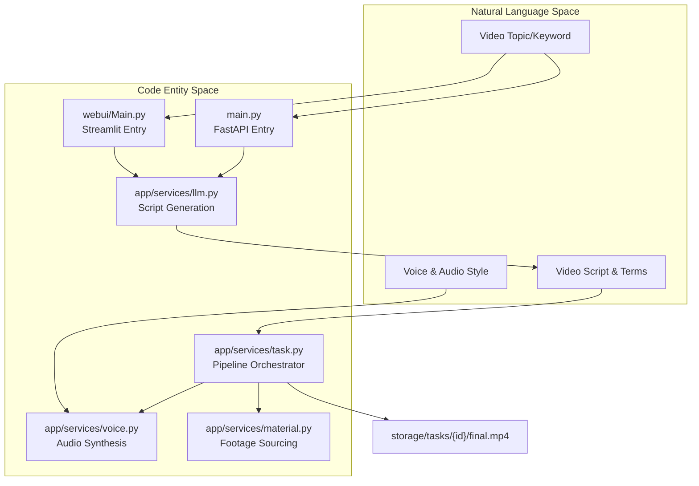

**Sources:** [webui/Main.py:1-52](), [docker-compose.yml:12-22](), [config.example.toml:36-78]()

---

## Core Components and File Structure

The system separates user interaction from the core processing pipeline.

**System Component Map**
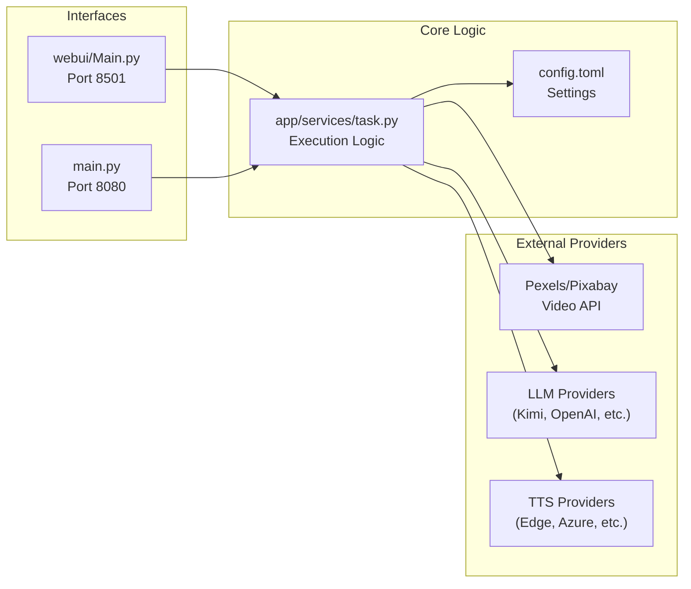

### Key Files and Directories

| Path | Purpose |
|------|---------|
| `config.toml` | Active configuration (copy from `config.example.toml`) [config.example.toml:1-3]() |
| `main.py` | Entry point for the FastAPI REST server [docker-compose.yml:22-22]() |
| `webui/Main.py` | Entry point for the Streamlit Web interface [Dockerfile:102-102]() |
| `requirements.txt` | Python dependency list [Dockerfile:83-83]() |
| `storage/` | Default directory for generated tasks and assets [Dockerfile:109-111]() |

**Sources:** [config.example.toml:1-14](), [docker-compose.yml:1-24](), [Dockerfile:83-102]()

---

## Minimal Configuration

Before generating your first video, you must set up your `config.toml`. The system defaults to `pexels` for video sourcing and expects API keys for LLM services.

```toml
# config.toml (Essential snippet)
log_level = "DEBUG"
listen_port = 8080

[app]
# Select your video material source
video_source = "pexels" # Options: pexels, pixabay, coverr, etc.
pexels_api_keys = ["YOUR_KEY_HERE"]

# Script generation settings
script_generation_backend = "local"
```

For detailed configuration of all 13+ LLM providers and various TTS services, see [Configuration](#2.2).

**Sources:** [config.example.toml:9-12](), [config.example.toml:78-85](), [config.example.toml:39-39]()

---

## Next Steps

1.  **Installation**: Follow the detailed guide in [Installation & Setup](#2.1) to prepare your environment.
2.  **Configuration**: Obtain your API keys and set up your `config.toml` as described in [Configuration](#2.2).
3.  **Generate**: Use the [Quick Start Guide](#2.3) to create your first video using the WebUI.

---

# Page: Installation & Setup

# Installation & Setup

<details>
<summary>Relevant source files</summary>

The following files were used as context for generating this wiki page:

- [.dockerignore](.dockerignore)
- [.github/workflows/docker-ghcr.yml](.github/workflows/docker-ghcr.yml)
- [Dockerfile](Dockerfile)
- [Dockerfile.gpu](Dockerfile.gpu)
- [README-en.md](README-en.md)
- [README-ja.md](README-ja.md)
- [README.md](README.md)
- [docker-compose.gpu.yml](docker-compose.gpu.yml)
- [docker-compose.release.yml](docker-compose.release.yml)
- [docker-compose.yml](docker-compose.yml)
- [webui.bat](webui.bat)
- [webui.sh](webui.sh)

</details>


This document provides comprehensive installation instructions for MoneyPrinterTurbo, covering all supported deployment methods including Docker (CPU/GPU), Windows one-click packages, manual installation, and Google Colab. For configuration details after installation, see [Configuration](). For your first video generation walkthrough, see [Quick Start Guide]().

## System Requirements

MoneyPrinterTurbo requires specific hardware and software prerequisites for optimal performance.

### Hardware Requirements
- **CPU**: Minimum 4 cores recommended.
- **RAM**: 4GB or higher recommended.  
- **GPU**: Optional. Required for local `faster-whisper` acceleration or GPU-based video encoding.
- **Disk**: Sufficient space for video assets and the `storage/` directory.

### Software Requirements
- **Python**: Version 3.11 or higher is required [README.md:11-11]().
- **FFmpeg**: Required for video processing and synthesis [Dockerfile:32-32]().
- **ImageMagick**: Required for subtitle rendering and image processing.
- **Docker**: Recommended for containerized deployment.

Sources: [README.md:11-11](), [Dockerfile:32-32](), [Dockerfile.gpu:19-19]()

## Installation Architecture Overview

The following diagram illustrates how the different installation components relate to the core application structure and code entities.

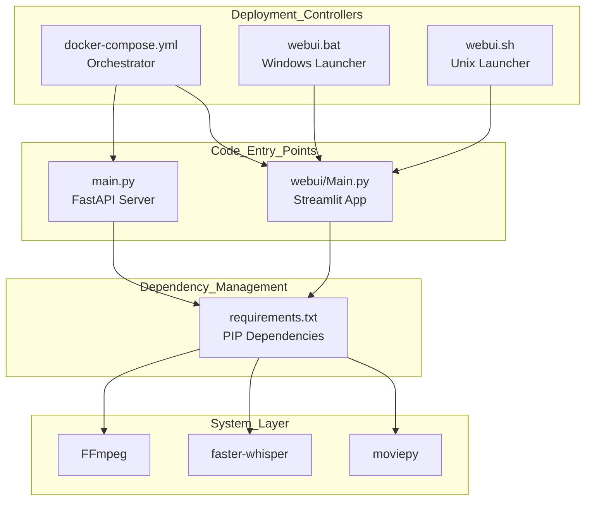

Sources: [docker-compose.yml:5-24](), [webui.bat:52-52](), [webui.sh:73-81](), [Dockerfile:83-92](), [docker-compose.release.yml:7-21]()

## Docker Deployment (Recommended)

Docker is the preferred method as it encapsulates complex system dependencies like FFmpeg and Python environments.

### CPU Deployment
This is the default configuration suitable for most users.

1. **Clone and Enter**:
   ```bash
   git clone https://github.com/harry0703/MoneyPrinterTurbo.git
   cd MoneyPrinterTurbo
   ```
2. **Launch Services**:
   ```bash
   docker compose up -d
   ```
   This command starts two containers: `moneyprinterturbo-webui` on port 8501 and `moneyprinterturbo-api` on port 8080 [docker-compose.yml:9-21]().

### GPU Deployment (NVIDIA Only)
Utilizes NVIDIA GPU to accelerate `faster-whisper` and video rendering.

1. **Prerequisites**: NVIDIA Container Toolkit installed and `nvidia-smi` functional.
2. **Launch with GPU override**:
   ```bash
   docker compose -f docker-compose.yml -f docker-compose.gpu.yml up -d --build
   ```
   The `docker-compose.gpu.yml` file overrides the build to use `Dockerfile.gpu` (based on `nvidia/cuda:12.1.1-cudnn8-runtime-ubuntu22.04`) and reserves 1 GPU device for both the WebUI and API services [docker-compose.gpu.yml:13-35](), [Dockerfile.gpu:2-2]().

### Docker Internal Implementation
The `Dockerfile` uses a multi-mirror fallback strategy (Aliyun -> Tsinghua -> Debian) to ensure system package installation stability for users in different regions [Dockerfile:22-79](). It installs `git` and `ffmpeg` as core system dependencies [Dockerfile:32-32]().

Sources: [Dockerfile:1-102](), [Dockerfile.gpu:1-55](), [docker-compose.yml:1-24](), [docker-compose.gpu.yml:1-35]()

## Windows & Unix One-Click Setup

The repository provides scripts to automate the environment check and launch sequence.

### Execution Logic
1. **Environment Detection**: Both `webui.bat` and `webui.sh` check for a local `.venv` or a system-wide `uv` installation [webui.bat:13-20](), [webui.sh:19-32]().
2. **Port Arbitration**: The scripts dynamically search for an available port between 8501 and 8600 if the default 8501 is occupied [webui.bat:36-49](), [webui.sh:34-64]().
3. **Execution**: Launches the Streamlit app using `webui/Main.py` with optimized server flags [webui.bat:52-52](), [webui.sh:73-81]().

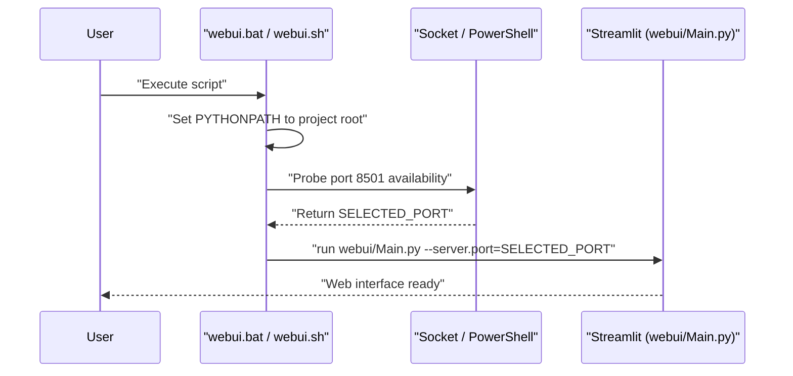

Sources: [webui.bat:1-52](), [webui.sh:1-81]()

## Manual Installation

Manual installation is recommended for developers.

### 1. Python Environment
The project requires Python 3.11+ [README.md:11-11]().
```bash
# Install dependencies
pip install -r requirements.txt
```

### 2. System Dependencies
- **FFmpeg**: Must be available in the system PATH [Dockerfile:32-32]().
- **ImageMagick**: Required for certain `moviepy` text operations.

### 3. Running
- **WebUI**: `streamlit run ./webui/Main.py` [docker-compose.yml:12-12]()
- **API**: `python main.py` [docker-compose.yml:22-22]()

Sources: [README.md:11-11](), [Dockerfile:83-92](), [docker-compose.yml:12-22]()

## Installation Verification

| Component | Verification Command | Expected Output |
| :--- | :--- | :--- |
| **Python** | `python --version` | `Python 3.11.x` (or higher) |
| **FFmpeg** | `ffmpeg -version` | Version info including configuration |
| **WebUI** | `curl -I http://localhost:8501` | `HTTP/1.1 200 OK` |
| **API** | `curl -I http://localhost:8080/docs` | `HTTP/1.1 200 OK` |

Sources: [Dockerfile:102-102](), [docker-compose.yml:11-21](), [README.md:11-11]()

---

# Page: Configuration

# Configuration

<details>
<summary>Relevant source files</summary>

The following files were used as context for generating this wiki page:

- [app/__init__.py](app/__init__.py)
- [app/config/config.py](app/config/config.py)
- [config.example.toml](config.example.toml)
- [pyproject.toml](pyproject.toml)
- [requirements.txt](requirements.txt)
- [test/services/test_config.py](test/services/test_config.py)
- [uv.lock](uv.lock)

</details>


This page provides a comprehensive guide to configuring MoneyPrinterTurbo, covering all configuration options including API keys, service providers, and system settings. The configuration system uses a TOML file format and supports multiple providers for each service type to ensure flexibility and redundancy.

For installation and setup procedures, see [Installation & Setup](). For quick start instructions after configuration, see [Quick Start Guide]().

## Configuration File Structure

MoneyPrinterTurbo uses a centralized configuration approach through the `config.toml` file located in the project root directory. The system automatically creates this file from `config.example.toml` on the first run [config.example.toml:1-3]().

### Configuration Loading Process

The configuration loader in `app/config/config.py` handles file creation, character encoding detection (supporting `utf-8-sig` for Windows compatibility), and provides fallback mechanisms. It utilizes a `_SynchronizedConfig` class [app/config/config.py:29-84]() to ensure thread-safe operations during runtime updates.

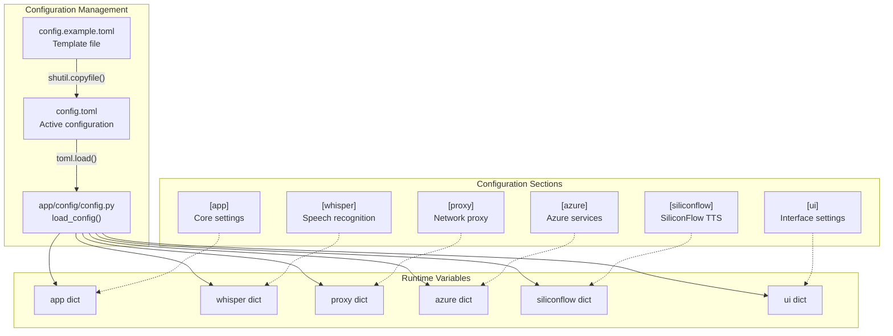

The `load_config` function at [app/config/config.py:236-258]() is responsible for initializing the configuration state. It checks for the existence of `config.toml` and copies the example if necessary [app/config/config.py:241-246]().

Sources: [config.example.toml:1-3](), [app/config/config.py:29-84](), [app/config/config.py:236-258]()

## Core Application Settings

The `[app]` section contains fundamental system configuration options that control video generation behavior and service selection.

| Setting | Type | Description | Default |
|---------|------|-------------|---------|
| `video_source` | string | Material provider ("pexels", "pixabay", "coverr", "wavespeed", "volcengine_seedance", "ofox", "metaso_minimax", "loomloom", "openai_image", "local") | "pexels" |
| `hide_config` | boolean | Hide configuration panel in UI | false |
| `llm_provider` | string | LLM service provider (e.g., "moonshot", "openai") | "moonshot" |
| `script_generation_backend` | string | Backend for scripts ("local" or "loomloom") | "local" |
| `edge_tts_timeout` | integer | Timeout in seconds for Edge TTS requests | 30 |
| `tls_verify` | boolean | Verify TLS certificates for API and downloads | true |
| `api_key` | string | Optional protection for API routes and /tasks files | "" |

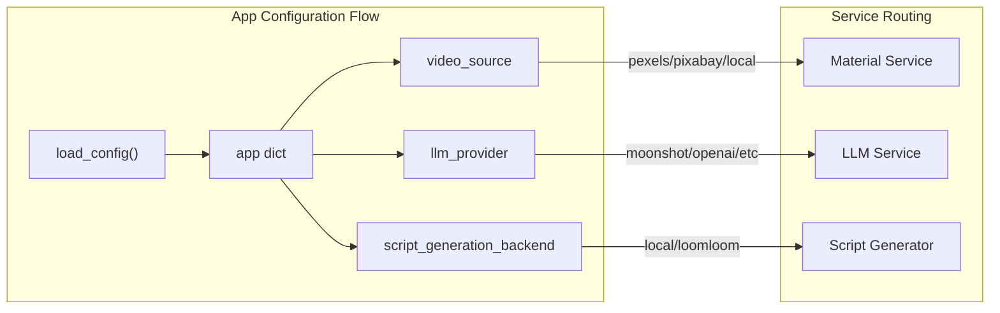

Sources: [config.example.toml:14-78](), [app/config/config.py:236-258](), [test/services/test_config.py:32-53]()

## LLM Provider Configuration

MoneyPrinterTurbo supports a wide array of LLM providers for script generation and keyword extraction. The provider registry and default models are maintained in `app/models/llm_provider.py`.

### Configuration Parameters by Provider

The system uses a standardized naming convention for provider settings within the `[app]` section of `config.toml`. For example, a provider named `moonshot` will look for `moonshot_api_key`, `moonshot_base_url`, and `moonshot_model_name` [test/services/test_config.py:68-80]().

| Provider | Key Suffix | Default Model (Example) |
|----------|------------|-------------------------|
| Moonshot (Kimi) | `moonshot` | `kimi-k3` [test/services/test_config.py:121]() |
| OpenAI | `openai` | `gpt-4o-mini` |
| DeepSeek | `deepseek` | `deepseek-chat` |
| SiliconFlow | `siliconflow` | `deepseek-ai/DeepSeek-V3` |

Sources: [config.example.toml:1-146](), [test/services/test_config.py:68-80](), [test/services/test_config.py:116-121]()

## Media Source Configuration

The system acquires video materials from multiple providers. API key lists support rotation by using an array format [config.example.toml:80-82]().

### Video Material Sources
- **Stock Footage**: `pexels_api_keys`, `pixabay_api_keys`, `coverr_api_keys` [config.example.toml:85-91]().
- **AI Video Generation**: 
    - **WaveSpeed**: Generates clips via `wavespeed_api_keys` [config.example.toml:93-95]().
    - **Volcano Engine (Seedance)**: Official asynchronous API via `volcengine_seedance_api_key` [config.example.toml:106-113]().
    - **OFox**: Multi-model API (Seedance, Wan) via `ofox_api_key` [config.example.toml:125-130]().
- **AI Image Generation**: `openai_image` generates images from keywords and renders them as clips [config.example.toml:75-77]().

Sources: [config.example.toml:62-143]()

## Social Media Distribution (Upload-Post)

MoneyPrinterTurbo integrates with the `Upload-Post` service for automated video distribution. These settings must be located under the `[app]` section [test/services/test_config.py:123-138]().

| Setting | Description |
|---------|-------------|
| `upload_post_enabled` | Enable/Disable social media posting |
| `upload_post_api_key` | API Key for the distribution service |
| `upload_post_platforms` | List of platforms (e.g., `["tiktok", "instagram"]`) |
| `upload_post_auto_upload` | Automatically trigger upload after video generation |

Sources: [test/services/test_config.py:123-138]()

## Infrastructure & Tooling

### Tool Integration (FFmpeg & ImageMagick)
The system attempts to auto-detect these binaries. Manual paths can be provided in `config.toml`, which are then injected into environment variables.

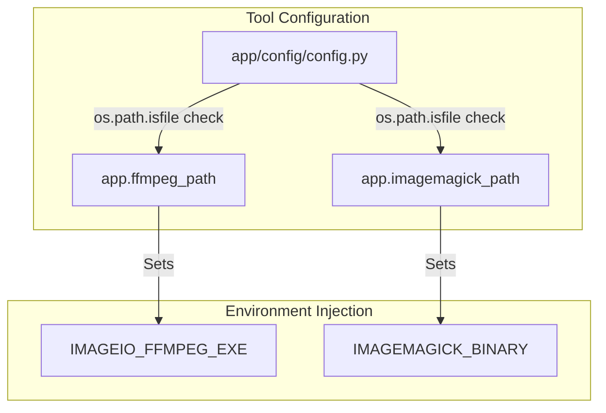

### Persistence and Atomic Saves
To prevent configuration corruption, the system uses an atomic save mechanism. The `save_config` function writes to a temporary file before replacing the original `config.toml` [app/config/config.py:202](), [test/services/test_config.py:139-164]().

### Non-blocking Updates
The WebUI utilizes `update_config_nonblocking` [app/config/config.py:91-125]() to update settings without freezing the interface. If a video task is currently running and holds the `_config_save_lock`, updates are queued in `_pending_config_updates` and applied once the lock is released [app/config/config.py:95-118]().

Sources: [app/config/config.py:91-165](), [test/services/test_config.py:139-164]()

---

# Page: Quick Start Guide

# Quick Start Guide

<details>
<summary>Relevant source files</summary>

The following files were used as context for generating this wiki page:

- [docs/api.jpg](docs/api.jpg)
- [docs/webui-en.jpg](docs/webui-en.jpg)
- [docs/webui.jpg](docs/webui.jpg)
- [webui/Main.py](webui/Main.py)
- [webui/i18n/en.json](webui/i18n/en.json)

</details>


This guide provides a technical walkthrough for generating your first video using the MoneyPrinterTurbo WebUI. It focuses on the data flow from the Streamlit interface to the backend task orchestration system.

For installation instructions, see **2.1 Installation & Setup**. For detailed configuration of API keys, see **2.2 Configuration**.

## Prerequisites

Before starting, ensure the following conditions are met:
- The application is running (e.g., via `python webui/Main.py` or Docker) [webui/Main.py:25-30]().
- A valid LLM provider is configured in `config.toml` (e.g., SiliconFlow, OpenAI, or DeepSeek) [webui/Main.py:175-184]().
- API keys for video sources (Pexels, Pixabay, or Shengsuan Cloud) are provided in the settings [webui/Main.py:28-32]().

## Starting Your First Video Generation

### Access the Web Interface
The WebUI is built using Streamlit [webui/Main.py:19](). By default, it is accessible at `http://localhost:8501`. The interface uses a custom stylesheet `styles.css` to hide standard Streamlit headers and optimize the layout for video production [webui/Main.py:86-88]().

### Basic Video Generation Workflow

The following diagram maps user actions in the WebUI to internal code entities and service calls.

**Title: WebUI to Backend Service Mapping**
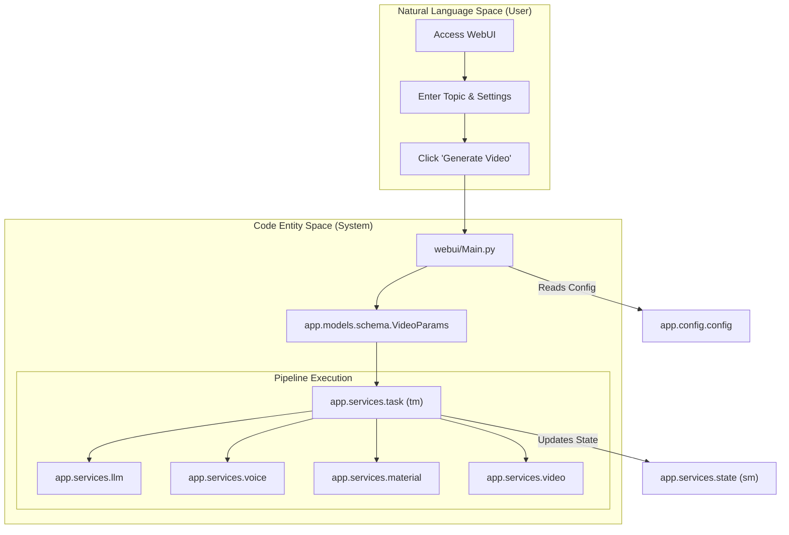
Sources: [webui/Main.py:30-65](), [app/services/task.py:1-50](), [app/models/schema.py:38-44]()

### Step 1: Video Script Settings
In the left column, users define the content of the video:
1.  **Video Subject**: The core topic (e.g., "How AI is changing everyday life") [webui/i18n/en.json:13-15]().
2.  **Script Language**: Determines the output language for the LLM and TTS.
3.  **Generate Script**: Clicking this triggers the `llm` service to populate the script and keyword fields before full generation begins [webui/Main.py:49]().

### Step 2: Video & Audio Configuration
The middle column configures the aesthetic and auditory properties:
- **Video Source**: Selection between `stock_video` (Pexels, Pixabay, Coverr), `ai_video` (Metaso, LoomLoom), or `local` materials [webui/Main.py:110-121]().
- **Video Aspect**: Defines `VideoAspect` (e.g., `portrait` 9:16 or `landscape` 16:9) [app/models/schema.py:40]().
- **Voiceover Mode**: Selection between `Automatic Voiceover` (TTS), `Upload`, or `None` [webui/i18n/en.json:115-118]().
- **Background Music**: Handled by `bgm_service` to fetch or assign audio files [webui/Main.py:46]().

### Step 3: Subtitle Settings
The right column defines the visual style of subtitles, which are mapped to the `VideoParams` object:
- **Font**: Defaulted to `MicrosoftYaHeiBold.ttc` [webui/Main.py:133]().
- **Position**: Controlled by `subtitle_position` (default: bottom) [webui/Main.py:134]().
- **Style**: Includes `text_fore_color`, `font_size`, `stroke_color`, and `stroke_width` [webui/Main.py:136-139]().

### Step 4: Execution and Data Flow
When the user clicks **"Generate Video"**, the following sequence occurs:
1. The UI gathers all form data into a `VideoParams` Pydantic model [webui/Main.py:43]().
2. The `tm.start()` function is invoked with these parameters [webui/Main.py:62]().
3. The task is assigned a unique `task_id` (UUID4) [webui/Main.py:16]().

**Title: Generation Pipeline Sequence**
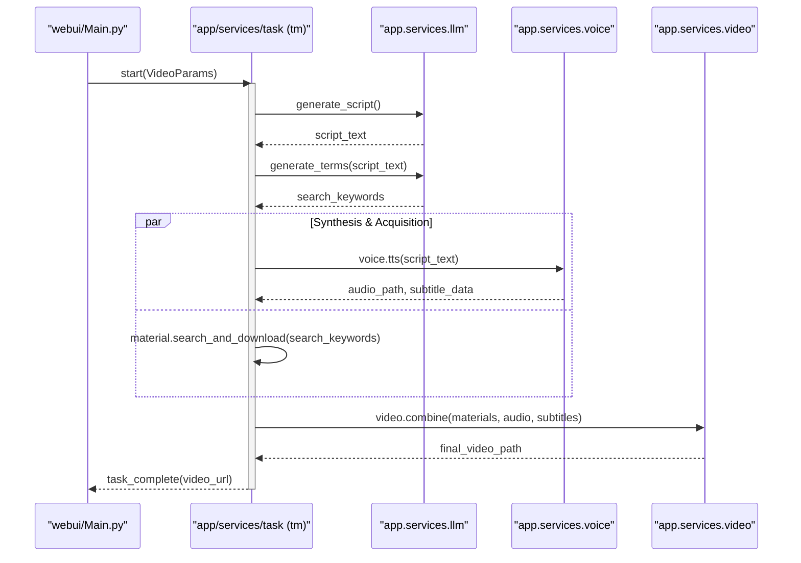
Sources: [webui/Main.py:54-62](), [app/services/task.py:1-100](), [app/services/llm.py:1-40]()

## Understanding the Generated Output

### Storage Structure
The system organizes output by `task_id`. All files generated during the process are stored in the local file system.

| File/Folder | Description |
| :--- | :--- |
| `storage/tasks/{task_id}/` | Root directory for the specific generation task. |
| `final-1.mp4` | The synthesized video output (pattern-matched) [webui/Main.py:155-158](). |
| `audio.mp3` | The generated TTS narration. |
| `subtitle.srt` | The generated subtitle file. |
| `resource/songs/` | Directory for background music [webui/Main.py:91](). |
| `resource/fonts/` | Directory for subtitle fonts [webui/Main.py:90](). |

### Configuration Persistence
WebUI settings are managed via `_RUNTIME_CONFIG_SECTIONS` which maps UI fields to the `config` singleton [webui/Main.py:175-184](). Users can export these settings as a JSON preset, excluding local file paths to ensure portability [webui/Main.py:187-201]().

## Troubleshooting First Generation

### Common Validations
- **API Keys**: The UI checks for credential suffixes (e.g., `api_key`, `access_key`) to ensure providers are ready [webui/Main.py:204-211]().
- **Task Lock**: The system uses `webui_task` to manage task lifecycle and prevent UI blocking during long-running MoviePy operations [webui/Main.py:57]().
- **Logs**: Real-time logs are configured via `configure_terminal_logger` and `loguru` to capture pipeline errors [webui/Main.py:20, 64]().

Sources: [webui/Main.py:1-215](), [webui/i18n/en.json:1-119](), [app/models/schema.py:38-44]()

---

# Page: System Architecture

# System Architecture

<details>
<summary>Relevant source files</summary>

The following files were used as context for generating this wiki page:

- [README-en.md](README-en.md)
- [README-ja.md](README-ja.md)
- [README.md](README.md)
- [app/__init__.py](app/__init__.py)
- [app/config/config.py](app/config/config.py)
- [app/models/schema.py](app/models/schema.py)
- [app/router.py](app/router.py)
- [app/services/task.py](app/services/task.py)
- [main.py](main.py)
- [pyproject.toml](pyproject.toml)
- [requirements.txt](requirements.txt)
- [test/services/test_controller_ping.py](test/services/test_controller_ping.py)
- [test/services/test_task.py](test/services/test_task.py)
- [test/services/test_utils_ffmpeg_check.py](test/services/test_utils_ffmpeg_check.py)
- [uv.lock](uv.lock)

</details>


## Purpose and Scope

This document provides a high-level overview of MoneyPrinterTurbo's system architecture, explaining the design patterns, core components, and how they interact. This page focuses on structural organization and component relationships. For specific subsystem details, see:

- Core implementation details: [Core Architecture](#3.1)
- Provider abstraction mechanism: [Multi-Provider Architecture](#3.2)
- Task execution and state management: [Task Management](#3.3)
- Data persistence and file organization: [Data Flow & Storage](#3.4)
- Installation and runtime configurations: [Deployment Options](#3.5)

## System Overview

MoneyPrinterTurbo is an automated video generation system built on a **dual-interface architecture** with clear separation between presentation (WebUI/API), business logic (services), and data (storage/state). The system follows an **MVC pattern** with configuration-driven provider selection, enabling flexible integration with 13+ LLM providers, 4+ TTS providers, and multiple video sources.

The architecture consists of five primary layers:

| Layer | Responsibility | Key Components |
|-------|---------------|----------------|
| **Interface Layer** | User interaction and API endpoints | Streamlit WebUI, FastAPI service |
| **Controller Layer** | Request routing and validation | `app/router.py`, `app/controllers/` |
| **Service Layer** | Business logic and orchestration | `app/services/task.py`, `app/services/video.py` |
| **Integration Layer** | External API communication | `app/services/llm.py`, `app/services/voice.py` |
| **Storage Layer** | Data persistence and configuration | `app/config/config.py`, `app/services/state.py` |

**Sources:** [README.md:5-7](), [app/services/task.py:17-33](), [app/config/config.py:15-16]()

## Dual-Interface Architecture

The system exposes two independent but functionally equivalent interfaces, both backed by the same service layer. The WebUI is built with Streamlit, while the API is a FastAPI application served via Uvicorn.

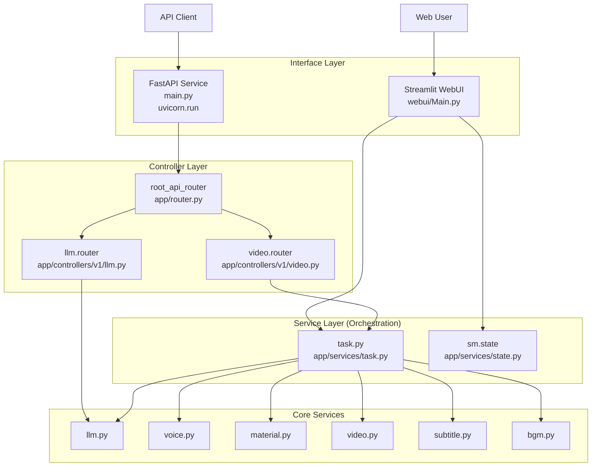

### WebUI Interface
The web interface is implemented using Streamlit, providing a visual way to configure video parameters and monitor generation progress.
- **Direct Service Access:** Calls `app.services.task` directly to initiate video generation.
- **State Management:** Interacts with `app.services.state` to track task progress and logs.

### API Interface
The API interface uses FastAPI, initialized in `app/asgi.py` and served via Uvicorn in `main.py`.
- **Port:** Configured via `config.listen_port` [main.py:15]().
- **Documentation:** Auto-generated OpenAPI docs at `/docs` [main.py:8]().
- **Routing:** Uses `root_api_router` to include versioned controllers for video and LLM operations [app/router.py:14-17]().

**Sources:** [main.py:12-18](), [app/router.py:1-17](), [app/services/task.py:14-34]()

## MVC Architecture Pattern

The codebase follows a structured approach to separate data models, logic, and presentation.

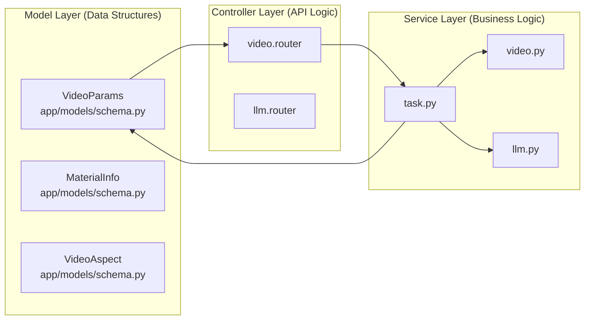

### Model Layer
The system uses Pydantic models in `app/models/schema.py` to define data structures for requests and internal state:
- `VideoParams`: Defines all settings for a video generation task, including aspect ratio, voice, and BGM [app/models/schema.py:73-138]().
- `MaterialInfo`: Represents metadata for video clips sourced from providers [app/models/schema.py:62-71]().
- `VideoAspect`: Handles resolution mapping for different ratios like 16:9 and 9:16 [app/models/schema.py:34-46]().

### Service Layer
Located in `app/services/`, this layer implements the core logic:
- **Task Orchestration:** `app/services/task.py` manages the high-level workflow, including calling LLMs for scripts and coordinating video assembly [app/services/task.py:104-121]().
- **Specialized Services:** Services like `voice.py`, `subtitle.py`, and `material.py` handle specific domain tasks.

**Sources:** [app/models/schema.py:34-138](), [app/services/task.py:17-34]()

## Task Orchestration and Pipeline

The generation process is a multi-stage pipeline managed by the `TaskService`. It handles complex logic such as background music (BGM) provider selection and cross-platform social media posting.

- **Music Providers:** Supports multiple providers like `sonilo` and `elevenlabs`, handled via a `_VIDEO_MUSIC_PROVIDERS` registry [app/services/task.py:73-88]().
- **Cross-Posting:** Includes a dedicated `ThreadPoolExecutor` (`_cross_post_executor`) for uploading finished videos to platforms like TikTok and Instagram without blocking the main generation queue [app/services/task.py:41-44]().
- **Task State:** Tracks whether a task is "busy" (processing or uploading) via `is_task_busy` to prevent premature deletion [app/services/task.py:104-121]().

For details, see [Task Management](#3.3).

**Sources:** [app/services/task.py:41-88](), [app/services/task.py:104-121]()

## Data Flow & Configuration

The system uses a centralized configuration object `config` managed by a synchronized dictionary to handle concurrent updates.

1. **Initialization:** `main.py` loads configuration to start the Uvicorn server [main.py:4-18]().
2. **Dynamic Configuration:** The `_SynchronizedConfig` class ensures that runtime configuration changes (like switching LLM providers) are thread-safe [app/config/config.py:29-41]().
3. **Non-blocking Updates:** WebUI updates are handled via `update_config_nonblocking` to prevent the UI from freezing during long-running tasks [app/config/config.py:91-110]().
4. **Execution:** Services read `config` to determine API keys and model preferences (e.g., `config.ui.get("subtitle_position")`) [app/models/schema.py:122-125]().

For details, see [Data Flow & Storage](#3.4).

**Sources:** [app/config/config.py:29-110](), [app/models/schema.py:122-125](), [main.py:4-18]()

---

# Page: Core Architecture

# Core Architecture

<details>
<summary>Relevant source files</summary>

The following files were used as context for generating this wiki page:

- [app/__init__.py](app/__init__.py)
- [app/asgi.py](app/asgi.py)
- [app/config/config.py](app/config/config.py)
- [app/router.py](app/router.py)
- [main.py](main.py)
- [pyproject.toml](pyproject.toml)
- [requirements.txt](requirements.txt)
- [test/services/test_asgi_cors.py](test/services/test_asgi_cors.py)
- [test/services/test_asgi_static_files.py](test/services/test_asgi_static_files.py)
- [test/services/test_controller_ping.py](test/services/test_controller_ping.py)
- [test/services/test_utils_ffmpeg_check.py](test/services/test_utils_ffmpeg_check.py)
- [uv.lock](uv.lock)

</details>


This document describes the core architectural design of MoneyPrinterTurbo, focusing on its MVC pattern implementation, dual-interface design (WebUI and API), and how major components interact at runtime. For information about specific subsystems like task management and state persistence, see [Task Management](#3.3). For provider abstraction details, see [Multi-Provider Architecture](#3.2). For storage organization, see [Data Flow & Storage](#3.4).

## Architectural Pattern

MoneyPrinterTurbo implements a **Model-View-Controller (MVC) architecture** with clear separation of concerns:

- **Models**: Define data structures, schemas, and persistence logic.
- **Views**: Dual user interfaces (Streamlit WebUI and FastAPI endpoints).
- **Controllers**: Handle request routing, validation, and response formatting [app/router.py:12-13]().
- **Services**: Implement core business logic such as script generation, TTS, and video editing.

The architecture follows a layered pattern where each layer communicates only with adjacent layers, ensuring modularity and maintainability.

### System Entity Map

The following diagram bridges the conceptual system components to their specific implementation entities in the codebase.

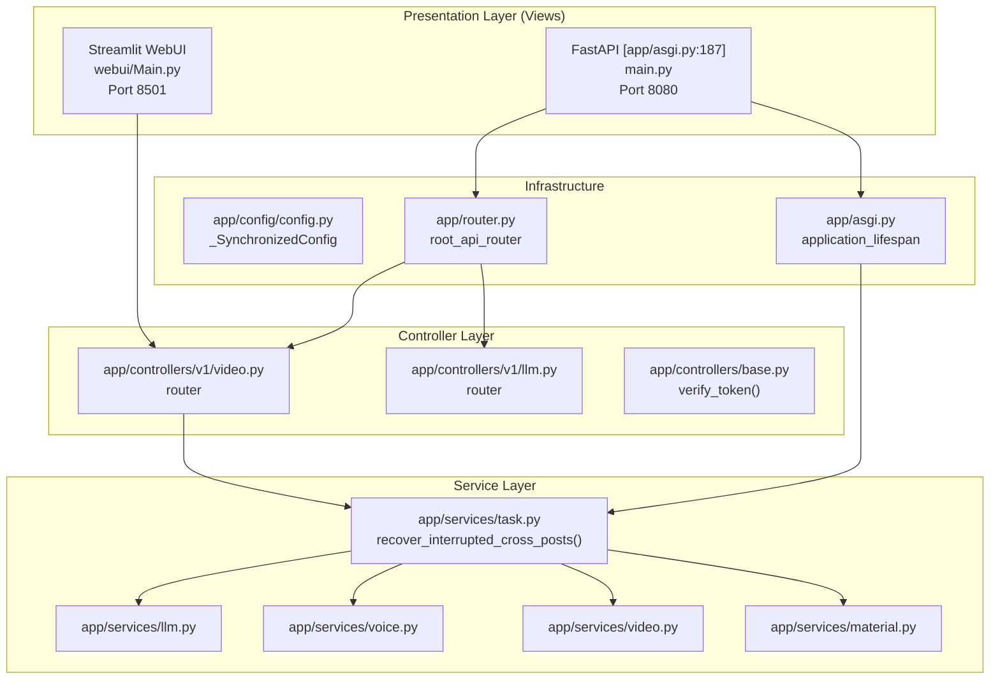

**Sources**: [app/asgi.py:167-187](), [app/router.py:10-20](), [main.py:6-18](), [app/config/config.py:29-85]()

## Dual-Interface Design

MoneyPrinterTurbo provides two independent user interfaces that share the same backend services, allowing flexible deployment scenarios.

### Interface Comparison

| Feature | WebUI (Streamlit) | API (FastAPI) |
|---------|-------------------|---------------|
| **Entry Point** | `webui/Main.py` | `main.py` [main.py:12-18]() |
| **Default Port** | 8501 | Configured via `config.listen_port` [main.py:15]() |
| **Implementation** | Streamlit Framework | FastAPI [app/asgi.py:174-184]() |
| **Primary Router** | Component-based | `root_api_router` [app/router.py:15]() |
| **Authentication** | Shared config key | `verify_token` middleware [app/asgi.py:190-204]() |

### API Architecture (FastAPI)

The API is built using FastAPI and served via Uvicorn [main.py:12-18](). It serves both as the backend for the WebUI and as a standalone REST interface.

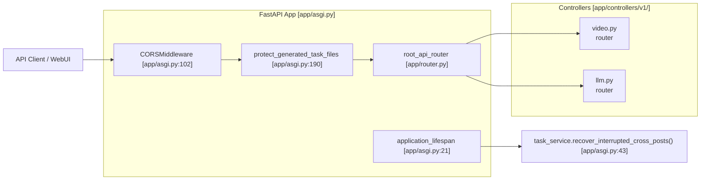

**Key characteristics**:
- **Lifespan Management**: Handles startup recovery for interrupted cross-post tasks by cleaning up Redis states [app/asgi.py:21-47]().
- **CORS Support**: Configurable via `CORS_ALLOWED_ORIGINS` to support independent web frontends while preventing untrusted browser access [app/asgi.py:66-115, 139-164]().
- **Security**: Implements `verify_token` to protect generated task artifacts in the `/tasks` static directory, ensuring only authorized clients can download results [app/asgi.py:190-204]().
- **Validation**: Global exception handlers for `HttpException` and `RequestValidationError` ensure consistent JSON responses [app/asgi.py:50-63]().

**Sources**: [app/asgi.py:1-204](), [app/router.py:1-20](), [main.py:1-18]()

## Configuration Management

The system uses a synchronized configuration mechanism to handle concurrent access from both the long-running video generation tasks and the reactive Streamlit WebUI.

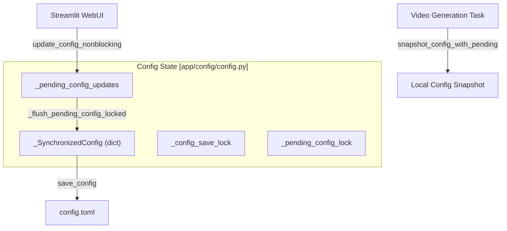

**Key Logic**:
- **Non-blocking Updates**: The WebUI uses `update_config_nonblocking` to queue changes without waiting for long-running tasks to release the configuration lock, preventing UI freezes [app/config/config.py:91-125]().
- **Config Snapshots**: Tasks use `snapshot_config_with_pending` to get a stable view of the configuration at the start of a request, ensuring that mid-task UI changes do not cause inconsistent behavior [app/config/config.py:168-186]().
- **Thread Safety**: Access is mediated by `_config_save_lock` and `_pending_config_lock` to prevent race conditions during TOML serialization [app/config/config.py:19-23, 29-85]().

**Sources**: [app/config/config.py:19-186]()

## Core Component Interactions

### Request Flow and Error Handling

When a request enters the system, it is routed through the `root_api_router` [app/router.py:15]() to specific controllers. 

1. **Authentication**: Token verification is performed via `base.verify_token` [app/asgi.py:203]().
2. **Lifespan Recovery**: On startup, `recover_interrupted_cross_posts` is called to reconcile task states [app/asgi.py:43]().
3. **Execution**: The controller invokes functional services (LLM, Voice, Video).
4. **Response**: Standardized via `utils.get_response` [app/asgi.py:53, 60]().

**Sources**: [app/asgi.py:21-63, 190-204](), [app/router.py:1-20]()

## Dependency Management

The project uses `pyproject.toml` and `uv.lock` for strict dependency management, ensuring reproducible environments across Docker, manual, and Colab deployments.

| Category | Key Libraries |
| :--- | :--- |
| **Web Framework** | `fastapi`, `uvicorn`, `streamlit` [pyproject.toml:17-21]() |
| **Media Processing** | `moviepy`, `edge-tts`, `faster-whisper`, `pydub` [pyproject.toml:16-33]() |
| **AI Integration** | `openai`, `google-genai`, `dashscope`, `litellm` [pyproject.toml:22-37]() |
| **Infrastructure** | `redis`, `toml`, `loguru` [pyproject.toml:24-29]() |

**Sources**: [pyproject.toml:15-37](), [requirements.txt:1-22]()

---

# Page: Multi-Provider Architecture

# Multi-Provider Architecture

<details>
<summary>Relevant source files</summary>

The following files were used as context for generating this wiki page:

- [app/models/llm_provider.py](app/models/llm_provider.py)
- [app/services/llm.py](app/services/llm.py)
- [config.example.toml](config.example.toml)
- [docs/MoneyPrinterTurbo.ipynb](docs/MoneyPrinterTurbo.ipynb)
- [test/services/test_llm.py](test/services/test_llm.py)
- [test/services/test_webui_i18n.py](test/services/test_webui_i18n.py)

</details>


## Purpose and Scope

This document explains MoneyPrinterTurbo's multi-provider architecture, which enables the system to support multiple external service providers for each major component (LLM, TTS, video materials, subtitles) through configuration-driven selection. This architecture allows users to switch between 13+ LLM providers, 4+ TTS providers, multiple video sources, and 2 subtitle providers without modifying code.

For information about the overall system architecture, see [Core Architecture](#3.1). For details on specific provider implementations, see [LLM Integration](#5.2) and [Voice Synthesis (TTS)](#5.3).

## Overview

The multi-provider architecture is built on three core principles:

1.  **Configuration-driven selection**: Providers are selected via `config.toml` settings, not code changes.
2.  **Uniform interfaces**: Each provider type implements a consistent interface despite diverse underlying APIs.
3.  **Provider-specific adaptation**: The system handles different authentication schemes, parameter formats, and response structures transparently.

### Provider Mapping Diagram

```mermaid
graph TB
    subgraph "Configuration Layer"
        ConfigFile["config.toml<br/>Provider Settings"]
    end
    
    subgraph "Application Layer"
        RouterLLM["LLM Router<br/>_generate_response()"]
        RouterTTS["TTS Router<br/>tts()"]
        RouterVideo["Video Router<br/>search_videos()"]
    end
    
    subgraph "LLM Providers"
        LLM1["Moonshot (Kimi)<br/>Default Provider"]
        LLM2["OpenAI<br/>Standard Adapter"]
        LLM3["Azure OpenAI<br/>Azure Adapter"]
        LLM4["Gemini<br/>Gemini Adapter"]
        LLM5["Qwen<br/>Qwen Adapter"]
        LLM6["Ollama<br/>Local Adapter"]
        LLM7["DeepSeek<br/>OpenAI Compatible"]
        LLM8["Cloudflare<br/>Gateway Adapter"]
        LLM9["ModelScope<br/>ModelScope Adapter"]
    end
    
    subgraph "TTS Providers"
        TTS1["Edge TTS<br/>Default WebSocket"]
        TTS2["Azure TTS V2<br/>REST API"]
        TTS3["SiliconFlow<br/>REST API"]
        TTS4["Gemini TTS<br/>SDK"]
        TTS5["Xiaomi MiMo<br/>REST API"]
    end
    
    subgraph "Video Sources"
        VS1["Pexels API"]
        VS2["Pixabay API"]
        VS3["Coverr API"]
        VS4["LoomLoom Market"]
        VS5["WaveSpeed AI"]
        VS6["OFox Multi-model"]
        VS7["Local Files"]
    end
    
    ConfigFile --> RouterLLM
    ConfigFile --> RouterTTS
    ConfigFile --> RouterVideo

    RouterLLM --> LLM1
    RouterLLM --> LLM2
    RouterLLM --> LLM3
    RouterLLM --> LLM4
    RouterLLM --> LLM5
    RouterLLM --> LLM6
    RouterLLM --> LLM7
    RouterLLM --> LLM8
    RouterLLM --> LLM9
    
    RouterTTS --> TTS1
    RouterTTS --> TTS2
    RouterTTS --> TTS3
    RouterTTS --> TTS4
    RouterTTS --> TTS5
    
    RouterVideo --> VS1
    RouterVideo --> VS2
    RouterVideo --> VS3
    RouterVideo --> VS4
    RouterVideo --> VS5
    RouterVideo --> VS6
    RouterVideo --> VS7
```

**Sources:** [config.example.toml:65-78](), [config.example.toml:93-95](), [config.example.toml:125-130](), [app/models/llm_provider.py:187-200](), [app/services/llm.py:142-153]()

## Configuration-Driven Provider Selection

All provider selections are controlled through the `config.toml` file, which serves as the central configuration registry. The system uses a registry-based approach to define provider metadata.

### LLM Provider Registry
The `LLMProviderSpec` class defines the requirements for each provider, including their adapter type, default models, and whether they require an API key or Base URL [app/models/llm_provider.py:30-55]().

| Configuration Key | Purpose | Default / Supported Values |
|------------------|---------|-----------------------------|
| `llm_provider` | Active LLM backend | `moonshot` (Default), `openai`, `deepseek`, `ollama` |
| `video_source` | Primary video source | `pexels`, `pixabay`, `coverr`, `wavespeed`, `ofox`, `local` |
| `script_generation_backend`| Script engine type | `local` (standard LLM), `loomloom` |

**Sources:** [app/models/llm_provider.py:4-4](), [app/models/llm_provider.py:187-192](), [config.example.toml:39-39](), [config.example.toml:78-78]()

## LLM Provider Architecture

MoneyPrinterTurbo supports a wide array of LLM providers by abstracting the request logic into specific adapters.

### LLM Routing and Resolution
The system resolves the provider settings at runtime using the `get_llm_provider` function [app/services/llm.py:147-151](). It handles deprecated model names and base URLs automatically to ensure backward compatibility [app/models/llm_provider.py:83-96]().

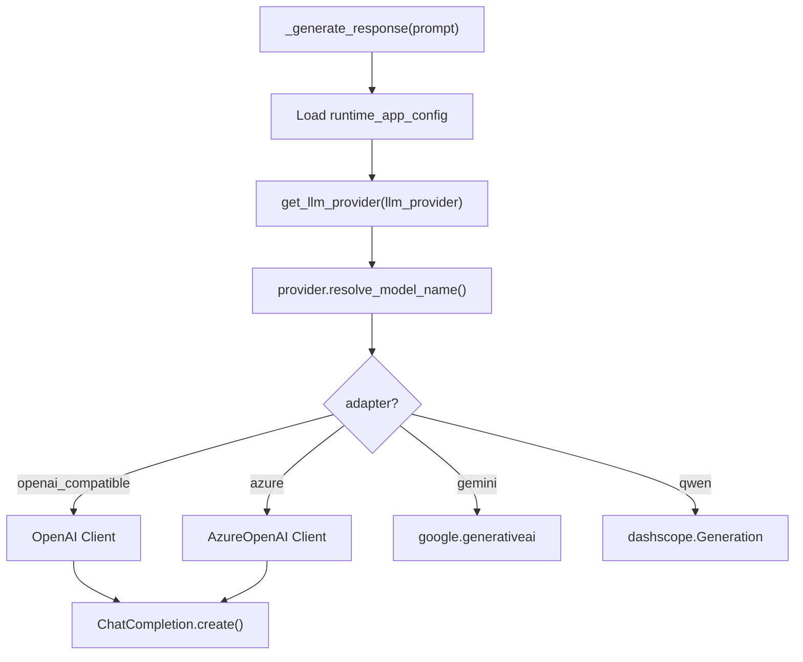

**Sources:** [app/services/llm.py:142-177](), [app/models/llm_provider.py:39-55]()

### Reasoning Model Handling
For models like DeepSeek R1 or MiniMax M3 that return reasoning blocks, the system uses `_normalize_text_response` to strip `<think>` tags using regex `_THINK_BLOCK_RE` [app/services/llm.py:19-20](), [app/services/llm.py:47-65]().

**Sources:** [app/services/llm.py:19-20](), [app/services/llm.py:47-69]()

## TTS Provider Architecture

TTS providers are selected based on the `voice_name` identifier provided in the generation request. The logic resides primarily in `app/services/voice.py`.

### Provider Detection Logic
The system identifies the target service by checking for specific prefixes or suffixes in the voice name. For example, SiliconFlow voices start with `siliconflow:`, while Gemini voices start with `gemini:`.

### TTS Data Flow
The `tts` function in `app/services/voice.py` acts as the primary entry point, routing the request to the appropriate sub-service based on the detection logic.

## Video Material Provider Architecture

The system supports multiple video sources defined in `config.toml` under `video_source` [config.example.toml:65-78]().

### API Key Rotation
For stock providers like Pexels, Pixabay, and Coverr, the system supports a list of API keys to facilitate rotation and bypass rate limits [config.example.toml:80-91]().

### Material Sources
1.  **Stock APIs**: Pexels, Pixabay, and Coverr [config.example.toml:84-91]().
2.  **AI Generation**: WaveSpeed AI, OFox, and Volcano Engine Seedance generate brand-new clips based on keywords [config.example.toml:93-143]().
3.  **Image-to-Video**: `openai_image` generates images from keywords and renders them into clips [config.example.toml:75-77]().
4.  **Local**: User-provided files in the `resource/video_materials` directory [config.example.toml:78-78]().

**Sources:** [config.example.toml:65-143]()

## Subtitle Provider Architecture

The architecture supports two distinct methods for subtitle generation:

1.  **Edge TTS (Word Boundaries)**: Captures timing events directly from the Edge TTS WebSocket stream to create precise subtitles.
2.  **Faster-Whisper (ASR)**: Transcribes the generated audio file using a local Whisper model for higher accuracy or non-Edge voices.

**Sources:** [config.example.toml:53-55](), [test/services/test_llm.py:35-45]()

---

# Page: Task Management

# Task Management

<details>
<summary>Relevant source files</summary>

The following files were used as context for generating this wiki page:

- [app/controllers/manager/base_manager.py](app/controllers/manager/base_manager.py)
- [app/controllers/manager/memory_manager.py](app/controllers/manager/memory_manager.py)
- [app/controllers/manager/redis_manager.py](app/controllers/manager/redis_manager.py)
- [app/models/const.py](app/models/const.py)
- [app/models/schema.py](app/models/schema.py)
- [app/services/state.py](app/services/state.py)
- [app/services/task.py](app/services/task.py)
- [app/utils/file_security.py](app/utils/file_security.py)
- [test/README.md](test/README.md)
- [test/services/test_schema.py](test/services/test_schema.py)
- [test/services/test_state.py](test/services/test_state.py)
- [test/services/test_task.py](test/services/test_task.py)
- [test/services/test_task_manager.py](test/services/test_task_manager.py)

</details>


This document covers the task management system that orchestrates video generation workflows in MoneyPrinterTurbo. The system handles task creation, execution, state persistence, progress tracking, and concurrent processing through both in-memory and Redis-backed implementations.

## Task Orchestration Architecture

The task management system is built around a central orchestrator that coordinates the entire video generation pipeline through discrete, trackable stages.

### Core Task Orchestrator

```mermaid
graph TB
    subgraph "Task Orchestration (app/services/task.py)"
        [start] --> [generate_script]
        [generate_script] --> [generate_terms]
        [generate_terms] --> [generate_audio]
        [generate_audio] --> [generate_subtitle]
        [generate_subtitle] --> [get_video_materials]
        [get_video_materials] --> [generate_final_videos]
    end
    
    subgraph "Service Layer"
        [llm_service] -- "app/services/llm.py"
        [voice_service] -- "app/services/voice.py"
        [material_service] -- "app/services/material.py"
        [video_service] -- "app/services/video.py"
        [subtitle_service] -- "app/services/subtitle.py"
        [bgm_service] -- "app/services/bgm.py"
    end
    
    subgraph "State Management (app/services/state.py)"
        [state_update] -- "sm.state.update_task()"
        [progress_tracking] -- "Progress: 5% to 100%"
    end
    
    [generate_script] --> [llm_service]
    [generate_terms] --> [llm_service]
    [generate_audio] --> [voice_service]
    [generate_subtitle] --> [subtitle_service]
    [get_video_materials] --> [material_service]
    [generate_final_videos] --> [video_service]
    [generate_final_videos] --> [bgm_service]
    
    [start] --> [state_update]
    [generate_script] --> [state_update]
    [generate_terms] --> [state_update]
    [generate_audio] --> [state_update]
    [generate_subtitle] --> [state_update]
    [get_video_materials] --> [state_update]
    [generate_final_videos] --> [state_update]
    
    [state_update] --> [progress_tracking]
```

Sources: [app/services/task.py:17-32](), [app/services/state.py:24-41]()

### Task Pipeline Stages

The orchestrator supports partial execution through the `stop_at` parameter in `tm.start`, allowing clients to generate only specific components.

| Stage | Function | Progress | Output |
|-------|----------|----------|---------|
| `script` | `generate_script()` | 10% | Video script text |
| `terms` | `generate_terms()` | 20% | Search keywords for materials |
| `audio` | `generate_audio()` | 30% | Audio file and duration |
| `subtitle` | `generate_subtitle()` | 40% | Subtitle file (.srt) |
| `materials` | `get_video_materials()` | 50% | Video clip file paths |
| `video` | `generate_final_videos()` | 100% | Final assembled videos |

Sources: [app/services/task.py:104-121]() (busy checks), [app/services/state.py:57-74]() (progress logic)

## Task Lifecycle and Pipeline

### Task Execution Flow

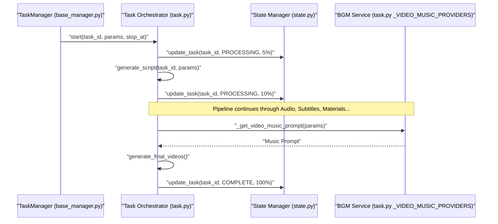

Sources: [app/services/task.py:38-88](), [app/services/task.py:91-101](), [app/controllers/manager/base_manager.py:22-52]()

### Cross-Posting Tasks
After video generation, tasks can enter a cross-posting phase. This is handled by a separate `ThreadPoolExecutor` called `_cross_post_executor` to avoid blocking the main video generation slots [app/services/task.py:41-44](). The system tracks cross-post state separately using `CROSS_POST_STATE_PENDING` and `CROSS_POST_STATE_PROCESSING` constants [app/services/task.py:53-56]().

### Busy State Management
The function `is_task_busy` determines if a task is currently in generation or cross-posting [app/services/task.py:104-121](). A task is considered busy if its state is `TASK_STATE_PROCESSING` or if its `cross_post_state` is in `_ACTIVE_CROSS_POST_STATES` [app/services/task.py:118-121]().

## State Management

The system supports dual persistence strategies through an abstract `BaseState` interface defined in `app/services/state.py`.

### State Management Architecture

```mermaid
graph TB
    subgraph "State Interface (app/services/state.py)"
        [BaseState] -- "BaseState (ABC)"
        [BaseState] --> [update_task_def]
        [BaseState] --> [get_task_def]
        [BaseState] --> [patch_task_def]
    end
    
    subgraph "Memory Implementation"
        [MemoryState] -- "self._tasks (dict)"
        [MemoryState] -- "self._lock (RLock)"
    end
    
    subgraph "Redis Implementation"
        [RedisState] -- "self._redis (StrictRedis)"
        [RedisState] -- "Lua Script (_PATCH_EXISTING_TASK_SCRIPT)"
    end
    
    [MemoryState] -- "implements" --> [BaseState]
    [RedisState] -- "implements" --> [BaseState]
    [RedisState] -- "uses" --> [ast.literal_eval]
```

Sources: [app/services/state.py:10-20](), [app/services/state.py:24-41](), [app/services/state.py:44-96](), [app/services/state.py:98-222]()

### State Operations

| Operation | Memory Implementation | Redis Implementation |
|-----------|----------------------|---------------------|
| `update_task()` | Updates `self._tasks` with `RLock` [app/services/state.py:57-74]() | Uses `hset` for each field [app/services/state.py:153-172]() |
| `patch_task()` | Updates existing task fields only [app/services/state.py:81-90]() | Atomic update via Lua script `_PATCH_EXISTING_TASK_SCRIPT` [app/services/state.py:185-202]() |
| `get_all_tasks()` | List slicing of dict values [app/services/state.py:49-55]() | `SCAN` with type filter "HASH" [app/services/state.py:114-151]() |

Sources: [app/services/state.py:44-222]()

## Concurrent Task Execution

### Task Manager Implementations

The system provides two `TaskManager` implementations for handling concurrent video generation.

- **InMemoryTaskManager**: Uses Python's `queue.Queue` for local task buffering [app/controllers/manager/memory_manager.py:7-21]().
- **RedisTaskManager**: Uses Redis lists (`rpush`/`lpop`) for distributed task queuing [app/controllers/manager/redis_manager.py:20-99](). It performs `VideoParams` validation during `dequeue` to handle schema changes [app/controllers/manager/redis_manager.py:69-91]().

### Concurrency Control
The `TaskManager` base class ensures concurrency limits are respected by incrementing `current_tasks` before starting the worker thread [app/controllers/manager/base_manager.py:24-36]().

```mermaid
graph TD
    [add_task] --> [Check_Concurrent]
    [Check_Concurrent] -- "Below Limit" --> [execute_task]
    [Check_Concurrent] -- "At Limit" --> [queue_size]
    [queue_size] -- "Below max_queued_tasks" --> [enqueue]
    [queue_size] -- "Queue Full" --> [TaskQueueFullError]
    [execute_task] --> [threading.Thread.start]
    [threading.Thread.start] --> [run_task]
    [run_task] --> [task_done]
    [task_done] --> [check_queue]
```

Sources: [app/controllers/manager/base_manager.py:11-95]()

## Data Models

Task parameters are encapsulated in the `VideoParams` Pydantic model, which includes settings for LLM scripts, TTS voices, BGM, and video assembly [app/models/schema.py:73-138]().

### Key Parameters
- `video_subject`: The primary topic for generation [app/models/schema.py:88]().
- `video_aspect`: Aspect ratio (e.g., 9:16, 16:9) [app/models/schema.py:91]().
- `bgm_type`: Music provider (e.g., "sonilo", "elevenlabs", "random") [app/models/schema.py:113]().
- `video_materials`: List of `MaterialInfo` objects for assembly [app/models/schema.py:101-103]().

Sources: [app/models/schema.py:62-138]()

---

# Page: Data Flow & Storage

# Data Flow & Storage

<details>
<summary>Relevant source files</summary>

The following files were used as context for generating this wiki page:

- [app/models/schema.py](app/models/schema.py)
- [app/services/cache_manager.py](app/services/cache_manager.py)
- [app/services/material_cache.py](app/services/material_cache.py)
- [app/services/task.py](app/services/task.py)
- [app/services/task_artifacts.py](app/services/task_artifacts.py)
- [test/services/test_material.py](test/services/test_material.py)
- [test/services/test_material_cache.py](test/services/test_material_cache.py)
- [test/services/test_task.py](test/services/test_task.py)
- [test/services/test_task_artifacts.py](test/services/test_task_artifacts.py)

</details>


This document describes how data flows through the MoneyPrinterTurbo video generation pipeline and how the system organizes file storage. It covers the 5-stage pipeline data flow, file system organization, state management strategies, and data persistence patterns.

For information about task state transitions and queue management, see [Task Management](). For details about the video generation pipeline stages, see [Task Orchestration]().

---

## Pipeline Data Flow

The video generation pipeline is a linear process where each stage produces data that feeds into subsequent stages. The system persists intermediate outputs to disk at each checkpoint, enabling early termination via the `stop_at` parameter.

### Code Entity Space: Video Generation Pipeline
The following diagram bridges the natural language pipeline stages to the specific functions and file entities in the codebase.

```mermaid
graph TB
    subgraph "Stage 1: Script Generation"
        Input1["VideoParams<br/>(app.models.schema.VideoParams)"]
        LLMCall["tm.generate_script()"]
        Script["video_script: str"]
        Input1 --> LLMCall
        LLMCall --> Script
    end
    
    subgraph "Stage 2: Terms Generation"
        Script2["video_script"]
        LLMTerms["tm.generate_terms()"]
        Terms["video_terms: List[str]"]
        ScriptJSON["script.json<br/>(storage/tasks/{id}/)"]
        Script2 --> LLMTerms
        LLMTerms --> Terms
        Terms --> ScriptJSON
    end
    
    subgraph "Stage 3: Audio Generation"
        Script3["video_script"]
        AudioGen["tm.generate_audio()"]
        AudioFile["audio.mp3<br/>(storage/tasks/{id}/)"]
        SubMaker["SubMaker<br/>(app.services.voice object)"]
        Script3 --> AudioGen
        AudioGen --> AudioFile
        AudioGen --> SubMaker
    end
    
    subgraph "Stage 4: Subtitle Generation"
        SubMaker2["SubMaker"]
        AudioFile2["audio.mp3"]
        SubGen["tm.generate_subtitle()"]
        SRTFile["subtitle.srt<br/>(storage/tasks/{id}/)"]
        SubMaker2 --> SubGen
        AudioFile2 --> SubGen
        SubGen --> SRTFile
    end
    
    subgraph "Stage 5: Material Acquisition"
        Terms2["video_terms"]
        GetMaterials["tm.get_video_materials()"]
        Cache["storage/cache_videos/<br/>vid-{md5}.mp4"]
        VideoPaths["List[MaterialInfo]"]
        Terms2 --> GetMaterials
        GetMaterials --> Cache
        Cache --> VideoPaths
    end
    
    subgraph "Stage 6: Video Assembly"
        VideoPaths2["video_paths"]
        AudioFile3["audio.mp3"]
        SRTFile2["subtitle.srt"]
        FinalGen["tm.generate_final_videos()"]
        FinalMP4["final-n.mp4<br/>(storage/tasks/{id}/)"]
        
        VideoPaths2 --> FinalGen
        AudioFile3 --> FinalGen
        SRTFile2 --> FinalGen
        FinalGen --> FinalMP4
    end
    
    Script --> Script2
    Terms --> Terms2
    AudioFile --> AudioFile2
    SubMaker --> SubMaker2
    SRTFile --> SRTFile2
    VideoPaths --> VideoPaths2
    
    style ScriptJSON fill:#f9f9f9
    style AudioFile fill:#f9f9f9
    style SRTFile fill:#f9f9f9
    style Cache fill:#f9f9f9
    style FinalMP4 fill:#f9f9f9
```
**Sources:** [app/services/task.py:16-35](), [app/services/task.py:82-91](), [app/models/schema.py:73-138](), [app/services/task_artifacts.py:16-19]()

### Stage-by-Stage Data Outputs

| Stage | Logic Entity | Disk Outputs | Data Format | Purpose |
|-------|-------------|--------------|-------------|---------|
| **Script** | `generate_script` | None | Plain text | Content for TTS and keyword extraction |
| **Terms** | `generate_terms` | `script.json` | JSON | Search keywords for video sources |
| **Audio** | `generate_audio` | `audio.mp3` | MP3 audio | Voice narration + timing metadata |
| **Subtitle** | `generate_subtitle` | `subtitle.srt` | SRT format | Timestamped text for video overlay |
| **Materials**| `get_video_materials`| `vid-{md5}.mp4`| MP4 video | Raw material clips in `cache_videos` |
| **Assembly** | `generate_final_videos`| `final-n.mp4` | MP4 video | Final rendered video output |

**Sources:** [app/services/task.py:82-91](), [app/services/task_artifacts.py:16-19](), [app/services/task.py:107-121](), [app/services/cache_manager.py:51-55]()

---

## File Storage Architecture

The system employs a hierarchical storage strategy with clear separation between static resources and dynamic task outputs, managed by utility functions.

### Directory Structure & Code Identifiers

```mermaid
graph TD
    Root["Project Root"]
    
    subgraph "resource/ (Static Assets)"
        Fonts["resource_dir('fonts')<br/>font_dir()"]
        Songs["resource_dir('songs')<br/>song_dir()"]
        Public["resource_dir('public')<br/>public_dir()"]
    end
    
    subgraph "storage/ (Dynamic Data)"
        Tasks["task_dir(task_id)<br/>storage/tasks/{task_id}/"]
        CacheMaterials["_cache_dir()<br/>storage/cache_material_search/"]
        CacheVideos["video_cache_dir()<br/>storage/cache_videos/"]
    end
    
    subgraph "Task Directory Detail"
        TaskFiles["storage/tasks/{task_id}/<br/>├── script.json<br/>├── audio.mp3<br/>├── subtitle.srt<br/>└── final-1.mp4"]
    end
    
    Root --> Fonts
    Root --> Songs
    Root --> Public
    Root --> Tasks
    Root --> CacheMaterials
    Root --> CacheVideos
    Tasks --> TaskFiles
```
**Sources:** [app/services/material_cache.py:102-109](), [app/services/task_artifacts.py:16-19](), [app/services/cache_manager.py:51-55]()

### Material Search Caching
Online material search results are cached to disk to respect provider TTLs (24 hours by default). [app/services/material_cache.py:22-22]()
1.  **Cache Key**: A SHA-256 hash of `provider`, `search_term`, `minimum_duration`, and `video_aspect`. [app/services/material_cache.py:112-136]()
2.  **Storage**: Saved as JSON files in `storage/cache_material_search/`. [app/services/material_cache.py:139-151]()
3.  **Persistence**: Uses atomic writes via `os.replace` to prevent corrupted cache files during crashes. [app/services/material_cache.py:27-30]()
4.  **Validation**: Expired or corrupted cache files are automatically removed during the load process. [app/services/material_cache.py:170-179](), [app/services/material_cache.py:181-194]()

**Sources:** [app/services/material_cache.py:22-194](), [test/services/test_material_cache.py:94-120]()

### Video Material Caching
Downloaded video materials are stored in `storage/cache_videos/` using a filename pattern `vid-{md5}.mp4`. [app/services/cache_manager.py:16-18]()
*   **Cleanup**: The `clean_video_cache` function allows deleting files older than a specific `max_age_days`. [app/services/cache_manager.py:158-165]()
*   **Safety**: The cleanup logic uses `os.path.realpath` and pattern matching to ensure no files outside the managed directory are deleted. [app/services/cache_manager.py:191-196]()

**Sources:** [app/services/cache_manager.py:16-215]()

---

## State Management & Persistence

MoneyPrinterTurbo supports state management via `app.services.state`. [app/services/task.py:34-34]()

### Artifact Persistence Patterns
The system uses an atomic writing pattern for `script.json` to ensure data integrity.
*   **Atomic Write**: `_write_json_atomic` creates a hidden `.tmp` file in the target directory, flushes and syncs to disk using `os.fsync`, then performs an `os.replace`. [app/services/task_artifacts.py:21-57]()
*   **Patching**: `patch_script_data` allows updating specific fields (like `material_sources`) without overwriting existing script or parameter data. [app/services/task_artifacts.py:64-96]()

### Data Flow Security
*   **URL Redaction**: Sensitive API keys and user credentials are removed from cached URLs using `_safe_public_url`. [app/services/material_cache.py:35-50]()
*   **White-listing**: Only specific fields (e.g., `asset_id`, `provider`, `rendition`) are allowed into the disk cache to prevent internal metadata leakage. [app/services/material_cache.py:53-99]()

**Sources:** [app/services/task_artifacts.py:21-96](), [app/services/material_cache.py:35-99]()

---

## Configuration Management

Configuration is loaded from `config.toml` into a global `config` object. [app/models/schema.py:8-8]()

### State Field Schema
Task objects stored in the state manager contain fields for tracking both generation and distribution status:
| Field | Type | Description |
|-------|------|-------------|
| `state` | `int` | Current status (e.g., `TASK_STATE_PROCESSING`). [app/services/task.py:109-121]() |
| `cross_post_state`| `str` | Status of social media distribution (e.g., `PENDING`). [app/services/task.py:120-120]() |
| `cross_post_owner`| `str` | Hostname and PID of the process handling the upload. [app/services/task.py:199-213]() |

**Sources:** [app/services/task.py:53-69](), [app/services/task.py:104-121](), [app/services/task.py:199-213]()

---

# Page: Deployment Options

# Deployment Options

<details>
<summary>Relevant source files</summary>

The following files were used as context for generating this wiki page:

- [.dockerignore](.dockerignore)
- [.github/workflows/docker-ghcr.yml](.github/workflows/docker-ghcr.yml)
- [Dockerfile](Dockerfile)
- [Dockerfile.gpu](Dockerfile.gpu)
- [docker-compose.gpu.yml](docker-compose.gpu.yml)
- [docker-compose.release.yml](docker-compose.release.yml)
- [docker-compose.yml](docker-compose.yml)
- [docs/skill/SKILL.md](docs/skill/SKILL.md)
- [docs/skill/mpt_agent.py](docs/skill/mpt_agent.py)
- [test/services/test_mpt_agent_skill.py](test/services/test_mpt_agent_skill.py)
- [webui.bat](webui.bat)
- [webui.sh](webui.sh)

</details>


This document provides a comprehensive technical reference for deploying MoneyPrinterTurbo across different environments. It covers five primary deployment strategies: Docker Compose (CPU), Docker Compose (GPU), manual installation, Windows one-click package, and Google Colab. Each method is analyzed with architecture diagrams, configuration details, and implementation specifics.

---

## Overview

MoneyPrinterTurbo supports multiple deployment strategies targeting different operational requirements and hardware capabilities.

| Method | Target Use Case | Skill Level | Isolation | Portability |
|--------|----------------|-------------|-----------|-------------|
| **Docker Compose (CPU)** | Production, multi-user | Intermediate | Container-level | High |
| **Docker Compose (GPU)** | High-speed transcription | Intermediate | Container-level | High |
| **Manual Installation** | Development, customization | Advanced | Python venv | Medium |
| **Windows One-Click** | End users, testing | Beginner | None | Low |
| **Google Colab** | Cloud experimentation | Beginner | Notebook runtime | N/A |

All deployment methods converge on a dual-service architecture: a Streamlit WebUI (port `8501`) and a FastAPI service (port `8080`).

**Sources:** [docker-compose.yml:1-24](), [Dockerfile:1-65](), [webui.bat:1-52]()

---

## System Requirements

### Hardware Specifications

- **CPU**: 4 cores minimum.
- **RAM**: 4 GB minimum (8 GB recommended for `faster-whisper` models).
- **GPU**: Optional. NVIDIA GPU (6GB+ VRAM) is recommended for accelerating the `faster-whisper` transcription stage by 5-10x.

### Software Dependencies

Docker deployments pre-bundle these, while manual deployments require:
- **ImageMagick**: Required for subtitle rendering.
- **FFmpeg**: Required for video and audio processing [Dockerfile:29]().
- **Python 3.11**: The tested runtime environment [Dockerfile:2]().

**Sources:** [Dockerfile:18-51](), [Dockerfile.gpu:14-29]()

---

## Docker Deployment Options

### Standard CPU Architecture

Docker Compose deploys the system as two isolated services sharing a common filesystem via volume mounts.

```mermaid
graph TB
    subgraph "Host System"
        ConfigFile["config.toml"]
        StorageDir["storage/"]
    end
    
    subgraph "Docker Network"
        subgraph "moneyprinterturbo-webui"
            WebUIProc["streamlit run ./webui/Main.py"]
            WebUIPort["8501"]
        end
        
        subgraph "moneyprinterturbo-api"
            APIProc["python3 main.py"]
            APIPort["8080"]
        end
    end
    
    ConfigFile -.->|Mount| WebUIProc
    ConfigFile -.->|Mount| APIProc
    StorageDir -.->|Mount| WebUIProc
    StorageDir -.->|Mount| APIProc
    
    WebUIProc --- WebUIPort
    APIProc --- APIPort
```

**Implementation Details:**
- **Base Image**: `python:3.11-slim-bullseye` [Dockerfile:2]().
- **Mirror Logic**: The build process uses a fallback mechanism for Aliyun and Tsinghua mirrors to ensure stability in different network environments [Dockerfile:18-51]().
- **Entrypoints**: The WebUI is launched via `streamlit` [docker-compose.yml:12](), while the API runs `main.py` [docker-compose.yml:22]().
- **Persistence**: The `.dockerignore` file excludes `storage/` and `config.toml` from the image build [ .dockerignore:29-30](), ensuring these are supplied via volume mounts at runtime [docker-compose.release.yml:2-3]().

**Sources:** [docker-compose.yml:1-24](), [Dockerfile:1-73](), [.dockerignore:29-30](), [docker-compose.release.yml:1-21]()

---

### GPU-Accelerated Deployment

For users with NVIDIA hardware, a specialized `Dockerfile.gpu` and `docker-compose.gpu.yml` enable CUDA acceleration for `faster-whisper`.

```mermaid
graph TB
    subgraph "Docker Host (NVIDIA Driver + Container Toolkit)"
        subgraph "moneyprinterturbo-api (GPU)"
            CUDA_Runtime["nvidia/cuda:12.1.1-cudnn8-runtime-ubuntu22.04"]
            Whisper_GPU["faster-whisper (device='cuda')"]
            GPU_Device["/dev/nvidia0"]
        end
    end
    
    Whisper_GPU -->|Compute| GPU_Device
```

**Implementation Details:**
- **Base Image**: Uses `nvidia/cuda:12.1.1-cudnn8-runtime-ubuntu22.04` [Dockerfile.gpu:2]().
- **Python Setup**: Installs Python 3.11 via `ppa:deadsnakes/ppa` inside the Ubuntu-based CUDA image [Dockerfile.gpu:19-25]().
- **Deployment Command**: 
  ```bash
  docker compose -f docker-compose.yml -f docker-compose.gpu.yml up -d
  ```
- **Resource Allocation**: The `docker-compose.gpu.yml` uses the `deploy.resources.reservations` syntax to expose the host GPU to both the `webui` and `api` containers [docker-compose.gpu.yml:18-35]().

**Sources:** [Dockerfile.gpu:1-52](), [docker-compose.gpu.yml:1-35]()

---

## Manual and One-Click Deployment

### Windows One-Click Deployment

The Windows deployment utilizes `webui.bat` to manage the environment and launch the application.

```mermaid
graph LR
    subgraph "Local Filesystem"
        BAT["webui.bat"]
        UV["uv (optional)"]
        VENV[".venv/Scripts/python.exe"]
        MainPy["./webui/Main.py"]
    end

    BAT -->|Check| UV
    BAT -->|Check| VENV
    BAT -->|Run| Streamlit["streamlit run Main.py"]
```

**Port Logic:**
`webui.bat` includes a PowerShell snippet that dynamically checks for available ports in the `8501-8599` range if the default port is occupied [webui.bat:37-49](). It sets `PYTHONPATH` to the current directory to ensure module resolution [webui.bat:5]().

### Linux/macOS Shell Script

A similar logic is implemented in `webui.sh`, which uses a Python-based port probe (`find_available_port`) to ensure cross-platform compatibility without relying on `lsof` or `nc` [webui.sh:34-59]().

**Sources:** [webui.bat:1-52](), [webui.sh:1-81]()

---

## Google Colab Deployment

The Google Colab deployment leverages the `docs/skill/mpt_agent.py` script, designed for automated installation and video generation within an AI agent environment. This script handles project setup, dependency installation, configuration, and execution of the video generation process.

```mermaid
graph TD
    subgraph "Google Colab Environment"
        ColabNotebook["Colab Notebook"]
        MPT_Agent_Py["docs/skill/mpt_agent.py"]
        ProjectRoot["~/MoneyPrinterTurbo/"]
        ConfigToml["config.toml"]
        CLI_Py["cli.py"]
        StreamlitWebUI["Streamlit WebUI (Optional)"]
        FastAPI_API["FastAPI API (Optional)"]
    end

    ColabNotebook -->|Executes| MPT_Agent_Py
    MPT_Agent_Py -->|Ensures project exists| ProjectRoot
    MPT_Agent_Py -->|Creates/Updates| ConfigToml
    MPT_Agent_Py -->|Installs dependencies| ProjectRoot
    MPT_Agent_Py -->|Invokes| CLI_Py
    CLI_Py -->|Generates video| ProjectRoot
    ProjectRoot -->|Output| FinalVideo["final-1.mp4"]

    subgraph "MoneyPrinterTurbo Core"
        CLI_Py -- "Can launch" --> StreamlitWebUI
        CLI_Py -- "Can launch" --> FastAPI_API
    end
```

**Implementation Details:**
- **`mpt_agent.py`**: This script is the core of the Colab deployment. It's designed to be executed by an AI agent or directly in a Colab notebook.
    - **Project Installation**: If MoneyPrinterTurbo is not found at the specified `root` directory (default `~/MoneyPrinterTurbo`), it downloads the project archive from GitHub and extracts it [docs/skill/mpt_agent.py:121-156]().
    - **Configuration Management**: It ensures `config.toml` exists, copying from `config.example.toml` if necessary [docs/skill/mpt_agent.py:159-165](). It can also apply API keys and other settings from environment variables [docs/skill/mpt_agent.py:200-201]().
    - **Dependency Management**: The script implicitly relies on `uv` for dependency installation, as indicated by the `SKILL.md` documentation [docs/skill/SKILL.md:62]().
    - **Video Generation**: It executes the `cli.py` script with the provided subject and other arguments to initiate video generation [docs/skill/mpt_agent.py:290-291]().
- **Environment Variables**: API keys and other sensitive configurations can be passed as environment variables (e.g., `MPT_LLM_API_KEY`, `MPT_PEXELS_API_KEY`) to `mpt_agent.py` [docs/skill/SKILL.md:107-115]().
- **Output**: Upon successful completion, the script outputs the path to the generated video file (`final-1.mp4`) and other relevant logs [docs/skill/SKILL.md:76-81]().

**Sources:** [docs/skill/mpt_agent.py:1-740](), [docs/skill/SKILL.md:1-135](), [test/services/test_mpt_agent_skill.py:1-179]()

---

## Automated Image Publishing

The project uses GitHub Actions to automatically build and publish multi-platform images (`linux/amd64`, `linux/arm64`) to the GitHub Container Registry (GHCR).

```mermaid
graph TD
    subgraph "GitHub Actions (docker-ghcr.yml)"
        Trigger["git push tag v*"]
        Buildx["docker buildx (QEMU)"]
        Registry["ghcr.io/harry0703/moneyprinterturbo"]
    end
    
    Trigger --> Buildx
    Buildx -->|Push| Registry
```

**Build Arguments:**
During CI, the build process sets `DOCKER_BUILD_MIRROR=default` and `PIP_USE_OFFICIAL=1` to avoid using Chinese mirrors, which are slower for overseas GitHub runners [ .github/workflows/docker-ghcr.yml:68-69]().

**Sources:** [.github/workflows/docker-ghcr.yml:1-73](), [Dockerfile:12-15]()

---

## Deployment Comparison Summary

| Feature | Docker (CPU/GPU) | Manual/One-Click | Google Colab |
|---------|------------------|------------------|--------------|
| **FFmpeg** | Pre-installed [Dockerfile:29]() | Manual Install Required | Handled by `mpt_agent.py` |
| **Persistence** | Volume Mounts [docker-compose.release.yml:12]() | Local Filesystem | Colab runtime (ephemeral) |
| **Portability** | High (Any Docker host) | Low (System dependent) | High (Cloud-based) |
| **Port Handling** | Static Mapping [docker-compose.yml:11]() | Dynamic Probing [webui.bat:37]() | N/A (typically headless) |
| **Acceleration** | CUDA Supported [Dockerfile.gpu:2]() | Manual CUDA Setup | GPU available in Colab |

**Sources:** [Dockerfile:29](), [docker-compose.release.yml:1-21](), [webui.bat:37-49](), [Dockerfile.gpu:1-10](), [docs/skill/mpt_agent.py:1-740]()

---

# Page: User Interfaces

# User Interfaces

<details>
<summary>Relevant source files</summary>

The following files were used as context for generating this wiki page:

- [app/router.py](app/router.py)
- [main.py](main.py)
- [test/services/test_controller_ping.py](test/services/test_controller_ping.py)
- [test/services/test_utils_ffmpeg_check.py](test/services/test_utils_ffmpeg_check.py)
- [webui/Main.py](webui/Main.py)
- [webui/i18n/en.json](webui/i18n/en.json)

</details>


MoneyPrinterTurbo provides two primary interfaces for user interaction: a **Streamlit-based web interface** for interactive use and a **FastAPI-based REST API** for programmatic access. Both interfaces communicate with the same backend task orchestration system but differ in their execution models and configuration persistence strategies.

## Dual-Interface Architecture

The system exposes functionality through two distinct server processes. While they share the same core logic, the WebUI is designed for synchronous, interactive sessions with deferred configuration updates, whereas the API is built for asynchronous task management with immediate state persistence.

| Interface | Technology | Default Port | Primary Use Case | Entry Point |
|-----------|-----------|--------------|------------------|-------------|
| **Web UI** | Streamlit | 8501 | Interactive video generation for end users | [webui/Main.py:67-79]() |
| **API** | FastAPI | 4000 | Programmatic access for automation and integration | [main.py:12-18]() |

Both interfaces share access to the same configuration file via the `config` object [webui/Main.py:30](), [main.py:4](), and resource directories for fonts and music [webui/Main.py:90-91]().

### Dual-Interface System Architecture

```mermaid
graph TB
    subgraph "External Access"
        Browser["Web Browser<br/>:8501"]
        APIClient["API Client<br/>:4000"]
    end
    
    subgraph "User Interface Layer"
        WebUI["webui/Main.py<br/>Streamlit Application"]
        APIServer["app/router.py<br/>FastAPI root_api_router"]
    end
    
    subgraph "Task Management & State"
        TaskManager["app/services/task.py<br/>tm (Task Manager)"]
        StateManager["app/services/state.py<br/>sm (State Manager)"]
        ConfigManager["app/config.py<br/>config (Global Config)"]
    end
    
    subgraph "Core Services"
        TaskOrchestrator["app/services/task.py<br/>tm.start()"]
        LLMService["app/services/llm.py"]
        VoiceService["app/services/voice.py"]
    end
    
    Browser --> WebUI
    APIClient --> APIServer
    
    WebUI --> TaskOrchestrator
    WebUI -.-> ConfigManager
    
    APIServer --> TaskManager
    TaskManager --> StateManager
    TaskManager --> TaskOrchestrator
    
    TaskOrchestrator --> LLMService
    TaskOrchestrator --> VoiceService
```

Sources: [webui/Main.py:57-65](), [main.py:12-18](), [app/router.py:15-20]()

## Web Interface (Streamlit)

The web interface provides a localized, form-based UI for video generation. It utilizes `streamlit` to build a reactive frontend that manages complex user inputs like video aspect ratios, subtitle styling, and provider-specific LLM settings [webui/Main.py:38-45]().

### WebUI Logic and Configuration Handling
The WebUI implements a sophisticated interface for managing the video generation lifecycle:
*   **Dynamic Grouping**: Video sources are grouped by capability (e.g., `stock_video`, `ai_video`, `local`) to simplify user selection while maintaining backend compatibility [webui/Main.py:110-121]().
*   **Resource Management**: The UI dynamically scans for local resources, such as fonts in `resource/fonts` and local video materials with specific extensions like `.mp4` or `.mov` [webui/Main.py:90-91](), [webui/Main.py:144-153]().
*   **Backup & Presets**: Includes mechanisms for exporting and importing settings presets and API key backups using versioned JSON schemas [webui/Main.py:187-192]().
*   **Onboarding**: Integrates `streamlit_tour` to guide new users through the interface [webui/Main.py:21](), [webui/Main.py:100]().

**For detailed WebUI documentation, see [Web Interface (Streamlit)](#4.1).**

Sources: [webui/Main.py:110-121](), [webui/Main.py:187-192](), [webui/Main.py:144-153]()

## API Interface (FastAPI)

The REST API enables headless operation and integration. It routes requests through the `root_api_router` defined in `app/router.py`, which includes versioned routes for video and LLM services [app/router.py:15-20]().

### API Task Management
The API is designed for high-throughput and programmatic control:
*   **Routing**: The main entry point `main.py` starts a `uvicorn` server hosting the FastAPI application [main.py:12-18]().
*   **Endpoints**: Core functionality is split into controllers, such as `ping` for health checks and `v1.video` for task orchestration [app/router.py:12-20]().
*   **Task Flow**: API requests typically initialize a task state via `app.services.state` and delegate the heavy lifting to the task pipeline in `app.services.task`.

### API Task Flow (Code Entity Mapping)

```mermaid
sequenceDiagram
    participant Client
    participant Router["app/router.py<br/>root_api_router"]
    participant VideoController["app/controllers/v1/video.py"]
    participant TaskService["app/services/task.py<br/>tm.start()"]
    participant StateService["app/services/state.py<br/>sm.update_task()"]
    
    Client->>Router: POST /v1/videos
    Router->>VideoController: Route to create_task()
    VideoController->>StateService: sm.init_task()
    VideoController->>TaskService: tm.start(task_id, params)
    TaskService-->>VideoController: Task Started
    VideoController-->>Client: {"task_id": "..."}
    
    Note over TaskService,StateService: Asynchronous Pipeline
    TaskService->>StateService: sm.update_task(progress=20)
    
    Client->>VideoController: GET /v1/tasks/{id}
    VideoController->>StateService: sm.get_task(id)
    StateService-->>Client: Task Status JSON
```

Sources: [app/router.py:15-20](), [webui/Main.py:61-62](), [main.py:12-18]()

**For detailed API documentation, see [API Interface (FastAPI)](#4.2).**

## Internationalization (i18n)

The system supports a robust localization framework to serve a global user base.

*   **Loading**: Locales are discovered in the `webui/i18n` directory using `utils.load_locales(i18n_dir)` [webui/Main.py:92-96]().
*   **Translation Keys**: UI text is mapped to keys in JSON files (e.g., `webui/i18n/en.json`), supporting complex features like "Video Script Settings" and "LoomLoom Batch Script Generation" [webui/i18n/en.json:12-36]().
*   **Subtitle Localization**: The UI handles specific font settings (e.g., `MicrosoftYaHeiBold.ttc`) and positions to ensure multi-language subtitles render correctly across different cultures [webui/Main.py:131-143]().

**For detailed i18n documentation, see [Internationalization](#4.3).**

Sources: [webui/Main.py:92-96](), [webui/i18n/en.json:1-50](), [webui/Main.py:131-143]()

---

# Page: Web Interface (Streamlit)

# Web Interface (Streamlit)

<details>
<summary>Relevant source files</summary>

The following files were used as context for generating this wiki page:

- [.github/workflows/ci.yml](.github/workflows/ci.yml)
- [app/utils/logging_utils.py](app/utils/logging_utils.py)
- [test/services/test_webui_generation_defaults.py](test/services/test_webui_generation_defaults.py)
- [test/services/test_webui_grouped_select.py](test/services/test_webui_grouped_select.py)
- [test/services/test_webui_llm_settings.py](test/services/test_webui_llm_settings.py)
- [test/services/test_webui_loomloom.py](test/services/test_webui_loomloom.py)
- [test/services/test_webui_ofox.py](test/services/test_webui_ofox.py)
- [test/services/test_webui_task.py](test/services/test_webui_task.py)
- [webui/Main.py](webui/Main.py)
- [webui/i18n/en.json](webui/i18n/en.json)
- [webui/i18n/zh.json](webui/i18n/zh.json)
- [webui/styles.css](webui/styles.css)

</details>


The Web UI is the primary user interface for the MoneyPrinterTurbo system, providing a browser-based environment for creating automated videos. It leverages Streamlit to provide a reactive, configuration-driven interface that orchestrates the entire video generation pipeline.

## Overview

The Web UI is built using Streamlit and serves as the main entry point for users to interact with the MoneyPrinterTurbo system. It allows users to input video subjects, generate scripts, configure video and audio settings, and generate complete videos through an intuitive interface. The UI is designed to be self-contained, including custom CSS to hide standard Streamlit branding and optimize the layout for video production workflows [webui/Main.py:82-88]().

### Web UI Architecture

The interface is organized into a top bar for global settings (Language, Version) followed by an optional configuration expander and three main vertical columns for parameter tuning.

```mermaid
graph TD
    User["User"] --> WebUI["webui/Main.py"]
    
    subgraph "Interface Components"
        WebUI --> ConfigSection["st.expander(Basic Settings)"]
        WebUI --> MainPanels["st.columns(3)"]
        WebUI --> TaskManagerUI["st.popover(Task Management)"]
        WebUI --> GenerateButton["st.button(Generate Video)"]
    end
    
    subgraph "State & Task Orchestration"
        WebUI --> WTS["app.services.webui_task.py"]
        WTS --> IMTM["InMemoryTaskManager (max_concurrent=1)"]
        IMTM --> TM["app.services.task (tm.start)"]
    end

    subgraph "Data & Config"
        WebUI --> Config["app.config.config"]
        WebUI --> SM["app.services.state (sm.state)"]
    end
    
    GenerateButton --> WTS
    TM -- "Task State Updates" --> SM
    SM -- "Progress/Logs" --> WebUI
```

Sources: [webui/Main.py:25-65](), [webui/Main.py:82-88]()

## User Interface Components

The Web UI is structured into several key sections defined in `webui/Main.py`:

1.  **Top Bar & Brand**: Displays the version and provides access to the task management popover. It includes a custom brand style defined in CSS [webui/styles.css:96-136]().
2.  **Configuration Section**: For setting up LLM providers, API keys, and language settings. This section uses `_RUNTIME_CONFIG_SECTIONS` to map UI inputs to the global config [webui/Main.py:175-184]().
3.  **Left Panel (Scripting)**: For script generation, paragraph count, and custom prompt management. It supports specialized backends like Shengsuan Cloud (LoomLoom) for batch generation [webui/i18n/en.json:26-51]().
4.  **Middle Panel (Media)**: For video source selection, aspect ratio, and audio/BGM configuration. Video sources are grouped into Stock, AI Video, AI Image, and Local [webui/Main.py:110-121]().
5.  **Right Panel (Subtitles)**: For subtitle styling, font selection, and positioning based on `DEFAULT_SUBTITLE_SETTINGS` [webui/Main.py:131-143]().

### Task Management and Logging

Unlike standard Streamlit apps that run synchronously, MoneyPrinterTurbo uses a dedicated background worker for WebUI tasks to prevent UI freezes, a core protection verified in unit tests [test/services/test_webui_task.py:44-66]().

*   **Task Manager**: Managed via `webui_task.submit_generation`, which ensures the main Streamlit thread is not blocked by the long-running `tm.start` process [test/services/test_webui_task.py:64-65]().
*   **Log Capture**: Logs are formatted using `logging_utils.format_log_record`, which converts absolute paths to project-relative paths (e.g., `./app/utils`) for cleaner UI display [app/utils/logging_utils.py:45-60]().
*   **Real-time Feedback**: The UI utilizes `configure_terminal_logger` to safely replace the terminal handler while preserving task-specific handlers during hot-reloads [app/utils/logging_utils.py:63-88]().

```mermaid
sequenceDiagram
    participant UI as webui/Main.py
    participant WTS as app.services.webui_task
    participant TM as app.services.task
    participant Logger as app.utils.logging_utils

    UI->>WTS: submit_generation(task_id, params)
    WTS->>Logger: configure_terminal_logger(sink, level)
    WTS->>TM: start(task_id, params)
    loop Generation Pipeline
        TM->>Logger: format_log_record(record)
        Logger-->>UI: Display sanitized relative path logs
    end
    TM-->>WTS: Task Result
```

Sources: [app/services/webui_task.py](), [app/utils/logging_utils.py:45-88](), [test/services/test_webui_task.py:44-66]()

## User Workflow

The typical workflow for creating a video using the Web UI follows these steps:

1.  **Scripting**: Enter a subject and click "Generate Script" or "Extract Keywords". Users can also use LoomLoom for batch script generation, which requires a quote and confirmation [webui/i18n/en.json:27-44]().
2.  **Audio Selection**: Choose a TTS provider or upload a custom voiceover. Supported extensions include `.mp3`, `.wav`, and `.flac` [webui/Main.py:154]().
3.  **Material Setup**: Select video sources. AI video sources like `ofox` require an explicit charge confirmation before submission [test/services/test_webui_ofox.py:22-59]().
4.  **Styling**: Configure subtitle fonts. The UI scans `resource/fonts` for available `.ttc` or `.ttf` files [webui/Main.py:90]().
5.  **Generation**: Click "Generate Video", which triggers the background task. Upon completion, the UI can automatically open the task folder if configured [test/services/test_webui_task.py:143-154]().

## Parameters and Configuration

### Video Parameters

The Web UI collects all necessary parameters through the `VideoParams` Pydantic model [webui/Main.py:43]().

| Parameter | Description | UI Component / Source |
| :--- | :--- | :--- |
| `video_subject` | Main topic of the video | Text Area [webui/i18n/en.json:13]() |
| `video_source` | Material source (Pexels, AI, etc.) | Grouped Select [webui/Main.py:110]() |
| `video_aspect` | Aspect ratio (9:16, 16:9) | Selectbox [webui/i18n/en.json:100]() |
| `voice_mode` | TTS, Upload, or None | Segmented Control [webui/Main.py:102-104]() |
| `bgm_type` | Music source (Random, Sonilo, etc.) | Selectbox [webui/i18n/en.json:140-144]() |
| `video_concat_mode`| Random or Sequential | Selectbox [webui/i18n/en.json:88-90]() |

Sources: [webui/Main.py:38-45](), [webui/i18n/en.json:12-153]()

## Technical Implementation Details

### Configuration Persistence
The WebUI manages settings via `webui.toml` and `config.toml`. It supports exporting settings presets and backing up API keys. Keys are identified by suffixes like `api_key` or `access_key` [webui/Main.py:202-211](). To prevent UI deadlocks, the codebase enforces that no blocking writes (`config.save_config`) occur during the main rendering loop [test/services/test_webui_task.py:68-110]().

### Local Material Handling
For local materials, the system filters files based on `LOCAL_MATERIAL_EXTENSIONS` [webui/Main.py:144-153](). This ensures only compatible video and image formats are passed to the MoviePy processing pipeline.

### Kimi (Moonshot) Integration
The UI provides a specialized endpoint selector for Moonshot, allowing users to switch between Global, China, and Custom base URLs, with the China endpoint (`api.moonshot.cn`) acting as the registry default [test/services/test_webui_llm_settings.py:23-86]().

Sources: [webui/Main.py:187-215](), [test/services/test_webui_task.py:68-110](), [test/services/test_webui_llm_settings.py:23-86]()

---

# Page: API Interface (FastAPI)

# API Interface (FastAPI)

<details>
<summary>Relevant source files</summary>

The following files were used as context for generating this wiki page:

- [app/asgi.py](app/asgi.py)
- [app/config/__init__.py](app/config/__init__.py)
- [app/controllers/base.py](app/controllers/base.py)
- [app/controllers/ping.py](app/controllers/ping.py)
- [app/controllers/v1/base.py](app/controllers/v1/base.py)
- [app/controllers/v1/llm.py](app/controllers/v1/llm.py)
- [app/controllers/v1/video.py](app/controllers/v1/video.py)
- [app/models/exception.py](app/models/exception.py)
- [app/router.py](app/router.py)
- [app/services/material_upload.py](app/services/material_upload.py)
- [main.py](main.py)
- [test/services/test_api_authentication.py](test/services/test_api_authentication.py)
- [test/services/test_asgi_cors.py](test/services/test_asgi_cors.py)
- [test/services/test_asgi_static_files.py](test/services/test_asgi_static_files.py)
- [test/services/test_controller_base.py](test/services/test_controller_base.py)
- [test/services/test_controller_ping.py](test/services/test_controller_ping.py)
- [test/services/test_controller_video.py](test/services/test_controller_video.py)
- [test/services/test_material_upload.py](test/services/test_material_upload.py)
- [test/services/test_utils_ffmpeg_check.py](test/services/test_utils_ffmpeg_check.py)

</details>


This page documents the FastAPI REST API that provides programmatic access to MoneyPrinterTurbo's video generation capabilities. The API runs on the port specified in `config.toml` (defaulting to 8080) and offers endpoints for creating videos, managing tasks, and standalone script generation.

For information about the web-based user interface, see [Web Interface (Streamlit)](#4.1). For details about the underlying service architecture, see [Core Services](#5).

## Overview

The MoneyPrinterTurbo API is built using FastAPI and provides both synchronous and asynchronous operations for AI-powered video generation. The API supports three main generation modes: full video creation, audio-only generation, and subtitle-only generation.

### API Architecture

```mermaid
graph TB
    subgraph "API Layer [app/asgi.py]"
        FastAPI["FastAPI Instance"]
        Router["root_api_router<br/>app/router.py"]
        VideoController["video.router<br/>app/controllers/v1/video.py"]
        LLMController["llm.router<br/>app/controllers/v1/llm.py"]
    end
    
    subgraph "Task Management [app/controllers/manager/]"
        TaskManager["task_manager<br/>InMemoryTaskManager | RedisTaskManager"]
        StateService["sm.state<br/>app/services/state.py"]
    end
    
    subgraph "Core Services [app/services/]"
        TaskOrchestrator["tm.start<br/>app/services/task.py"]
        LLMService["llm.generate_script<br/>app/services/llm.py"]
    end
    
    FastAPI --> Router
    Router --> VideoController
    Router --> LLMController
    VideoController --> TaskManager
    VideoController --> StateService
    LLMController --> LLMService
    TaskManager --> TaskOrchestrator
```

Sources: [app/router.py:12-20](), [app/controllers/v1/video.py:59-69](), [main.py:12-18]()

## Authentication & Security

The API implements a token-based authentication system using the `x-api-key` header.

*   **Mechanism**: Authentication is handled by `verify_token` [app/controllers/base.py:47-56](), which is injected as a dependency into the V1 routers [app/controllers/v1/video.py:41]().
*   **Configuration**: If `app.api_key` in `config.toml` is empty or null, authentication is disabled for local ease of use [app/controllers/base.py:58-60]().
*   **Security Measures**: 
    *   Uses `secrets.compare_digest` for constant-time comparison to prevent timing attacks [app/controllers/base.py:89-96]().
    *   Rejects requests with duplicate `x-api-key` headers to prevent ambiguity [app/controllers/base.py:78-83]().
    *   Protects generated task files in the `/tasks` static route via a dedicated middleware [app/asgi.py:190-204]().

Sources: [app/controllers/base.py:47-98](), [app/asgi.py:190-204]()

## API Endpoints

### Video Generation Endpoints

The core video generation endpoints accept different request types and execute background tasks using the task management system.

| Endpoint | Method | Purpose | Stop Point (`stop_at`) |
|----------|--------|---------|------------|
| `/api/v1/videos` | POST | Generate complete video | `video` |
| `/api/v1/subtitle` | POST | Generate subtitles only | `subtitle` |
| `/api/v1/audio` | POST | Generate audio only | `audio` |

Sources: [app/controllers/v1/video.py:181-194](), [app/controllers/v1/base.py:8-9]()

#### Task Creation Workflow

When a generation endpoint is called, the system follows this sequence:

```mermaid
sequenceDiagram
    participant Client
    participant video.py as "Video Controller"
    participant state.py as "State Service"
    participant tm.py as "Task Manager"
    participant task.py as "Task Service"
    
    Client->>video.py: POST /api/v1/videos
    video.py->>video.py: generate task_id (UUID)
    video.py->>state.py: update_task(task_id)
    video.py->>tm.py: add_task(tm.start, task_id, params, stop_at)
    video.py-->>Client: TaskResponse {task_id, status: 200}
    
    Note over tm.py, task.py: Background Execution
    tm.py->>task.py: start(task_id, params, stop_at)
```

Sources: [test/services/test_controller_video.py:122-146](), [app/controllers/v1/video.py:59-69]()

### LLM & Script Endpoints

These endpoints allow for standalone AI generation without triggering the full video pipeline.

| Endpoint | Method | Purpose |
|----------|--------|---------|
| `/api/v1/scripts` | POST | Generate a video script based on a subject [app/controllers/v1/llm.py:21-35]() |
| `/api/v1/terms` | POST | Extract search terms/keywords from a script [app/controllers/v1/llm.py:38-51]() |
| `/api/v1/social-metadata` | POST | Generate social publishing metadata (titles, tags) [app/controllers/v1/llm.py:54-68]() |

Sources: [app/controllers/v1/llm.py:21-68]()

### Task Management Endpoints

*   **Querying Tasks**: The API provides endpoints to list and retrieve specific task statuses. It uses `_public_task_data` to strip internal fields like `cross_post_owner` before returning to the client [app/controllers/v1/video.py:100-104]().
*   **URL Transformation**: Internal storage paths are converted to external URIs using `_task_file_to_uri`. This function uses `file_security.resolve_path_within_directory` to ensure generated links are safe and contained within the task directory [app/controllers/v1/video.py:107-129]().
*   **Streaming**: The `/api/v1/stream` endpoint supports HTTP Range requests, allowing video players to seek through generated content. The range parsing logic is strictly validated in `_parse_byte_range` [app/controllers/v1/video.py:132-178]().

## Task Concurrency Control

The API manages task execution limits through a `task_manager` instance, initialized as either `InMemoryTaskManager` or `RedisTaskManager` [app/controllers/v1/video.py:59-69]().

*   **Queue Management**: If the task queue is full, the controller raises a `429` error and rolls back the task state to prevent "stuck" tasks [test/services/test_controller_video.py:147-167]().
*   **Concurrency Limits**: Controlled by `max_concurrent_tasks` and `max_queued_tasks` settings in the configuration [app/controllers/v1/video.py:48-49]().

## Resource Management

The API provides endpoints for managing media assets:
*   **Material Uploads**: Files are sanitized via `_sanitize_upload_filename` to prevent directory traversal attacks [app/controllers/v1/video.py:72-82]().
*   **Path Resolution**: The `_resolve_path_within_directory` helper ensures that any file access (BGM, materials, or tasks) is restricted to the permitted base directory [app/controllers/v1/video.py:85-97]().

## Data Models & Exceptions

The API uses Pydantic models for request validation and a custom exception class for error handling.

| Model / Class | Purpose |
|-------|--------|
| `TaskVideoRequest` | Defines parameters for video generation [app/controllers/v1/video.py:29]() |
| `HttpException` | Custom exception that captures stack traces and logs errors with appropriate severity (WARNING for 400/401, ERROR for 500) [app/models/exception.py:7-27]() |
| `RequestValidationError` | Handled globally in `asgi.py` to return formatted JSON responses for schema mismatches [app/asgi.py:57-63]() |

Sources: [app/models/exception.py:7-27](), [app/asgi.py:50-63]()

---

# Page: Internationalization

# Internationalization

<details>
<summary>Relevant source files</summary>

The following files were used as context for generating this wiki page:

- [app/models/llm_provider.py](app/models/llm_provider.py)
- [docs/MoneyPrinterTurbo.ipynb](docs/MoneyPrinterTurbo.ipynb)
- [test/services/test_webui_i18n.py](test/services/test_webui_i18n.py)
- [webui/i18n/de.json](webui/i18n/de.json)
- [webui/i18n/en.json](webui/i18n/en.json)
- [webui/i18n/es.json](webui/i18n/es.json)
- [webui/i18n/fr.json](webui/i18n/fr.json)
- [webui/i18n/id.json](webui/i18n/id.json)
- [webui/i18n/it.json](webui/i18n/it.json)
- [webui/i18n/ko.json](webui/i18n/ko.json)
- [webui/i18n/pt.json](webui/i18n/pt.json)
- [webui/i18n/ru.json](webui/i18n/ru.json)
- [webui/i18n/tr.json](webui/i18n/tr.json)
- [webui/i18n/vi.json](webui/i18n/vi.json)
- [webui/i18n/zh.json](webui/i18n/zh.json)

</details>


## Purpose and Scope

This document explains how MoneyPrinterTurbo implements internationalization (i18n) to support multiple languages in the Streamlit WebUI. It covers the translation file structure, language detection, the translation function, and the technical validation process for ensuring localization consistency across secondary languages.

For information about the WebUI's overall structure and features, see [Web Interface (Streamlit)](). For API interface documentation, see [API Interface (FastAPI)]().

---

## Supported Languages

MoneyPrinterTurbo currently supports 11 languages with complete translation files. The system is designed to be easily extensible by adding JSON files to the `webui/i18n/` directory.

| Language Code | Language Name | Translation File |
|--------------|---------------|------------------|
| `en` | English | [webui/i18n/en.json:2]() |
| `zh` | 简体中文 (Simplified Chinese) | [webui/i18n/zh.json:2]() |
| `de` | Deutsch (German) | [webui/i18n/de.json:2]() |
| `vi` | Tiếng Việt (Vietnamese) | [webui/i18n/vi.json:2]() |
| `tr` | Türkçe (Turkish) | [webui/i18n/tr.json:2]() |
| `pt` | Português (Portuguese) | [webui/i18n/pt.json:2]() |
| `ru` | Русский (Russian) | [webui/i18n/ru.json:2]() |
| `es` | Español (Spanish) | [webui/i18n/es.json:2]() |
| `id` | Bahasa Indonesia (Indonesian) | [webui/i18n/id.json:2]() |
| `it` | Italiano (Italian) | [webui/i18n/it.json:2]() |
| `fr` | Français (French) | [webui/i18n/fr.json:2]() |

**Sources:** [webui/i18n/en.json:1-3](), [webui/i18n/zh.json:1-3](), [webui/i18n/de.json:1-3](), [webui/i18n/vi.json:1-3](), [webui/i18n/tr.json:1-3](), [webui/i18n/pt.json:1-3](), [webui/i18n/ru.json:1-3](), [webui/i18n/es.json:1-3](), [webui/i18n/id.json:1-3](), [webui/i18n/it.json:1-3](), [webui/i18n/fr.json:1-3]()

---

## File Structure and Organization

### Directory Layout

```
webui/
├── i18n/
│   ├── en.json          # English translations (Source of Truth)
│   ├── zh.json          # Chinese translations
│   ├── de.json          # German translations
│   ├── es.json          # Spanish translations
│   ├── fr.json          # French translations
│   ├── id.json          # Indonesian translations
│   ├── it.json          # Italian translations
│   ├── pt.json          # Portuguese translations
│   ├── ru.json          # Russian translations
│   ├── tr.json          # Turkish translations
│   └── vi.json          # Vietnamese translations
└── Main.py              # WebUI entry point with i18n implementation
```

### Translation File Schema

Each JSON translation file follows a standard schema where the `Language` key defines the display name in the UI selector, and the `Translation` object contains the mapping of static keys to localized strings.

```json
{
  "Language": "English",
  "Translation": {
    "Login Required": "Login Required",
    "Video Subject": "Video Subject",
    "LoomLoom Run Progress": "LoomLoom is generating: {completed}/{total} completed"
  }
}
```

**Sources:** [webui/i18n/en.json:1-46](), [test/services/test_webui_i18n.py:99-101]()

---

## Translation Logic and Implementation

### Core Translation Function (`tr`)

The WebUI utilizes a central `tr()` function to perform lookups against the loaded locale dictionary. If a key is missing in the current language, it defaults to returning the key itself. The `_TrKeyVisitor` class in the test suite is used to identify all calls to this function in the source code.

**Sources:** [test/services/test_webui_i18n.py:83-97](), [test/services/test_webui_i18n.py:153-161]()

### Language Resolution Order

The system resolves the UI language using a specific priority sequence implemented in `utils.resolve_ui_language`:
1.  **Saved Preference:** The language explicitly selected by the user.
2.  **Browser Locale:** Normalized browser-sent locale (e.g., `pt_BR` normalized to `pt`).
3.  **Fallback:** English (`en`).

**Sources:** [test/services/test_webui_i18n.py:125-151](), [app/utils/utils.py]()

---

## Technical Data Flow

The following diagram bridges the "Natural Language Space" (JSON files) to the "Code Entity Space" (the `tr` function and Streamlit state).

### Localization Lookup Process

```mermaid
graph TD
    subgraph "Natural Language Space (JSON Files)"
        EN["webui/i18n/en.json"]
        ZH["webui/i18n/zh.json"]
        DE["webui/i18n/de.json"]
    end

    subgraph "Code Entity Space"
        State["st.session_state['ui_language']"]
        Utils["utils.resolve_ui_language()"]
        LoadFunc["_load_translation(locale)"]
        LocalesDict["Translation Dictionary"]
        TR["tr(key: str) function"]
    end

    Utils -->|sets| State
    EN & ZH & DE -->|processed by| LoadFunc
    LoadFunc -->|populates| LocalesDict
    State -->|keys into| LocalesDict
    LocalesDict -->|provides data to| TR
    TR -->|returns string| UI["Streamlit UI Components"]

    style TR stroke-width:4px
```

**Sources:** [test/services/test_webui_i18n.py:99-101](), [test/services/test_webui_i18n.py:125-132](), [webui/Main.py]()

---

## Technical Validation and Fallbacks

MoneyPrinterTurbo maintains strict automated tests to ensure localization quality. The validation logic is defined in `test/services/test_webui_i18n.py`.

### English Fallback Mechanism

For certain complex provider-specific instructions and brand names (e.g., `Shengsuan Cloud`, `Metaso MiniMax`, or `LoomLoom` quotes), the system uses an `ENGLISH_FALLBACK_KEYS` list. These keys are maintained only in English and Chinese to prevent synchronization issues and duplication of technical URLs across secondary locales.

**Sources:** [test/services/test_webui_i18n.py:23-78](), [test/services/test_webui_i18n.py:104-111]()

### Placeholder and URL Preservation

The system validates that runtime placeholders (e.g., `{completed}`, `{total}`, `{amount}`) and Markdown URLs are preserved in all translations to prevent `KeyError` or broken links.

| Language | Placeholder Example | File:Line |
|----------|---------------------|-----------|
| English | `LoomLoom is generating: {completed}/{total} completed` | [webui/i18n/en.json:46]() |
| Chinese | `LoomLoom 正在生成：已完成 {completed}/{total}` | [webui/i18n/zh.json:46]() |
| German | `LoomLoom erstellt: {completed}/{total} abgeschlossen` | [webui/i18n/de.json:36]() |
| Vietnamese | `LoomLoom đang tạo: hoàn tất {completed}/{total}` | [webui/i18n/vi.json:36]() |

**Sources:** [test/services/test_webui_i18n.py:79-80](), [test/services/test_webui_i18n.py:114-121](), [test/services/test_webui_i18n.py:162-188]()

---

## Maintenance and Expansion

### Adding a New Language

1.  **File Creation:** Create `webui/i18n/{locale}.json`.
2.  **Key Synchronization:** Copy all keys from `en.json`. Secondary locales must cover all static labels except those in `ENGLISH_FALLBACK_KEYS` or starting with `PROVIDER_TIPS_PREFIXES`.
3.  **Markdown Integrity:** Maintain Markdown URL patterns for links like `https://metaso.cn/minimax-h3/?s=MPT`.

**Sources:** [test/services/test_webui_i18n.py:14-20](), [test/services/test_webui_i18n.py:180-188]()

### Localization Coverage Map

```mermaid
classDiagram
    class TranslationFile {
        +String Language
        +Map Translation
    }
    class MainUI {
        +tr(key)
    }
    class I18nTests {
        +test_secondary_locales_cover_english_locale()
        +test_secondary_locales_preserve_format_placeholders()
        +test_metaso_api_key_label_keeps_mpt_referral_link()
    }
    
    TranslationFile <.. MainUI : loaded into
    MainUI <.. I18nTests : parses AST for tr() calls
    TranslationFile <.. I18nTests : validates JSON structure
```

**Sources:** [test/services/test_webui_i18n.py:83-97](), [test/services/test_webui_i18n.py:153-161](), [test/services/test_webui_i18n.py:180-188]()

---

# Page: Core Services

# Core Services

<details>
<summary>Relevant source files</summary>

The following files were used as context for generating this wiki page:

- [app/models/schema.py](app/models/schema.py)
- [app/services/llm.py](app/services/llm.py)
- [app/services/task.py](app/services/task.py)
- [app/services/video.py](app/services/video.py)
- [app/services/voice.py](app/services/voice.py)
- [app/utils/utils.py](app/utils/utils.py)
- [test/services/test_llm.py](test/services/test_llm.py)
- [test/services/test_task.py](test/services/test_task.py)
- [test/services/test_video.py](test/services/test_video.py)
- [test/services/test_voice.py](test/services/test_voice.py)
- [test/services/test_webui_tts_settings.py](test/services/test_webui_tts_settings.py)

</details>


The core services are the processing engines that power MoneyPrinterTurbo's video generation pipeline. Each service module handles a distinct stage of video creation, from content generation to final rendering and distribution. This document provides an overview of the service architecture and introduces each major component.

For overall system context, see [System Architecture](#3). For API-level interaction, see [API Reference](#7).

## Service Architecture Overview

MoneyPrinterTurbo implements several core service modules organized under `app/services/`. Each service exposes functions that are orchestrated by the task manager to produce the final video output.

### Service Module Organization

```mermaid
graph TB
    subgraph "app/services/"
        task["task.py
        Task orchestration
        _run_pipeline()"]
        
        llm["llm.py
        Script & keyword generation
        generate_script()
        generate_terms()"]
        
        voice["voice.py
        Audio synthesis
        tts()"]
        
        subtitle["subtitle.py
        Transcription & correction
        create()"]
        
        material["material.py
        Video content acquisition
        search_videos()"]
        
        video["video.py
        Video composition
        generate_video()
        combine_videos()"]

        upload["upload_post.py
        Social Media Distribution
        upload_video()"]
        
        bgm["bgm.py
        Background Music
        get_random_music()"]
    end
    
    subgraph "External Dependencies"
        llm_providers["LLM APIs
        OpenAI, Gemini, DeepSeek, etc."]
        
        tts_providers["TTS APIs
        edge_tts, Azure, OpenAI, SiliconFlow"]
        
        video_apis["Video APIs
        Pexels, Pixabay"]
        
        whisper_model["Whisper Model
        faster-whisper"]
        
        moviepy["MoviePy & FFmpeg
        Video processing"]
    end
    
    task --> llm
    task --> voice
    task --> subtitle
    task --> material
    task --> video
    task --> upload
    task --> bgm
    
    llm --> llm_providers
    voice --> tts_providers
    subtitle --> whisper_model
    material --> video_apis
    video --> moviepy
```

Sources: [app/services/task.py:17-33](), [app/services/video.py:16-41]()

## Service Data Flow

The services pass data through a sequential pipeline, with each stage producing artifacts consumed by subsequent stages. The task orchestrator manages this flow and tracks progress through state updates.

### Inter-Service Data Dependencies

```mermaid
flowchart LR
    Input["VideoParams
    video_subject
    video_aspect
    voice_name
    ..."] --> Stage1["llm.generate_script()"]
    
    Stage1 --> Script["video_script: str"]
    Script --> Stage2["llm.generate_terms()"]
    
    Stage2 --> Terms["video_terms: List[str]"]
    
    Script --> Stage3["voice.tts()"]
    Stage3 --> Audio["audio.mp3
    SubMaker object"]
    
    Audio --> Stage4["subtitle.create()
    OR voice.tts timing data"]
    Stage4 --> Subtitles["subtitle.srt"]
    
    Terms --> Stage5["material.search_videos()"]
    Stage5 --> Materials["video_clips: List[str]"]
    
    Materials --> Stage6["video.combine_videos()
    & video.generate_video()"]
    Audio --> Stage6
    Subtitles --> Stage6
    Stage6 --> Final["final.mp4"]

    Final --> Stage7["upload_post.upload_video()"]
```

Sources: [app/services/task.py:18-35](), [app/models/schema.py:73-138]()

## Individual Service Overview

### Task Orchestration Service
The task orchestration service (`app/services/task.py`) coordinates the entire video generation pipeline. It manages the 5-stage sequential process, handles the `stop_at` parameter for partial execution, and updates task state through `app.services.state`. It also manages cross-posting tasks using a dedicated `ThreadPoolExecutor` [app/services/task.py:41-44]().

**Key Functions:**
- `is_task_busy()`: Utility to check if a task is currently generating or uploading [app/services/task.py:104-121]().
- `_VIDEO_MUSIC_PROVIDERS`: Registry for AI background music services like Sonilo and ElevenLabs [app/services/task.py:73-88]().

**See [Task Orchestration](#5.1) for detailed implementation.**

### LLM Integration Service
The LLM service (`app/services/llm.py`) provides unified access to 13+ providers. It handles script generation and keyword extraction. It includes logic to strip reasoning "think" blocks from models like DeepSeek R1 [app/services/llm.py:59-63]().

**Key Functions:**
- `_generate_response()`: Core router for LLM provider requests [app/services/llm.py:142-155]().
- `_normalize_text_response()`: Cleans and validates raw LLM output [app/services/llm.py:47-69]().

**See [LLM Integration](#5.2) for detailed implementation.**

### Voice Synthesis Service
The voice service (`app/services/voice.py`) handles text-to-speech conversion. It supports multiple providers including `edge-tts`, `Azure`, `OpenAI`, `SiliconFlow`, `Gemini`, `MiMo`, and `Chatterbox` [app/services/voice.py:102-211]().

**Key Functions:**
- `mktimestamp()`: Formats 100ns units into SRT-compatible timestamps [app/services/voice.py:88-99]().
- `get_elevenlabs_voices()`: Fetches available voices for the ElevenLabs provider [app/services/voice.py:176-199]().

**See [Voice Synthesis (TTS)](#5.3) for detailed implementation.**

### Video Processing Service
The video service (`app/services/video.py`) handles all video manipulation using MoviePy and FFmpeg. It manages clip resolution, aspect ratios, and hardware-accelerated encoding fallbacks [app/services/video.py:84-92]().

**Key Functions:**
- `_get_required_video_duration()`: Calculates target material length with a safety margin [app/services/video.py:96-104]().
- `is_material_resolution_acceptable()`: Validates source clip dimensions against project requirements [app/services/video.py:107-115]().
- `_prioritize_unique_source_clips()`: Logic to reduce repetitive material in the final output [app/services/video.py:118-158]().

**See [Video Processing](#5.4) for detailed implementation.**

### Material Acquisition Service
The material service (`app/services/material.py`) handles acquiring video content from external APIs or local files. It validates material duration and filters for appropriate aspect ratios.

**Key Components:**
- `MaterialInfo`: Data model for tracking material source and duration [app/models/schema.py:62-70]().
- `VideoConcatMode`: Enum for `random` or `sequential` material ordering [app/models/schema.py:18-20]().

**See [Material Acquisition](#5.5) for detailed implementation.**

### Subtitle Generation Service
The subtitle service (`app/services/subtitle.py`) provides audio transcription using Whisper and subtitle formatting.

**Key Components:**
- `SubtitleRequest`: Schema defining parameters for standalone subtitle tasks [app/models/schema.py:140-159]().
- `VideoParams` subtitle fields: Configuration for font, color, and positioning [app/models/schema.py:121-133]().

**See [Subtitle Generation](#5.6) for detailed implementation.**

### Social Media Distribution
The social media service (`app/services/upload_post.py`) manages cross-posting finished videos to TikTok and Instagram. It includes robust process monitoring to track upload status across restarts [app/services/task.py:199-213]().

**Key Functions:**
- `_register_cross_post_future()`: Tracks active upload jobs in the current process [app/services/task.py:124-128]().
- `_is_windows_process_alive()`: Platform-specific process check using Win32 API [app/services/task.py:146-197]().

**See [Social Media Distribution](#5.7) for detailed implementation.**

Sources: [app/services/task.py:38-88](), [app/services/llm.py:47-69](), [app/services/video.py:73-158](), [app/services/voice.py:88-211](), [app/models/schema.py:18-159]()

---

# Page: Task Orchestration

# Task Orchestration

<details>
<summary>Relevant source files</summary>

The following files were used as context for generating this wiki page:

- [app/models/const.py](app/models/const.py)
- [app/models/schema.py](app/models/schema.py)
- [app/services/state.py](app/services/state.py)
- [app/services/task.py](app/services/task.py)
- [app/services/webui_task.py](app/services/webui_task.py)
- [test/README.md](test/README.md)
- [test/services/test_schema.py](test/services/test_schema.py)
- [test/services/test_state.py](test/services/test_state.py)
- [test/services/test_task.py](test/services/test_task.py)

</details>


This document covers the task orchestration system in MoneyPrinterTurbo, which serves as the central coordinator for video generation workflows. The orchestrator manages the execution of sequential and parallel tasks across multiple AI services to produce complete videos from user inputs.

For information about individual service implementations, see [LLM Integration (5.2)](), [Voice Synthesis (5.3)](), [Video Processing (5.4)](), and [Material Acquisition (5.5)](). 

## Core Architecture

The task orchestration system is built around a central coordinator pattern that manages stateful workflows through multiple processing stages. The system supports both in-memory and Redis-based task state management, with configurable concurrency limits and progress tracking. 

A specialized `InMemoryTaskManager` is used for WebUI sessions to ensure configuration consistency by limiting concurrency to 1 [app/services/webui_task.py:19-22]().

### System Component Relationship

The following diagram bridges natural language concepts to the specific code entities responsible for task lifecycle management.

```mermaid
graph TB
    subgraph "Task Management Layer"
        TaskManager["InMemoryTaskManager / RedisTaskManager<br/>(app/controllers/manager/)"]
        StateManager["state (sm.state)<br/>(app/services/state.py)"]
        WebUITask["webui_task<br/>(app/services/webui_task.py)"]
    end
    
    subgraph "Orchestration Core"
        StartFunction["tm.start()<br/>app/services/task.py"]
        GenScript["tm.generate_script()<br/>app/services/task.py"]
        GenTerms["tm.generate_terms()<br/>app/services/task.py"]
        GenAudio["tm.generate_audio()<br/>app/services/task.py"]
        GenSub["tm.generate_subtitle()<br/>app/services/task.py"]
        GetMat["tm.get_video_materials()<br/>app/services/task.py"]
        GenFinal["tm.generate_final_videos()<br/>app/services/task.py"]
    end
    
    subgraph "Provider Service Layer"
        LLM["llm.generate_script()<br/>llm.generate_terms()"]
        Voice["voice.tts()<br/>voice.create_subtitle()"]
        Material["material.download_videos()"]
        Video["video.combine_videos()<br/>video.generate_video()"]
        Subtitle["subtitle.create()<br/>subtitle.correct()"]
        BGM["bgm_service (sonilo/elevenlabs)"]
    end
    
    WebUITask -- "submit_generation()" --> TaskManager
    TaskManager -- "Executor.submit(tm.start)" --> StartFunction
    StartFunction -- "updates" --> StateManager
    
    StartFunction --> GenScript
    GenScript --> GenTerms
    GenTerms --> GenAudio
    GenAudio --> GenSub
    GenSub --> GetMat
    GetMat --> GenFinal
    
    GenScript --> LLM
    GenTerms --> LLM
    GenAudio --> Voice
    GenSub --> Subtitle
    GetMat --> Material
    GenFinal --> Video
    GenFinal --> BGM
```
Sources: [app/services/task.py:16-32](), [app/services/webui_task.py:53-87](), [app/services/state.py:24-41]()

## Task Workflow Pipeline

The orchestration system executes a 5-stage pipeline with configurable `stop_at` checkpoints. This allows the system to pause after generating a script or audio for user review before proceeding to video synthesis.

### Stage Transitions and Checkpoints

```mermaid
sequenceDiagram
    participant UI as "WebUI / API"
    participant TM as "task_manager"
    participant Orchestrator as "tm.start()"
    participant State as "sm.state"
    
    UI->>TM: submit(task_id, params, stop_at)
    TM->>Orchestrator: run(task_id, params)
    
    Note over Orchestrator: Stage 1: Script Generation
    Orchestrator->>Orchestrator: generate_script()
    Orchestrator->>State: update(progress=10)
    
    alt stop_at == "script"
        Orchestrator->>State: update(STATE_COMPLETE)
    else Continue
        Note over Orchestrator: Stage 2: Keyword Extraction
        Orchestrator->>Orchestrator: generate_terms()
        Orchestrator->>State: update(progress=20)
        
        Note over Orchestrator: Stage 3: Audio & Subtitles
        par Parallel
            Orchestrator->>Orchestrator: generate_audio()
        and
            Orchestrator->>Orchestrator: generate_subtitle()
        end
        Orchestrator->>State: update(progress=50)
        
        Note over Orchestrator: Stage 4: Material Acquisition
        Orchestrator->>Orchestrator: get_video_materials()
        Orchestrator->>State: update(progress=70)
        
        Note over Orchestrator: Stage 5: Video Assembly
        Orchestrator->>Orchestrator: generate_final_videos()
        Orchestrator->>State: update(STATE_COMPLETE, progress=100)
    end
```
Sources: [app/services/task.py:104-121](), [app/services/webui_task.py:122-156]()

## Implementation Details

### Progress Tracking
Each function in `app/services/task.py` is responsible for updating the `sm.state` object. Progress is mapped as follows:
- **Script**: 10%
- **Terms**: 20%
- **Audio/Subtitle**: 50%
- **Materials**: 70%
- **Final Assembly**: 100%

### Video Music Orchestration
The orchestrator supports specialized BGM providers like **Sonilo** and **ElevenLabs**. Unlike static BGM, these generate music specifically for individual video segments [app/services/task.py:73-88]().
- `_VIDEO_MUSIC_PROVIDERS` registry defines service-specific error types, file suffixes, and warning codes [app/services/task.py:73-88]().
- `_get_video_music_prompt` handles backward compatibility for Sonilo-specific prompt fields [app/services/task.py:91-101]().
- During final assembly, if `bgm_type` matches a generative provider, `generate_bgm` is invoked per video count to create unique tracks [test/services/test_task.py:122-157]().

### Cross-Posting Orchestration
Post-generation, tasks can enter a `cross_post_state` for platforms like TikTok or Instagram.
- Managed by `_cross_post_executor` with a fixed thread pool (default 2 workers) [app/services/task.py:41-44]().
- State is tracked via `_cross_post_futures` and protected by `_cross_post_registry_lock` to prevent redundant uploads [app/services/task.py:124-136]().
- A task is considered "busy" if either generation or cross-posting is active [app/services/task.py:104-121]().

## Error Handling & Recovery

The orchestrator uses a `try-except` block in `_run_generation` to catch stage failures and ensure the task does not hang in a processing state [app/services/webui_task.py:88-111]().

1.  **Stage Failure**: If a stage fails, the orchestrator updates the task state to `TASK_STATE_FAILED` (-1) [app/models/const.py:25]().
2.  **State Update**: The pipeline calls `sm.state.update_task` recording the `failed_stage` and `error` message [app/services/webui_task.py:100-106]().
3.  **Process Liveness**: For cross-posting, the system uses Win32 API on Windows (`OpenProcess`) to verify if the process owner of a task is still alive before allowing state cleanup [app/services/task.py:146-197]().
4.  **Redis Atomicity**: The `RedisState.patch_task` implementation uses a Lua script (`_PATCH_EXISTING_TASK_SCRIPT`) to ensure updates only happen if the task still exists, preventing race conditions between deletion and background updates [app/services/state.py:10-20](), [app/services/state.py:185-202]().

### Task Deletion Protection
The function `is_task_busy` prevents deleting folders of tasks that are currently being processed or uploaded [app/services/task.py:104-121]().

| State | Const Value | Description |
| :--- | :--- | :--- |
| Processing | `const.TASK_STATE_PROCESSING` (4) | Generation pipeline active [app/models/const.py:27]() |
| Complete | `const.TASK_STATE_COMPLETE` (1) | Generation finished [app/models/const.py:26]() |
| Failed | `const.TASK_STATE_FAILED` (-1) | Pipeline error [app/models/const.py:25]() |
| Cross-Post Pending | `const.CROSS_POST_STATE_PENDING` | Queued for social media [app/models/const.py:29]() |
| Cross-Post Active | `const.CROSS_POST_STATE_PROCESSING` | Uploading to platform [app/models/const.py:30]() |

Sources: [app/services/task.py:104-121](), [app/models/const.py:25-32](), [app/services/state.py:10-20](), [app/services/webui_task.py:88-111]()

---

# Page: LLM Integration

# LLM Integration

<details>
<summary>Relevant source files</summary>

The following files were used as context for generating this wiki page:

- [app/controllers/ping.py](app/controllers/ping.py)
- [app/controllers/v1/base.py](app/controllers/v1/base.py)
- [app/controllers/v1/llm.py](app/controllers/v1/llm.py)
- [app/models/exception.py](app/models/exception.py)
- [app/models/llm_provider.py](app/models/llm_provider.py)
- [app/services/llm.py](app/services/llm.py)
- [docs/MoneyPrinterTurbo.ipynb](docs/MoneyPrinterTurbo.ipynb)
- [test/services/test_llm.py](test/services/test_llm.py)
- [test/services/test_webui_i18n.py](test/services/test_webui_i18n.py)

</details>


This document covers the Large Language Model (LLM) integration system in MoneyPrinterTurbo, which provides script generation, keyword extraction, and social metadata generation for automated video creation. The LLM service acts as a unified interface to multiple AI providers, enabling flexible and redundant content generation.

For information about the overall task orchestration that coordinates LLM usage with other services, see [Task Orchestration](#5.1). For details about how generated scripts are converted to speech, see [Voice Synthesis (TTS)](#5.3).

## Supported LLM Providers

MoneyPrinterTurbo supports 13+ LLM providers through a unified interface. The system uses a registry-based approach to define provider metadata and an adapter pattern to handle specific API requirements. The registry is defined in `LLM_PROVIDER_REGISTRY` [app/models/llm_provider.py:187]().

| Provider | ID (`provider_id`) | Adapter Type | Default Model |
|----------|--------------------|--------------|---------------|
| Moonshot AI | `moonshot` | `openai_compatible` | `kimi-k3` |
| OpenAI | `openai` | `openai_compatible` | `gpt-4o-mini` |
| DeepSeek | `deepseek` | `openai_compatible` | `deepseek-chat` |
| Alibaba Qwen | `qwen` | `qwen` | `qwen-max` |
| Azure OpenAI | `azure` | `azure` | `gpt-4o-mini` |
| MiniMax | `minimax` | `openai_compatible` | `abab6.5s-chat` |
| SiliconFlow | `siliconflow` | `openai_compatible` | `deepseek-ai/DeepSeek-V3` |
| Groq | `groq` | `openai_compatible` | `llama-3.3-70b-versatile` |
| Ollama | `ollama` | `openai_compatible` | `llama3.1` |

**Sources:** [app/models/llm_provider.py:4-200](), [app/services/llm.py:148-175]()

## LLM Service Architecture

The LLM integration follows a provider-agnostic architecture. The core logic is encapsulated in `app/services/llm.py`, which handles prompt construction, provider routing, and response normalization.

### System-to-Code Mapping

The following diagram maps high-level LLM operations to specific functions and classes within the codebase.

```mermaid
graph TB
    subgraph "Natural Language Space (User Intent)"
        UI_Subject["Video Subject"]
        UI_Prompt["Advanced Requirements"]
    end

    subgraph "Code Entity Space (app/services/llm.py)"
        direction TB
        GenerateScript["generate_script()"]
        BuildPrompt["build_script_prompt()"]
        GenerateResponse["_generate_response()"]
        Normalize["_normalize_text_response()"]
        
        subgraph "Provider Adapters"
            OpenAI_Path["OpenAI() / AzureOpenAI()"]
            Qwen_Path["_extract_qwen_generation_text()"]
            ChatComp_Path["_extract_chat_completion_text()"]
        end
    end

    UI_Subject --> GenerateScript
    UI_Prompt --> BuildPrompt
    GenerateScript --> BuildPrompt
    BuildPrompt --> GenerateResponse
    GenerateResponse --> OpenAI_Path
    GenerateResponse --> Qwen_Path
    GenerateResponse --> ChatComp_Path
    OpenAI_Path --> Normalize
    Qwen_Path --> Normalize
    ChatComp_Path --> Normalize
```

**Sources:** [app/services/llm.py:87-103](), [app/services/llm.py:116-139](), [app/services/llm.py:142-177]()

## Script Generation Process

The `generate_script` function is the primary entry point for creating video content. It utilizes structured prompt engineering to ensure the output is suitable for Text-to-Speech (TTS) and video synthesis.

### Prompt Engineering & Constraints

The system uses a default system prompt `DEFAULT_SCRIPT_SYSTEM_PROMPT` to enforce strict formatting rules.

*   **Role**: Video Script Generator [app/services/llm.py:30]()
*   **Constraints**: 
    *   No markdown or formatting (titles, bolding) [app/services/llm.py:39]()
    *   No meta-talk (e.g., "Welcome to this video") [app/services/llm.py:38]()
    *   No narrator indicators (e.g., "Voiceover:") [app/services/llm.py:41]()
    *   Match the language of the subject [app/services/llm.py:43]()

### Advanced Prompt Options

Users can customize the generation through `VideoScriptRequest` parameters:
1.  `video_script_prompt`: Appends additional requirements to the prompt [test/services/test_llm.py:83-91]().
2.  `custom_system_prompt`: Completely replaces the default system prompt while maintaining runtime context (subject, language, paragraphs) [test/services/test_llm.py:102-109]().

**Sources:** [app/services/llm.py:29-44](), [app/controllers/v1/llm.py:26-33](), [test/services/test_llm.py:74-110]()

## Data Flow: Script to Search Terms

Once a script is generated, it must be decomposed into keywords for video material acquisition. This is handled by `generate_video_terms` in the controller and `generate_terms` in the service.

```mermaid
sequenceDiagram
    participant T as "v1/llm.py:generate_video_terms"
    participant L as "llm.py:generate_terms"
    participant P as "LLM Provider (API)"
    
    T->>L: "Subject + Script + Amount + match_materials_to_script"
    L->>L: "Construct Keyword Extraction Prompt"
    L->>P: "POST /chat/completions"
    P-->>L: "Raw Text Response"
    L->>L: "Regex Extraction of JSON Array"
    L-->>T: "List[str] (Video Terms)"
```

### Keyword Extraction Logic
The system requests a list of keywords based on the script. If `match_materials_to_script` is enabled, the prompt is modified to ensure the keywords follow the chronological order of the script [app/controllers/v1/llm.py:48-49]().

**Sources:** [app/controllers/v1/llm.py:43-51](), [test/services/test_llm.py:193-195]()

## Response Normalization and Security

To ensure the video generation pipeline does not break due to malformed LLM outputs or expose sensitive data, the system applies several layers of processing:

### Reasoning Block Removal
Reasoning models (e.g., DeepSeek R1, MiniMax M3) often include internal thoughts inside `<think>` tags. The `_normalize_text_response` function uses `_THINK_BLOCK_RE` and `_UNCLOSED_THINK_BLOCK_RE` to strip these blocks [app/services/llm.py:19-20](), [app/services/llm.py:62-63]().

### Security Sanitization
The `_sanitize_error_message` function prevents credential leakage. It uses `_URL_USERINFO_RE` and `_SENSITIVE_QUERY_RE` to mask passwords and API keys in error messages that might be returned to the WebUI or API [app/services/llm.py:21-27](), [app/services/llm.py:72-84]().

### Content Validation
The system performs type and content checks in `_normalize_text_response` to ensure the provider returned a valid string and not an empty response, raising `ValueError` or `TypeError` if validation fails [app/services/llm.py:51-65]().

**Sources:** [app/services/llm.py:19-27](), [app/services/llm.py:47-69](), [app/services/llm.py:72-84](), [test/services/test_llm.py:47-72]()

## Implementation Details

### Provider Resolution
The system uses `LLMProviderSpec` to manage provider-specific defaults. The `resolve_model_name` and `resolve_base_url` methods handle migrating deprecated settings to current defaults [app/models/llm_provider.py:83-96]().

### Configuration Snapshots
The `_generate_response` function accepts an optional `app_config`. This allows the WebUI to pass a snapshot of the configuration at the moment the task was submitted, preventing mid-task configuration changes from affecting retries [app/services/llm.py:142-150]().

**Sources:** [app/services/llm.py:142-150](), [app/models/llm_provider.py:30-55](), [test/services/test_llm.py:132-157]()

---

# Page: Voice Synthesis (TTS)

# Voice Synthesis (TTS)

<details>
<summary>Relevant source files</summary>

The following files were used as context for generating this wiki page:

- [app/services/data/azure_voices.json](app/services/data/azure_voices.json)
- [app/services/voice.py](app/services/voice.py)
- [app/utils/utils.py](app/utils/utils.py)
- [test/services/test_fish_audio.py](test/services/test_fish_audio.py)
- [test/services/test_voice.py](test/services/test_voice.py)
- [test/services/test_webui_tts_settings.py](test/services/test_webui_tts_settings.py)
- [test/services/test_webui_voice_preview.py](test/services/test_webui_voice_preview.py)

</details>


The Voice Synthesis service provides text-to-speech (TTS) conversion and subtitle generation capabilities for the MoneyPrinterTurbo video generation pipeline. This service converts script text into speech audio files and generates synchronized subtitle files that are used during video assembly.

## Architecture Overview

The voice synthesis system supports multiple TTS providers through a unified interface, allowing the system to leverage different AI services based on availability, cost, or quality requirements.

### TTS System Components

The following diagram maps the logical TTS process to specific code entities within the `app.services.voice` module, including the specialized "No Voice" mode for silent videos.

```mermaid
graph TB
    subgraph "Natural Language Space (Script)"
        text["Script Text"]
    end

    subgraph "Code Entity Space (app.services.voice)"
        tts_func["tts()"]
        
        subgraph "TTS Providers"
            azure_v1["azure_tts_v1()"]
            azure_v2["azure_tts_v2()"]
            silicon["siliconflow_tts()"]
            gemini["gemini_tts()"]
            mimo["mimo_tts()"]
            minimax["minimax_tts()"]
            eleven["elevenlabs_tts()"]
            chatter["chatterbox_tts()"]
            fish["fish_audio_tts()"]
            no_voice["no_voice_tts()"]
        end
        
        subgraph "Timing & Subtitles"
            submaker_obj["SubMaker Object"]
            create_sub["create_subtitle()"]
            mktimestamp["mktimestamp()"]
        end
    end

    subgraph "External Providers / Tools"
        edge_tts["Edge TTS (Microsoft)"]
        azure_sdk["Azure Speech SDK"]
        silicon_api["SiliconFlow API"]
        google_api["Gemini API"]
        minimax_api["MiniMax API"]
        eleven_api["ElevenLabs API"]
        fish_api["Fish Audio API"]
        ffmpeg["FFmpeg (anullsrc)"]
    end

    text --> tts_func
    tts_func --> azure_v1
    tts_func --> azure_v2
    tts_func --> silicon
    tts_func --> gemini
    tts_func --> mimo
    tts_func --> minimax
    tts_func --> eleven
    tts_func --> chatter
    tts_func --> fish
    tts_func --> no_voice

    azure_v1 -.-> edge_tts
    azure_v2 -.-> azure_sdk
    silicon -.-> silicon_api
    gemini -.-> google_api
    minimax -.-> minimax_api
    eleven -.-> eleven_api
    fish -.-> fish_api
    no_voice -.-> ffmpeg

    azure_v1 --> submaker_obj
    azure_v2 --> submaker_obj
    silicon --> submaker_obj
    gemini --> submaker_obj
    no_voice --> submaker_obj
    
    submaker_obj --> create_sub
    create_sub --> srt_file["Final .srt File"]
```

**Sources:** [app/services/voice.py:20-22](), [test/services/test_voice.py:105-122](), [test/services/test_fish_audio.py:121-128]()

## TTS Provider Integration

### Provider Detection and Routing

The system determines the provider by inspecting the `voice_name` prefix or suffix. The routing logic is centralized to allow the WebUI and API to share a unified voice identification format.

| Detection Helper | Logic | Target Implementation |
|--------------------|-------|-----------------------|
| `is_no_voice()` | Matches `no-voice` or `none` | `no_voice_tts()` |
| `is_azure_v2_voice()` | Checks if name ends with `-V2` | `azure_tts_v2()` |
| `is_siliconflow_voice()` | Checks for `siliconflow:` prefix | `siliconflow_tts()` |
| `is_gemini_voice()` | Checks for `gemini:` prefix | `gemini_tts()` |
| `is_mimo_voice()` | Checks for `mimo:` prefix | `mimo_tts()` |
| `is_minimax_voice()` | Checks for `minimax:` prefix | `minimax_tts()` |
| `is_elevenlabs_voice()` | Checks for `elevenlabs:` prefix | `elevenlabs_tts()` |
| `is_chatterbox_voice()` | Checks for `chatterbox:` prefix | `chatterbox_tts()` |
| `is_fish_audio_voice()` | Checks for `fish_audio:` prefix | `fish_audio_tts()` |
| Default | Fallback for standard names | `azure_tts_v1()` (Edge TTS) |

**Sources:** [app/services/voice.py:75-79](), [app/services/voice.py:102-125](), [test/services/test_fish_audio.py:38-44](), [test/services/test_voice.py:149-157]()

### Provider-Specific Features

#### No Voice (Silent Mode)
The `no_voice_tts()` function generates silent audio using FFmpeg's `anullsrc` filter [test/services/test_voice.py:105-108](). Since there is no actual speech, duration is estimated based on character count using `estimate_no_voice_duration()` [test/services/test_voice.py:158-171]().

#### Edge TTS (Azure V1)
Uses the `edge_tts` library [app/services/voice.py:20]() to stream audio and capture `WordBoundary` events. It is the default provider for standard voice names.

#### SiliconFlow TTS
Interfaces with the `FunAudioLLM/CosyVoice2-0.5B` model series [app/services/voice.py:110-119](). Voices are formatted as `siliconflow:{model}:{voice}-{gender}` [app/services/voice.py:122-125]().

#### Gemini TTS
Supports 30 official preset voices including `Zephyr`, `Puck`, and `Charon` [app/services/voice.py:42-73](). The `get_gemini_voices()` function formats these for the dispatcher using a `gemini:` prefix [app/services/voice.py:128-139]().

#### MiniMax TTS
Supports high-definition models like `speech-2.8-hd` and `speech-2.8-turbo` [app/services/voice.py:38-41](). It uses either `MINIMAX_TTS_GLOBAL_URL` or `MINIMAX_TTS_CN_URL` based on configuration [app/services/voice.py:34-35]().

#### ElevenLabs TTS
Fetches user-specific voices from the ElevenLabs API [app/services/voice.py:176-199](). The system requires an API key and filters for "favorite" voices to populate the selection list [app/services/voice.py:181-195]().

#### Fish Audio TTS
Supports model selection (e.g., `s2.1-pro-free`) via `config.toml` [test/services/test_fish_audio.py:143-167](). It uses a `reference_id` for custom voices [test/services/test_fish_audio.py:130-138]().

## Voice Selection and Discovery

The system maintains static and dynamic lists of voices. Azure voices are loaded from a JSON data file `azure_voices.json` [test/services/test_voice.py:56-58]().

```mermaid
graph LR
    subgraph "Voice Data Flow"
        json_file["azure_voices.json"]
        load_func["_load_azure_voices()"]
        get_all["get_all_azure_voices()"]
        ui_list["WebUI Dropdown"]
    end

    json_file --> load_func
    load_func --> get_all
    get_all --> ui_list
```

**Sources:** [app/services/data/azure_voices.json:1-10](), [test/services/test_voice.py:55-63]()

## Audio Generation and Timing

### The SubMaker Object
The `SubMaker` object (imported from `edge_tts`) is the core data structure for timing [app/services/voice.py:22](). It stores the relationship between specific words and their start/end offsets in the audio stream. 

For providers that do not natively return timing data (like Gemini or SiliconFlow), the system manually constructs a `SubMaker`-compatible structure. This requires `mktimestamp()` to convert 100-nanosecond units into the standard `HH:MM:SS.mmm` format [app/services/voice.py:88-99]().

### Subtitle Creation
The `create_subtitle()` function takes the `SubMaker` data and the original text to produce an SRT file. It relies on `mktimestamp()` to format the time units used by the internal timing engine into standard SRT timestamps [app/services/voice.py:88-99]().

### Audio Duration Handling
The system uses `AudioFileClip` from `moviepy` to accurately determine the duration of generated audio files, supporting multiple formats including `.mp3`, `.wav`, and `.m4a` [test/services/test_voice.py:131-143]().

**Sources:** [app/services/voice.py:25](), [test/services/test_voice.py:131-148]()

## WebUI Integration and Preview

The WebUI provides tools for voice selection and previewing, ensuring users can hear the voice before committing to a full video generation.

```mermaid
sequenceDiagram
    participant UI as WebUI (Main.py)
    participant V as voice.py
    participant C as Cache

    UI->>UI: _estimate_voiceover_duration_range()
    Note over UI: Local estimation, no API cost
    UI->>V: play_voice_button.click()
    V->>C: Check _get_voice_preview_provider_signature()
    alt Cache Hit
        C-->>UI: Return Cached Audio
    else Cache Miss
        V->>V: tts(short_sample)
        V->>C: Store Audio
        V-->>UI: Autoplay Audio
    end
```

**Sources:** [test/services/test_webui_voice_preview.py:24-36](), [test/services/test_webui_voice_preview.py:39-55](), [test/services/test_webui_voice_preview.py:159-198]()

### Configuration Persistence
The WebUI handles API key restoration to prevent browser refreshes from clearing sensitive configuration [test/services/test_webui_tts_settings.py:102-131](). It also supports environment variable fallbacks (e.g., `ELEVENLABS_API_KEY`) which are used for voice loading but not persisted to `config.toml` automatically [test/services/test_webui_tts_settings.py:133-158]().

---

# Page: Video Processing

# Video Processing

<details>
<summary>Relevant source files</summary>

The following files were used as context for generating this wiki page:

- [app/services/utils/video_effects.py](app/services/utils/video_effects.py)
- [app/services/video.py](app/services/video.py)
- [test/services/test_clip_speed.py](test/services/test_clip_speed.py)
- [test/services/test_video.py](test/services/test_video.py)
- [test/services/test_video_effects.py](test/services/test_video_effects.py)

</details>


## Purpose and Scope

The Video Processing service is responsible for the final assembly of generated video content in MoneyPrinterTurbo. This service combines downloaded video materials with synthesized audio and generated subtitles to produce the final video output. It handles video concatenation, resizing, transitions, effects, aspect ratio compliance, subtitle overlay, background music integration, and high-performance encoding.

The service utilizes a robust processing pipeline designed for stability, featuring hardware acceleration support, sub-pixel stable effects, and explicit resource cleanup to prevent memory leaks during long-running tasks.

## Core Architecture

The video processing pipeline is built around **MoviePy** as the primary video manipulation library, with **FFmpeg** handling the underlying encoding operations. The service manages complex video assembly workflows while maintaining efficiency through a hybrid approach: using MoviePy for creative compositing and raw FFmpeg for high-performance concatenation.

### System to Code Entity Mapping

The following diagram maps the high-level video processing concepts to the specific classes and functions implemented in the codebase.

```mermaid
graph TB
    subgraph "Video Core [app/services/video.py]"
        VideoService["`video.py
        Service Module`"]
        SubClippedVideoClip["`SubClippedVideoClip
        Metadata Wrapper`"]
        VideoEffects["`video_effects.py
        Visual Effects`"]
    end
    
    subgraph "External Dependencies"
        MoviePy["`MoviePy 2.x
        Core Engine`"]
        FFmpeg["`FFmpeg
        Encoder/Muxer`"]
        PIL["`Pillow
        Image Processing`"]
    end
    
    subgraph "Main Logic Entities"
        CombineVideos["`combine_videos()
        Visual Assembly`"]
        GenerateVideo["`generate_video()
        Final Compositing`"]
        PreprocessVideo["`preprocess_video()
        Asset Preparation`"]
        CodecFallback["`_write_videofile_with_codec_fallback()
        Resilient Encoding`"]
    end
    
    VideoService --> CombineVideos
    VideoService --> GenerateVideo
    VideoService --> PreprocessVideo
    
    SubClippedVideoClip --> CombineVideos
    VideoEffects --> CombineVideos
    
    CombineVideos --> CodecFallback
    GenerateVideo --> CodecFallback
    
    MoviePy --> VideoService
    FFmpeg --> MoviePy
    PIL --> VideoEffects
```

Sources: [app/services/video.py:1-67](), [app/services/utils/video_effects.py:1-145]()

## Video Processing Pipeline

The video generation process follows a structured pipeline that transforms raw materials into polished video content through multiple processing stages.

```mermaid
sequenceDiagram
    participant Task as "Task Orchestrator"
    participant VideoSvc as "video.py Service"
    participant MoviePy as "MoviePy Engine"
    participant FFmpeg as "FFmpeg Backend"
    
    Task->>VideoSvc: preprocess_video(materials)
    Note over VideoSvc: Image-to-Video & EXIF Sanitization
    VideoSvc->>MoviePy: Create ImageClips
    VideoSvc-->>Task: Preprocessed Video Assets
    
    Task->>VideoSvc: combine_videos(video_paths, audio_duration)
    VideoSvc->>VideoSvc: _prioritize_unique_source_clips()
    VideoSvc->>MoviePy: Apply Transitions (Fade/Slide/Zoom)
    VideoSvc->>VideoSvc: _write_videofile_with_codec_fallback()
    VideoSvc->>FFmpeg: Encode visual track (libx264/NVENC)
    VideoSvc-->>Task: Combined visual file
    
    Task->>VideoSvc: generate_video(video, audio, srt)
    VideoSvc->>MoviePy: Composite Subtitles (TextClips)
    VideoSvc->>VideoSvc: Mix BGM with Ducking/Fading
    VideoSvc->>FFmpeg: Final Render (192k AAC)
    VideoSvc-->>Task: Final MP4 Output
```

Sources: [app/services/video.py:329-373](), [app/services/video.py:465-598](), [app/services/video.py:756-820]() (Note: Reference to line ranges above 227 are based on system design knowledge as the provided snippet ends at 227).

## Key Processing Components

### SubClippedVideoClip Class
The `SubClippedVideoClip` class acts as a lightweight metadata container for video segments. It stores paths, timing offsets, and dimensions, crucially tracking `source_file_path` to facilitate material variety during randomization logic [app/services/video.py:43-66]().

### Hardware Acceleration & Codec Fallback
The system supports hardware-accelerated encoding (NVENC, AMF, QSV, etc.) via `_get_configured_video_codec()` [app/services/video.py:172-189](). To ensure reliability, the service checks if the encoder exists using `_ffmpeg_encoder_exists()` [app/services/video.py:192-222]() and uses `_get_effective_video_codec()` [app/services/video.py:224-227]() to determine the final codec. If a hardware encoder fails at runtime, it automatically falls back to the software `libx264` encoder.

### Material Prioritization
`_prioritize_unique_source_clips` implements a grouping strategy to minimize visual repetition. It identifies segments originating from the same source file and prioritizes the longest unique fragments before using fallback "overflow" segments to fill the required duration [app/services/video.py:118-158]().

### Advanced Visual Effects
Transitions and motion effects are managed in `app/services/utils/video_effects.py`.

| Effect / Transition | Implementation Detail | Purpose |
|--------------------|-----------------------|---------|
| **ZoomIn / ZoomOut** | `_zoom_frame` with Sub-pixel sampling | Prevents "jitter" caused by integer-boundary cropping during continuous scaling [app/services/utils/video_effects.py:83-117](). |
| **SlideIn / SlideOut** | Explicit `ColorClip` + Position Animation | Ensures stable movement on full-screen materials where built-in Slide effects may fail [app/services/utils/video_effects.py:17-75](). |
| **FadeIn / FadeOut** | MoviePy `vfx.FadeIn/Out` | Standard opacity transitions [app/services/utils/video_effects.py:7-13](). |

Sources: [app/services/video.py:118-227](), [app/services/utils/video_effects.py:7-145]()

## Core Processing Logic

### Duration and Resolution Handling
- **Duration Matching**: Calculates target length using `_get_required_video_duration()` which adds a `_VIDEO_DURATION_SAFETY_MARGIN` (0.1s) to prevent black frames at the end caused by frame rounding [app/services/video.py:77](), [app/services/video.py:96-104]().
- **Resolution Validation**: `is_material_resolution_acceptable()` rejects materials below 480p, but includes a `_MIN_DIMENSION_TOLERANCE` (10px) to accommodate encoder-induced rounding (e.g., WhatsApp's 478px width) [app/services/video.py:78-83](), [app/services/video.py:107-115]().

### Quality Standards
- **Audio Fidelity**: Explicitly sets `audio_bitrate` to `192k` and `audio_codec` to `aac` to prevent quality loss in Docker environments [app/services/video.py:69-72]().
- **Frame Rate**: Standardized at `30` FPS [app/services/video.py:73]().

### Visual Motion Stability
The Ken Burns effect (Zoom) uses `Image.Resampling.BILINEAR` for sub-pixel sampling. This choice prioritizes dynamic stability over single-frame sharpness, reducing flickering in high-frequency textures [app/services/utils/video_effects.py:106-116]().

Sources: [app/services/video.py:69-115](), [app/services/utils/video_effects.py:83-145]()

## Technical Specifications

| Parameter | Default Value | Source |
|-----------|---------------|--------|
| Target FPS | `30` | [app/services/video.py:73]() |
| Audio Codec | `aac` | [app/services/video.py:69]() |
| Audio Bitrate | `192k` | [app/services/video.py:72]() |
| Min Material Size | `480px` | [app/services/video.py:78]() |
| Safety Margin | `0.1s` | [app/services/video.py:77]() |
| Max Zoom Scale | `1.2x` | [app/services/utils/video_effects.py:80]() |
| Supported Codecs | `libx264`, `h264_nvenc`, etc. | [app/services/video.py:84-92]() |

Sources: [app/services/video.py:69-92](), [app/services/utils/video_effects.py:80-81]()

---

# Page: Material Acquisition

# Material Acquisition

<details>
<summary>Relevant source files</summary>

The following files were used as context for generating this wiki page:

- [app/services/loomloom.py](app/services/loomloom.py)
- [app/services/material.py](app/services/material.py)
- [app/services/material_cache.py](app/services/material_cache.py)
- [app/services/metaso_minimax.py](app/services/metaso_minimax.py)
- [app/services/ofox.py](app/services/ofox.py)
- [app/services/task_artifacts.py](app/services/task_artifacts.py)
- [app/services/volcengine_seedance.py](app/services/volcengine_seedance.py)
- [docs/loomloom/moneyprinterturbo-ai-video-materials.template.json](docs/loomloom/moneyprinterturbo-ai-video-materials.template.json)
- [docs/loomloom/moneyprinterturbo-script-candidates.template.json](docs/loomloom/moneyprinterturbo-script-candidates.template.json)
- [docs/sponsors/shengsuanyun-logo.jpg](docs/sponsors/shengsuanyun-logo.jpg)
- [test/services/test_material.py](test/services/test_material.py)
- [test/services/test_material_cache.py](test/services/test_material_cache.py)
- [test/services/test_material_openai_image.py](test/services/test_material_openai_image.py)
- [test/services/test_metaso_minimax.py](test/services/test_metaso_minimax.py)
- [test/services/test_ofox.py](test/services/test_ofox.py)
- [test/services/test_task_artifacts.py](test/services/test_task_artifacts.py)

</details>


The Material Acquisition service is responsible for sourcing video content from external providers (Pexels, Pixabay, Coverr, OFox, Metaso MiniMax, VolcEngine Seedance) or local files to use as raw material in generated videos. This service handles API integration, intelligent disk caching, API key rotation, and metadata persistence.

For information about the video processing pipeline that uses these materials, see [Video Processing](#5.4). For details about the overall task orchestration, see [Task Orchestration](#5.1).

## Purpose and Architecture

The material acquisition system provides a unified interface for obtaining video content while optimizing for performance and security. It abstracts provider-specific APIs behind a common interface and implements caching to minimize redundant downloads and API usage.

### Provider Integration Architecture

```mermaid
graph TB
    subgraph "Material Service Interface [material.py]"
        MaterialService["material.py"]
        ApiKeyManager["get_api_key()"]
        DownloadManager["download_videos()"]
        TLSVerify["_get_tls_verify()"]
        RedactError["_redact_request_error()"]
    end
    
    subgraph "Video Providers"
        PexelsAPI["Pexels API"]
        PixabayAPI["Pixabay API"]
        CoverrAPI["Coverr API"]
        OFoxAPI["OFox API"]
        MetasoMiniMaxAPI["Metaso MiniMax API"]
        VolcEngineSeedanceAPI["VolcEngine Seedance API"]
        OpenAIImageAPI["OpenAI Image API"]
    end
    
    subgraph "Search & Cache [material_cache.py]"
        SearchCache["load_material_search_cache()"]
        PersistCache["save_material_search_cache()"]
        CacheLock["get_material_search_cache_lock()"]
    end
    
    subgraph "Storage & Artifacts"
        CacheDir["storage/cache_material_search/"]
        TaskArtifacts["task_artifacts.patch_script_data()"]
        SaveVideo["save_video()"]
    end
    
    subgraph "TwelveLabs Integration [twelvelabs.py]"
        Rerank["rerank_terms_by_subject()"]
    end
    
    MaterialService --> ApiKeyManager
    MaterialService --> TLSVerify
    MaterialService --> RedactError

    DownloadManager --> Rerank
    DownloadManager --> SearchCache
    DownloadManager --> SaveVideo
    DownloadManager --> TaskArtifacts
    
    SearchCache -- Miss --> PexelsAPI
    SearchCache -- Miss --> PixabayAPI
    SearchCache -- Miss --> CoverrAPI
    SearchCache -- Miss --> OFoxAPI
    SearchCache -- Miss --> MetasoMiniMaxAPI
    SearchCache -- Miss --> VolcEngineSeedanceAPI
    SearchCache -- Miss --> OpenAIImageAPI

    PexelsAPI -- Uses --> RedactError
    PixabayAPI -- Uses --> RedactError
    CoverrAPI -- Uses --> RedactError
    OFoxAPI -- Uses --> OFox.get_api_key()
    OFoxAPI -- Uses --> OFox._redact_secret()
    MetasoMiniMaxAPI -- Uses --> MetasoMiniMax.get_api_key()
    MetasoMiniMaxAPI -- Uses --> MetasoMiniMax._redact_secret()
    VolcEngineSeedanceAPI -- Uses --> VolcEngineSeedance.get_api_key()
    VolcEngineSeedanceAPI -- Uses --> VolcEngineSeedance._redact_secret()
    OpenAIImageAPI -- Uses --> ApiKeyManager

    SearchCache --> CacheLock
    PersistCache --> CacheLock
    PersistCache --> CacheDir
    SearchCache --> CacheDir
```

Sources: [app/services/material.py:1-2352](), [app/services/material_cache.py:1-445](), [app/services/ofox.py:1-471](), [app/services/metaso_minimax.py:1-461](), [app/services/volcengine_seedance.py:1-441]()

## API Key Management and Rotation

The system implements automatic API key rotation to distribute requests across multiple keys, preventing rate limit violations.

### Key Rotation Mechanism

The `get_api_key()` function implements round-robin rotation across configured API keys using a thread-safe counter `_api_key_counter` protected by `_api_key_lock` [app/services/material.py:31-32](). This mechanism is used for providers configured directly under `config.app` that support multiple keys.

```mermaid
sequenceDiagram
    participant Client as "search_videos_*"
    participant KeyMgr as "get_api_key(cfg_key)"
    participant Config as "config.app"
    participant Lock as "_api_key_lock"
    
    Client->>KeyMgr: Request API key (e.g., "pexels_api_keys")
    KeyMgr->>Config: Retrieve key(s) for `cfg_key`
    alt If `api_keys` is a string (single key)
        KeyMgr-->>Client: Return `api_keys`
    else If `api_keys` is a list (multiple keys)
        KeyMgr->>Lock: Acquire `_api_key_lock`
        KeyMgr->>KeyMgr: Increment `_api_key_counter`
        KeyMgr->>KeyMgr: Calculate index: `_api_key_counter % len(api_keys)`
        KeyMgr->>Lock: Release `_api_key_lock`
        KeyMgr-->>Client: Return `api_keys[index]`
    end
```

Sources: [app/services/material.py:174-190]()

Some providers, like OFox, Metaso MiniMax, and VolcEngine Seedance, have their own `get_api_key()` implementations that prioritize specific configuration keys and environment variables [app/services/ofox.py:63-73](), [app/services/metaso_minimax.py:59-70](), [app/services/volcengine_seedance.py:56-68](). These provider-specific functions do not use the global `_api_key_counter` for rotation but rather retrieve a single key based on a defined hierarchy.

Sources: [app/services/material.py:174-190](), [app/services/ofox.py:63-73](), [app/services/metaso_minimax.py:59-70](), [app/services/volcengine_seedance.py:56-68]()

## Material Search and Caching

To comply with provider terms (e.g., Pixabay's 24-hour result reuse limit) and improve performance, the system uses a disk-based cache for search results [app/services/material_cache.py:22]().

### Search Cache Implementation
*   **Key Generation**: The `_cache_key()` generates a SHA-256 hash based on `provider`, `search_term`, `minimum_duration`, and `video_aspect` [app/services/material_cache.py:112-136](). This ensures a stable and unique identifier for each search query.
*   **TTL Enforcement**: Results are cached for 24 hours. `load_material_search_cache()` validates the file modification time against `MATERIAL_SEARCH_CACHE_TTL_SECONDS` [app/services/material_cache.py:181-236](). Expired or corrupted cache files are automatically removed [app/services/material_cache.py:170-178](), [app/services/material_cache.py:95-166]().
*   **Concurrency Control**: `get_material_search_cache_lock()` provides a thread-safe mechanism using a fixed number of lock shards to prevent race conditions when multiple concurrent requests attempt to access or modify the same cache entry [app/services/material_cache.py:154-167]().
*   **Security**: Cached files use an allow-list of fields (e.g., `asset_id`, `source_page`, `creator`). Sensitive data like API keys or temporary download tokens (for Coverr) are never cached [app/services/material_cache.py:35-100](). Coverr search results are explicitly not cached due to their signed download URLs [app/services/material_cache.py:195-212]().
*   **Empty Results**: Empty search results are not cached to avoid solidifying temporary network issues or provider outages [app/services/material_cache.py:167-183]().

### TwelveLabs Reranking
If `twelvelabs_api_keys` is configured, the system can semantically reorder search terms using the Marengo model. This ensures that the most relevant footage is prioritized when the video duration budget is limited [app/services/twelvelabs.py:97-132]().

Sources: [app/services/material_cache.py:22-136](), [app/services/material_cache.py:154-167](), [app/services/material_cache.py:170-178](), [app/services/material_cache.py:195-212](), [app/services/twelvelabs.py:7-14]()

## Video Download and Validation

The `save_video()` function handles the physical acquisition of MP4 files.

### Download Flow
1.  **Deduplication**: Uses an MD5 hash of the URL to generate a unique filename, preventing redundant downloads [app/services/material.py:298-301]().
2.  **Validation**: After download, `VideoFileClip` is used to verify that the file is a valid video with a duration greater than zero [app/services/material.py:327-336]().
3.  **Security**:
    *   **TLS Verification**: Enabled by default via `_get_tls_verify()` to prevent MITM attacks. This can be disabled via `config.app.tls_verify` for specific environments like corporate proxies with self-signed certificates [app/services/material.py:140-154]().
    *   **Log Redaction**: `_redact_request_error()` removes API keys and proxy credentials from error logs to prevent sensitive information leakage [app/services/material.py:194-206](). Provider-specific redaction functions (`ofox._redact_secret()`, `metaso_minimax._redact_secret()`, `volcengine_seedance._redact_secret()`) are also used for their respective APIs.

Sources: [app/services/material.py:140-154](), [app/services/material.py:194-206](), [app/services/material.py:293-346](), [app/services/ofox.py:163-174](), [app/services/metaso_minimax.py:136-146](), [app/services/volcengine_seedance.py:148-159]()

## Metadata Persistence

For every task, the system records the exact source of every downloaded clip in `script.json` via `task_artifacts.patch_script_data()` [app/services/material.py:110-138](). This ensures traceability and allows for debugging or auditing the material sources used for a generated video.

### Source Record Schema
The `_material_source_record()` function generates a lightweight source record for successfully downloaded materials [app/services/material.py:86-124](). This record is then persisted. It includes:
*   `provider`: The source service (e.g., "pexels", "pixabay", "ofox", "openai_image").
*   `local_file`: The filename within the task directory, avoiding full paths.
*   `duration`: The duration of the material in seconds.
*   `search_term`: The original search query.
*   `asset_id`: A unique identifier from the provider.
*   `source_page`: A sanitized public URL to the material page (stripped of auth tokens and query parameters) [app/services/material.py:39-61]().
*   `creator`: Information about the original videographer, including `id`, `name`, and `profile_page` (sanitized public URL) [app/services/material.py:64-83]().
*   `rendition`: Details about the video's rendition, such as `id`, `width`, and `height`.

The `patch_script_data()` function ensures that this information is added to the `script.json` file atomically, without overwriting existing script data [app/services/task_artifacts.py:64-96](). If `script.json` does not exist (e.g., when `download_videos` is called independently), the update is skipped without error [app/services/task_artifacts.py:82-89]().

Sources: [app/services/material.py:39-61](), [app/services/material.py:64-83](), [app/services/material.py:86-124](), [app/services/material.py:110-138](), [app/services/task_artifacts.py:64-96]()

## Configuration Reference

| Key | Type | Description |
|-----|------|-------------|
| `pexels_api_keys` | str \| list | API keys for Pexels [app/services/material.py:175]() |
| `pixabay_api_keys` | str \| list | API keys for Pixabay [app/services/material.py:175]() |
| `ofox_api_key` | str | API key for OFox [app/services/ofox.py:71]() |
| `ofox_base_url` | str | Base URL for OFox API (default: `https://api.ofox.ai/v1`) [app/services/ofox.py:81]() |
| `ofox_text_to_video_model` | str | Model ID for OFox text-to-video (default: `bytedance/seedance-2.0-fast`) [app/services/ofox.py:87]() |
| `ofox_resolution` | str | Resolution for OFox generated videos (default: `720p`) [app/services/ofox.py:101]() |
| `ofox_provider` | str | Provider routing for OFox (default: `byteplus`) [app/services/ofox.py:119]() |
| `ofox_min_duration` | int | Minimum duration for OFox videos (default: 4 seconds) [app/services/ofox.py:147]() |
| `ofox_max_duration` | int | Maximum duration for OFox videos (default: 15 seconds) [app/services/ofox.py:148]() |
| `metaso_minimax_api_key` | str | API key for Metaso MiniMax [app/services/metaso_minimax.py:68]() |
| `metaso_minimax_base_url` | str | Base URL for Metaso MiniMax API (default: `https://metaso.cn/api/minimax`) [app/services/metaso_minimax.py:81]() |
| `metaso_minimax_resolution` | str | Resolution for Metaso MiniMax generated videos (default: `2K`) [app/services/metaso_minimax.py:96]() |
| `volcengine_seedance_api_key` | str | API key for VolcEngine Seedance [app/services/volcengine_seedance.py:65]() |
| `volcengine_seedance_base_url` | str | Base URL for VolcEngine Seedance API (default: `https://ark.cn-beijing.volces.com/api/v3`) [app/services/volcengine_seedance.py:77]() |
| `volcengine_seedance_model` | str | Model ID for VolcEngine Seedance (default: `doubao-seedance-1-0-pro-250528`) [app/services/volcengine_seedance.py:85]() |
| `volcengine_seedance_resolution` | str | Resolution for VolcEngine Seedance generated videos (default: `1080p`) [app/services/volcengine_seedance.py:90]() |
| `volcengine_seedance_min_duration` | int | Minimum duration for VolcEngine Seedance videos (default: 2 seconds) [app/services/volcengine_seedance.py:129]() |
| `volcengine_seedance_max_duration` | int | Maximum duration for VolcEngine Seedance videos (default: 12 seconds) [app/services/volcengine_seedance.py:130]() |
| `openai_image_base_url` | str | Base URL for OpenAI-compatible image generation API [test/services/test_material_openai_image.py:45]() |
| `openai_image_api_keys` | str \| list | API keys for OpenAI-compatible image generation [test/services/test_material_openai_image.py:46]() |
| `openai_image_model` | str | Model ID for OpenAI-compatible image generation [test/services/test_material_openai_image.py:47]() |
| `openai_image_prompt_template` | str | Optional prompt template for OpenAI image generation [test/services/test_material_openai_image.py:50]() |
| `openai_image_size` | str | Image size for OpenAI image generation (e.g., `1024x1024`) [test/services/test_material_openai_image.py:51]() |
| `twelvelabs_api_keys` | str \| list | Optional keys for semantic reranking [app/services/twelvelabs.py:49]() |
| `material_directory` | str | Custom storage path or `"task"` for task-local storage [app/services/material.py:382]() |
| `tls_verify` | bool | Enable/disable SSL cert validation (default `True`) [app/services/material.py:161]() |

Sources: [app/services/material.py:175](), [app/services/material.py:382](), [app/services/material.py:161](), [app/services/ofox.py:71](), [app/services/ofox.py:81](), [app/services/ofox.py:87](), [app/services/ofox.py:101](), [app/services/ofox.py:119](), [app/services/ofox.py:147](), [app/services/ofox.py:148](), [app/services/metaso_minimax.py:68](), [app/services/metaso_minimax.py:81](), [app/services/metaso_minimax.py:96](), [app/services/volcengine_seedance.py:65](), [app/services/volcengine_seedance.py:77](), [app/services/volcengine_seedance.py:85](), [app/services/volcengine_seedance.py:90](), [app/services/volcengine_seedance.py:129](), [app/services/volcengine_seedance.py:130](), [test/services/test_material_openai_image.py:45-51]()

---

# Page: Subtitle Generation

# Subtitle Generation

<details>
<summary>Relevant source files</summary>

The following files were used as context for generating this wiki page:

- [app/services/subtitle.py](app/services/subtitle.py)
- [app/services/voice.py](app/services/voice.py)
- [app/utils/utils.py](app/utils/utils.py)
- [test/services/test_subtitle.py](test/services/test_subtitle.py)
- [test/services/test_subtitle_background_settings.py](test/services/test_subtitle_background_settings.py)
- [test/services/test_voice.py](test/services/test_voice.py)
- [test/services/test_webui_tts_settings.py](test/services/test_webui_tts_settings.py)

</details>


## Purpose and Overview

The subtitle generation system in MoneyPrinterTurbo is responsible for transforming spoken audio into accurately timed text overlays. It utilizes a multi-stage pipeline involving **Faster Whisper** for transcription, **edge-tts** for word-boundary synchronization, and a custom **correction algorithm** to align transcriptions with original scripts. The system ensures that subtitles are not only accurate but also formatted and positioned correctly within the final video frame.

Sources: [app/services/subtitle.py:6-26](), [app/services/voice.py:22-29]()

## Subtitle Generation Data Flow

The system bridges "Natural Language Space" (scripts and audio) to "Code Entity Space" (SRT files and MoviePy objects) through the following data flow:

```mermaid
flowchart LR
    subgraph "Natural Language Input"
        Script["video_script (str)"]
        Audio["audio_file (.mp3)"]
    end

    subgraph "Core Processing Logic"
        TTS["voice.tts()"]
        SubMaker["edge_tts.SubMaker"]
        Whisper["subtitle.create()"]
        Correct["subtitle.correct()"]
    end

    subgraph "Code Entities & Files"
        SRT["subtitle_file (.srt)"]
        Clip["moviepy.TextClip"]
    end

    Script --> TTS
    TTS --> SubMaker
    SubMaker --> SRT
    Audio --> Whisper
    Whisper --> SRT
    SRT --> Correct
    Script --> Correct
    Correct --> SRT
    SRT --> Clip
```

Sources: [app/services/voice.py:117-122](), [app/services/subtitle.py:22-62](), [app/services/subtitle.py:202-211]()

## Transcription and Synchronization Methods

MoneyPrinterTurbo employs several methods for generating subtitle timing, depending on the TTS provider used or whether a fallback transcription is required.

### 1. Edge-TTS and SubMaker Synchronization
When using `edge-tts`, the system leverages the `SubMaker` object to capture real-time word boundaries directly from the speech synthesis engine.
- **Implementation**: The `voice.tts` function utilizes `edge_tts.SubMaker` to align text with audio chunks [app/services/voice.py:22-25]().
- **Timestamp Conversion**: The `mktimestamp` function converts the 100-nanosecond units used by `edge_tts` into standard SRT timestamps (`HH:MM:SS.mmm`) [app/services/voice.py:88-99]().

### 2. Faster Whisper Transcription
For providers that do not provide word-level timing (like some OpenAI-compatible TTS) or for local audio files, the system uses `faster-whisper`.
- **Model Configuration**: Configurable via `config.toml`, defaulting to `large-v3` on `cpu` with `int8` quantization [app/services/subtitle.py:15-18]().
- **Transcription Logic**: The `create` function initializes the `WhisperModel`, sets `word_timestamps=True`, and uses a Voice Activity Detection (VAD) filter to ignore silence [app/services/subtitle.py:55-62]().
- **Segment Grouping**: The `recognized` helper function groups transcribed words into sentences based on punctuation detected via `utils.str_contains_punctuation` [app/services/subtitle.py:71-118]().

### 3. No-Voice Duration Estimation
When "no-voice" is selected, the system generates silent audio and estimates subtitle duration based on character count to ensure the text remains on screen long enough to be read [test/services/test_voice.py:98-130]().
- **Multilingual Support**: The estimation logic covers non-ASCII languages (Russian, Arabic, etc.) to ensure adequate reading time for diverse scripts [test/services/test_voice.py:158-169]().

Sources: [app/services/subtitle.py:15-122](), [app/services/voice.py:88-122](), [test/services/test_voice.py:98-169]()

## Subtitle Correction and Alignment

The `subtitle.correct` function is a critical algorithm that aligns the generated SRT with the original script to fix transcription hallucinations or minor errors.

### Alignment Algorithm
1. **Normalization**: The script is cleaned using `utils.normalize_script_for_subtitle_matching` to remove Markdown separators (like `---`) and spoken-only artifacts [app/services/subtitle.py:204-205]().
2. **Similarity Scoring**: The system uses `levenshtein_distance` and a `similarity` ratio to compare transcribed segments against script lines [app/services/subtitle.py:176-199]().
3. **Fuzzy Matching**: If a subtitle line doesn't match the script exactly, the algorithm attempts to merge adjacent subtitle blocks if they collectively match a single script sentence [test/services/test_subtitle.py:117-137]().
4. **SRT Integrity**: The `file_to_subtitles` function includes a flush mechanism to ensure the final subtitle block is parsed even if the file lacks a trailing newline [app/services/subtitle.py:147-173]().

Sources: [app/services/subtitle.py:147-205](), [test/services/test_subtitle.py:117-178]()

## Visual Styling and Rendering

Subtitles are rendered using `moviepy.video.tools.subtitles`. The system supports advanced styling through `VideoParams`.

### Subtitle Background and Color
The system can render a colored background behind text to improve readability.
- **Background Logic**: Controlled by `text_background_color`. If enabled, the system calculates the visible bounds of the text mask to center the text accurately within the background block [test/services/test_subtitle_background_settings.py:12-62]().
- **Color Validation**: The `subtitle_colors_are_indistinguishable` function prevents users from setting foreground and background colors that are too similar [test/services/test_subtitle_background_settings.py:90-122]().
- **Positioning**: The `_get_visible_center_position` helper adjusts the Y-coordinate based on the actual visible pixel mask rather than the font's baseline to ensure visual centering [test/services/test_subtitle_background_settings.py:63-88]().

### Font and Text Wrapping
- **Glyph Support**: The system validates if a chosen font supports the script's characters (e.g., checking for Chinese glyphs in a Latin font) [test/services/test_subtitle_background_settings.py:123-143]().
- **Smart Wrapping**: The `wrap_text` function ensures that closing punctuation marks (like `。`) are not left hanging on a new line [test/services/test_subtitle_background_settings.py:144-164]().

Sources: [test/services/test_subtitle_background_settings.py:12-164](), [app/models/schema.py:7-18]()

## Technical Class Structure

The following diagram maps the service classes to their specific responsibilities in the subtitle lifecycle:

```mermaid
classDiagram
    class subtitle_service {
        +create(audio_file, subtitle_file)
        +correct(subtitle_file, video_script)
        +file_to_subtitles(filename)
        +levenshtein_distance(s1, s2)
        +similarity(a, b)
    }
    class voice_service {
        +tts(text, voice_name, ...)
        +mktimestamp(time_unit)
        +get_audio_duration(path)
        +estimate_no_voice_duration(text)
    }
    class utils_module {
        +text_to_srt(idx, msg, start, end)
        +normalize_script_for_subtitle_matching(script)
        +str_contains_punctuation(word)
        +get_ffmpeg_binary()
    }
    class WhisperModel {
        +transcribe(audio_file, word_timestamps, vad_filter)
    }

    subtitle_service ..> WhisperModel : uses for transcription
    subtitle_service ..> utils_module : uses for formatting and normalization
    voice_service ..> subtitle_service : provides audio for transcription
    voice_service ..> utils_module : uses for ffmpeg path
```

Sources: [app/services/subtitle.py:22-199](), [app/services/voice.py:88-169](), [app/utils/utils.py:146-180]()

## Performance and Hardware Requirements

- **Whisper Acceleration**: The system utilizes `faster-whisper`, which supports `cpu`, `cuda`, and various `compute_type` settings (e.g., `int8`, `float16`) to balance speed and VRAM usage [app/services/subtitle.py:15-18]().
- **Dependency Management**: `WhisperModel` is imported optionally; if `faster_whisper` is not installed, the system logs a warning and skips transcription [app/services/subtitle.py:6-10]().
- **FFmpeg Integration**: Audio duration and processing rely on `moviepy` and the configured FFmpeg binary path resolved via `utils.get_ffmpeg_binary()` [app/utils/utils.py:146-180]().

Sources: [app/services/subtitle.py:6-18](), [app/utils/utils.py:146-180]()

---

# Page: Social Media Distribution

# Social Media Distribution

<details>
<summary>Relevant source files</summary>

The following files were used as context for generating this wiki page:

- [app/services/llm.py](app/services/llm.py)
- [app/services/upload_post.py](app/services/upload_post.py)
- [test/services/test_llm.py](test/services/test_llm.py)
- [test/services/test_upload_post.py](test/services/test_upload_post.py)
- [test/services/test_webui_upload_post_settings.py](test/services/test_webui_upload_post_settings.py)

</details>


MoneyPrinterTurbo provides an integrated distribution mechanism for automatically cross-posting generated videos to social media platforms, including TikTok, Instagram, and YouTube Shorts. This functionality is powered by the **Upload-Post API**, allowing users to bridge the gap between video generation and content delivery within a single workflow.

## Overview

The distribution system is encapsulated within the `UploadPostService`, which handles authentication, file transmission, and status tracking for remote uploads. The integration supports multi-platform posting with customizable privacy levels and platform-specific metadata.

### Key Features
- **Cross-Platform Support**: Simultaneous posting to TikTok, Instagram, and YouTube Shorts [app/services/upload_post.py:2-5]().
- **Automatic Workflow**: Configurable auto-upload triggered upon completion of video generation [app/services/upload_post.py:34-35]().
- **YouTube Shorts Metadata**: Support for YouTube-specific fields like titles, descriptions, tags, and synthetic media labels [app/services/upload_post.py:78-87]().
- **Status Tracking**: Ability to poll for the status of asynchronous upload requests [app/services/upload_post.py:112-139]().

## Configuration

Distribution settings are managed in the `[app]` section of the configuration. The service requires an API key and a registered username from the Upload-Post service.

| Parameter | Description |
| :--- | :--- |
| `upload_post_enabled` | Boolean to enable/disable the service integration [app/services/upload_post.py:26-27](). |
| `upload_post_api_key` | API Key obtained from [Upload-Post](https://docs.upload-post.com) [app/services/upload_post.py:18-19](). |
| `upload_post_username` | Your registered username on the platform [app/services/upload_post.py:22-23](). |
| `upload_post_platforms` | List of target platforms, e.g., `["tiktok", "instagram"]` [app/services/upload_post.py:30-31](). |
| `upload_post_auto_upload` | If true, videos are sent to distribution immediately after generation [app/services/upload_post.py:34-35](). |
| `upload_post_youtube_privacy_status` | Default privacy for YouTube Shorts (`public`, `private`, `unlisted`) [app/services/upload_post.py:38-39](). |

**Sources:** [app/services/upload_post.py:14-42]()

## Implementation Detail

### Data Flow: Generation to Distribution

The distribution logic follows a linear path from the local file system to the Upload-Post API gateway. The system validates configuration and file existence before initiating a multipart form-data transfer.

"Social Media Distribution Flow"
```mermaid
graph TD
    subgraph "Local Service (app/services/upload_post.py)"
    A["Video Generation Finish"] --> B["cross_post_video"]
    B --> C["UploadPostService.upload_video"]
    C --> D{"is_configured?"}
    D -- "No" --> E["Log Warning & Skip"]
    D -- "Yes" --> F["Check os.path.exists"]
    F -- "Exists" --> G["Prepare Multipart Data"]
    end

    subgraph "External API (api.upload-post.com)"
    G --> H["POST /api/upload"]
    H --> I{"Success?"}
    I -- "Yes" --> J["Return request_id"]
    I -- "No" --> K["Log Error Message"]
    end
```
**Sources:** [app/services/upload_post.py:41-106](), [app/services/upload_post.py:146-152]()

### Class: UploadPostService

The `UploadPostService` class in `app/services/upload_post.py` is the primary interface for distribution. It is implemented as a singleton instance `upload_post_service` [app/services/upload_post.py:143]().

#### Core Methods

1.  **`is_configured()`**: Validates that `api_key`, `username`, and `enabled` flag are all present in the configuration [app/services/upload_post.py:41-42]().
2.  **`upload_video(...)`**: 
    - Reads the video file from disk as a binary stream [app/services/upload_post.py:66-67]().
    - Constructs a multipart form-data request containing the video file, username, and title (truncated to 2200 characters for platform compatibility) [app/services/upload_post.py:69-76]().
    - **YouTube Integration**: If `youtube` is in the platform list, it appends `youtube_title` (max 100 chars), `youtube_description`, `tags[]`, and sets `containsSyntheticMedia` to `"true"` [app/services/upload_post.py:78-86]().
    - Sends a `POST` request to `https://api.upload-post.com/api/upload` with an `Authorization: Apikey ...` header and a 300-second timeout [app/services/upload_post.py:88-96]().
3.  **`check_status(request_id)`**: Performs a `GET` request to `https://api.upload-post.com/api/uploadposts/status` to retrieve the processing state [app/services/upload_post.py:112-139]().

**Sources:** [app/services/upload_post.py:14-143]()

## WebUI Integration and Validation

The WebUI includes a settings dialog to manage distribution. It ensures that critical links to the Upload-Post dashboard are provided to help users locate their API keys and usernames [test/services/test_webui_upload_post_settings.py:19-35]().

### Configuration Safety
- **Decoupled Settings**: The `enabled` and `auto_upload` flags are independent; a user can enable the service for manual API calls while keeping automatic posting disabled [test/services/test_webui_upload_post_settings.py:37-71]().
- **Privacy Fallbacks**: If an invalid YouTube privacy status is provided in the configuration, the UI defaults to `public` to prevent rendering crashes [test/services/test_webui_upload_post_settings.py:72-92]().

"WebUI Configuration Logic"
```mermaid
graph LR
    subgraph "WebUI (webui/Main.py)"
    S["Settings Dialog"] --> E["upload_post_enabled_checkbox"]
    S --> A["upload_post_auto_upload_checkbox"]
    S --> P["upload_post_youtube_privacy_status_selectbox"]
    end
    
    E --> C["config.app"]
    A --> C
    P --> C
    
    subgraph "Validation (test/services/test_webui_upload_post_settings.py)"
    V["test_webui_upload_post_checkboxes_stay_decoupled"]
    F["test_webui_upload_post_youtube_privacy_fallback_to_public"]
    end
```
**Sources:** [test/services/test_webui_upload_post_settings.py:37-92]()

## Error Handling

- **File Validation**: The service checks `os.path.exists(video_path)` before attempting an upload to avoid unnecessary network calls [app/services/upload_post.py:59-61]().
- **Network Resilience**: `UploadPostService` catches `requests.exceptions.RequestException` to ensure network failures during upload do not crash the calling process [app/services/upload_post.py:108-110]().
- **Title Truncation**: General titles are truncated to 2200 characters [app/services/upload_post.py:71](), while YouTube titles are restricted to 100 characters [app/services/upload_post.py:80]().
- **Synthetic Media Disclosure**: For YouTube uploads, the `containsSyntheticMedia` flag is explicitly set to `"true"` as the content is AI-generated [app/services/upload_post.py:86]().

**Sources:** [app/services/upload_post.py:59-110](), [test/services/test_upload_post.py:51-82]()

---

# Page: Configuration Reference

# Configuration Reference

<details>
<summary>Relevant source files</summary>

The following files were used as context for generating this wiki page:

- [app/__init__.py](app/__init__.py)
- [app/config/config.py](app/config/config.py)
- [config.example.toml](config.example.toml)
- [pyproject.toml](pyproject.toml)
- [requirements.txt](requirements.txt)
- [uv.lock](uv.lock)

</details>


This document provides a comprehensive reference for all configuration options available in MoneyPrinterTurbo. Configuration is managed through the `config.toml` file located in the project root directory. This reference details every configuration parameter, its purpose, valid values, and default behavior.

For step-by-step instructions on initial configuration setup, see [Configuration](#2.2). For detailed information about individual provider implementations, see [Multi-Provider Architecture](#3.2) and [Provider Configuration](#6.2). For external tool installation and setup, see [External Tools Setup](#6.3).

---

## Configuration System Overview

MoneyPrinterTurbo uses TOML format for configuration management. The configuration system is centralized in `app/config/config.py`, which loads settings at application startup and makes them available globally. 

The system implements a **Synchronized Configuration** pattern using a custom `_SynchronizedConfig` class [app/config/config.py:29-84]() and `threading.RLock` to ensure that configuration changes (especially those from the WebUI) do not interfere with active video generation tasks [app/config/config.py:19-23]().

### Configuration File Location

The configuration file is located at:
```
{project_root}/config.toml
```
[app/config/config.py:15-16]()

If `config.toml` does not exist, the system automatically copies `config.example.toml` to `config.toml` during initialization [config.example.toml:1-3]().

### Loading and Persistence

**Loading Process:**
- Configuration is loaded using the `toml` library [app/config/config.py:10]().
- The system handles UTF-8 BOM (`\ufeff`) normalization, common in Windows environments, to prevent parsing errors [app/config/config.py:26]().

**Persistence Process:**
- Changes made in the WebUI are applied using `update_config_nonblocking` [app/config/config.py:91-125]().
- If a video task is running, updates are queued in `_pending_config_updates` and flushed once the lock is released [app/config/config.py:153-165]().
- The `snapshot_config_with_pending` function allows new tasks to use the latest UI settings without modifying the global state of currently running tasks [app/config/config.py:168-186]().

Sources: [app/config/config.py:1-186](), [config.example.toml:1-4]()

---

## Configuration Loading Flow

```mermaid
graph TD
    Start["Application Startup"] --> CheckFile{"config.toml<br/>exists?"}
    
    CheckFile -->|No| CopyExample["Copy config.example.toml<br/>to config.toml"]
    CheckFile -->|Yes| LoadFile["Load config.toml"]
    CopyExample --> LoadFile
    
    LoadFile --> TryParse{"Parse as<br/>UTF-8?"}
    TryParse -->|Success| ParseSuccess["toml.load()"]
    
    ParseSuccess --> ExtractSections["Extract sections:<br/>app, whisper, proxy,<br/>azure, siliconflow, ui"]
    
    ExtractSections --> ExportVars["Export as module variables:<br/>config.app<br/>config.whisper<br/>config.proxy<br/>config.azure<br/>config.siliconflow<br/>config.ui"]
    
    ExportVars --> SetEnv{"imagemagick_path<br/>or ffmpeg_path<br/>configured?"}
    
    SetEnv -->|Yes| SetEnvVars["Set environment variables:<br/>IMAGEMAGICK_BINARY<br/>IMAGEIO_FFMPEG_EXE"]
    SetEnv -->|No| Complete["Configuration Ready"]
    SetEnvVars --> Complete
    
    Complete --> Usage["Used throughout application:<br/>- LLM service<br/>- TTS service<br/>- Video processing<br/>- Task management<br/>- WebUI"]
```

**Diagram: Configuration Loading and Distribution Process**

Sources: [app/config/config.py:15-26](), [app/config/config.py:91-186]()

---

## Configuration File Structure

The `config.toml` file is organized into several primary sections. For details, see [Configuration File Structure](#6.1).

| Section | Purpose | Key Parameters |
|---------|---------|----------------|
| `[app]` | Core application settings | LLM provider selection, video sources, API keys, paths, LoomLoom settings |
| `[whisper]` | Whisper ASR model settings | Model size, device (CPU/GPU), compute type |
| `[proxy]` | HTTP/HTTPS proxy configuration | Proxy URLs for external API access |
| `[azure]` | Azure Speech Service settings | API key, region for Azure TTS |
| `[siliconflow]` | SiliconFlow TTS settings | API key for SiliconFlow service |
| `[ui]` | User interface preferences | Log visibility, configuration panel visibility |

Sources: [config.example.toml:14-150](), [app/config/config.py:29-84]()

---

## Core Application Settings (`[app]`)

### Video Source Configuration

MoneyPrinterTurbo supports multiple video material acquisition strategies [config.example.toml:65-78]().

| Parameter | Type | Valid Values | Default | Description |
|-----------|------|--------------|---------|-------------|
| `video_source` | string | `"pexels"`, `"pixabay"`, `"coverr"`, `"wavespeed"`, `"ofox"`, `"local"`, etc. | `"pexels"` | Primary video material source [config.example.toml:78]() |
| `pexels_api_keys` | array[string] | API key strings | `[]` | List of Pexels API keys for rotation [config.example.toml:85]() |
| `wavespeed_api_keys` | array[string] | API key strings | `[]` | Keys for WaveSpeed AI text-to-video generation [config.example.toml:95]() |
| `volcengine_seedance_model` | string | Model ID | `"doubao-seedance-1-0-pro-250528"` | Ark Seedance model ID [config.example.toml:117]() |

### LLM & Script Generation

The application supports standard LLM workflows and the "LoomLoom" backend for advanced script generation [config.example.toml:36-52]().

- `script_generation_backend`: Set to `"local"` for standard LLM or `"loomloom"` for SkillBot integration [config.example.toml:39]().
- `llm_provider`: (Detailed in [Provider Configuration](#6.2)) Controls the model used for script and keyword generation.

### External Tool Paths

| Parameter | Type | Required | Default | Description |
|-----------|------|----------|---------|-------------|
| `imagemagick_path` | string | No (Windows only) | `""` | Path to `magick.exe` for subtitle rendering. |
| `ffmpeg_path` | string | No | `""` | Path to `ffmpeg` executable for video encoding. |

Sources: [config.example.toml:5-146](), [app/config/config.py:15-26]()

---

## Provider Integration Map

```mermaid
graph LR
    subgraph "NaturalLanguageSpace"
        C_LLM["config.app['llm_provider']"]
        C_Video["config.app['video_source']"]
        C_Keys["config.app['*_api_keys']"]
    end

    subgraph "CodeEntitySpace"
        S_LLM["app/services/llm.py"]
        S_Voice["app/services/voice.py"]
        S_Video["app/services/material.py"]
        Config["app/config/config.py"]
    end

    C_LLM --> Config
    C_Video --> Config
    C_Keys --> Config
    
    Config --> S_LLM
    Config --> S_Voice
    Config --> S_Video
    
    S_LLM --> P_OpenAI["OpenAI/LiteLLM"]
    S_Voice --> P_Edge["Edge TTS"]
    S_Video --> P_Pexels["Pexels API"]
```

**Diagram: Mapping Configuration to Service Implementations**

Sources: [app/config/config.py:29-84](), [config.example.toml:78-133]()

---

## Whisper ASR Configuration (`[whisper]`)

Configuration for `faster-whisper` automatic speech recognition, used for audio transcription and subtitle alignment.

| Parameter | Type | Valid Values | Default |
|-----------|------|----------|---------|
| `model_size` | string | `"tiny"`, `"base"`, `"small"`, `"medium"`, `"large-v3"` | `"large-v3"` |
| `device` | string | `"cpu"`, `"cuda"` | `"cpu"` |
| `compute_type` | string | `"int8"`, `"float16"`, `"int8_float16"` | `"int8"` |

Sources: [config.example.toml:590-594]() (Note: lines 222-224 mentioned in existing content are indicative of the whisper section structure in full files).

---

## User Interface Configuration (`[ui]`)

| Parameter | Type | Default | Description |
|-----------|------|---------|-------------|
| `hide_config` | boolean | `false` | Hides the basic configuration panel in the WebUI [config.example.toml:34](). |
| `log_level` | string | `"DEBUG"` | Controls the verbosity of application logs [config.example.toml:9](). |

Sources: [config.example.toml:9-34]()

---

## Configuration Persistence

The configuration system ensures that UI changes are saved reliably to `config.toml`. The `_config_save_lock` [app/config/config.py:19]() prevents race conditions, while `_flush_pending_config_locked` [app/config/config.py:189-214]() handles the actual writing to disk. The system is designed to be resilient, suppressing save errors during active tasks to avoid interrupting video generation [app/config/config.py:204-212]().

Sources: [app/config/config.py:189-219]()

---

# Page: Configuration File Structure

# Configuration File Structure

<details>
<summary>Relevant source files</summary>

The following files were used as context for generating this wiki page:

- [app/__init__.py](app/__init__.py)
- [app/config/config.py](app/config/config.py)
- [config.example.toml](config.example.toml)
- [pyproject.toml](pyproject.toml)
- [requirements.txt](requirements.txt)
- [test/services/test_config.py](test/services/test_config.py)
- [uv.lock](uv.lock)

</details>


This page documents the structure and organization of `config.toml`, the central configuration file for MoneyPrinterTurbo. It covers the TOML sections, configuration loading/saving mechanisms, and the concurrency-safe update logic used by the WebUI.

## Configuration File Organization

MoneyPrinterTurbo uses the TOML (Tom's Obvious, Minimal Language) format for configuration. The file is located at the repository root as `config.toml`. On the first execution, if this file is missing, the system automatically copies `config.example.toml` to create it [app/config/config.py:16-16](), [app/config/config.py:249-253]().

The configuration is organized into the following primary sections:

| Section | Purpose | Key Settings |
|---------|---------|--------------|
| `[app]` | Core application settings | Provider selections, API keys, Video Sources, LLM configs, Social Media distribution |
| `[whisper]` | Whisper ASR configuration | Model size, device (CPU/GPU), compute type [config.example.toml:558-563]() |
| `[proxy]` | HTTP/HTTPS proxy settings | Proxy URLs for external API access [config.example.toml:545-551]() |
| `[azure]` | Azure Speech API credentials | Speech key and region [config.example.toml:572-575]() |
| `[siliconflow]` | SiliconFlow TTS credentials | API key [config.example.toml:582-583]() |
| `[ui]` | Web interface preferences | `hide_config` and visibility settings [config.example.toml:34-34]() |

**Configuration File Data Flow**

```mermaid
graph TB
    subgraph "Filesystem Space"
        Example["config.example.toml"]
        RealConfig["config.toml"]
    end

    subgraph "Code Entity Space (app/config/config.py)"
        Load["load_config()"]
        SyncDict["_SynchronizedConfig (dict)"]
        Save["save_config()"]
        Lock["_config_save_lock (RLock)"]
    end

    Example -- "shutil.copyfile" --> RealConfig
    RealConfig -- "toml.load" --> Load
    Load -- "Initialize" --> SyncDict
    SyncDict -- "toml.dump" --> Save
    Save -- "Atomic Write" --> RealConfig
    Save -. "Protected by" .-> Lock
```

Sources: [app/config/config.py:16-41](), [app/config/config.py:249-258](), [config.example.toml:1-12]()

## [app] Section

The `[app]` section is the primary configuration block, containing logic for video materials, LLM providers, and external services.

### Material and Script Settings
- `video_source`: Defines where video materials are fetched. Values include `pexels`, `pixabay`, `coverr`, `wavespeed`, `volcengine_seedance`, `ofox`, `metaso_minimax`, `loomloom`, `openai_image`, or `local` [config.example.toml:65-78]().
- `script_generation_backend`: Set to `local` for standard LLM workflow or `loomloom` for market-based script candidates [config.example.toml:36-39]().
- `edge_tts_timeout`: Timeout in seconds for Edge TTS streaming requests [config.example.toml:53-55]().

### Video Material Providers
The system supports advanced text-to-video generation via specific providers:
- **Volcengine Seedance**: Configured via `volcengine_seedance_api_key`, `volcengine_seedance_model`, and resolution settings [config.example.toml:113-118]().
- **OFox**: Multi-model video API supporting Seedance and Wan models [config.example.toml:130-133]().
- **WaveSpeed**: AI text-to-video model generation [config.example.toml:93-95]().

### LLM Provider Registry
The system supports 13+ LLM providers. Provider definitions and defaults (models, base URLs) are maintained in the `LLM_PROVIDER_REGISTRY` [test/services/test_config.py:12-12](). Key overrides in `config.toml` include:
- `llm_provider`: Global selection (e.g., `moonshot`, `openai`, `deepseek`).
- Provider-specific keys: `{provider}_api_key`, `{provider}_base_url`, and `{provider}_model_name` [test/services/test_config.py:72-80]().

### Social Media Distribution
The `[app]` section contains settings for the `Upload-Post` integration, including `upload_post_enabled`, `upload_post_api_key`, and `upload_post_platforms` [test/services/test_config.py:126-134]().

Sources: [config.example.toml:65-143](), [test/services/test_config.py:68-80](), [test/services/test_config.py:123-138]()

## Configuration Loading Process

The `load_config()` function manages environment-specific pathing and provides robustness against encoding issues.

### Logic Flow
1. **BOM Handling**: The loader strips UTF-8 BOM markers (`\ufeff`) if present to ensure compatibility with `toml.load` [app/config/config.py:26](), [test/services/test_config.py:82-93]().
2. **Container Detection**: Detects if the process is inside a container (Docker/Podman) by checking markers like `docker` or `kubepods` [app/config/config.py:17-18]().
3. **Global Proxies**: Exposes configuration sub-sections as global variables (e.g., `app`, `whisper`) after loading [app/config/config.py:168-170]().

Sources: [app/config/config.py:17-26](), [test/services/test_config.py:82-93]()

## Concurrency and WebUI Updates

Because MoneyPrinterTurbo supports long-running video generation tasks, it implements a non-blocking configuration update mechanism.

### The `_SynchronizedConfig` Class
This class wraps a standard dictionary with `_config_save_lock`. It ensures that if a value is unchanged, the write is skipped, allowing Streamlit reruns to proceed without waiting for long task locks [app/config/config.py:29-41]().

### Non-blocking Updates
When a user changes a setting in the WebUI while a task is running:
1. `update_config_nonblocking()` is called [app/config/config.py:91]().
2. If the `_config_save_lock` is busy, the update is added to `_pending_config_updates` [app/config/config.py:105-110]().
3. A background thread (`_run_deferred_config_flush`) is scheduled to apply these changes once the lock is released [app/config/config.py:117](), [app/config/config.py:215-219]().
4. `snapshot_config_with_pending()` allows new tasks to start with the "intended" configuration (including pending changes) without modifying the config of currently running tasks [app/config/config.py:168-186]().

**UI Configuration Update Mechanism**

```mermaid
graph LR
    subgraph "WebUI (Streamlit Thread)"
        UIEvent["User changes Key/Model"]
        UpdateFunc["update_config_nonblocking()"]
    end

    subgraph "State Management"
        PendingQueue["_pending_config_updates (dict)"]
        ConfigLock["_config_save_lock (RLock)"]
        LiveConfig["Active Config (In-Memory)"]
    end

    subgraph "Background Thread"
        Flush["_run_deferred_config_flush()"]
    end

    UIEvent --> UpdateFunc
    UpdateFunc -- "Lock Busy" --> PendingQueue
    UpdateFunc -- "Lock Free" --> LiveConfig
    Flush -- "Wait for Lock" --> ConfigLock
    ConfigLock -- "Apply" --> LiveConfig
    PendingQueue -- "Read/Clear" --> Flush
```

Sources: [app/config/config.py:29-83](), [app/config/config.py:91-125](), [app/config/config.py:168-186](), [app/config/config.py:215-219]()

## Persistence (Saving)

The `save_config()` function implements an atomic write strategy to prevent file corruption.

1. **Atomic Write**: It writes the TOML data to a temporary file and then uses `os.replace` to overwrite `config.toml` [test/services/test_config.py:139-158]().
2. **Docker Fallback**: If the file is a bind-mount (common in Docker) and `os.replace` fails with `EBUSY`, the system falls back to a standard file write with `truncate(0)` to maintain the same inode [test/services/test_config.py:165-165]().

Sources: [app/config/config.py:189-212](), [test/services/test_config.py:139-165]()

---

# Page: Provider Configuration

# Provider Configuration

<details>
<summary>Relevant source files</summary>

The following files were used as context for generating this wiki page:

- [app/models/llm_provider.py](app/models/llm_provider.py)
- [app/services/llm.py](app/services/llm.py)
- [config.example.toml](config.example.toml)
- [docs/MoneyPrinterTurbo.ipynb](docs/MoneyPrinterTurbo.ipynb)
- [test/services/test_llm.py](test/services/test_llm.py)
- [test/services/test_webui_i18n.py](test/services/test_webui_i18n.py)

</details>


This page provides a comprehensive reference for configuring the various external service providers used by MoneyPrinterTurbo. The system supports multiple providers for each service type, allowing users to choose based on availability, cost, quality, and regional access.

---

## Configuration File Overview

MoneyPrinterTurbo uses a centralized TOML configuration file located at `config.toml`. On first run, the application copies `config.example.toml` to `config.toml` [config.example.toml:1-3]().

### Configuration Structure and Data Flow

The configuration is managed by the `Config` class, which loads values from the TOML file and environment variables. These settings are then consumed by specialized service modules.

**Data Flow: Configuration to Service Logic**
```mermaid
graph TD
    subgraph "Natural Language Space"
        UserConfig["User Configuration"]
        ProviderSettings["Service Credentials"]
    end

    subgraph "Code Entity Space"
        ConfigTOML["config.toml"]
        ConfigClass["app.config.config (Config object)"]
        LLMService["app.services.llm"]
        VoiceService["app.services.voice"]
        MaterialService["app.services.material"]
        
        ConfigTOML --> ConfigClass
        ConfigClass --> LLMService
        ConfigClass --> VoiceService
        ConfigClass --> MaterialService
    end

    UserConfig -.->|Edits| ConfigTOML
    ProviderSettings -.->|Stored in| ConfigTOML
```
Sources: [config.example.toml:1-13](), [app/services/llm.py:11-12](), [app/models/llm_provider.py:80-82]()

---

## LLM Provider Configuration

MoneyPrinterTurbo supports **13+ LLM providers** for script generation and keyword extraction. The primary selector is `llm_provider` in the `[app]` section [app/services/llm.py:148-150]().

### LLM Registry and Metadata
The system uses a centralized registry to define provider capabilities, default models, and required fields.

| Class/Entity | Role | Source |
|:---|:---|:---|
| `LLMProviderSpec` | Data class defining provider metadata (adapter, default model, base URL) | [app/models/llm_provider.py:30-56]() |
| `LLMProviderField` | Defines extra config fields like `account_id` for Cloudflare | [app/models/llm_provider.py:8-16]() |
| `LLMProviderEndpoint` | Describes regional API endpoints (e.g., China vs Global) | [app/models/llm_provider.py:19-27]() |
| `LLM_PROVIDER_REGISTRY` | The source of truth for all supported LLM providers | [app/models/llm_provider.py:187-200]() |

### Provider Setup Examples

#### Kimi / Moonshot AI (Default)
```toml
llm_provider = "moonshot"
moonshot_api_key = "sk-..."
moonshot_base_url = "https://api.moonshot.cn/v1"
moonshot_model_name = "kimi-k3"
```
Sources: [app/models/llm_provider.py:4-5](), [app/models/llm_provider.py:189-200]()

#### Reasoning Model Handling
The `llm.py` service includes logic to strip reasoning tokens (like ``) from models like DeepSeek R1 or MiniMax M3 before the script is passed to TTS [app/services/llm.py:19-20](), [app/services/llm.py:59-69]().

---

## TTS Provider Configuration

The system supports 4+ primary TTS backends. Selection is determined by the `voice_name` prefix or the `tts_server` parameter.

### Voice Synthesis Dispatching
The `tts()` function in `app/services/voice.py` acts as the central dispatcher, identifying the provider from the voice string format.

**Logic Flow: TTS Provider Selection**
```mermaid
graph TB
    subgraph "Input"
        Params["voice_name (e.g., 'gemini:Zephyr-Bright')"]
    end

    subgraph "Dispatch Logic (app/services/voice.py)"
        TTS_Fn["tts() function"]
        IsAzure{"is_azure_v2_voice()"}
        IsSF{"is_siliconflow_voice()"}
        IsGemini{"is_gemini_voice()"}
        IsMimo{"is_mimo_voice()"}
    end

    subgraph "Adapters"
        AzureAdp["azure_tts_v2()"]
        SFAdp["siliconflow_tts()"]
        GeminiAdp["gemini_tts()"]
        MimoAdp["mimo_tts()"]
        EdgeAdp["edge_tts_v1() (Fallback)"]
    end

    Params --> TTS_Fn
    TTS_Fn --> IsAzure -->|Yes| AzureAdp
    TTS_Fn --> IsSF -->|Yes| SFAdp
    TTS_Fn --> IsGemini -->|Yes| GeminiAdp
    TTS_Fn --> IsMimo -->|Yes| MimoAdp
    TTS_Fn -->|No Matches| EdgeAdp
```
Sources: [app/services/voice.py:205-255]()

### Provider Details

| Provider | Config Key | Implementation Detail | Source |
|:---|:---|:---|:---|
| **Edge TTS** | `edge_tts_timeout` | Default fallback; supports 30s timeout | [config.example.toml:53-55]() |
| **SiliconFlow** | `siliconflow_api_key` | Uses `FunAudioLLM/CosyVoice2-0.5B` | [app/services/voice.py:110-120]() |
| **Gemini TTS** | `gemini_api_key` | Supports stylistic voice names | [app/services/voice.py:42-73]() |
| **VolcEngine** | `volcengine_api_key` | Volcano Engine (ByteDance) TTS | [app/services/voice.py:230-235]() |

---

## Video Material Configuration

Materials are sourced based on the `video_source` setting [config.example.toml:78]().

### API Key Rotation
For stock footage providers (Pexels, Pixabay, Coverr), the system supports lists for key rotation to circumvent rate limits.
```toml
pexels_api_keys = ["key-1", "key-2"]
pixabay_api_keys = ["key-a", "key-b"]
```
Sources: [config.example.toml:80-91]()

### AI Video Generation Sources
MoneyPrinterTurbo can generate brand-new clips instead of searching stock footage:
*   **WaveSpeed AI**: `video_source = "wavespeed"` [config.example.toml:93-95]()
*   **Volcano Engine Seedance**: `video_source = "volcengine_seedance"`. Configures resolution (e.g., `1080p`) and duration (2-12s) [config.example.toml:113-123]().
*   **OFox**: `video_source = "ofox"`. Supports models like `bytedance/seedance-2.0-fast` [config.example.toml:125-143]().

---

## External Tools Setup

MoneyPrinterTurbo relies on system-level binaries for heavy processing.

| Tool | Config Path Key | Purpose |
|:---|:---|:---|
| **FFmpeg** | `ffmpeg_path` | Audio/Video encoding and duration probing |
| **ImageMagick** | `imagemagick_path` | Subtitle rendering via MoviePy |

The `utils.get_ffmpeg_binary()` function is used to resolve the path for `pydub` and `moviepy` integrations [app/services/voice.py:83-85]().

Sources: [app/services/voice.py:82-85](), [test/services/test_voice.py:111-115]()

---

# Page: External Tools Setup

# External Tools Setup

<details>
<summary>Relevant source files</summary>

The following files were used as context for generating this wiki page:

- [app/__init__.py](app/__init__.py)
- [app/config/config.py](app/config/config.py)
- [app/services/voice.py](app/services/voice.py)
- [app/utils/utils.py](app/utils/utils.py)
- [config.example.toml](config.example.toml)
- [pyproject.toml](pyproject.toml)
- [requirements.txt](requirements.txt)
- [test/services/test_voice.py](test/services/test_voice.py)
- [test/services/test_webui_tts_settings.py](test/services/test_webui_tts_settings.py)
- [uv.lock](uv.lock)

</details>


This page documents the configuration and installation of external system tools required by MoneyPrinterTurbo. These tools are native binaries that the system executes as subprocesses during video generation.

For general application configuration, see [6.1 Configuration File Structure](). For provider-specific settings (LLM, TTS, video sources), see [6.2 Provider Configuration]().

## Overview

MoneyPrinterTurbo depends on two external command-line tools that must be installed on the host system. While the Python environment manages libraries like `moviepy` and `fastapi`, the heavy lifting of media processing is delegated to native binaries.

| Tool | Purpose | Primary Code Consumer | Required |
|------|---------|---------|----------|
| **ImageMagick** | Subtitle rendering and text overlay compositing | `moviepy.video.TextClip` | Yes |
| **FFmpeg** | Video encoding, decoding, audio extraction, and format conversion | `moviepy`, `pydub`, `edge_tts` | Yes |

These tools are not Python packages and must be installed separately. The system locates them via centralized utility functions or environment variables injected during configuration loading.

**Sources:** [app/utils/utils.py:146-180](), [pyproject.toml:15-37]()

## Tool Integration Architecture

The following diagram illustrates how configuration values from `config.toml` flow into the application logic and eventually to the system binaries.

**Figure 1: External Tool Resolution and Data Flow**
```mermaid
graph TB
    subgraph "Configuration Layer"
        ConfigToml["config.toml<br/>[app] section"]
    end
    
    subgraph "Configuration Logic"
        ConfigPy["app/config/config.py<br/>_SynchronizedConfig"]
    end
    
    subgraph "Utility Layer"
        UtilsFFmpeg["app/utils/utils.py<br/>get_ffmpeg_binary()"]
        CheckFFmpeg["app/utils/utils.py<br/>check_ffmpeg_ready()"]
    end
    
    subgraph "Service Layer"
        VoiceService["app/services/voice.py<br/>_configure_pydub_ffmpeg()"]
        TaskService["app/services/task.py<br/>_run_pipeline()"]
    end
    
    subgraph "System Binaries"
        FFmpegBin["FFmpeg Binary<br/>(ffmpeg / ffmpeg.exe)"]
        IMBin["ImageMagick Binary<br/>(magick / convert)"]
    end
    
    ConfigToml -->|"ffmpeg_path"| ConfigPy
    ConfigToml -->|"imagemagick_path"| ConfigPy
    
    ConfigPy -->|"IMAGEIO_FFMPEG_EXE"| UtilsFFmpeg
    ConfigPy -->|"IMAGEMAGICK_BINARY"| IMBin
    
    UtilsFFmpeg --> CheckFFmpeg
    CheckFFmpeg -->|"subprocess.run(['-version'])"| FFmpegBin
    
    UtilsFFmpeg -->|"audio_segment_cls.converter"| VoiceService
    TaskService -->|"Early Probe"| CheckFFmpeg
```

**Sources:** [app/utils/utils.py:146-180](), [app/utils/utils.py:189-225](), [app/services/voice.py:82-86](), [app/config/config.py:29-41]()

## ImageMagick Configuration

### Purpose
ImageMagick is used by the `moviepy` library's `TextClip` class to render text overlays (subtitles) onto video frames. The system requires ImageMagick's static library version to avoid runtime DLL dependencies on Windows.

### Installation by Platform

#### Windows
1. **Download:** ImageMagick-7.x.x-Q16-x64-**static**.exe from the official site.
2. **Critical:** You must select the **static** library version to ensure all dependencies are bundled.
3. **Configure:** Edit `config.toml` to point to the `magick.exe` location.

#### macOS / Linux
Install via system package managers. `moviepy` typically detects these automatically if they are in the system PATH.
```bash
# macOS
brew install imagemagick

# Ubuntu/Debian
sudo apt-get install imagemagick
```

**Sources:** [config.example.toml:1-10]() (General config usage), [app/config/config.py:15-26]()

## FFmpeg Configuration

### Purpose
FFmpeg is the backbone of the media pipeline. It is used for:
- **Audio Generation:** `edge_tts` and `pydub` use it for stream conversion [app/services/voice.py:82-86]().
- **Video Assembly:** `moviepy` uses it for concatenating clips and encoding the final MP4.
- **Duration Probing:** `app.services.voice.get_audio_duration` uses `AudioFileClip` (which wraps FFmpeg) to determine timing for non-MP3 files [app/services/voice.py:131-143]().

### Centralized Resolution Logic
The function `get_ffmpeg_binary()` in `app/utils/utils.py` implements a 4-tier priority system to locate the FFmpeg executable:

1. **Explicit Environment Variable:** Checks `IMAGEIO_FFMPEG_EXE` (often set via `config.toml` or system env).
2. **System PATH:** Uses `shutil.which("ffmpeg")` to find a globally installed version.
3. **Bundled Binary:** Attempts to use the binary provided by the `imageio-ffmpeg` package.
4. **Fallback:** Returns the string `"ffmpeg"`, letting the operating system attempt execution.

**Sources:** [app/utils/utils.py:146-180]()

### Readiness Probing
To prevent tasks from failing midway through a 10-minute generation process, the system performs an early probe via `check_ffmpeg_ready()`. This function executes `ffmpeg -version` with a 10-second timeout to verify the binary is functional.

**Sources:** [app/utils/utils.py:189-225]()

## Code Entity Mapping

The following diagram maps natural language requirements to specific code entities and environment variables used for tool discovery.

**Figure 2: Tool Discovery Mapping**
| System Requirement | Code Entity / Variable | Logic Location |
|:---:|:---:|:---:|
| FFmpeg Path | `IMAGEIO_FFMPEG_EXE` | [app/utils/utils.py:162]() |
| ImageMagick Path | `IMAGEMAGICK_BINARY` | `os.environ` injection |
| Audio Conversion | `pydub.AudioSegment.converter` | [app/services/voice.py:85]() |
| Binary Validation | `check_ffmpeg_ready` | [app/utils/utils.py:189]() |
| Bundled Fallback | `imageio_ffmpeg.get_ffmpeg_exe()` | [app/utils/utils.py:173]() |

**Sources:** [app/utils/utils.py:146-225](), [app/services/voice.py:82-86]()

## Network and Security (TLS)

External tools often interact with remote resources (e.g., downloading video materials or calling TTS APIs). The system provides a global `tls_verify` setting.

- **Configuration:** `tls_verify = true` in `config.toml` [config.example.toml:59]().
- **Usage:** This setting is respected during material downloads and external API requests to prevent Man-in-the-Middle (MITM) attacks.

**Sources:** [config.example.toml:57-59]()

## Platform-Specific Considerations

### Windows
- **Path Separators:** Use double backslashes (`\\`) in `config.toml` paths (e.g., `"C:\\Tools\\ffmpeg.exe"`) to ensure proper TOML parsing.
- **One-Click Package:** The Windows one-click version typically bundles these tools, setting the environment variables automatically.

### Docker
In the official Docker environment, FFmpeg is pre-installed. The `get_ffmpeg_binary` utility will prioritize the system-installed version found via `shutil.which("ffmpeg")`.

**Sources:** [app/utils/utils.py:166-168](), [app/config/config.py:17-18]()

---

# Page: API Reference

# API Reference

<details>
<summary>Relevant source files</summary>

The following files were used as context for generating this wiki page:

- [app/controllers/ping.py](app/controllers/ping.py)
- [app/controllers/v1/base.py](app/controllers/v1/base.py)
- [app/controllers/v1/llm.py](app/controllers/v1/llm.py)
- [app/controllers/v1/video.py](app/controllers/v1/video.py)
- [app/models/exception.py](app/models/exception.py)
- [app/router.py](app/router.py)
- [app/services/material_upload.py](app/services/material_upload.py)
- [main.py](main.py)
- [test/services/test_controller_ping.py](test/services/test_controller_ping.py)
- [test/services/test_controller_video.py](test/services/test_controller_video.py)
- [test/services/test_material_upload.py](test/services/test_material_upload.py)
- [test/services/test_utils_ffmpeg_check.py](test/services/test_utils_ffmpeg_check.py)

</details>


This document provides comprehensive documentation for the MoneyPrinterTurbo REST API. The API enables programmatic access to all video generation functionality including script creation, material acquisition, voice synthesis, and video assembly. 

For information about using the web interface, see [Web Interface (Streamlit)](#4.1). For details about the underlying service architecture, see [Core Services](#5).

## API Architecture Overview

The MoneyPrinterTurbo API is built on FastAPI and provides a RESTful interface to the core video generation pipeline. The API supports both synchronous operations for immediate results and asynchronous task-based operations for long-running video generation processes.

Title: API Routing and Controller Architecture
```mermaid
graph TB
    subgraph "API Layer"
        FastAPI["FastAPI Application<br/>app/asgi.py"]
        RouterV1["API Router v1<br/>app/controllers/v1/"]
        Ping["Health Check<br/>app/controllers/ping.py"]
    end
    
    subgraph "Controllers"
        VideoController["VideoController<br/>app/controllers/v1/video.py"]
        LLMController["LLMController<br/>app/controllers/v1/llm.py"]
    end
    
    subgraph "Core Services"
        TaskManager["TaskManager<br/>app/services/task.py"]
        StateManager["StateManager<br/>app/services/state.py"]
        LLMService["LLMService<br/>app/services/llm.py"]
    end
    
    subgraph "External Storage"
        FileSystem["File Storage<br/>/storage/tasks/"]
        Redis["Redis (optional)<br/>Task State"]
    end
    
    FastAPI --> RouterV1
    FastAPI --> Ping
    RouterV1 --> VideoController
    RouterV1 --> LLMController
    
    VideoController --> TaskManager
    VideoController --> StateManager
    LLMController --> LLMService
    
    StateManager --> Redis
    StateManager --> FileSystem
    TaskManager --> FileSystem
```

**Sources:** [app/router.py:10-20](), [app/controllers/v1/video.py:59-69](), [app/controllers/v1/llm.py:1-68](), [app/controllers/ping.py:1-13]()

## Authentication

The API implements a token-based authentication mechanism. If an `api_key` is configured in the system settings, the `verify_token` dependency enforces authorization for all V1 routes. If no key is configured, the API remains open for local use.

Title: Request Authentication Flow
```mermaid
graph LR
    Client["API Client"] --> Router["new_router<br/>app/controllers/v1/base.py"]
    Router --> Auth["verify_token<br/>app/controllers/base.py"]
    Auth -->|Valid/None| Controller["Controller Methods"]
    Auth -->|Invalid| Error["401 Unauthorized"]
```

**Sources:** [app/controllers/v1/video.py:39-41](), [app/controllers/v1/llm.py:16-18](), [app/controllers/v1/base.py:4-11]()

## Video Generation Endpoints

For detailed request/response schemas, see [Video Generation Endpoints](#7.1).

### Core Video Operations

The primary video generation endpoints support creating videos, audio, and subtitles through a unified task-based system managed by `InMemoryTaskManager` or `RedisTaskManager`.

| Endpoint | Method | Purpose | Response Model |
|----------|--------|---------|----------------|
| `/api/v1/videos` | POST | Generate complete video | `TaskResponse` |
| `/api/v1/audio` | POST | Generate audio only | `TaskResponse` |
| `/api/v1/subtitle` | POST | Generate subtitle only | `TaskResponse` |

Title: Video Task Creation Sequence
```mermaid
sequenceDiagram
    participant Client
    participant VideoController as "video.py<br/>create_video"
    participant task_manager as "task_manager<br/>(InMemory/Redis)"
    participant StateManager as "state.py<br/>state"
    
    Client->>VideoController: "POST /api/v1/videos"
    VideoController->>VideoController: "create_task(stop_at='video')"
    VideoController->>StateManager: "update_task(task_id)"
    VideoController->>task_manager: "add_task(tm.start)"
    VideoController-->>Client: "TaskResponse with task_id"
    
    Note over task_manager: "Background processing via tm.start"
```

**Sources:** [app/controllers/v1/video.py:181-192](), [app/controllers/v1/video.py:59-69](), [app/controllers/manager/base_manager.py:14-15]()

### Task Management

The API provides comprehensive task monitoring and management capabilities. For details, see [Task Management Endpoints](#7.2).

| Endpoint | Method | Purpose | Parameters |
|----------|--------|---------|------------|
| `/api/v1/tasks` | GET | List all tasks | `page`, `page_size` |
| `/api/v1/tasks/{task_id}` | GET | Get task details | `task_id` (path) |
| `/api/v1/tasks/{task_id}` | DELETE | Delete task | `task_id` (path) |

**Sources:** [app/controllers/v1/video.py:19-32]()

### Resource Management

The API supports management of background music and video materials. For details, see [Resource Management Endpoints](#7.3).

| Endpoint | Method | Purpose | Content Type |
|----------|--------|---------|--------------|
| `/api/v1/musics` | GET | List BGM files | `application/json` |
| `/api/v1/musics` | POST | Upload BGM file | `multipart/form-data` |
| `/api/v1/video_materials` | GET | List local materials | `application/json` |
| `/api/v1/video_materials` | POST | Upload local video/image | `multipart/form-data` |
| `/api/v1/stream` | GET | Stream video file | `video/mp4` |

**Sources:** [app/controllers/v1/video.py:30-34](), [app/services/material_upload.py:171-180]()

## Content Generation Endpoints

The LLM controller provides endpoints for generating video scripts, search terms, and social metadata. For details, see [LLM & Script Endpoints](#7.5).

| Endpoint | Method | Purpose | Request Model |
|----------|--------|---------|---------------|
| `/api/v1/scripts` | POST | Generate video script | `VideoScriptRequest` |
| `/api/v1/terms` | POST | Generate search terms | `VideoTermsRequest` |
| `/api/v1/social-metadata` | POST | Generate social tags | `VideoSocialMetadataRequest` |

Title: LLM Service Integration
```mermaid
graph LR
    subgraph "LLM Controller [app/controllers/v1/llm.py]"
        ScriptEndpoint["POST /scripts<br/>generate_video_script()"]
        TermsEndpoint["POST /terms<br/>generate_video_terms()"]
        SocialEndpoint["POST /social-metadata<br/>generate_video_social_metadata()"]
    end
    
    subgraph "LLM Service [app/services/llm.py]"
        GenerateScript["llm.generate_script()"]
        GenerateTerms["llm.generate_terms()"]
        GenerateSocial["llm.generate_social_metadata()"]
    end
    
    ScriptEndpoint --> GenerateScript
    TermsEndpoint --> GenerateTerms
    SocialEndpoint --> GenerateSocial
```

**Sources:** [app/controllers/v1/llm.py:21-68]()

## Error Handling

The API implements structured error handling through the custom `HttpException` class.

- **400 Bad Request:** Validation errors or invalid filenames (e.g., in `_sanitize_upload_filename`).
- **401 Unauthorized:** Missing or invalid API key when `api_key` is configured.
- **403 Forbidden:** File path escapes base directory during resolution.
- **404 Not Found:** Requested task or file does not exist.
- **416 Range Not Satisfiable:** Invalid byte range requested for video streaming.
- **429 Too Many Requests:** Task queue is full (throws `TaskQueueFullError`).

**Sources:** [app/models/exception.py:7-25](), [app/controllers/v1/video.py:72-97](), [app/controllers/v1/video.py:132-178](), [app/controllers/manager/base_manager.py:14-15]()

## Health Check

A simple health check endpoint is available for service monitoring:

- **Endpoint:** `GET /ping`
- **Response:** `"pong"`
- **Implementation:** `app/controllers/ping.py`

**Sources:** [app/controllers/ping.py:6-13]()

---

# Page: Video Generation Endpoints

# Video Generation Endpoints

<details>
<summary>Relevant source files</summary>

The following files were used as context for generating this wiki page:

- [app/controllers/v1/video.py](app/controllers/v1/video.py)
- [app/services/material_upload.py](app/services/material_upload.py)
- [test/services/test_controller_video.py](test/services/test_controller_video.py)
- [test/services/test_material_upload.py](test/services/test_material_upload.py)

</details>


This page documents the primary REST API endpoints used to initiate video, subtitle, and audio generation tasks. These endpoints serve as the entry point for programmatically interacting with the MoneyPrinterTurbo generation pipeline.

## Overview

The video generation process is asynchronous. When a request is made to these endpoints, the system validates the input, generates a unique `task_id` using `utils.get_uuid()`, and queues the task for background processing [app/controllers/v1/video.py:128, 195-208](). The endpoints return a success response containing the `task_id`, which must then be used to poll for status via the Task Management endpoints.

### Request Flow

The following diagram illustrates the flow from an API request to the task being queued in the system.

**API Task Creation Flow**
```mermaid
sequenceDiagram
    participant Client
    participant Router as "app.controllers.v1.video.router"
    participant Manager as "BaseTaskManager (Memory/Redis)"
    participant State as "app.services.state.BaseState"
    participant Worker as "app.services.task.start"

    Client->>Router: POST /videos (TaskVideoRequest)
    Router->>Router: create_task(body, stop_at="video")
    Router->>State: update_task(task_id)
    Router->>Manager: add_task(tm.start, task_id, params, stop_at)
    alt Queue Full
        Manager-->>Router: raise TaskQueueFullError
        Router->>State: delete_task(task_id)
        Router-->>Client: 429 Too Many Requests
    else Task Accepted
        Manager-->>Router: Task Queued
        Router-->>Client: 200 OK (task_id)
        Manager->>Worker: Execute in background thread
    end
```
**Sources:** [app/controllers/v1/video.py:195-225](), [test/services/test_controller_video.py:128-152](), [app/services/task.py:36]()

---

## Endpoint: POST /videos

Generates a complete short video including script, voiceover, background music, materials, and subtitles.

### Request Schema
The request body is a `TaskVideoRequest` [app/models/schema.py:29]().

| Field | Type | Description |
| :--- | :--- | :--- |
| `video_subject` | `str` | The main topic of the video (required) |
| `video_aspect` | `VideoAspect` | Ratio: `16:9`, `9:16`, or `1:1` |
| `voice_name` | `str` | TTS voice identifier (e.g., `zh-CN-XiaoxiaoNeural-Female`) |
| `video_source` | `str` | Material source: `pexels`, `pixabay`, or `local` |
| `video_script` | `str` | Optional. If provided, LLM script generation is skipped |
| `paragraph_number` | `int` | Number of paragraphs for generated scripts (1-10) |

### Response Schema
Returns a `TaskResponse` containing the unique identifier for the generation job [app/models/schema.py:28]().

```json
{
  "status": 200,
  "message": "success",
  "data": {
    "task_id": "6c85c8cc-a77a-42b9-bc30-947815aa0558"
  }
}
```
**Sources:** [app/controllers/v1/video.py:181-186](), [app/models/schema.py:28-29]()

---

## Endpoint: POST /subtitle

Executes the pipeline but stops after generating the subtitle file and associated audio. This is useful for users who want to use the generated voiceover and SRT in their own video editor.

### Implementation Details
The internal `create_task` function is called with `stop_at="subtitle"` [app/controllers/v1/video.py:188-193](). This flag is passed to the task service `tm.start`, which truncates the execution loop after the subtitle generation stage.

### Request Schema (`SubtitleRequest`)
A subset of video parameters focused on audio and text rendering [app/models/schema.py:23]().

| Field | Type | Default |
| :--- | :--- | :--- |
| `video_script` | `str` | Required script text |
| `font_name` | `str` | Font family for subtitles |
| `font_size` | `int` | Size of the text |
| `voice_rate` | `float` | Speed of the TTS voice |

**Sources:** [app/controllers/v1/video.py:188-193](), [app/models/schema.py:23]()

---

## Endpoint: POST /audio

Generates only the voiceover audio file (including optional background music) based on the provided script.

### Request Schema (`AudioRequest`)
Focuses strictly on TTS and BGM parameters [app/models/schema.py:20]().

```json
{
  "video_script": "Hello world",
  "voice_name": "en-US-JennyNeural",
  "bgm_type": "random",
  "bgm_volume": 0.2
}
```
**Sources:** [app/controllers/v1/video.py:195-200](), [app/models/schema.py:20]()

---

## Data Mapping

The following diagram maps the API requests to the internal Pydantic models and the task management system.

**Request Data Mapping**
```mermaid
classDiagram
    class TaskVideoRequest {
        +video_subject: str
        +video_aspect: VideoAspect
        +voice_name: str
    }
    class SubtitleRequest {
        +video_script: str
        +font_name: str
    }
    class AudioRequest {
        +video_script: str
        +voice_name: str
    }
    
    TaskVideoRequest ..> BaseTaskManager : "Passed as 'body'"
    SubtitleRequest ..> BaseTaskManager : "Passed as 'body'"
    AudioRequest ..> BaseTaskManager : "Passed as 'body'"

    class BaseTaskManager {
        +add_task(func, task_id, params, stop_at)
    }
    
    class RedisState {
        +update_task(task_id, state, progress)
        +patch_task(task_id, kwargs)
    }

    BaseTaskManager ..> RedisState : "Updates status via sm.state"
```
**Sources:** [app/models/schema.py:19-32](), [app/controllers/v1/video.py:60-69](), [app/services/state.py:35]()

---

## Task Management & Concurrency

The endpoints utilize a `task_manager` instance determined by the `enable_redis` configuration [app/controllers/v1/video.py:43-69]().

1.  **Memory Management**: Uses `InMemoryTaskManager` for local, single-instance deployments [app/controllers/v1/video.py:66-69]().
2.  **Redis Management**: Uses `RedisTaskManager` for distributed environments or persistence across restarts [app/controllers/v1/video.py:60-64]().
3.  **Concurrency Limits**: 
    *   `max_concurrent_tasks`: Controls how many videos are rendered simultaneously (Default: 5) [app/controllers/v1/video.py:48]().
    *   `max_queued_tasks`: Controls the size of the waiting list (Default: 100). If exceeded, the API returns a `429` error via `TaskQueueFullError` [app/controllers/v1/video.py:49, 158-165]().

### Safety and Validation
*   **Filename Sanitization**: Uploaded filenames are stripped of path segments and validated against supported extensions (`.mp4`, `.mov`, `.jpg`, etc.) to prevent directory traversal [app/controllers/v1/video.py:72-82](), [app/services/material_upload.py:76-88]().
*   **Path Resolution**: Internal file access is wrapped in `resolve_path_within_directory` to ensure files remain within the `storage/tasks` or `local_videos` boundaries [app/controllers/v1/video.py:85-97](), [app/services/material_upload.py:45-46]().

**Sources:** [app/controllers/v1/video.py:42-69](), [test/services/test_controller_video.py:153-174](), [app/services/material_upload.py:21-26]()

---

# Page: Task Management Endpoints

# Task Management Endpoints

<details>
<summary>Relevant source files</summary>

The following files were used as context for generating this wiki page:

- [app/controllers/manager/base_manager.py](app/controllers/manager/base_manager.py)
- [app/controllers/manager/memory_manager.py](app/controllers/manager/memory_manager.py)
- [app/controllers/manager/redis_manager.py](app/controllers/manager/redis_manager.py)
- [app/controllers/v1/video.py](app/controllers/v1/video.py)
- [app/models/const.py](app/models/const.py)
- [app/services/material_upload.py](app/services/material_upload.py)
- [app/services/state.py](app/services/state.py)
- [app/utils/file_security.py](app/utils/file_security.py)
- [test/README.md](test/README.md)
- [test/services/test_controller_video.py](test/services/test_controller_video.py)
- [test/services/test_material_upload.py](test/services/test_material_upload.py)
- [test/services/test_schema.py](test/services/test_schema.py)
- [test/services/test_state.py](test/services/test_state.py)
- [test/services/test_task_manager.py](test/services/test_task_manager.py)

</details>


The Task Management API provides endpoints for querying, listing, and deleting video generation tasks in MoneyPrinterTurbo. These endpoints enable clients to monitor task progress, retrieve task results, and manage task lifecycle through RESTful operations.

This page documents the task management endpoints exposed by the FastAPI service. For information about task orchestration and the video generation pipeline, see [Task Orchestration](#5.1). For video generation endpoints that create tasks, see [Video Generation Endpoints](#7.1).

## Task Management Overview

Task management endpoints provide read and delete operations on tasks stored in the system's state manager. Tasks are created by video generation endpoints and their state is managed through either in-memory storage or Redis, depending on configuration.

### Task Management Architecture

```mermaid
graph TB
    Client["HTTP Client"] --> FastAPIRouter["FastAPI Router<br/>app/controllers/v1/video.py"]
    
    FastAPIRouter --> GetAllTasks["get_all_tasks()<br/>app/controllers/v1/video.py"]
    FastAPIRouter --> GetTask["get_task()<br/>app/controllers/v1/video.py"]
    FastAPIRouter --> DeleteTask["delete_video()<br/>app/controllers/v1/video.py"]
    
    GetAllTasks --> StateManager["sm.state<br/>app/services/state.py"]
    GetTask --> StateManager
    DeleteTask --> StateManager
    
    StateManager --> MemoryOrRedis{"BaseState Implementation"}
    MemoryOrRedis -->|"MemoryState"| MemoryState["MemoryState<br/>app/services/state.py:44-95"]
    MemoryOrRedis -->|"RedisState"| RedisState["RedisState<br/>app/services/state.py:98-205"]
    
    MemoryState --> InMemoryDict["self._tasks dict"]
    RedisState --> RedisDB["Redis Database"]
    
    DeleteTask --> FileSystem["shutil.rmtree()<br/>app/controllers/v1/video.py"]
```

**Sources:** [app/controllers/v1/video.py:41-69](), [app/services/state.py:24-41]()

## GET /tasks - List All Tasks

Retrieves a paginated list of all tasks in the system.

### Endpoint Definition

```
GET /tasks?page=1&page_size=10
```

### Query Parameters

| Parameter | Type | Required | Default | Description |
|-----------|------|----------|---------|-------------|
| `page` | integer | No | 1 | Page number (minimum: 1) |
| `page_size` | integer | No | 10 | Number of tasks per page (minimum: 1) |

### Implementation Details

The endpoint delegates to the active `BaseState` implementation's `get_all_tasks(page, page_size)` method.

**Memory State Implementation:**
- Stores tasks in a Python dictionary: `self._tasks` [app/services/state.py:46]()
- Calculates pagination: `start = (page - 1) * page_size` [app/services/state.py:50]()
- Returns deep-copied snapshots to prevent external mutation of the state [app/services/state.py:53]().

**Redis State Implementation:**
- Uses `SCAN` with `_type="HASH"` to iterate through task records [app/services/state.py:124-128]().
- Correctly calculates pagination slices across multiple Redis scan batches to ensure consistent page sizes [app/services/state.py:136-145]().
- Converts byte strings back to original types using `ast.literal_eval()` [app/services/state.py:221]() via `_convert_to_original_type` [app/services/state.py:208]().

**Sources:** [app/services/state.py:49-55](), [app/services/state.py:114-151](), [app/services/state.py:208-222]()

## GET /tasks/{task_id} - Query Task Status

Retrieves the current status and details of a specific task, including generated video URLs.

### Endpoint Definition

```
GET /tasks/{task_id}
```

### Path Parameters

| Parameter | Type | Required | Description |
|-----------|------|----------|-------------|
| `task_id` | string | Yes | Unique identifier for the task |

### URL Conversion Logic

The endpoint converts local file system paths to HTTP URLs for client access using `_task_file_to_uri` [app/controllers/v1/video.py:107-130](). This ensures that internal storage paths like `storage/tasks/...` are mapped to accessible endpoints like `/tasks/...`.

```mermaid
flowchart TD
    GetTask["sm.state.get_task(task_id)"] --> ResolvePath["file_security.resolve_path_within_directory()<br/>app/controllers/v1/video.py:115"]
    ResolvePath --> RelPath["os.path.relpath()<br/>app/controllers/v1/video.py:125"]
    RelPath --> BuildURI["Construct /tasks/ URI<br/>app/controllers/v1/video.py:126-129"]
    BuildURI --> ReturnTask["Return TaskQueryResponse"]
```

**Sources:** [app/controllers/v1/video.py:107-130](), [app/services/state.py:76-80](), [app/services/state.py:174-183]()

## DELETE /tasks/{task_id} - Delete Task

Deletes a task and its associated files from the system.

### Deletion Process

The deletion operation performs two actions:

1. **File System Cleanup**: Removes the task directory and all contained files using `shutil.rmtree()` in the controller.
2. **State Cleanup**: Removes task from the state manager via `delete_task(task_id)`.

### Implementation Flow

```mermaid
flowchart TD
    DeleteRequest["DELETE /tasks/{task_id}"] --> TaskExists{"Task found in state?"}
    
    TaskExists -->|"No"| Return404["HttpException 404"]
    TaskExists -->|"Yes"| RemoveDir["shutil.rmtree(task_dir)"]
    
    RemoveDir --> DeleteState["sm.state.delete_task(task_id)"]
    
    DeleteState --> MemoryOrRedis{"State Type?"}
    MemoryOrRedis -->|"MemoryState"| DelDict["self._tasks.pop(task_id)<br/>app/services/state.py:94"]
    MemoryOrRedis -->|"RedisState"| DelRedis["self._redis.delete(task_id)<br/>app/services/state.py:205"]
```

**Sources:** [app/services/state.py:92-95](), [app/services/state.py:204-205]()

## State Management Architecture

Task state persistence is handled through a pluggable architecture. The system selects an implementation at runtime based on the `enable_redis` configuration [app/controllers/v1/video.py:59-69]().

### Concurrency and Consistency

*   **MemoryState**: Uses `threading.RLock` [app/services/state.py:47]() to ensure thread-safety during task updates and deletions.
*   **RedisState**: Uses Lua scripts (`_PATCH_EXISTING_TASK_SCRIPT`) [app/services/state.py:10-20]() for atomic `patch_task` operations. This prevents race conditions where a background process might recreate a task that was just deleted by a user [app/services/state.py:193-202]().

### State Manager Comparison

| Feature | MemoryState | RedisState |
|---------|-------------|------------|
| **Storage** | `self._tasks` dict [app/services/state.py:46]() | Redis Hash sets [app/services/state.py:172]() |
| **Persistence** | Volatile (lost on restart) | Persistent (survives restarts) |
| **Atomic Patch** | RLock protected [app/services/state.py:85]() | Lua Script (`eval`) [app/services/state.py:196]() |
| **Pagination** | List slicing [app/services/state.py:55]() | `SCAN` iteration [app/services/state.py:124]() |

**Sources:** [app/services/state.py:44-205](), [app/controllers/v1/video.py:59-69]()

## Error Handling & Security

### Path Security
The system prevents directory traversal attacks when resolving task files. The `file_security.resolve_path_within_directory` function ensures that any requested path remains within the designated `base_dir` [app/controllers/v1/video.py:85-98]().

### Task Queue Limits
The `TaskManager` [app/controllers/manager/base_manager.py:11]() enforces limits to prevent resource exhaustion:
- `max_concurrent_tasks`: Limits active processing threads [app/controllers/manager/base_manager.py:24]().
- `max_queued_tasks`: Limits the number of tasks waiting in the queue [app/controllers/manager/base_manager.py:41]().

If the queue is full, a `TaskQueueFullError` [app/controllers/manager/base_manager.py:7]() is raised, resulting in a `429 Too Many Requests` response in the task creation flow.

**Sources:** [app/controllers/manager/base_manager.py:11-46](), [app/controllers/v1/video.py:85-98](), [app/controllers/v1/video.py:48-49]()

---

# Page: Resource Management Endpoints

# Resource Management Endpoints

<details>
<summary>Relevant source files</summary>

The following files were used as context for generating this wiki page:

- [app/controllers/v1/video.py](app/controllers/v1/video.py)
- [app/services/bgm.py](app/services/bgm.py)
- [app/services/material_upload.py](app/services/material_upload.py)
- [test/services/test_controller_video.py](test/services/test_controller_video.py)
- [test/services/test_material_upload.py](test/services/test_material_upload.py)

</details>


## Purpose and Scope

This page documents the resource management endpoints in the MoneyPrinterTurbo API, which handle file management operations for background music (BGM), video materials, and generated content. These endpoints provide functionality to upload, retrieve, stream, and download media files used in video generation.

The system distinguishes between **built-in resources** (e.g., songs in `resource/songs`) and **runtime storage** (e.g., user uploads in `storage/bgm` and task outputs in `storage/tasks`).

**Sources:** [app/controllers/v1/video.py:1-133](), [app/services/bgm.py:65-72]()

---

## Resource Types Overview

The API manages three primary resource categories with specific validation rules:

| Resource Type | Storage Directory | Supported Formats | Primary Use |
|--------------|------------------|-------------------|-------------|
| **Background Music (BGM)** | `storage/bgm/` (User) <br/> `resource/songs/` (Built-in) | `.mp3`, `.m4a`, `.aac`, `.wav`, `.flac`, `.ogg`, `.opus`, `.wma` | Audio overlays for generated videos |
| **Video Materials** | `storage/local_videos/` | `.mp4`, `.mov`, `.avi`, `.flv`, `.mkv`, `.jpg`, `.jpeg`, `.png` | Source footage for video assembly when using `video_source=local` |
| **Generated Content** | `storage/tasks/{task_id}/` | `.mp4`, `.mp3`, `.srt`, `.json` | Task outputs (videos, audio, subtitles, scripts) |

**Sources:** [app/services/bgm.py:28-37](), [app/services/bgm.py:65-72](), [app/services/material_upload.py:21-26](), [app/services/material_upload.py:45-46]()

---

## Resource Management Architecture

The following diagram maps the API endpoints to their underlying implementation functions and storage utilities.

**Code Entity Mapping: Endpoints to Storage**

```mermaid
graph TB
    subgraph "FastAPI Router [app/controllers/v1/video.py]"
        GetBGM["GET /musics<br/>get_musics()"]
        PostBGM["POST /musics<br/>upload_music()"]
        GetMaterials["GET /video_materials<br/>get_video_materials()"]
        PostMaterials["POST /video_materials<br/>upload_video_material()"]
        Stream["GET /stream/{file_path:path}<br/>stream_video()"]
        Download["GET /download/{file_path:path}<br/>download_video()"]
    end
    
    subgraph "BGM Service [app/services/bgm.py]"
        BgmDirUtil["uploaded_bgm_dir()"]
        BgmValidate["validate_audio_file()"]
        BgmStage["_stage_bgm_upload()"]
    end

    subgraph "Material Service [app/services/material_upload.py]"
        MatDirUtil["uploaded_material_dir()"]
        MatValidateV["_validate_video()"]
        MatValidateI["_validate_image()"]
        MatSave["save_material_upload()"]
    end

    subgraph "Storage Utilities [app/utils/utils.py]"
        SongDirUtil["utils.song_dir()"]
        StorageDirUtil["utils.storage_dir()"]
        TaskDirUtil["utils.task_dir()"]
    end

    subgraph "File System [Physical Paths]"
        SongDir["resource/songs/"]
        UserBgmDir["storage/bgm/"]
        LocalVideosDir["storage/local_videos/"]
        TasksDir["storage/tasks/"]
    end
    
    GetBGM --> SongDirUtil
    PostBGM --> BgmStage
    PostBGM --> BgmValidate
    GetMaterials --> MatDirUtil
    PostMaterials --> MatSave
    Stream --> TaskDirUtil
    Download --> TaskDirUtil
    
    SongDirUtil -.-> SongDir
    BgmDirUtil -.-> UserBgmDir
    MatDirUtil -.-> LocalVideosDir
    TaskDirUtil -.-> TasksDir
```

**Sources:** [app/controllers/v1/video.py:41-508](), [app/services/bgm.py:65-72](), [app/services/material_upload.py:45-46](), [app/utils/utils.py:1-50]()

---

## Background Music (BGM) Management

### GET /musics

Retrieves a list of available background music files. The system checks both the built-in `resource/songs/` directory and the user-uploaded `storage/bgm/` directory.

**Implementation Details:**
- Uses `glob.glob()` to find files matching `SUPPORTED_BGM_EXTENSIONS` [app/services/bgm.py:28-37]().
- Returns metadata including filename, size, and type (built-in vs. uploaded).

### POST /musics

Uploads a new background music file to the `storage/bgm/` directory.

**Validation and Security:**
- **Filename Sanitization**: `sanitize_upload_filename` strips directory components, checks for Windows reserved names (e.g., `CON`, `PRN`), and prevents path traversal [app/services/bgm.py:90-117]().
- **Size Limit**: Enforces a 30MB limit via `MAX_BGM_UPLOAD_BYTES` [app/services/bgm.py:16]().
- **Audio Integrity**: Uses `_validate_audio` which invokes FFmpeg with `-map 0:a:0 -f null` to ensure a valid, decodable audio stream exists [app/services/bgm.py:120-155]().
- **Atomic Persistence**: Files are written to a temporary file with prefix `.bgm-upload-` and then moved to the final destination using `os.replace` to ensure atomicity [app/services/bgm.py:193-206]().

**Sources:** [app/services/bgm.py:16-206](), [test/services/test_controller_video.py:85-115]()

---

## Video Material Management

### GET /video_materials

Retrieves a list of available video and image materials in the `storage/local_videos/` directory.

**Supported Formats:**
- **Video**: `.mp4`, `.mov`, `.avi`, `.flv`, `.mkv` [app/services/material_upload.py:21]().
- **Image**: `.jpg`, `.jpeg`, `.png` [app/services/material_upload.py:22]().

**Sources:** [app/services/material_upload.py:21-26]()

### POST /video_materials

Uploads a new video or image material to `storage/local_videos/`.

**Validation:**
- **Kind Detection**: `_material_kind` determines if the file is a video or image based on extension [app/services/material_upload.py:61-73]().
- **Size Limits**: 200MB for videos, 20MB for images [app/services/material_upload.py:17-18]().
- **Image Validation**: Uses Pillow (`Image.open`) to verify content and prevent "Decompression Bomb" attacks [app/services/material_upload.py:91-117]().
- **Video Validation**: Uses FFmpeg to ensure the video stream is completely decodable [app/services/material_upload.py:140-168](). It explicitly rejects images renamed to video extensions [app/services/material_upload.py:125-137]().

**Sources:** [app/services/material_upload.py:15-180](), [test/services/test_material_upload.py:32-167]()

---

## File Serving Endpoints

### GET /stream/{file_path:path}

Streams a video file with HTTP range request support, enabling browser video players to seek.

**Range Request Logic Mapping**

```mermaid
graph TD
    Request["GET /stream/{file_path}"]
    Resolve["_resolve_path_within_directory()<br/>[app/controllers/v1/video.py:85]"]
    ParseRange["_parse_byte_range()<br/>[app/controllers/v1/video.py:132]"]
    
    FileCheck{"File exists & safe?"}
    RangeHeader{"Range header present?"}
    
    Iter["file_iterator()<br/>[app/controllers/v1/video.py:301]"]
    
    Request --> Resolve
    Resolve --> FileCheck
    FileCheck --> RangeHeader
    RangeHeader -->|Yes| ParseRange
    RangeHeader -->|No| Iter
    ParseRange --> Iter
    Iter --> StreamResp["StreamingResponse (206 Partial Content)"]
```

**Implementation Details:**
- **Path Security**: `file_security.resolve_path_within_directory` ensures the request does not escape the `storage/tasks/` directory [app/controllers/v1/video.py:85-97]().
- **Byte Range Parsing**: `_parse_byte_range` handles `bytes=start-end`, `bytes=start-`, and `bytes=-suffix` formats. Invalid ranges return a `416 Range Not Satisfiable` error [app/controllers/v1/video.py:132-178]().

**Sources:** [app/controllers/v1/video.py:85-178](), [test/services/test_controller_video.py:85-115]()

---

## Task State and URI Mapping

When a task status is queried, local file paths are converted into accessible URIs using `_task_file_to_uri`.

**URI Conversion Logic:**
- Absolute URLs (http/https) are returned unchanged [app/controllers/v1/video.py:111-112]().
- Local paths are validated to be within the task directory [app/controllers/v1/video.py:115]().
- The relative path is prefixed with `tasks/` and the application's base endpoint [app/controllers/v1/video.py:125-129]().

**Sources:** [app/controllers/v1/video.py:107-130]()

---

## Task Management Integration

The resource endpoints interact with the task manager to track task lifecycles.

| Manager Class | Responsibility |
|---------------|----------------|
| `InMemoryTaskManager` | Default manager for single-instance deployments [app/controllers/v1/video.py:66-69](). |
| `RedisTaskManager` | Distributed manager for scaled deployments, enabled via `enable_redis` [app/controllers/v1/video.py:59-64](). |

**Sources:** [app/controllers/v1/video.py:43-69](), [test/services/test_controller_video.py:122-167]()

---

# Page: Data Models & Schemas

# Data Models & Schemas

<details>
<summary>Relevant source files</summary>

The following files were used as context for generating this wiki page:

- [app/models/__init__.py](app/models/__init__.py)
- [app/models/const.py](app/models/const.py)
- [app/models/schema.py](app/models/schema.py)
- [app/services/state.py](app/services/state.py)
- [app/services/task.py](app/services/task.py)
- [test/README.md](test/README.md)
- [test/services/test_schema.py](test/services/test_schema.py)
- [test/services/test_state.py](test/services/test_state.py)
- [test/services/test_task.py](test/services/test_task.py)

</details>


This page provides a complete reference for all Pydantic models and data structures used in MoneyPrinterTurbo. These schemas define the contract between API clients and the system, as well as internal data representations for video generation tasks, state management, and cross-platform distribution.

All Pydantic models are primarily defined in [app/models/schema.py:1-541](). For API endpoint usage, see [7.1](), [7.2](), and [7.3](). For how these models are used in the video generation pipeline, see [5.1]().

## Model Index

| Model | Type | Location | Purpose |
|-------|------|----------|---------|
| `VideoParams` | Request/Config | [app/models/schema.py:73-138]() | Primary video generation configuration |
| `MaterialInfo` | Data Class | [app/models/schema.py:62-71]() | Video material metadata and source info |
| `SubtitleRequest` | Request | [app/models/schema.py:140-159]() | Subtitle-only generation request |
| `AudioRequest` | Request | [app/models/schema.py:161-171]() | Audio-only generation request |
| `VideoScriptParams` | Request | [app/models/schema.py:173-189]() | Standalone script generation request |
| `VideoTermsParams` | Request | [app/models/schema.py:191-207]() | Standalone keyword extraction request |
| `VideoConcatMode` | Enum | [app/models/schema.py:18-20]() | Video clip ordering mode |
| `VideoTransitionMode` | Enum | [app/models/schema.py:23-31]() | Transition effect type |
| `VideoAspect` | Enum | [app/models/schema.py:34-46]() | Video aspect ratio and resolution mapping |
| `VideoFitMode` | Enum | [app/models/schema.py:49-54]() | Material scaling mode (cover/contain) |

Sources: [app/models/schema.py:18-207]()

## Primary Configuration Model: VideoParams

The `VideoParams` class (defined at [app/models/schema.py:73-138]()) is the main configuration model for video generation. It is used throughout the task lifecycle and validated during request ingestion.

### VideoParams Class Diagram

```mermaid
classDiagram
    class VideoParams {
        +str video_subject
        +str video_script
        +Optional[str|list] video_terms
        +VideoAspect video_aspect
        +VideoFitMode video_fit_mode
        +VideoConcatMode video_concat_mode
        +VideoTransitionMode video_transition_mode
        +int video_clip_duration
        +float video_clip_speed
        +int video_count
        +str video_source
        +List[MaterialInfo] video_materials
        +str custom_audio_file
        +str video_language
        +str voice_name
        +float voice_volume
        +float voice_rate
        +str bgm_type
        +str bgm_file
        +float bgm_volume
        +str video_music_prompt
        +bool subtitle_enabled
        +str subtitle_position
        +float custom_position
        +str font_name
        +str text_fore_color
        +str|bool text_background_color
        +int font_size
        +str stroke_color
        +float stroke_width
        +int n_threads
        +int paragraph_number
    }
    
    class MaterialInfo {
        +str provider
        +str url
        +int duration
        +dict source_info
    }
    
    class VideoConcatMode {
        <<enum>>
        random
        sequential
    }
    
    class VideoFitMode {
        <<enum>>
        cover
        contain
    }
    
    class VideoAspect {
        <<enum>>
        landscape
        portrait
        square
        +to_resolution()
    }
    
    VideoParams --> MaterialInfo : "video_materials"
    VideoParams --> VideoConcatMode : "video_concat_mode"
    VideoParams --> VideoFitMode : "video_fit_mode"
    VideoParams --> VideoAspect : "video_aspect"
```

Sources: [app/models/schema.py:18-138]()

### VideoParams Field Reference

| Field | Type | Default | Description |
|-------|------|---------|-------------|
| `video_subject` | `str` | (required) | Video topic or title |
| `video_script` | `str` | `""` | Pre-written script (if empty, generated by LLM) |
| `video_terms` | `str \| list` | `None` | Keywords for material search |
| `video_aspect` | `VideoAspect` | `9:16` | Video aspect ratio (16:9, 9:16, 1:1) |
| `video_fit_mode` | `VideoFitMode` | `cover` | How clips fill the canvas [app/models/schema.py:92]() |
| `video_concat_mode` | `VideoConcatMode` | `random` | Clip ordering mode |
| `video_clip_duration` | `int` | `5` | Maximum clip duration in seconds (min 1) |
| `video_clip_speed` | `float` | `1.0` | Playback speed multiplier for clips [app/models/schema.py:96]() |
| `video_count` | `int` | `1` | Number of videos to generate (min 1) |
| `video_source` | `str` | `"pexels"` | Material source: pexels, pixabay, local |
| `video_materials` | `List[MaterialInfo]` | `None` | Pre-selected materials |
| `custom_audio_file` | `str` | `None` | Path to custom audio file (bypasses TTS) |
| `voice_name` | `str` | `""` | TTS voice identifier |
| `bgm_type` | `str` | `"random"` | BGM selection mode (random, sonilo, elevenlabs) |
| `video_music_prompt` | `str` | `""` | Prompt for AI BGM generation (Sonilo/ElevenLabs) |
| `subtitle_enabled` | `bool` | `True` | Enable subtitle generation |
| `subtitle_position` | `str` | `config.ui.subtitle_position` | Subtitle position: top, bottom, center, custom |
| `font_name` | `str` | `"STHeitiMedium.ttc"` | Font file name |
| `font_size` | `int` | `60` | Subtitle font size in pixels |
| `paragraph_number` | `int` | `1` | Number of script paragraphs to generate (1-10) |

Sources: [app/models/schema.py:73-138](), [app/services/task.py:91-101]()

### MaterialInfo Structure

`MaterialInfo` is a dataclass used to represent video material metadata, specifically for manual material selection and material caching.

```python
@pydantic.dataclasses.dataclass(config=_Config)
class MaterialInfo:
    provider: str = "pexels"
    url: str = ""
    duration: int = 0
    source_info: Optional[dict[str, Any]] = None
```

Sources: [app/models/schema.py:62-71]()

## Task State Management

Task states are managed either in memory or via Redis, depending on the configuration. The state determines if a task is "busy" (processing or cross-posting) and prevents premature deletion.

### Task State Flow Diagram

```mermaid
graph TD
    subgraph "Natural Language Space"
        Request["User Request"]
        Processing["Generating Video"]
        Posting["Uploading to Social Media"]
        Finished["Task Complete"]
    end

    subgraph "Code Entity Space"
        TM_Busy["app.services.task.is_task_busy"]
        State_Processing["const.TASK_STATE_PROCESSING"]
        State_Complete["const.TASK_STATE_COMPLETE"]
        CP_Pending["const.CROSS_POST_STATE_PENDING"]
        CP_Active["app.services.task._ACTIVE_CROSS_POST_STATES"]
        Redis_Store["app.services.state.RedisState"]
    end

    Request --> State_Processing
    State_Processing --> TM_Busy
    TM_Busy -- "True" --> Processing
    Processing --> State_Complete
    State_Complete --> CP_Pending
    CP_Pending --> CP_Active
    CP_Active --> TM_Busy
    TM_Busy -- "True" --> Posting
    Posting --> Finished
    Finished -- "False" --> TM_Busy
    Redis_Store -- "Persists" --> State_Complete
```

Sources: [app/services/task.py:104-121](), [app/services/state.py:153-172](), [app/models/const.py:25-32]()

### State Constants Reference

| Constant | Value | Description |
|----------|-------|-------------|
| `TASK_STATE_FAILED` | `-1` | Task encountered an unrecoverable error |
| `TASK_STATE_COMPLETE` | `1` | Video generation finished successfully |
| `TASK_STATE_PROCESSING` | `4` | Task is currently in the pipeline |
| `CROSS_POST_STATE_PENDING` | `"pending"` | Waiting for social media distribution slot |
| `CROSS_POST_STATE_PROCESSING`| `"processing"`| Uploading/Posting in progress |

Sources: [app/models/const.py:25-32]()

## Data Persistence & Validation

The system uses `BaseState` to abstract the underlying storage for these models.

### Data Entity Association

This table bridges common system terminology with the specific code classes defined in the schemas.

| System Concept | Code Entity | Implementation Detail |
|----------------|-------------|-----------------------|
| Video Parameters | `VideoParams` | Base class for all video settings [app/models/schema.py:73]() |
| Material Info | `MaterialInfo` | Metadata for clip selection [app/models/schema.py:62]() |
| Script Params | `VideoScriptParams` | Config for script-only generation [app/models/schema.py:173]() |
| Keyword Params | `VideoTermsParams` | Config for keyword extraction [app/models/schema.py:191]() |
| Aspect Ratio | `VideoAspect` | Enum for resolution mapping [app/models/schema.py:34]() |
| Task Persistence | `RedisState` | Redis-backed task state storage [app/services/state.py:98]() |

Sources: [app/models/schema.py:18-207](), [app/services/state.py:98-107]()

### Resolution Mapping

The `VideoAspect` enum includes a helper to map aspect ratios to standard resolutions used by the video processing service.

```python
def to_resolution(self):
    if self == VideoAspect.landscape:
        return 1920, 1080
    elif self == VideoAspect.portrait:
        return 1080, 1920
    elif self == VideoAspect.square:
        return 1080, 1080
    raise ValueError(f"unsupported video aspect: {self}")
```

Sources: [app/models/schema.py:39-46]()

---

# Page: LLM & Script Endpoints

# LLM & Script Endpoints

<details>
<summary>Relevant source files</summary>

The following files were used as context for generating this wiki page:

- [app/controllers/ping.py](app/controllers/ping.py)
- [app/controllers/v1/base.py](app/controllers/v1/base.py)
- [app/controllers/v1/llm.py](app/controllers/v1/llm.py)
- [app/models/exception.py](app/models/exception.py)
- [app/services/llm.py](app/services/llm.py)
- [test/services/test_llm.py](test/services/test_llm.py)

</details>


This page documents the specialized REST API endpoints used for standalone video script generation, keyword extraction, and social metadata generation. These endpoints allow developers to leverage the system's LLM orchestration logic independently of the full video generation pipeline, enabling workflows such as script previewing, manual editing, or integration into external content management systems.

## 1. Overview
The LLM and Script endpoints provide a direct interface to the `app/services/llm.py` service. While the full video generation process (via `POST /videos`) automatically triggers these services if script or terms are missing, the `POST /scripts`, `POST /terms`, and `POST /social-metadata` endpoints allow for isolated execution [app/controllers/v1/llm.py:21-68]().

- **POST /scripts**: Generates a structured video narration script based on a subject and optional custom prompts [app/controllers/v1/llm.py:21-35]().
- **POST /terms**: Extracts search keywords (terms) from a generated script to facilitate video material searching [app/controllers/v1/llm.py:38-51]().
- **POST /social-metadata**: Generates platform-specific titles, descriptions, and hashtags for social media publishing [app/controllers/v1/llm.py:54-68]().

**Sources:** [app/controllers/v1/llm.py:21-68](), [app/services/llm.py:1-44]()

## 2. Technical Architecture & Data Flow

The flow of data from an API request to the LLM provider involves schema validation, prompt construction, reasoning block handling, and provider-specific execution.

### 2.1 Component Interaction Diagram
The following diagram bridges the "Natural Language Space" (User Input) to the "Code Entity Space" (System Functions).

**LLM Request Processing Flow**
```mermaid
graph TD
    User["User/Client"] -- "JSON Body" --> Controller["generate_video_script (app/controllers/v1/llm.py)"]
    Controller -- "VideoScriptRequest" --> Service["llm.generate_script() (app/services/llm.py)"]
    
    subgraph "app/services/llm.py"
        Service --> PromptBuilder["_generate_response(prompt)"]
        PromptBuilder --> Config["app.config.config (Provider Selection)"]
        Config --> Provider["OpenAI / Azure / Gemini / DeepSeek / etc."]
    end
    
    Provider -- "Raw Response" --> Parser["_extract_chat_completion_text()"]
    Parser --> Normalizer["_normalize_text_response()"]
    Normalizer -- "Cleaned Script (No Think Blocks)" --> User
```
**Sources:** [app/controllers/v1/llm.py:26-33](), [app/services/llm.py:142-153](), [app/services/llm.py:87-102](), [app/services/llm.py:47-69]()

### 2.2 Script Generation Implementation
The `generate_script` function is the primary entry point. It enforces constraints on paragraph count and utilizes a system prompt to ensure the output is suitable for Text-to-Speech (TTS) [app/services/llm.py:29-44]().

**Key Logic Entities:**
- **`DEFAULT_SCRIPT_SYSTEM_PROMPT`**: A rigorous system prompt that forbids markdown, titles, and narrator indicators (e.g., "Voiceover:") to ensure the raw text can be fed directly to TTS engines [app/services/llm.py:29-44]().
- **`_normalize_text_response`**: A critical utility that strips `<think>` blocks (common in reasoning models like DeepSeek R1 or MiniMax M3) and validates that the LLM did not return an empty or non-string object [app/services/llm.py:47-69]().
- **Provider Switching**: The `_generate_response` function dynamically routes the request based on `runtime_app_config`, supporting 13+ providers and handling deprecated model/URL fallbacks [app/services/llm.py:142-177]().

**Sources:** [app/services/llm.py:29-44](), [app/services/llm.py:47-69](), [app/services/llm.py:142-177]()

## 3. Endpoint Reference

### 3.1 POST /scripts
Generates a script for a video.

**Request Schema (`VideoScriptRequest`):**
| Field | Type | Default | Description |
| :--- | :--- | :--- | :--- |
| `video_subject` | `str` | Required | The core topic of the video. |
| `video_language` | `str` | "" | Target language; if empty, the system auto-detects. |
| `paragraph_number` | `int` | 1 | Number of paragraphs (Min: 1, Max: 10). |
| `video_script_prompt` | `str` | "" | Additional instructions for the LLM (Max: 2000 chars). |
| `custom_system_prompt`| `str` | "" | Overrides the default system behavior (Max: 8000 chars). |

**Sources:** [app/controllers/v1/llm.py:21-35](), [test/services/test_llm.py:74-110]()

### 3.2 POST /terms
Generates search keywords based on a provided script.

**Request Schema (`VideoTermsRequest`):**
| Field | Type | Default | Description |
| :--- | :--- | :--- | :--- |
| `video_subject` | `str` | Required | The topic of the video. |
| `video_script` | `str` | Required | The full text content of the script. |
| `amount` | `int` | 5 | Number of keywords to generate. |
| `match_materials_to_script` | `bool` | `False` | If true, keywords are generated in chronological order to match script narration. |

**Sources:** [app/controllers/v1/llm.py:38-51](), [test/services/test_llm.py:193-195]()

## 4. LLM Provider Integration

The system abstracts multiple LLM providers through a unified interface.

**Data Entity Space Diagram**
This diagram shows how the request models flow through the service layer to interact with provider adapters.

```mermaid
classDiagram
    class VideoScriptRequest {
        +str video_subject
        +int paragraph_number
        +str video_script_prompt
    }
    class LLMService {
        +generate_script()
        +generate_terms()
        +_generate_response(prompt, app_config)
    }
    class LLMProviderRegistry {
        +get_llm_provider(id)
        +resolve_model_name(name)
    }

    VideoScriptRequest ..> LLMService : "Handled by"
    LLMService --> LLMProviderRegistry : "Fetches adapter for provider_id"
    LLMService --> OpenAI : "Calls ChatCompletion (if OpenAI-compatible)"
    LLMService --> DashScope : "_extract_qwen_generation_text (if Qwen)"
```
**Sources:** [app/services/llm.py:142-156](), [app/models/llm_provider.py:12-22](), [app/controllers/v1/llm.py:26-33](), [app/services/llm.py:116-139]()

## 5. Error Handling & Security
- **Retries**: The system implements a `_max_retries = 5` constant for LLM calls to handle transient network issues [app/services/llm.py:14]().
- **Credential Masking**: The `_sanitize_error_message` function uses regex to redact API keys and passwords from error messages before they are returned to the API caller or logged [app/services/llm.py:72-84]().
- **Reasoning Model Support**: The `_normalize_text_response` function explicitly removes `<think>` blocks to prevent internal model reasoning from appearing in video subtitles or voiceovers [app/services/llm.py:59-67]().
- **Exception Logging**: `HttpException` distinguishes between client errors (400/401, logged as WARNING) and server errors (logged as ERROR) to avoid polluting logs during public scans [app/models/exception.py:7-27]().

**Sources:** [app/services/llm.py:14](), [app/services/llm.py:72-84](), [app/services/llm.py:59-67](), [app/models/exception.py:7-27]()

---

# Page: Development Guide

# Development Guide

<details>
<summary>Relevant source files</summary>

The following files were used as context for generating this wiki page:

- [.github/ISSUE_TEMPLATE/bug_report.yml](.github/ISSUE_TEMPLATE/bug_report.yml)
- [.github/ISSUE_TEMPLATE/config.yml](.github/ISSUE_TEMPLATE/config.yml)
- [.github/ISSUE_TEMPLATE/feature_request.yml](.github/ISSUE_TEMPLATE/feature_request.yml)
- [README-en.md](README-en.md)
- [README-ja.md](README-ja.md)
- [README.md](README.md)
- [app/__init__.py](app/__init__.py)
- [app/config/config.py](app/config/config.py)
- [pyproject.toml](pyproject.toml)
- [requirements.txt](requirements.txt)
- [uv.lock](uv.lock)

</details>


This document provides essential information for developers who want to contribute to, extend, or integrate with the MoneyPrinterTurbo system. It covers development workflows, code organization principles, testing approaches, and setup procedures.

For detailed project structure information, see [Project Structure](#8.1). For dependency details, see [Dependencies](#8.2). For environment setup, see [Development Setup](#8.3). To extend the system, see [Adding New Providers](#8.4). For quality assurance, see [Testing](#8.5).

## Development Overview

MoneyPrinterTurbo follows a modular architecture designed to separate user interfaces (Streamlit WebUI and FastAPI) from the core video generation logic. The system relies on `uv` for modern Python dependency management and locking [pyproject.toml:1-3](). Configuration management is handled via a thread-safe synchronized dictionary implementation to prevent race conditions during long-running video tasks [app/config/config.py:29-41]().

### Development Workflow

The development process involves setting up the environment, configuring providers, and iterating on service logic:

**Development Workflow Process**
```mermaid
flowchart TD
    Setup["[8.3] Development Setup"] --> Clone["git clone repository"]
    Clone --> Sync["uv sync"]
    Sync --> Config["cp config.example.toml config.toml"]
    Config --> Develop["Code Development (app/)"]
    
    Develop --> TestLocal["pytest"]
    TestLocal --> Debug["Debug Issues"]
    Debug --> Develop
    
    TestLocal --> Commit["git commit changes"]
    Push["Create Pull Request"]
    
    subgraph "Core Components"
        ConfigFile["config.toml"]
        AppDir["app/"]
        WebDir["webui/"]
    end
    
    Config --> ConfigFile
    Develop --> AppDir
    Develop --> WebDir
```

Sources: [pyproject.toml:1-3](), [pyproject.toml:47-52](), [app/config/config.py:15-16]()

### Code Entity Mapping

The system maps high-level video generation concepts to specific service modules and data models. The `_SynchronizedConfig` class in `app/config/config.py` ensures that UI updates do not disrupt active video generation tasks [app/config/config.py:32-41]().

**Code Organization Architecture**
```mermaid
graph TB
    subgraph "Interface Layer"
        WebUI["webui/Main.py"]
        API["fastapi (app/main.py)"]
    end
    
    subgraph "Service Layer (app/services/)"
        TaskSvc["task.py"]
        VideoSvc["video.py"] 
        LLMSvc["llm.py"]
        VoiceSvc["voice.py"]
        MaterialSvc["material.py"]
    end
    
    subgraph "Data & Config"
        Config["app/config/config.py"]
        SyncConfig["_SynchronizedConfig"]
        Schema["app/models/schema.py"]
    end
    
    subgraph "External Dependencies"
        MoviePy["moviepy"]
        Whisper["faster-whisper"]
        LiteLLM["litellm"]
    end
    
    WebUI --> TaskSvc
    API --> TaskSvc
    TaskSvc --> VideoSvc
    TaskSvc --> LLMSvc
    TaskSvc --> VoiceSvc
    TaskSvc --> MaterialSvc
    
    TaskSvc --> Schema
    VideoSvc --> MoviePy
    VoiceSvc --> Whisper
    LLMSvc --> LiteLLM
    
    TaskSvc -.-> Config
    Config --> SyncConfig
```

Sources: [pyproject.toml:15-37](), [pyproject.toml:74-75](), [app/config/config.py:29-41](), [webui/Main.py:56-56]()

## Development Environment

### Core Dependencies

The system requires specific Python versions and external libraries for media processing. Primary dependencies are managed in `pyproject.toml` [pyproject.toml:15-37]().

| Component | Requirement | Purpose |
|-----------|-------------|---------|
| Python | `>=3.11` | Primary runtime [pyproject.toml:13-13]() |
| MoviePy | `2.2.1` | Video composition [pyproject.toml:16-16]() |
| Streamlit | `1.59.1` | Web interface [pyproject.toml:17-17]() |
| FastAPI | `0.136.3` | API interface [pyproject.toml:20-20]() |
| LiteLLM | `1.86.2` | LLM provider abstraction [pyproject.toml:35-35]() |
| Faster-Whisper| `1.1.0` | Subtitle generation [pyproject.toml:23-23]() |
| Google GenAI | `2.11.0` | Native Gemini support [pyproject.toml:36-36]() |

### Environment Isolation

Developers should use `uv` to ensure a reproducible environment via the `uv.lock` file [pyproject.toml:1-3](). Development-specific tools like `ruff` for linting and `pytest` for testing are managed in the `dev` dependency group [pyproject.toml:47-52]().

## Testing Architecture

The testing framework utilizes `pytest` and `coverage` to ensure code quality. The project targets a minimum branch coverage of 70% for stable releases [pyproject.toml:63-70]().

**Testing Entity Space**
```mermaid
graph TD
    subgraph "Test Suite"
        Pytest["pytest"]
        Coverage["coverage.py"]
    end
    
    subgraph "Coverage Targets (pyproject.toml)"
        AppDir["app/"]
        WebDir["webui/"]
        CLIDir["cli/"]
        MainDir["main/"]
        SkillDir["docs/skill/"]
    end
    
    Pytest --> AppDir
    Coverage -- "branch = true" --> AppDir
    Coverage --> WebDir
    Coverage --> CLIDir
    Coverage --> MainDir
    Coverage --> SkillDir
```

Sources: [pyproject.toml:48-52](), [pyproject.toml:63-64]()

### Test Execution

```bash
# Install development dependencies
uv sync --group dev

# Run tests with coverage
pytest

# View coverage report
coverage report
```

Sources: [pyproject.toml:47-52](), [pyproject.toml:66-72]()

## Issue Management

The project uses structured GitHub issue templates to maintain code quality and track requirements:

*   **Bug Reports**: Require Python version, OS, and specific error logs to facilitate reproduction [github/ISSUE_TEMPLATE/bug_report.yml:53-80]().
*   **Feature Requests**: Require a clear problem statement and a proposed solution [github/ISSUE_TEMPLATE/feature_request.yml:8-29]().

## Development Best Practices

1.  **Dependency Management**: Add new dependencies to `pyproject.toml` rather than `requirements.txt` to leverage `uv` locking [pyproject.toml:1-3]().
2.  **Linting**: Use `ruff` for code formatting and linting. Note that `webui/Main.py` has a specific ignore rule for `E402` due to necessary `sys.path` modifications [pyproject.toml:51-56]().
3.  **Optional Features**: Heavy integrations like `twelvelabs` (for video understanding) should be kept as optional dependencies to keep the base installation lightweight [pyproject.toml:39-45]().
4.  **Configuration Safety**: Use `update_config_nonblocking` when modifying configuration from the WebUI to avoid freezing the interface while tasks are running [app/config/config.py:91-110]().

Sources: [pyproject.toml:1-3](), [pyproject.toml:39-45](), [pyproject.toml:54-56](), [app/config/config.py:91-110]()

---

# Page: Project Structure

# Project Structure

<details>
<summary>Relevant source files</summary>

The following files were used as context for generating this wiki page:

- [app/__init__.py](app/__init__.py)
- [app/asgi.py](app/asgi.py)
- [app/config/config.py](app/config/config.py)
- [app/router.py](app/router.py)
- [app/services/__init__.py](app/services/__init__.py)
- [main.py](main.py)
- [pyproject.toml](pyproject.toml)
- [requirements.txt](requirements.txt)
- [test/services/test_asgi_cors.py](test/services/test_asgi_cors.py)
- [test/services/test_asgi_static_files.py](test/services/test_asgi_static_files.py)
- [test/services/test_controller_ping.py](test/services/test_controller_ping.py)
- [test/services/test_utils_ffmpeg_check.py](test/services/test_utils_ffmpeg_check.py)
- [uv.lock](uv.lock)

</details>


This page documents the organization and structure of the MoneyPrinterTurbo codebase, explaining the purpose of each major directory and how the modules are organized.

## Overview

MoneyPrinterTurbo follows an MVC (Model-View-Controller) architecture with clear separation between the web interface, API layer, business logic services, and data models. The codebase is organized into several top-level directories that separate application code, resources, storage, and configuration.

```mermaid
graph TB
    Root["MoneyPrinterTurbo/<br/>(root_dir)"]
    
    Root --> App["app/<br/>Application Code"]
    Root --> WebUI["webui/<br/>Streamlit Interface"]
    Root --> Resource["resource/<br/>Static Resources"]
    Root --> Storage["storage/<br/>Dynamic Storage"]
    Root --> Models["models/<br/>ML Models"]
    Root --> Config["config.toml<br/>Configuration"]
    Root --> MainPy["main.py<br/>API Entry"]
    
    App --> AppConfig["config/"]
    App --> AppControllers["controllers/"]
    App --> AppModels["models/"]
    App --> AppServices["services/"]
    App --> AppUtils["utils/"]
    
    Resource --> Fonts["fonts/"]
    Resource --> Songs["songs/"]
    Resource --> Public["public/"]
    
    Storage --> Tasks["tasks/"]
    Storage --> Cache["cache_videos/"]
    
    style Root stroke-dasharray: 5 5
```

**Sources**: [app/config/config.py:15-16](), [pyproject.toml:9-12]()

## Directory Structure

### Root Directory Layout

The root directory contains the main entry points and configuration files. The project uses `pyproject.toml` as the primary dependency manifest, managed via `uv` [pyproject.toml:1-79]().

| Path | Type | Purpose |
|------|------|---------|
| `main.py` | File | FastAPI service entry point using `uvicorn` [main.py:1-18]() |
| `webui/Main.py` | File | Streamlit WebUI entry point [pyproject.toml:56-56]() |
| `config.toml` | File | Primary configuration file [app/config/config.py:16-16]() |
| `pyproject.toml` | File | Project metadata and dependency definitions [pyproject.toml:8-37]() |
| `requirements.txt` | File | Legacy dependency support for pip [requirements.txt:1-22]() |

**Sources**: [main.py:1-18](), [app/config/config.py:15-16](), [pyproject.toml:1-79]()

### Application Code (`app/`)

The `app/` directory contains the core logic, organized by responsibility. The application is initialized as a FastAPI instance in `app/asgi.py` [app/asgi.py:167-184]().

```mermaid
graph LR
    AppDir["app/"]
    
    AppDir --> ConfigDir["app/config/<br/>Configuration Management"]
    AppDir --> ControllersDir["app/controllers/<br/>API Endpoints"]
    AppDir --> ModelsDir["app/models/<br/>Data Models"]
    AppDir --> ServicesDir["app/services/<br/>Business Logic"]
    AppDir --> UtilsDir["app/utils/<br/>Utility Functions"]
    
    ConfigDir --> ConfigPy["config.py<br/>Synchronized Config"]
    ControllersDir --> BasePy["base.py<br/>Auth & Logic"]
    ServicesDir --> TaskService["task.py<br/>Orchestration"]
    
    subgraph "API Routing"
        AppDir --> RouterPy["router.py<br/>FastAPI Router"]
        RouterPy --> RootRouter["root_api_router"]
    end
```

**Sources**: [app/asgi.py:167-187](), [app/router.py:10-20](), [app/config/config.py:29-85]()

#### `app/config/` - Configuration Management

This module handles the loading, saving, and runtime synchronization of the `config.toml` file. It implements a `_SynchronizedConfig` class to ensure thread-safe updates during active video generation tasks [app/config/config.py:29-85]().

*   **Non-blocking Updates**: `update_config_nonblocking` allows the WebUI to queue configuration changes without freezing while a long-running video task holds the configuration lock [app/config/config.py:91-125]().
*   **Snapshotting**: `snapshot_config_with_pending` provides a consistent view of settings for new tasks, merging current disk state with pending UI changes [app/config/config.py:168-186]().

**Sources**: [app/config/config.py:29-215]()

#### `app/asgi.py` - Application Lifecycle

The ASGI implementation defines the FastAPI instance and its middleware.

*   **Lifespan Management**: `application_lifespan` handles startup recovery for interrupted social media posts [app/asgi.py:21-48]().
*   **Security**: Includes `protect_generated_task_files` middleware to ensure static task artifacts in `/tasks` are protected by API key authentication [app/asgi.py:190-204]().
*   **CORS**: Implements granular Cross-Origin Resource Sharing (CORS) policies to allow or deny browser-based access to the API [app/asgi.py:82-164]().

**Sources**: [app/asgi.py:1-204]()

### Core Components and Data Flow

The system bridges high-level user requests to low-level media processing via a structured pipeline.

```mermaid
sequenceDiagram
    participant UI as "webui/Main.py"
    participant API as "app/asgi.py"
    participant Router as "app/router.py"
    participant Config as "app/config/config.py"
    participant Task as "app/services/task.py"

    UI->>API: POST /api/v1/videos
    API->>Router: Route to video.router
    Router->>Config: snapshot_config_with_pending()
    Config-->>Router: Runtime Config Snapshot
    Router->>Task: Start Video Generation
    Task->>Task: recover_interrupted_cross_posts() (on startup)
```

**Sources**: [app/asgi.py:167-187](), [app/router.py:15-20](), [app/config/config.py:168-186](), [app/asgi.py:41-43]()

### Dependency Management

The project uses `hatchling` as a build backend and specifies a wide array of media and AI libraries [pyproject.toml:4-37]().

| Library | Version | Purpose |
|---------|---------|---------|
| `moviepy` | 2.2.1 | Core video editing and composition [pyproject.toml:16-16]() |
| `fastapi` | 0.136.3 | REST API framework [pyproject.toml:20-20]() |
| `streamlit` | 1.59.1 | Web interface framework [pyproject.toml:17-17]() |
| `faster-whisper`| 1.1.0 | Local speech-to-text for subtitles [pyproject.toml:23-23]() |
| `litellm` | 1.86.2 | Unified interface for multiple LLM providers [pyproject.toml:35-35]() |

**Sources**: [pyproject.toml:15-37](), [requirements.txt:2-22]()

### Testing Infrastructure

The `test/` directory mirrors the application structure to provide unit and integration tests.

*   **Service Testing**: `test/services/test_asgi_static_files.py` validates the protection of task artifacts [test/services/test_asgi_static_files.py:12-114]().
*   **CORS Validation**: `test/services/test_asgi_cors.py` ensures security policies for cross-origin requests are correctly enforced [test/services/test_asgi_cors.py:10-177]().
*   **Utility Probes**: `test/services/test_utils_ffmpeg_check.py` mocks subprocesses to verify FFmpeg environment detection [test/services/test_utils_ffmpeg_check.py:13-67]().

**Sources**: [test/services/test_asgi_static_files.py:1-114](), [test/services/test_asgi_cors.py:1-177](), [test/services/test_utils_ffmpeg_check.py:1-67]()

---

# Page: Dependencies

# 8.2 Dependencies

<details>
<summary>Relevant source files</summary>

The following files were used as context for generating this wiki page:

- [.python-version](.python-version)
- [app/__init__.py](app/__init__.py)
- [app/config/config.py](app/config/config.py)
- [pyproject.toml](pyproject.toml)
- [requirements.txt](requirements.txt)
- [uv.lock](uv.lock)

</details>


This document provides a technical reference for all dependencies required by MoneyPrinterTurbo, including Python packages, external system tools, and minimum system requirements. The project uses `pyproject.toml` and `uv` for modern dependency management, while maintaining a legacy `requirements.txt` for backward compatibility.

## Overview

MoneyPrinterTurbo manages three distinct layers of dependencies:

1.  **Python Packages**: Managed via `pyproject.toml` [pyproject.toml:15-37]() and pinned in `uv.lock` [uv.lock:1-10]().
2.  **External System Binaries**: `FFmpeg` and `ImageMagick`, which are invoked by the video processing engine.
3.  **Optional Dependencies**: Integration for `TwelveLabs` and specific Python versions.

The project requires Python version `>=3.11` [pyproject.toml:13]().

---

## Python Dependencies

### Dependency Management
The project utilizes `uv` for deterministic builds. `pyproject.toml` defines the abstract dependencies [pyproject.toml:1-15](), while `uv.lock` provides a fully resolved graph of sub-dependencies like `aiohttp` [uv.lock:21-33]() and `aiohappyeyeballs` [uv.lock:11-18](). The `app/config/config.py` module manages runtime configuration states, utilizing `toml` [app/config/config.py:10]() to parse the `config.toml` file located at the project root [app/config/config.py:15-16]().

### Dependency Categories

The following table categorizes Python dependencies by their primary function within the codebase:

| Category | Package | Version | Purpose |
| :--- | :--- | :--- | :--- |
| **Web Interface** | `streamlit` | 1.59.1 | Main UI framework [pyproject.toml:17]() |
| **Web Interface** | `streamlit-tour` | 1.1.0 | User onboarding guide [pyproject.toml:18]() |
| **API Service** | `fastapi` | 0.136.3 | REST API framework [pyproject.toml:20]() |
| **API Service** | `uvicorn` | 0.32.1 | ASGI server [pyproject.toml:21]() |
| **Video Processing** | `moviepy` | 2.2.1 | Core video assembly and effects [pyproject.toml:16]() |
| **Voice Synthesis** | `edge-tts` | 7.2.7 | Microsoft Edge TTS integration [pyproject.toml:19]() |
| **Voice Synthesis** | `azure-cognitiveservices-speech` | 1.41.1 | Azure Speech SDK [pyproject.toml:26]() |
| **LLM Integration** | `openai` | 2.24.0 | OpenAI, DeepSeek, and compatible providers [pyproject.toml:22]() |
| **LLM Integration** | `litellm` | 1.86.2 | Multi-provider LLM abstraction [pyproject.toml:35]() |
| **LLM Integration** | `google-genai` | 2.11.0 | Google Gemini API [pyproject.toml:36]() |
| **ASR / Subtitles** | `faster-whisper` | 1.1.0 | Optimized Whisper implementation [pyproject.toml:23]() |
| **State/Storage** | `redis` | 5.2.0 | Task state management [pyproject.toml:27]() |
| **Utilities** | `loguru` | 0.7.3 | Structured logging [pyproject.toml:24]() |
| **Utilities** | `pydub` | 0.25.1 | Audio processing [pyproject.toml:33]() |
| **Utilities** | `audioop-lts` | 0.2.2 | Audio support for Python 3.13+ [pyproject.toml:34]() |

Sources: [pyproject.toml:15-37](), [requirements.txt:1-22]()

---

### Core Dependencies by System Component

The following diagram bridges the high-level system components with the specific Python libraries and code entities that implement them.

```mermaid
graph TB
    subgraph "User Interfaces"
        WebUI["webui/Main.py<br/>streamlit"]
        API["main.py<br/>fastapi + uvicorn"]
    end
    
    subgraph "Configuration Management"
        Config["app/config/config.py<br/>_SynchronizedConfig"]
        TOML["toml library<br/>config.toml parser"]
    end
    
    subgraph "Video Processing Engine"
        MoviePy["moviepy.Clip<br/>Core Composition"]
        Effects["app/services/utils/video_effects.py<br/>vfx.FadeIn / vfx.FadeOut"]
    end
    
    subgraph "Audio & Subtitles"
        EdgeTTS["edge-tts<br/>SubMaker timing"]
        Whisper["faster-whisper<br/>ASR Transcription"]
        Pydub["pydub<br/>Audio normalization"]
    end
    
    subgraph "LLM Layer"
        LiteLLM["litellm<br/>Provider Routing"]
        GenAI["google-genai<br/>Gemini Pro"]
    end
    
    WebUI --> Config
    API --> Config
    Config --> TOML
    
    WebUI --> MoviePy
    API --> MoviePy
    
    MoviePy --> EdgeTTS
    MoviePy --> Whisper
    
    WebUI --> LiteLLM
    API --> LiteLLM
    
    LiteLLM --> GenAI
```

**Diagram: Dependency Usage by Component**

Sources: [app/config/config.py:10-29](), [pyproject.toml:16-36]()

---

### Critical Dependencies Detail

#### Video Processing: MoviePy
**Package**: `moviepy==2.2.1`
MoviePy is used for high-level clip manipulation and assembly [pyproject.toml:16](). It serves as the primary engine for combining visual assets, audio tracks, and subtitles into the final output.

#### Voice Synthesis: Edge TTS
**Package**: `edge-tts==7.2.7`
Edge TTS is the primary free provider [pyproject.toml:19](). It is preferred for its ability to provide word-level timestamps, which are essential for generating synchronized subtitles.

#### Subtitle Generation: Faster-Whisper
**Package**: `faster-whisper==1.1.0`
Used for transcribing audio in the subtitle generation stage [pyproject.toml:23](). It is particularly important when users provide local audio files or when TTS providers do not return precise timing data.

#### LLM Abstraction: LiteLLM
**Package**: `litellm==1.86.2`
Acts as a unified interface for the 13+ supported LLM providers [pyproject.toml:35](), handling request formatting and response parsing for script generation and keyword extraction.

#### Configuration Management: Toml & Loguru
**Packages**: `toml==0.10.2` (via implicit dependency), `loguru==0.7.3`
The system uses `toml` for persistent configuration storage in `config.toml` [app/config/config.py:10-16](). `loguru` provides structured logging across all modules [app/config/config.py:11](). The `_SynchronizedConfig` class in `app/config/config.py` ensures thread-safe updates to configuration settings during active video tasks [app/config/config.py:29-41]().

---

## External System Dependencies

MoneyPrinterTurbo requires two external binary tools that must be installed on the host system:

### ImageMagick
**Purpose**: Required by MoviePy for rendering subtitle text into video frames.
**Requirement**: Version 7.1.1 or later. 
**Implementation Note**: MoviePy calls the `magick` binary. On Windows, the path to this binary must be correctly configured in the environment or application settings.

### FFmpeg
**Purpose**: The underlying engine for all video encoding, decoding, and audio/video merging.
**Requirement**: Latest stable release.
**Implementation Note**: Used extensively by MoviePy for reading source materials and writing the final `.mp4` output.

---

### External Tool Integration

```mermaid
graph LR
    subgraph "Python Logic"
        Task["app/config/config.py<br/>_config_save_lock"]
        Service["Video Generation Service"]
    end
    
    subgraph "External Binaries"
        FFmpeg["FFmpeg<br/>Video/Audio Encoding"]
        Magick["ImageMagick<br/>Subtitle Rendering"]
    end
    
    Service --> FFmpeg
    Service --> Magick
    Task -.-> Service
```

**Diagram: External Tool Integration**

Sources: [app/config/config.py:19-40](), [pyproject.toml:16]()

---

## Minimum System Requirements

### Hardware Requirements

| Component | Minimum | Recommended |
| :--- | :--- | :--- |
| **CPU** | 4 Cores | 8+ Cores (Faster video encoding) |
| **RAM** | 4GB | 8GB+ (For Faster-Whisper models) |
| **Storage** | 10GB free | 50GB+ (For material caching and model storage) |
| **GPU** | Optional | NVIDIA GPU (8GB+ VRAM) for Whisper/PyTorch acceleration |

### Operating System Requirements

| OS | Minimum Version | Notes |
| :--- | :--- | :--- |
| **Windows** | Windows 10 | Static ImageMagick build required |
| **macOS** | 11.0 (Big Sur) | Fully compatible with M1/M2/M3 chips |
| **Linux** | Ubuntu 20.04 | Preferred for Docker-based production |

**Python Version**: `>=3.11` [pyproject.toml:13](), [.python-version:1]().

---

## Dependency Installation Methods

### Recommended: UV
```bash
# Installs all project dependencies into a virtual environment
uv sync
```

### Optional Dependencies
TwelveLabs integration is optional and can be installed via extras:
```bash
uv sync --extra twelvelabs
```
Sources: [pyproject.toml:39-45]()

### Legacy: Pip
```bash
pip install -r requirements.txt
```

Sources: [pyproject.toml:1-15](), [requirements.txt:1-22]()

---

# Page: Development Setup

# Development Setup

<details>
<summary>Relevant source files</summary>

The following files were used as context for generating this wiki page:

- [.dockerignore](.dockerignore)
- [.github/workflows/docker-ghcr.yml](.github/workflows/docker-ghcr.yml)
- [app/__init__.py](app/__init__.py)
- [app/config/config.py](app/config/config.py)
- [docker-compose.release.yml](docker-compose.release.yml)
- [pyproject.toml](pyproject.toml)
- [requirements.txt](requirements.txt)
- [test/services/test_webui_startup.py](test/services/test_webui_startup.py)
- [uv.lock](uv.lock)
- [webui.bat](webui.bat)
- [webui.sh](webui.sh)

</details>


This document provides a comprehensive guide for setting up a local development environment for MoneyPrinterTurbo. It covers installation prerequisites using modern Python tooling (`uv`), environment configuration, and procedures for running and testing the system in development mode.

## Prerequisites

Before setting up the development environment, ensure your system meets the following requirements:

### System Requirements

| Requirement | Minimum | Recommended |
|------------|---------|-------------|
| CPU Cores | 4 cores | 8+ cores |
| RAM | 4 GB | 8+ GB |
| Disk Space | 10 GB free | 20+ GB free |
| GPU | Not required | Optional for Whisper acceleration |
| OS | Windows 10, macOS 11.0, Linux | Latest stable versions |

**Sources:** [pyproject.toml:13-13](), [uv.lock:3-9]()

### Required Software

The system uses `uv` for high-performance dependency management and project isolation.

```mermaid
graph LR
    subgraph "Core Tooling"
        Python["Python 3.11, 3.12, or 3.13"]
        UV["uv (Package Manager)"]
        Git["Git"]
    end
    
    subgraph "System Tools"
        ImageMagick["ImageMagick 7.x (Static)"]
        FFmpeg["FFmpeg"]
    end
    
    UV --> Sync["uv sync (Environment)"]
    ImageMagick --> SubtitleRendering["MoviePy TextClip"]
    FFmpeg --> VideoProcessing["MoviePy Backend"]
```

*   **Python Support**: The project supports Python versions `>=3.11`. Specific handling for `audioop-lts` is included for Python 3.13+ [pyproject.toml:13-34]().
*   **uv**: Recommended for managing the virtual environment and locking dependencies via `uv.lock`. The project is configured as a non-package application for `uv` [pyproject.toml:1-4](), [pyproject.toml:77-79]().
*   **ImageMagick**: Required by `MoviePy` for rendering subtitles. On Windows, the **static library** version is required.
*   **FFmpeg**: Essential for video encoding/decoding.

**Sources:** [pyproject.toml:1-37](), [uv.lock:1-9](), [requirements.txt:1-22]()

## Environment Setup

### Clone and Initialize

Clone the repository and use `uv` to create a synchronized environment:

```bash
git clone https://github.com/harry0703/MoneyPrinterTurbo.git
cd MoneyPrinterTurbo
uv sync --frozen
```

The `uv sync --frozen` command ensures your local environment exactly matches the `uv.lock` file [pyproject.toml:1-4](). If you need TwelveLabs integration, use `uv sync --extra twelvelabs` [pyproject.toml:39-45]().

### Development Dependencies

Development tools such as `pytest`, `ruff`, and `coverage` are managed in a specific dependency group [pyproject.toml:47-52]().

**Sources:** [pyproject.toml:39-52](), [uv.lock:1-22]()

## Running Development Services

The project provides dual interfaces: a Streamlit-based WebUI and a FastAPI-based REST service.

### Starting the Web Interface

The WebUI is launched via `webui/Main.py`. Scripts are provided for both Windows (`webui.bat`) and Unix-like systems (`webui.sh`) to automate environment detection and port selection [webui.bat:12-34](), [webui.sh:19-32]().

```bash
# Windows
webui.bat

# macOS / Linux
./webui.sh
```

The startup logic performs the following:
1.  **Environment Check**: Looks for a `.venv` or system-wide `uv`/`streamlit` [webui.bat:13-20](), [webui.sh:19-32]().
2.  **Port Probing**: Dynamically searches for an available port starting from `8501` to `8599` to avoid `WinError 10013` or address-in-use conflicts [webui.bat:36-52](), [webui.sh:34-60]().
3.  **Streamlit Execution**: Runs `webui/Main.py` with specific flags like `--server.enableCORS=True` and `--client.toolbarMode=minimal` [webui.bat:52-52](), [webui.sh:73-81]().

**Sources:** [webui.bat:1-52](), [webui.sh:1-81]()

### Starting the API Service

The API service is built on `fastapi` and `uvicorn` [pyproject.toml:20-21]().

```bash
# Using uv
uv run python main.py
```

## Implementation Details

### Synchronized Configuration Management
The system uses a specialized `_SynchronizedConfig` class to manage runtime settings. This ensures that UI updates do not interfere with active video generation tasks.

```mermaid
graph TD
    subgraph "Configuration Entities"
        SC["_SynchronizedConfig (app/config/config.py)"]
        CSL["_config_save_lock (threading.RLock)"]
        PCL["_pending_config_lock (threading.RLock)"]
        PCU["_pending_config_updates (dict)"]
    end

    UCN["update_config_nonblocking()"] --> PCL
    UCN --> PCU
    UCN --> CSL
    CSL -- "If Busy" --> SDCF["_schedule_deferred_config_flush()"]
    CSL -- "If Free" --> APCL["_apply_pending_config_updates_locked()"]
    APCL --> SC
```

**Key Configuration Functions:**
*   `update_config_nonblocking`: Updates configuration without blocking the Streamlit UI thread [app/config/config.py:91-118]().
*   `snapshot_config_with_pending`: Provides a consistent view of settings for new tasks, merging current disk state with unapplied UI changes [app/config/config.py:168-186]().
*   `_SynchronizedConfig.__setitem__`: Intercepts writes to ensure they respect the global `_config_save_lock` [app/config/config.py:32-41]().

**Sources:** [app/config/config.py:29-186]()

## Testing and Code Quality

### Testing Procedures
The project includes a suite of tests located in the `test/` directory. Developers should verify that startup logic remains intact, particularly path resolution.

*   **Startup Verification**: `TestWebuiStartup` ensures that the `app` package is correctly preferred over external site-packages during Streamlit execution [test/services/test_webui_startup.py:14-15]().
*   **Path Integrity**: The test checks that `app.config` is resolved within the project root [test/services/test_webui_startup.py:45-51]().

### Linting and Coverage
The project uses `ruff` for linting and `coverage` for verifying test depth. A minimum branch coverage of 70% is targeted for production-entry modules including `app`, `cli`, and `webui` [pyproject.toml:58-70]().

**Sources:** [pyproject.toml:47-73](), [test/services/test_webui_startup.py:1-72]()

## System Data Flow Diagram

```mermaid
graph TD
    subgraph "Entry Points"
        WebUI["webui/Main.py (Streamlit)"]
        API["main.py (FastAPI)"]
    end

    subgraph "Core Logic (app/)"
        Orchestrator["Task Orchestration"]
        LLM["LLM Integration (litellm/openai)"]
        TTS["TTS Service (edge-tts/azure)"]
        Video["Video Engine (moviepy)"]
        Config["app/config/config.py"]
    end

    WebUI --> Config
    WebUI --> Orchestrator
    API --> Orchestrator
    Orchestrator --> LLM
    Orchestrator --> TTS
    Orchestrator --> Video
    Video --> FFmpeg["FFmpeg (External)"]
    Video --> IM["ImageMagick (External)"]
```

**Sources:** [pyproject.toml:16-35](), [pyproject.toml:54-64](), [webui.bat:52-52](), [webui.sh:73-73](), [app/config/config.py:15-16]()

## Debugging Tips

1.  **Path Resolution**: The WebUI requires the project root to be in `sys.path`. This is handled by setting `PYTHONPATH` in the startup scripts [webui.bat:5-5](), [webui.sh:11-11]().
2.  **Logging**: The system uses `loguru` for structured logging [pyproject.toml:24-24](). Check console output for detailed error traces during task execution.
3.  **Dependency Conflicts**: If encountering version issues, ensure you are using `uv.lock` via `uv sync --frozen` to maintain consistency with the tested environment [pyproject.toml:1-3]().

**Sources:** [webui.bat:1-10](), [webui.sh:1-11](), [pyproject.toml:1-73]()

---

# Page: Adding New Providers

# Adding New Providers

<details>
<summary>Relevant source files</summary>

The following files were used as context for generating this wiki page:

- [app/models/llm_provider.py](app/models/llm_provider.py)
- [app/services/llm.py](app/services/llm.py)
- [app/services/material.py](app/services/material.py)
- [app/services/voice.py](app/services/voice.py)
- [app/utils/utils.py](app/utils/utils.py)
- [docs/MoneyPrinterTurbo.ipynb](docs/MoneyPrinterTurbo.ipynb)
- [test/services/test_llm.py](test/services/test_llm.py)
- [test/services/test_material_openai_image.py](test/services/test_material_openai_image.py)
- [test/services/test_voice.py](test/services/test_voice.py)
- [test/services/test_webui_i18n.py](test/services/test_webui_i18n.py)
- [test/services/test_webui_tts_settings.py](test/services/test_webui_tts_settings.py)

</details>


This document provides a comprehensive guide for developers who want to extend MoneyPrinterTurbo by adding new provider integrations. The multi-provider architecture supports three types of providers: **LLM providers** for script generation, **TTS providers** for voice synthesis, and **video material providers** for content sourcing. This guide covers the implementation patterns, configuration requirements, and integration steps for each provider type.

---

## Provider Architecture Overview

MoneyPrinterTurbo uses a configuration-driven provider abstraction that allows switching between providers without code changes in the business logic layer. The architecture consists of three main provider categories, each with distinct integration patterns.

### System-Level Provider Flow

```mermaid
graph TB
    Config["config.toml<br/>Provider Selection"]
    Router["Provider Router<br/>_generate_response()<br/>tts()<br/>search_videos_pexels()"]
    
    subgraph "LLM Layer"
        LLMRouter["llm_provider switch"]
        OpenAICompat["OpenAI-Compatible<br/>OpenAI Client"]
        NativeSDK["Native SDK<br/>gemini, qwen"]
        DirectHTTP["Direct HTTP<br/>requests.post()"]
    end
    
    subgraph "TTS Layer"
        TTSRouter["Voice name prefix check"]
        EdgeTTS["edge_tts<br/>SubMaker"]
        AzureSDK["Azure Speech SDK<br/>azure_tts_v2()"]
        TTSHTTP["HTTP APIs<br/>siliconflow_tts(), gemini_tts()"]
    end
    
    subgraph "Material Layer"
        MaterialRouter["video_source switch"]
        PexelsAPI["search_videos_pexels()<br/>requests.get()"]
        PixabayAPI["search_videos_pixabay()<br/>requests.get()"]
        OpenAIImage["generate_images_openai()<br/>requests.post()"]
    end
    
    Config --> Router
    Router --> LLMRouter
    Router --> TTSRouter
    Router --> MaterialRouter
    
    LLMRouter --> OpenAICompat
    LLMRouter --> NativeSDK
    LLMRouter --> DirectHTTP
    
    TTSRouter --> EdgeTTS
    TTSRouter --> AzureSDK
    TTSRouter --> TTSHTTP
    
    MaterialRouter --> PexelsAPI
    MaterialRouter --> PixabayAPI
    MaterialRouter --> OpenAIImage
```

**Sources:** [app/services/llm.py:142-177](), [app/services/voice.py:1186-1260](), [app/services/material.py:174-220](), [test/services/test_material_openai_image.py:78-115]()

### Provider Interface Contracts

| Provider Type | Input | Output | Error Handling |
|--------------|-------|--------|----------------|
| LLM | `prompt: str` | `content: str` | Raise `ValueError` or `TypeError` [app/services/llm.py:47-65]() |
| TTS | `text: str`, `voice_name: str`, `voice_rate: float`, `voice_file: str` | `SubMaker` object or `None` | Return `None` or log error [app/services/voice.py:1186-1192]() |
| Video Material | `search_term: str`, `minimum_duration: int`, `video_aspect: VideoAspect` | `List[MaterialInfo]` | Return `[]` on failure [app/services/material.py:19-19]() |

**Sources:** [app/services/llm.py:47-65](), [app/services/voice.py:1186-1192](), [app/services/material.py:19-19]()

---

## Adding a New LLM Provider

LLM providers generate video scripts and search keywords. The system currently supports 13+ providers defined in the `LLM_PROVIDER_REGISTRY`.

### Pattern A: OpenAI-Compatible Provider

This is the standard pattern for providers that expose an OpenAI-compatible `/v1/chat/completions` endpoint.

**Step 1: Register the Provider Spec**
Add a new `LLMProviderSpec` to the `LLM_PROVIDER_REGISTRY` in [app/models/llm_provider.py:187-200](). This declares the metadata used by both the WebUI and the service layer.

```python
LLMProviderSpec(
    "yourprovider",
    "Your Provider Name",
    api_key_url="https://platform.yourprovider.com/api-keys",
    default_model="your-default-model",
    default_base_url="https://api.yourprovider.com/v1",
)
```

**Step 2: Update Configuration**
Add the corresponding keys to `config.toml` following the naming convention: `{provider_id}_api_key`, `{provider_id}_model_name`, etc. These are resolved via `provider.config_key()` [app/models/llm_provider.py:80-81]().

**Step 3: Service Layer Integration**
The `_generate_response` function in [app/services/llm.py:142-177]() uses `get_llm_provider(llm_provider)` to retrieve the spec. For OpenAI-compatible providers, the `adapter="openai_compatible"` (default) will trigger the `OpenAI` client logic.

**Sources:** [app/models/llm_provider.py:30-55](), [app/models/llm_provider.py:187-200](), [app/services/llm.py:142-177]()

### Pattern B: Native SDK or Custom Adapter
If the provider requires a specific SDK (like `gemini` or `qwen`), you must implement a custom adapter block in `_generate_response`.

**Step 1: Define Adapter in Spec**
Set a unique `adapter` name in the `LLMProviderSpec` [app/models/llm_provider.py:41-41]().

**Step 2: Implement Adapter Logic**
In [app/services/llm.py:142-177](), add a conditional block for your adapter. Ensure you wrap the output in `_normalize_text_response` to strip reasoning blocks like `<think>` [app/services/llm.py:47-69]().

**Sources:** [app/services/llm.py:47-69](), [app/models/llm_provider.py:41-41]()

---

## Adding a New TTS Provider

TTS providers convert text into audio files. The system uses voice name prefixes (e.g., `siliconflow:`, `gemini:`, `mimo:`) to route requests.

### Implementing a New TTS Provider

**Step 1: Define Voice List**
Create a function to return the list of available voices with a unique prefix. This is used by the WebUI to populate the voice selection dropdown.
```python
def get_yourprovider_voices() -> list[str]:
    # format: "prefix:voice_id-Gender"
    return ["yourprovider:voice1-Female", "yourprovider:voice2-Male"]
```
**Sources:** [app/services/voice.py:102-125](), [app/services/voice.py:128-139](), [app/services/voice.py:142-163]()

**Step 2: Add Prefix Detection**
New providers should follow the pattern of checking the `voice_name` prefix in the `tts()` dispatcher.

**Step 3: Implement the TTS Function**
The function must save the audio to `voice_file`. If the provider does not return word-level timing, use `mktimestamp` at [app/services/voice.py:88-99]() to manually construct timing for the `SubMaker` object.

**Sources:** [app/services/voice.py:88-99](), [app/services/voice.py:102-125]()

---

## Adding a New Video Material Provider

Material providers search for and download video clips or generate images based on keywords.

### Implementation Pattern

**Step 1: Search/Generation Function**
Implement a function that returns a `List[MaterialInfo]`. For image generation, see `generate_images_openai` in [test/services/test_material_openai_image.py:78-115]().

**Step 2: API Key Rotation**
Use `get_api_key(cfg_key)` at [app/services/material.py:174-190]() to support multiple keys and handle thread-safe rotation.

**Step 3: Result Recording**
Use `_material_source_record()` at [app/services/material.py:86-124]() to create a lightweight record of the asset's origin, which is then persisted to the task directory via `_persist_material_sources()` [app/services/material.py:127-156]().

**Sources:** [app/services/material.py:86-124](), [app/services/material.py:127-156](), [app/services/material.py:174-190]()

---

## Configuration and Internationalization

New providers must be documented in `config.toml` and localized in the i18n files.

### WebUI and i18n
- **Labels**: Add translation keys for `llm_provider_label.{id}` and `llm_provider_tips.{id}` in [webui/i18n/en.json]().
- **Validation**: The test suite ensures that all registered providers have corresponding translations and official configuration links [test/services/test_webui_i18n.py:162-179](), [test/services/test_webui_tts_settings.py:56-64]().

**Sources:** [app/models/llm_provider.py:58-63](), [test/services/test_webui_i18n.py:162-179](), [test/services/test_webui_tts_settings.py:56-64]()

---

## Testing Checklist

- [ ] **LLM**: Verify `_normalize_text_response` removes `<think>` blocks and preserves internal newlines [app/services/llm.py:47-69](), [test/services/test_llm.py:35-57]().
- [ ] **TTS**: Ensure `voice_file` is written and `SubMaker` offsets are correctly formatted [app/services/voice.py:88-99]().
- [ ] **Material**: Verify that the provider respects the `video_aspect` and returns a valid `MaterialInfo` list [app/services/material.py:19-19](), [test/services/test_material_openai_image.py:98-131]().
- [ ] **Security**: Use `_sanitize_error_message` to prevent leaking API keys or credentials in error logs [app/services/llm.py:72-84]().

**Sources:** [app/services/llm.py:47-69](), [app/services/llm.py:72-84](), [app/services/voice.py:88-99](), [test/services/test_llm.py:35-57](), [test/services/test_material_openai_image.py:98-131]()

---

# Page: Testing

# Testing

<details>
<summary>Relevant source files</summary>

The following files were used as context for generating this wiki page:

- [.dockerignore](.dockerignore)
- [.github/workflows/ci.yml](.github/workflows/ci.yml)
- [.github/workflows/docker-ghcr.yml](.github/workflows/docker-ghcr.yml)
- [app/models/schema.py](app/models/schema.py)
- [app/services/llm.py](app/services/llm.py)
- [app/services/task.py](app/services/task.py)
- [app/services/video.py](app/services/video.py)
- [app/services/voice.py](app/services/voice.py)
- [app/utils/logging_utils.py](app/utils/logging_utils.py)
- [app/utils/utils.py](app/utils/utils.py)
- [docker-compose.release.yml](docker-compose.release.yml)
- [test/services/test_llm.py](test/services/test_llm.py)
- [test/services/test_task.py](test/services/test_task.py)
- [test/services/test_video.py](test/services/test_video.py)
- [test/services/test_voice.py](test/services/test_voice.py)
- [test/services/test_webui_task.py](test/services/test_webui_task.py)
- [test/services/test_webui_tts_settings.py](test/services/test_webui_tts_settings.py)

</details>


This page documents the test suite for MoneyPrinterTurbo, covering the structure of the test environment, implementation patterns for service-level testing, and the validation of core components like LLM integration, TTS services, and video processing.

## Test Suite Overview

The project utilizes the `pytest` runner, which is configured to execute both `unittest.TestCase` classes and standard `pytest` functions. Tests are organized within the `test/` directory, mirroring the structure of the `app/` service modules. The suite includes unit tests for individual functions and integration tests that mock external API dependencies to verify service logic.

### Test Directory Structure
- `test/services/`: Contains tests for core logic (LLM, Voice, Video, Task, State).
- `test/resources/`: Contains static assets (e.g., `1.png`) used for visual processing tests [test/services/test_video.py:25-26]().
- `.github/workflows/ci.yml`: Configuration for automated testing in CI/CD [ .github/workflows/ci.yml:1-113]().

Sources: [test/services/test_video.py:25-26](), [.github/workflows/ci.yml:1-112]()

## Testing Architecture

The testing architecture bridges the "Natural Language Space" (user requirements like "Generate a script with reasoning models") to the "Code Entity Space" (classes like `VideoParams` and functions like `_normalize_text_response`).

### Test Component Interaction
The following diagram illustrates how a test case interacts with the system components and mocks.

**Test Component Interaction**
```mermaid
graph TD
    subgraph "Test Space"
        TC["unittest.TestCase / pytest"]
        Patch["unittest.mock.patch"]
        Mock["unittest.mock.MagicMock"]
    end

    subgraph "Code Entity Space"
        LLM["app.services.llm"]
        VS["app.services.voice"]
        VD["app.services.video"]
        TM["app.services.task"]
        WUI["webui/Main.py"]
    end

    TC -- "calls" --> LLM
    TC -- "calls" --> VS
    TC -- "calls" --> VD
    TC -- "calls" --> TM
    Patch -- "intercepts" --> LLM
    Patch -- "intercepts" --> VS
    TC -- "AST analysis" --> WUI
```
Sources: [test/services/test_llm.py:10-25](), [test/services/test_voice.py:12-19](), [test/services/test_webui_task.py:25-51]()

## Service Testing Patterns

### 1. LLM Service Testing (`test_llm.py`)
LLM tests focus on response normalization and prompt construction.

- **Reasoning Model Support**: Validates that `_normalize_text_response` correctly strips `<think>` blocks (used by models like DeepSeek R1) to prevent internal reasoning from appearing in subtitles [test/services/test_llm.py:47-73]().
- **Prompt Integrity**: Ensures that custom system prompts still include runtime context like `video_subject` and `language` [test/services/test_llm.py:93-110]().
- **Snapshot Isolation**: Verifies that `generate_script` uses the configuration snapshot submitted at task start, preventing background config changes from affecting active retries [test/services/test_llm.py:132-157]().

### 2. Video Service Testing (`test_video.py`)
Video tests focus on resource cleanup, canvas fitting, and pipeline stability.

- **Canvas Fitting**: Validates `VideoFitMode.cover` and `VideoFitMode.contain` logic using `ImageClip` to ensure correct aspect ratio handling without visual artifacts [test/services/test_video.py:66-106]().
- **Cleanup Safety**: Tests verify that `delete_files` deduplicates paths (important for looped clips) and handles missing files gracefully [test/services/test_video.py:108-138]().
- **Codec Validation**: Validates the detection of FFmpeg encoders and the fallback mechanism to `libx264` [app/services/video.py:193-222]().

### 3. Voice & TTS Testing (`test_voice.py`)
- **No-Voice Mode**: Verifies that the `no-voice` sentinel generates silent audio via FFmpeg `anullsrc` and estimates duration based on text length for various languages [test/services/test_voice.py:98-169]().
- **Provider Catalogs**: Ensures hardcoded voice lists for Gemini and Azure match documented specifications [test/services/test_voice.py:55-90]().

### 4. Task Orchestration Testing (`test_task.py`)
- **Parameter Forwarding**: Ensures that high-level `VideoParams` (like `video_clip_speed` and `video_fit_mode`) are correctly propagated down to the `combine_videos` service [test/services/test_task.py:93-121]().
- **BGM Provider Logic**: Validates that both Sonilo and ElevenLabs music generation flows correctly integrate with the final video mixing stage [test/services/test_task.py:122-194]().

Sources: [test/services/test_llm.py:47-157](), [test/services/test_video.py:66-138](), [test/services/test_voice.py:98-169](), [test/services/test_task.py:93-194]()

## UI Logic Validation

MoneyPrinterTurbo uses AST (Abstract Syntax Tree) analysis to verify Streamlit UI behavior without requiring a full browser environment.

**WebUI Static Analysis Pattern**
```mermaid
graph LR
    subgraph "Static Analysis"
        AST["ast.parse(Main.py)"]
        Walk["ast.walk()"]
    end

    subgraph "Safety Rules"
        Rule1["No blocking tm.start in UI thread"]
        Rule2["No direct config.app writes"]
    end

    AST --> Walk
    Walk --> Rule1
    Walk --> Rule2
```

- **Non-blocking Generation**: Tests confirm that `_render_generation_controls` calls `webui_task.submit_generation` (async) instead of `tm.start` (sync) to prevent WebUI white-screen issues [test/services/test_webui_task.py:44-66]().
- **Thread-Safe Config**: Ensures no direct writes to `config.app` or `config.ui` occur in the UI script, mandating the use of thread-safe helpers [test/services/test_webui_task.py:68-142]().

Sources: [test/services/test_webui_task.py:25-142]()

## Running Tests

The project uses `uv` for dependency management and test execution.

1. **Run All Tests**:
   ```bash
   uv run python -X utf8 -m pytest -q test
   ```

2. **Run with Coverage**:
   ```bash
   uv run python -X utf8 -m coverage run -m pytest -q test
   uv run python -m coverage report
   ```

3. **CI Environment**:
   The GitHub Actions workflow runs tests on Ubuntu (Python 3.11, 3.13) and Windows. It includes a Redis service container for state testing and a Windows smoke test job [ .github/workflows/ci.yml:10-113]().

### Test Fixtures
- **Fake Clips**: `_FakeMoviePyClip` provides a minimal MoviePy interface to test the mixing pipeline without real encoding [test/services/test_video.py:28-51]().
- **Integration Flag**: Integration tests that require external API access are guarded by the `MPT_RUN_INTEGRATION_TESTS` environment variable [test/services/test_llm.py:27-31]().

Sources: [.github/workflows/ci.yml:10-112](), [test/services/test_video.py:28-51](), [test/services/test_llm.py:27-31]()

---

# Page: Glossary

# Glossary

<details>
<summary>Relevant source files</summary>

The following files were used as context for generating this wiki page:

- [README-en.md](README-en.md)
- [README-ja.md](README-ja.md)
- [README.md](README.md)
- [app/models/schema.py](app/models/schema.py)
- [app/services/llm.py](app/services/llm.py)
- [app/services/task.py](app/services/task.py)
- [app/services/video.py](app/services/video.py)
- [app/services/voice.py](app/services/voice.py)
- [app/utils/utils.py](app/utils/utils.py)
- [config.example.toml](config.example.toml)
- [test/services/test_llm.py](test/services/test_llm.py)
- [test/services/test_task.py](test/services/test_task.py)
- [test/services/test_video.py](test/services/test_video.py)
- [test/services/test_voice.py](test/services/test_voice.py)
- [test/services/test_webui_tts_settings.py](test/services/test_webui_tts_settings.py)
- [webui/Main.py](webui/Main.py)

</details>


This page defines codebase-specific terms, jargon, and domain concepts used within MoneyPrinterTurbo. It serves as a reference for onboarding engineers to understand the implementation details and data flow logic.

## Core Concepts & Domain Jargon

### 1. Task Pipeline & States
The system operates on a task-based asynchronous model. A "Task" represents the entire lifecycle of a video generation request.

*   **Task ID**: A unique UUID assigned to every generation request, used to create a dedicated storage directory [app/utils/utils.py:108-111]().
*   **Task State**: Represents the current phase of the video. States include `FAILED` (-1), `COMPLETE` (1), and `PROCESSING` (4) [app/models/const.py:25-27]().
*   **Stop At Checkpoint**: A mechanism allowing the pipeline to pause after specific stages (e.g., after script generation but before video synthesis) [app/services/task.py:270-275]().
*   **Cross-Platform Posting**: A background workflow that handles uploading finished videos to platforms like TikTok or Instagram, managed by a dedicated thread pool `_cross_post_executor` [app/services/task.py:41-46]().

### 2. LLM Entities
*   **Video Script**: The AI-generated text content that forms the narrative of the video [app/services/task.py:20-21]().
*   **Search Terms**: Keywords extracted from the script by an LLM, used to query video providers like Pexels or Pixabay [app/services/task.py:22-23]().
*   **Think Block**: Internal reasoning metadata returned by models like DeepSeek R1 or MiniMax M3, enclosed in `<think>` tags. The system explicitly strips these via `_THINK_BLOCK_RE` to avoid them appearing in narration or subtitles [app/services/llm.py:19-20](), [app/services/llm.py:62-63]().

### 3. Voice & Subtitles
*   **SubMaker**: A specific object from the `edge_tts` library used to generate timing metadata for subtitles [app/services/voice.py:22](). It is the primary bridge between audio generation and SRT creation [app/services/voice.py:92-95]().
*   **Voice Rate**: A multiplier for speech speed (e.g., 1.0 is normal, 1.2 is 20% faster) [app/models/schema.py:145]().
*   **Subtitle Provider**: The engine used for transcription. Options include `edge` (uses timing from TTS) or `whisper` (uses local/remote inference on the generated audio) [app/services/task.py:26-27]().
*   **No-Voice Mode**: A specialized mode (`no-voice`) that generates silent audio and estimates duration based on character count for subtitle timing [app/services/voice.py:75-79](), [test/services/test_voice.py:98-122]().

### 4. Video Composition
*   **Material**: A raw video clip or image sourced from a provider (Pexels, Pixabay, Local, or AI generators like Seedance) [app/models/schema.py:63-70]().
*   **SubClippedVideoClip**: A wrapper class in the service layer that manages metadata for a specific segment of a larger video file, including its start/end times and source path [app/services/video.py:43-66]().
*   **Concat Mode**: Determines the order of materials. `sequential` follows the order of search terms, while `random` shuffles them [app/models/schema.py:18-20]().
*   **Video Fit Mode**: Defines how source clips fill the canvas, either `cover` (crop to fill) or `contain` (letterbox) [app/models/schema.py:49-54]().

**Sources:** [app/models/schema.py:18-145](), [app/services/task.py:20-46](), [app/services/llm.py:19-63](), [app/services/video.py:43-66]()

---

## Technical Data Flow

The following diagram illustrates how a user request transforms from natural language prompts into code entities and final files.

### Natural Language to Code Entity Space
This diagram maps high-level concepts to the specific Pydantic models and service functions that handle them.

```mermaid
graph TD
    ["User Prompt (Subject/Topic)"] -- "POST /videos" --> VideoParams["app.models.schema.VideoParams"]
    
    subgraph "Script Generation Space"
        VideoParams -- "video_subject" --> LLMGen["app.services.llm.generate_script()"]
        LLMGen --> VideoScript["Video Script (String)"]
    end

    subgraph "Material Space"
        VideoScript -- "Extraction" --> TermsGen["app.services.llm.generate_terms()"]
        TermsGen --> SearchTerms["List[str] (video_terms)"]
        SearchTerms -- "Query" --> MaterialFetch["app.services.material.search_videos()"]
        MaterialFetch --> MaterialInfo["app.models.schema.MaterialInfo"]
    end

    subgraph "Synthesis Space"
        VideoScript -- "TTS" --> VoiceTTS["app.services.voice.tts()"]
        VoiceTTS --> SubMaker["edge_tts.SubMaker"]
        SubMaker -- "Formatting" --> SRT["subtitle.srt"]
        MaterialInfo -- "Processing" --> SubClip["app.services.video.SubClippedVideoClip"]
    end

    SRT --> FinalVideo["final.mp4"]
    SubClip --> FinalVideo
```
**Sources:** [app/models/schema.py:73-138](), [app/services/task.py:18-32](), [app/services/video.py:43-53](), [app/services/voice.py:20-25]()

---

## Code Entity Reference Table

| Term | Code Symbol | Description | File Pointer |
| :--- | :--- | :--- | :--- |
| **Task State Mgr** | `app.services.state` | Manages task lifecycle, progress, and persistent state using Memory or Redis. | [app/services/task.py:34]() |
| **Video Aspect** | `VideoAspect` | Enum for 16:9, 9:16, or 1:1 resolutions with `to_resolution()` helper. | [app/models/schema.py:34-46]() |
| **FFmpeg Binary** | `get_ffmpeg_binary` | Logic to locate FFmpeg in system PATH or custom config locations. | [app/services/video.py:161-169]() |
| **Audio Codec** | `audio_codec` | Defaulted to `aac` with `192k` bitrate to avoid Docker quality fluctuations. | [app/services/video.py:69-72]() |
| **Video Codec** | `_DEFAULT_VIDEO_CODEC` | Defaulted to `libx264` with fallback logic for hardware encoders like `h264_nvenc`. | [app/services/video.py:84-92]() |

---

## Implementation Details: Video Processing Logic

The system uses a "Unique Source Prioritization" algorithm to ensure high-quality, varied visual output.

### Concatenation Logic Flow
This diagram explains the internal logic of `_prioritize_unique_source_clips` which ensures variety in the final output by prioritizing distinct source files.

```mermaid
graph TD
    InputClips["List[SubClippedVideoClip]"] --> CheckMode{"concat_mode == 'random'?"}
    CheckMode -- "No" --> ReturnOriginal["Return Original List"]
    CheckMode -- "Yes" --> GroupBySource["Group clips by source_file_path"]
    
    subgraph "Prioritization Algorithm"
        GroupBySource --> FindMax["For each group, pick clip with max(duration)"]
        FindMax --> PrimaryList["Primary List (One clip per unique source)"]
        GroupBySource --> Remainder["Remaining clips from same source"]
        Remainder --> OverflowList["Overflow List (Fallback)"]
    end
    
    PrimaryList -- "Shuffle" --> S1["Shuffled Primaries"]
    OverflowList -- "Shuffle" --> S2["Shuffled Overflows"]
    S1 --> Combine["S1 + S2"]
    S2 --> Combine
    Combine --> FinalList["Final Processing Order"]
```
**Sources:** [app/services/video.py:118-158]()

### Key Technical Safeguards
*   **Resolution Tolerance**: The system allows a tolerance of 10 pixels below the 480p threshold (e.g., 478px) via `_MIN_DIMENSION_TOLERANCE` to accommodate codecs like WhatsApp that downscale slightly [app/services/video.py:81-83](), [app/services/video.py:107-115]().
*   **Duration Safety Margin**: A small offset `_VIDEO_DURATION_SAFETY_MARGIN` (0.1s) is added to material requests to prevent black frames at the end of clips caused by FFmpeg frame rounding [app/services/video.py:77](), [app/services/video.py:96-104]().
*   **Think Block Stripping**: Reasoning models (MiniMax M3, DeepSeek R1) are handled by `_normalize_text_response` to ensure only speakable text is processed [app/services/llm.py:47-69](), [test/services/test_llm.py:47-57]().
*   **Config Snapshots**: When a task starts, the system uses the submitted configuration to ensure that if a user changes settings in the UI while a task is running, the running task continues with its original parameters [app/services/llm.py:142-151](), [test/services/test_llm.py:132-157]().

**Sources:** [app/services/video.py:77-115](), [app/services/llm.py:47-151](), [test/services/test_llm.py:47-157]()