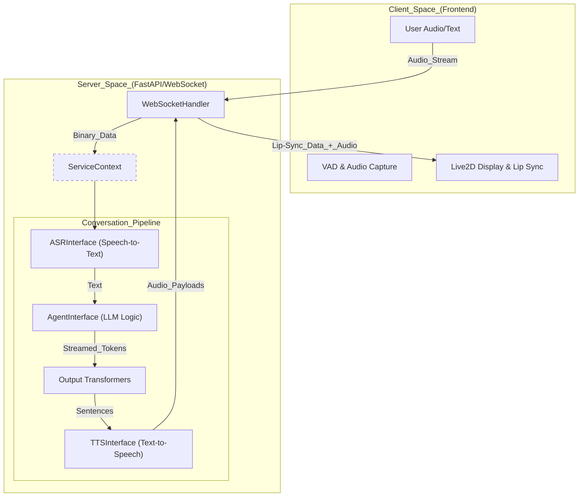
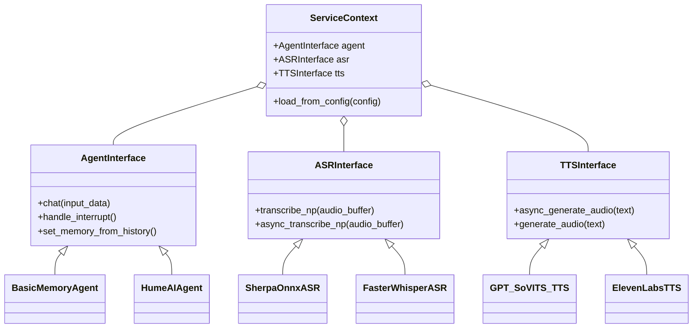

<!-- source: DeepWiki mcp.deepwiki.com · repo Open-LLM-VTuber/Open-LLM-VTuber · page 1 Project Overview · fetched 2026-10-30 -->

# Project Overview

Relevant source files

The following files were used as context for generating this wiki page:

- [README.CN.md](README.CN.md)
- [README.JP.md](README.JP.md)
- [README.KR.md](README.KR.md)
- [README.md](README.md)
- [assets/banner.cn.jpg](assets/banner.cn.jpg)
- [pyproject.toml](pyproject.toml)
- [uv.lock](uv.lock)

Open-LLM-VTuber is a cross-platform, voice-interactive AI companion system that integrates Large Language Models (LLMs), Automatic Speech Recognition (ASR), Text-to-Speech (TTS), and Live2D animation [README.md:44-47](). It is designed to run entirely offline or leverage cloud APIs, providing a modular framework for creating virtual personalities with visual perception and real-time interaction capabilities [README.md:65-68]().

The project was initially inspired by the goal of recreating the interaction style of AI Vtubers like `neuro-sama` using open-source, cross-platform solutions [README.md:55-56]().

## Core Pipeline Architecture

The application operates as a real-time processing pipeline that bridges user audio/text input to an animated Live2D avatar with synchronized voice output. The pipeline is managed by a `ServiceContext`, which acts as a dependency injection container for all AI engines [README.md:87-91]().

### High-Level Data Flow

The following diagram illustrates the transition from Natural Language Space (User Input) to Code Entity Space (System Components).

**System Data Flow and Entity Mapping**

**Sources:** [README.md:71-80](), [pyproject.toml:7-43]()

## Key Features

- **Multi-Modal Interaction**: Supports visual perception via camera, screen recording, and screenshots, allowing the AI to "see" the user's environment [README.md:71-73]().
- **Real-Time Voice Interruption**: Users can interrupt the AI without headphones (using echo cancellation/logic to ignore its own voice); the system manages interruption signals across the agent and TTS queues [README.md:73-74]().
- **Live2D Emotional Mapping**: Extracts emotional cues and expressions from LLM responses to trigger specific Live2D animations and motions [README.md:75-76]().
- **Modular Backend**: Pluggable architecture for LLMs (Ollama, OpenAI, Claude, Gemini, DeepSeek), ASR (Sherpa-ONNX, Faster-Whisper, FunASR), and TTS (GPT-SoVITS, CosyVoice, ElevenLabs) [README.md:82-86]().
- **Persistent Memory**: Chat logs are stored locally to maintain conversation continuity across sessions even after restarts [README.md:79-80]().
- **Desktop Pet Mode**: Special support for transparent backgrounds and "always-on-top" windowing for the desktop client [README.md:76-77]().

## Code Entity Space: Core Interfaces

The project relies on abstract base classes (Interfaces) to ensure modularity. Developers can extend these to add new model providers or custom logic [README.md:89-91]().

**Interface Hierarchy and Implementation Examples**

**Sources:** [README.md:87-91](), [pyproject.toml:7-43]()

## Wiki Navigation

This documentation is organized into sections covering the setup, configuration, and internal mechanics of the system.

### 1. Installation and Deployment
- **[Getting Started & Installation](#1.1)**: Step-by-step guide for local setup using `uv`, managing environment variables like `HF_HOME` or `MODELSCOPE_CACHE`, and initializing the frontend submodule [README.md:100-101]().
- **[Docker Deployment](#1.2)**: Guide for containerized deployment, including the Dockerfile structure and automated builds via GitHub Actions.
- **[Upgrade & Maintenance](#1.3)**: Details on the `upgrade.py` script and `UpgradeManager` for migrating configurations and updating the `model_dict.json` [README.md:107-108]().

### 2. Configuration and Personality
- **Configuration System**: Overview of how `conf.yaml` and the Pydantic-based `config_manager` control application behavior.
- **Character Configuration**: How to create and manage character YAML files in the `characters/` directory, including persona prompts and Live2D model assignments.
- **Prompt System**: Details on how `prompt_loader` assembles system prompts, including Live2D expression instructions and tool-calling definitions.

### 3. Technical Architecture
- **Server & WebSocket**: Deep dive into the FastAPI server, the `WebSocketHandler` message routing, and the static asset serving for Live2D models.
- **Conversation Pipeline**: Analysis of how the pipeline orchestrates ASR, LLM streaming, and the `TTSTaskManager` for ordered audio delivery and interruption handling.
- **Agent & MCP**: How the system handles tool use through the Model Context Protocol (MCP) and manages different LLM backends like OpenAI, Claude, and local GGUF models.

**Sources:** [README.md:104-108](), [pyproject.toml:1-43]()

---

