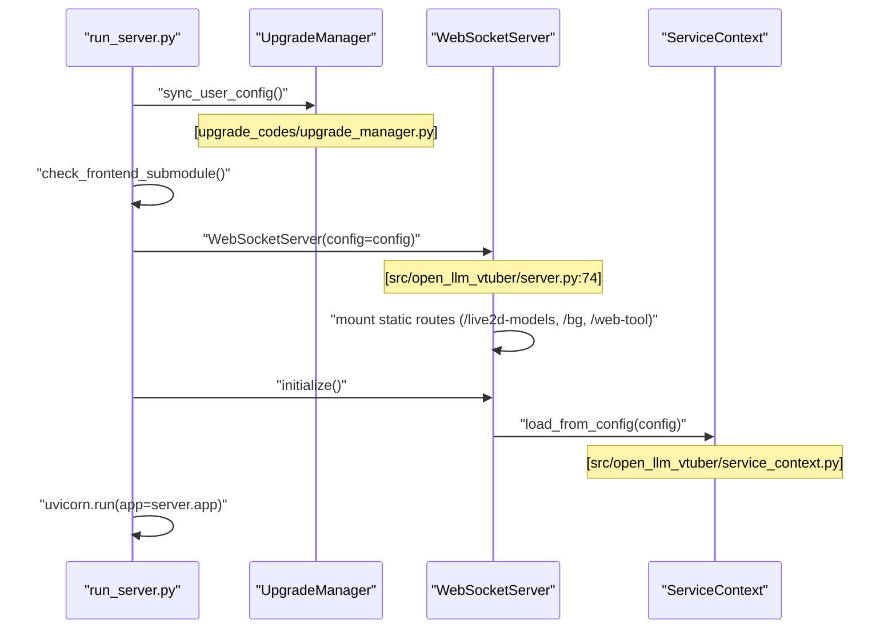
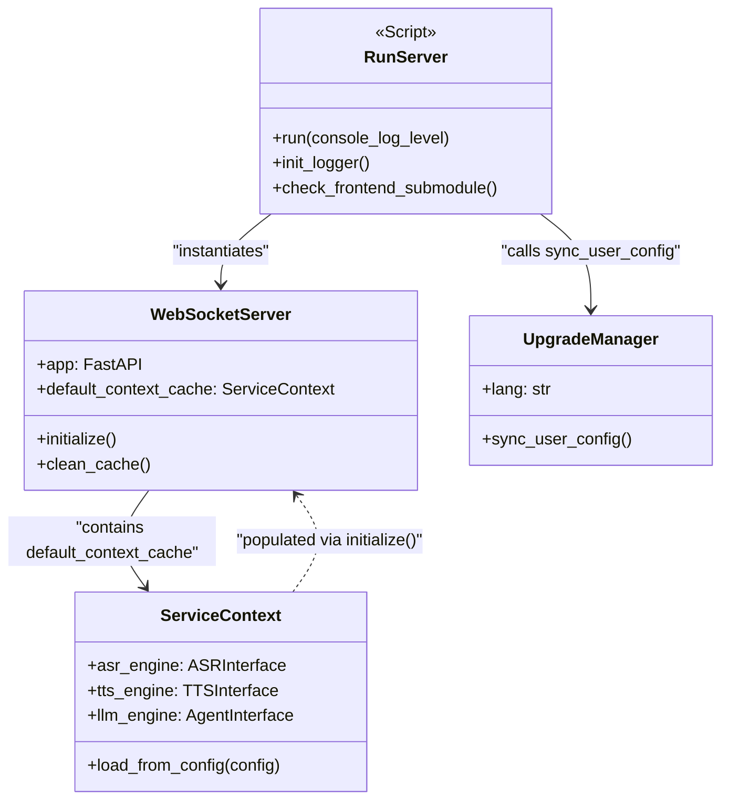

<!-- source: DeepWiki mcp.deepwiki.com · repo Open-LLM-VTuber/Open-LLM-VTuber · page 1.1 Getting Started & Installation · fetched 2026-10-30 -->

# Getting Started & Installation

<details>
<summary>Relevant source files</summary>

The following files were used as context for generating this wiki page:

- [.github/workflows/update-requirements.yml](.github/workflows/update-requirements.yml)
- [pyproject.toml](pyproject.toml)
- [requirements-bilibili.txt](requirements-bilibili.txt)
- [requirements.txt](requirements.txt)
- [run_server.py](run_server.py)
- [src/open_llm_vtuber/server.py](src/open_llm_vtuber/server.py)
- [uv.lock](uv.lock)

</details>


This page provides a technical guide for setting up the Open-LLM-VTuber environment. It covers dependency management using `uv`, environment configuration, server initialization, and frontend submodule management.

## System Requirements

The project requires **Python 3.10 to 3.12** [pyproject.toml:6-6](). It leverages `uv` for high-performance dependency resolution and `torch` for local AI inference [pyproject.toml:35-37]().

### Core Dependencies
The application relies on several key libraries:
*   **FastAPI & Uvicorn**: For the WebSocket and REST server [pyproject.toml:14-39]().
*   **Onnxruntime & Sherpa-ONNX**: For local ASR and VAD [pyproject.toml:21-32]().
*   **Loguru**: For structured logging [pyproject.toml:18-18]().
*   **Pydantic**: For configuration validation [src/open_llm_vtuber/server.py:14-14](), [src/open_llm_vtuber/config_manager/utils.py:1-20]().

## Installation Steps

### 1. Clone and Submodule Initialization
The frontend is maintained as a separate Git submodule. The server script `run_server.py` includes a `check_frontend_submodule` function to ensure `frontend/index.html` exists before starting [run_server.py:50-59]().

```bash
git clone https://github.com/Open-LLM-VTuber/Open-LLM-VTuber.git
cd Open-LLM-VTuber
git submodule update --init --recursive
```

### 2. Dependency Management with `uv`
The project uses `uv` for managing virtual environments and locking dependencies [uv.lock:1-3]().

**Standard Installation:**
```bash
uv sync
```

**Bilibili Integration (Optional):**
To enable Bilibili Live support, install the optional dependency group defined in `pyproject.toml` [pyproject.toml:45-50]():
```bash
uv sync --extra bilibili
```

### 3. Environment Variables
The application sets specific environment variables for model caching during startup in `run_server.py` [run_server.py:16-17]().

| Variable | Default Value | Description |
| :--- | :--- | :--- |
| `HF_HOME` | `./models` | Directory for Hugging Face model downloads [run_server.py:16-16](). |
| `MODELSCOPE_CACHE` | `./models` | Directory for ModelScope model downloads [run_server.py:17-17](). |
| `HF_ENDPOINT` | `https://hf-mirror.com` | Set if `--hf_mirror` flag is used [run_server.py:176-177](). |

## Running the Server

The server is launched via `run_server.py`, which handles configuration validation via `validate_config` and asynchronous service initialization [run_server.py:120-164]().

### CLI Arguments
The `parse_args()` function defines the following command-line interface [run_server.py:110-116]():

*   `--verbose`: Enables `DEBUG` level logging [run_server.py:169-170]().
*   `--hf_mirror`: Routes Hugging Face requests through `hf-mirror.com` by setting the `HF_ENDPOINT` environment variable [run_server.py:176-177]().

### Initialization Data Flow
The following diagram illustrates the startup sequence and how `run_server.py` interacts with the `WebSocketServer` and `UpgradeManager`.

**Server Startup Sequence**

Sources: [run_server.py:120-164](), [src/open_llm_vtuber/server.py:74-150](), [src/open_llm_vtuber/server.py:151-154]()

## Static Asset Serving

The `WebSocketServer` class uses `CORSStaticFiles` (a subclass of Starlette's `StaticFiles`) to serve assets. This custom class ensures `Access-Control-Allow-Origin: *` headers are present [src/open_llm_vtuber/server.py:23-40]().

**Asset Mapping Table**
| Endpoint | Local Directory | Entity/Purpose |
| :--- | :--- | :--- |
| `/cache` | `cache/` | Temporary audio files for TTS output [src/open_llm_vtuber/server.py:112-118](). |
| `/live2d-models` | `live2d-models/` | Live2D model files and `model_dict.json` [src/open_llm_vtuber/server.py:122-125](). |
| `/bg` | `backgrounds/` | Background images for the VTuber stage [src/open_llm_vtuber/server.py:127-130](). |
| `/avatars` | `avatars/` | Character profile pictures (via `AvatarStaticFiles`) [src/open_llm_vtuber/server.py:131-135](). |
| `/web-tool` | `web_tool/` | Browser-based ASR/TTS diagnostic tools [src/open_llm_vtuber/server.py:138-142](). |
| `/` | `frontend/` | The main frontend application [src/open_llm_vtuber/server.py:145-149](). |

## Code Architecture: Startup & Context

The server relies on `ServiceContext` to manage the lifecycle of AI engines (LLM, TTS, ASR).

**Code Entity Relationship**

Sources: [run_server.py:19-19](), [run_server.py:139-146](), [src/open_llm_vtuber/server.py:74-80](), [src/open_llm_vtuber/server.py:151-154]()

## Troubleshooting Submodules

If the frontend is missing, `run_server.py` attempts to run `git submodule update --init --recursive` [run_server.py:68-70](). If this fails (e.g., due to network issues), the server will log a `CRITICAL` error, and the root URL (`/`) will return a `404 Not Found` error [run_server.py:90-92]().

Manual restoration:
```bash
git restore frontend
git submodule update --init --recursive
```
Sources: [run_server.py:50-108]()

---

