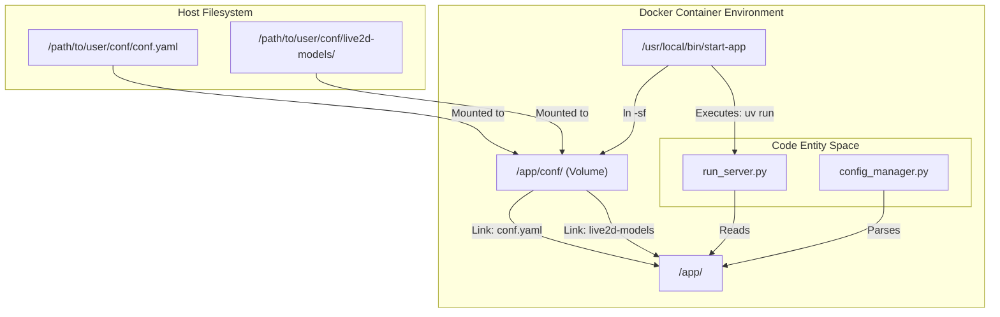
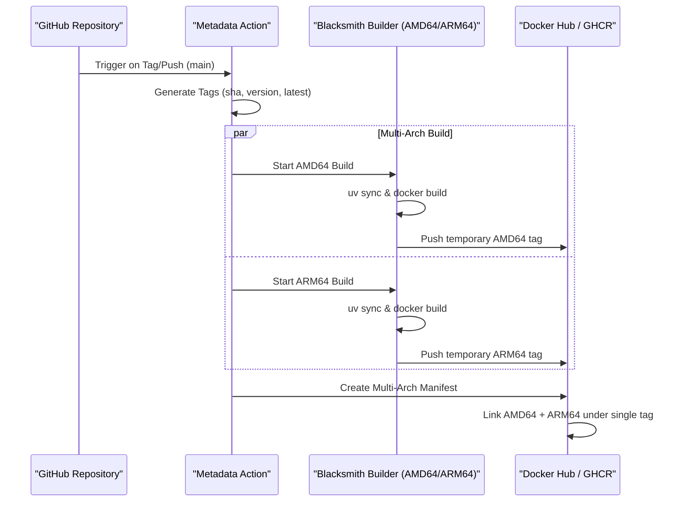

<!-- source: DeepWiki mcp.deepwiki.com · repo Open-LLM-VTuber/Open-LLM-VTuber · page 1.2 Docker Deployment · fetched 2026-10-30 -->

# Docker Deployment

Relevant source files

The following files were used as context for generating this wiki page:

- [.dockerignore](.dockerignore)
- [.github/workflows/docker-blacksmith.yml](.github/workflows/docker-blacksmith.yml)
- [dockerfile](dockerfile)

The Open-LLM-VTuber application is containerized using Docker to ensure consistent environments across different platforms and to simplify the deployment of its complex dependency tree (including system-level libraries like `ffmpeg`). The deployment architecture leverages `uv` for high-performance dependency management and a multi-stage-like approach to minimize image size while providing flexibility for user configurations.

## Dockerfile Architecture

The `dockerfile` uses `python:3.10-slim` as the base image to reduce the final footprint [[dockerfile:1]](). It employs a series of environment variables to optimize Python performance and ensure the `uv` package manager operates correctly within the container [[dockerfile:3-8]]().

### Build Stages and Dependency Management

The build process is divided into logical steps to maximize layer caching:

1.  **System Dependencies**: Installs `ffmpeg`, `git`, `curl`, and `ca-certificates` via `apt-get` [[dockerfile:13-16]]().
2.  **UV Installation**: Copies the `uv` and `uvx` binaries directly from the official `ghcr.io/astral-sh/uv` image [[dockerfile:19]]().
3.  **Dependency Sync**: Copies `pyproject.toml` and `uv.lock` first. It uses a cache mount for `/root/.cache/uv` to speed up subsequent builds and runs `uv sync --frozen --no-dev` to install exactly what is defined in the lockfile [[dockerfile:22-24]]().
4.  **Project Installation**: Copies the source code and installs the project itself using `uv pip install --no-deps .` to ensure the package is registered in the environment [[dockerfile:27-28]]().

### Startup Orchestration

The container uses a custom shell script, `start-app`, generated during the build process [[dockerfile:31-74]](). This script acts as an entrypoint manager that handles the mapping between the persistent host volume `/app/conf` and the application's expected internal directory structure.

**Filesystem Mapping Logic:**

| Source (Host Mount `/app/conf/`) | Destination (App Directory) | Status |
| :--- | :--- | :--- |
| `conf.yaml` | `/app/conf.yaml` | **Required** [[dockerfile:38-45]]() |
| `model_dict.json` | `/app/model_dict.json` | Optional [[dockerfile:48-50]]() |
| `live2d-models/` | `/app/live2d-models` | Optional (Symlinked) [[dockerfile:53-55]]() |
| `characters/` | `/app/characters` | Optional (Symlinked) [[dockerfile:58-60]]() |
| `avatars/` | `/app/avatars` | Optional (Symlinked) [[dockerfile:63-65]]() |
| `backgrounds/` | `/app/backgrounds` | Optional (Symlinked) [[dockerfile:68-70]]() |

**Sources:**
- [[dockerfile:1-82]]()

---

## Data Flow: Volume Mounting and Startup

The following diagram illustrates how the `start-app` script bridges the "Natural Language Space" of user-provided configuration files to the "Code Entity Space" of the running server.

### Container Initialization Flow

**Sources:**
- [[dockerfile:31-74]]()
- [[dockerfile:77-81]]()

---

## .dockerignore Implementation

The `.dockerignore` file is strictly configured to prevent local environment leaks (like API keys and virtual environments) and to ensure that the image remains lightweight by excluding local model caches and chat histories.

Key exclusions include:
*   **Secrets**: `.env`, `api_keys.py`, and `user_credentials.json` [[.dockerignore:41-43]]().
*   **Local Caches**: `__pycache__`, `.venv`, and `.cache/` [[.dockerignore:28-38, 79]]().
*   **Data Persistence**: `chat_history/`, `memory.db*`, and `logs/` [[.dockerignore:46-51, 67]]().
*   **Heavy Assets**: Most models are excluded except for essential defaults like `silero_vad.onnx` and `piper_voice` templates [[.dockerignore:56-61]]().
*   **Live2D Models**: All models except `mao_pro` and `shizuku` are ignored to keep the base image slim [[.dockerignore:14-16]]().

**Sources:**
- [[.dockerignore:1-80]]()

---

## Automated Build Workflow (GitHub Actions)

The project uses a sophisticated CI/CD pipeline defined in `.github/workflows/docker-blacksmith.yml` to build and push multi-arch images (AMD64 and ARM64) to both Docker Hub and GitHub Container Registry (GHCR).

### Build Pipeline Architecture

### Workflow Details

1.  **Metadata Generation**: The `meta` job calculates image tags based on Git refs, semver patterns, and SHA shorts [[.github/workflows/docker-blacksmith.yml:30-66]]().
2.  **Blacksmith Infrastructure**: Uses `useblacksmith/setup-docker-builder` for high-performance builds on specialized 8-vCPU runners [[.github/workflows/docker-blacksmith.yml:75-85]]().
3.  **Multi-Platform Matrix**: A strategy matrix builds for `linux/amd64` and `linux/arm64` in parallel [[.github/workflows/docker-blacksmith.yml:70-79]]().
4.  **Manifest Creation**: Since images are built on separate runners, a final `manifest` job uses `docker buildx imagetools create` to combine the architecture-specific images into a single multi-arch manifest [[.github/workflows/docker-blacksmith.yml:193-207]]().

**Sources:**
- [[.github/workflows/docker-blacksmith.yml:1-208]]()

---

