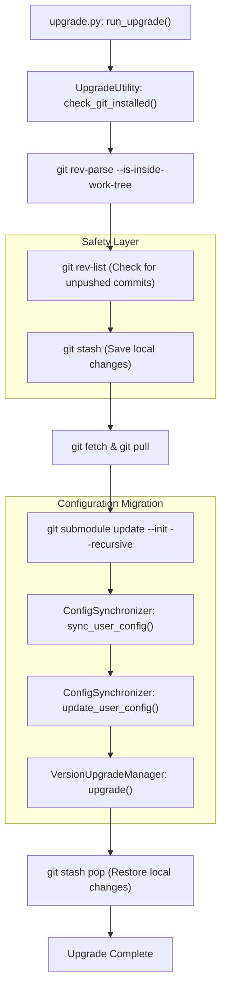
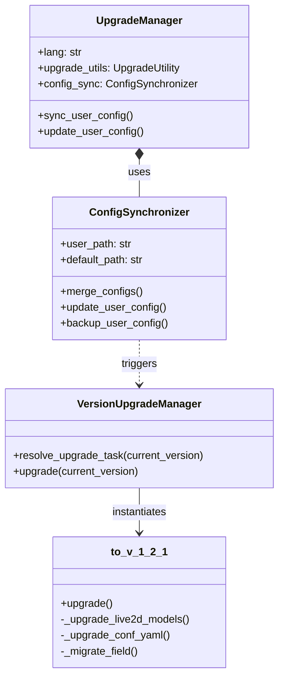

<!-- source: DeepWiki mcp.deepwiki.com · repo Open-LLM-VTuber/Open-LLM-VTuber · page 1.3 Upgrade & Maintenance · fetched 2026-10-30 -->

# Upgrade & Maintenance

Relevant source files

The following files were used as context for generating this wiki page:

- [.pre-commit-config.yaml](.pre-commit-config.yaml)
- [CLAUDE.md](CLAUDE.md)
- [upgrade.py](upgrade.py)
- [upgrade_codes/compare_yaml.py](upgrade_codes/compare_yaml.py)
- [upgrade_codes/config_sync.py](upgrade_codes/config_sync.py)
- [upgrade_codes/from_version/v_1_1_1.py](upgrade_codes/from_version/v_1_1_1.py)
- [upgrade_codes/upgrade_core/constants.py](upgrade_codes/upgrade_core/constants.py)
- [upgrade_codes/upgrade_core/upgrade_utils.py](upgrade_codes/upgrade_core/upgrade_utils.py)
- [upgrade_codes/upgrade_manager.py](upgrade_codes/upgrade_manager.py)
- [upgrade_codes/version_manager.py](upgrade_codes/version_manager.py)

The Open-LLM-VTuber project includes a robust maintenance system designed to keep local installations up to date with the remote repository while preserving user customizations. This is achieved through a dedicated upgrade pipeline that manages Git operations, configuration migrations, and dependency synchronization.

## Upgrade System Overview

The upgrade process is primarily driven by `upgrade.py`, which utilizes the `UpgradeManager` class to orchestrate a multi-stage update sequence. The system ensures that local changes are stashed, new code is pulled, and configuration files are migrated to the latest schema version without losing user settings.

### Core Components

| Component | File Path | Responsibility |
|:---|:---|:---|
| **Upgrade Script** | [upgrade.py:1-171]() | The entry point for manual updates, handling user interaction and the main execution loop. |
| **UpgradeManager** | [upgrade_codes/upgrade_manager.py:11-68]() | High-level orchestrator for language selection, logging initialization, and tool invocation. |
| **ConfigSynchronizer** | [upgrade_codes/config_sync.py:22-185]() | Manages YAML field merging, comment preservation, and version detection. |
| **VersionUpgradeManager** | [upgrade_codes/version_manager.py:8-94]() | Executes specific logic for migrating data (e.g., `model_dict.json`) between version ranges. |
| **UpgradeUtility** | [upgrade_codes/upgrade_core/upgrade_utils.py:10-148]() | Low-level wrappers for subprocess Git commands and system information logging. |

Sources: [upgrade.py:5-6](), [upgrade_codes/upgrade_manager.py:11-18](), [upgrade_codes/config_sync.py:22-35]()

## The Upgrade Pipeline

When a user runs `uv run upgrade.py`, the system follows a strict pipeline to prevent data loss and ensure a consistent state.

### Upgrade Process Data Flow
This diagram illustrates how the `UpgradeManager` interacts with Git and the local filesystem to perform an update.

Sources: [upgrade.py:9-168](), [upgrade_codes/upgrade_manager.py:45-68](), [upgrade_codes/config_sync.py:36-58](), [upgrade_codes/upgrade_core/upgrade_utils.py:17-36]()

## Configuration Migration & Synchronization

The system distinguishes between "Syncing" (ensuring files exist) and "Updating" (merging new fields and migrating logic).

### ConfigSynchronizer Logic
The `ConfigSynchronizer` performs three primary tasks during `update_user_config`:
1.  **Field Merging**: It identifies keys present in the default templates (e.g., `config_templates/conf.default.yaml`) that are missing in the user's `conf.yaml` and adds them while preserving existing values [upgrade_codes/config_sync.py:108-145]().
2.  **Comment Synchronization**: Using `CommentSynchronizer`, it attempts to keep the explanatory comments in `conf.yaml` aligned with the latest documentation in the templates [upgrade_codes/config_sync.py:66-75]().
3.  **Version Migration**: It detects the `conf_version` in `system_config` and triggers version-specific migration scripts via the `VersionUpgradeManager` [upgrade_codes/config_sync.py:79-92]().

### Version-Specific Tasks
Specific migration logic is encapsulated in classes like `to_v_1_2_1`. These classes handle breaking changes and data structure updates:
*   **Model Dict Updates**: Updating the `model_dict.json` file to reflect new Live2D model paths or parameters [upgrade_codes/version_manager.py:74-85]().
*   **Live2D Deprecation**: Removing deprecated models or updating `kScale` and `url` for existing ones [upgrade_codes/from_version/v_1_1_1.py:48-75]().
*   **Schema Refactoring**: Renaming fields or updating default values for specific components like VAD and ASR [upgrade_codes/from_version/v_1_1_1.py:86-105]().
*   **Translation/I18n**: Migrating values based on the user's selected language using a `migration_map` [upgrade_codes/from_version/v_1_1_1.py:17-37]().

Sources: [upgrade_codes/config_sync.py:52-97](), [upgrade_codes/version_manager.py:40-94](), [upgrade_codes/from_version/v_1_1_1.py:5-46]()

## Maintenance Entities & Implementation

The following diagram bridges the high-level maintenance concepts to the specific Python classes and methods that implement them.

Sources: [upgrade_codes/upgrade_manager.py:11-18](), [upgrade_codes/config_sync.py:22-35](), [upgrade_codes/version_manager.py:8-15](), [upgrade_codes/from_version/v_1_1_1.py:5-14]()

## Safety and Pre-checks

The upgrade system includes several safety checks to prevent code conflicts or data loss:
*   **Git Check**: Verifies Git is installed and the project is a valid repository [upgrade.py:20-34]().
*   **Unpushed Commits**: Blocks the upgrade if local commits exist on the `main` branch that haven't been pushed to the remote, providing backup suggestions [upgrade.py:37-48]().
*   **Uncommitted Changes**: Automatically uses `git stash` to save local modifications before pulling updates and `git stash pop` to restore them afterward [upgrade.py:51-75, 142-158]().
*   **Config Backup**: Creates a `conf.yaml.backup` before any configuration modification [upgrade_codes/config_sync.py:98-106]().

Sources: [upgrade.py:37-75](), [upgrade_codes/config_sync.py:98-106](), [upgrade_codes/upgrade_core/constants.py:8]()

---

