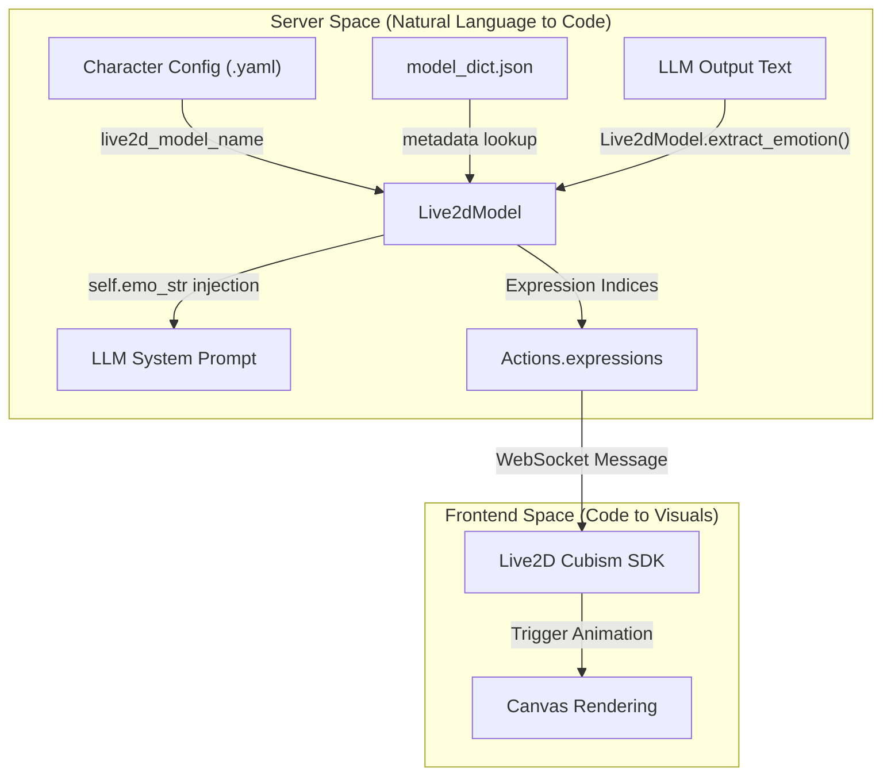
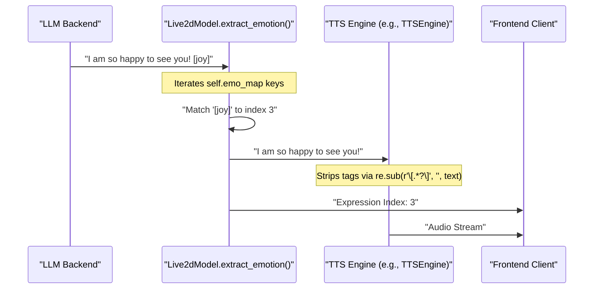

<!-- source: DeepWiki mcp.deepwiki.com · repo Open-LLM-VTuber/Open-LLM-VTuber · page 10 Live2D Model Integration · fetched 2026-10-30 -->

# Live2D Model Integration

Relevant source files

The following files were used as context for generating this wiki page:

- [model_dict.json](model_dict.json)
- [src/open_llm_vtuber/live2d_model.py](src/open_llm_vtuber/live2d_model.py)
- [src/open_llm_vtuber/tts/cosyvoice_tts.py](src/open_llm_vtuber/tts/cosyvoice_tts.py)
- [src/open_llm_vtuber/tts/fish_api_tts.py](src/open_llm_vtuber/tts/fish_api_tts.py)
- [src/open_llm_vtuber/tts/gpt_sovits_tts.py](src/open_llm_vtuber/tts/gpt_sovits_tts.py)
- [src/open_llm_vtuber/tts/sherpa_onnx_tts.py](src/open_llm_vtuber/tts/sherpa_onnx_tts.py)
- [src/open_llm_vtuber/tts/x_tts.py](src/open_llm_vtuber/tts/x_tts.py)

The Live2D Model Integration system manages the visual representation and emotional expression of the VTuber avatar. It bridges the gap between the LLM's textual output and the frontend's visual animations by parsing "Natural Language Space" emotions into "Code Entity Space" animation indices.

## Overview

Live2D integration is handled primarily by the `Live2dModel` class [src/open_llm_vtuber/live2d_model.py:10-26](). This class is responsible for loading model metadata, defining the available emotion set for the LLM, and extracting expression triggers from the generated response. It acts as a metadata container and processor, while the actual rendering is performed by the frontend.

### Live2D System Flow

The following diagram illustrates how the system transitions from a character's configuration to a rendered animation on the client.

**Live2D Animation Pipeline**

Sources: [src/open_llm_vtuber/live2d_model.py:28-54](), [model_dict.json:1-30]()

## Model Management and Configuration

All Live2D models must be registered in the `model_dict.json` file [model_dict.json:1-30](). This file serves as the central registry for the application to understand the physical and emotional properties of each model.

### Key Configuration Parameters
The system uses several parameters to ensure the model is positioned and scaled correctly in the browser:
- **`name`**: Unique identifier used in character YAML files [model_dict.json:3-3]().
- **`url`**: Path to the `.model3.json` file, typically served via `/live2d-models/` [model_dict.json:5-5]().
- **`kScale` & `initialXshift`**: Controls the size and initial positioning of the avatar [model_dict.json:6-8]().
- **`emotionMap`**: Maps string keywords (e.g., "joy") to integer expression indices defined in the Live2D model files [model_dict.json:11-20]().

For details on how to register and position new models, see [Live2D Model Configuration & model_dict.json](#10.1).

## Emotion Extraction and Animation

The `Live2dModel` class provides the logic for identifying when a character should change expressions. This is achieved through keyword extraction from the LLM's stream.

### The Extraction Process
1. **Prompt Injection**: During initialization, the `emo_str` (e.g., `[joy], [sadness]`) is generated from the model's `emotionMap` [src/open_llm_vtuber/live2d_model.py:48-53](). This is injected into the system prompt to instruct the LLM on how to signal emotions.
2. **Parsing**: As the LLM generates text, `extract_emotion()` scans for these tags [src/open_llm_vtuber/live2d_model.py:146-172]().
3. **Cleaning**: The tags are then removed from the text before it is sent to the TTS engine via `remove_emotion_keywords()` [src/open_llm_vtuber/live2d_model.py:174-200]().

**Emotion Extraction Logic**

Sources: [src/open_llm_vtuber/live2d_model.py:146-172](), [src/open_llm_vtuber/tts/gpt_sovits_tts.py:36-36]()

### TTS Compatibility
To prevent the TTS engine from reading the emotion tags (e.g., saying "bracket joy bracket"), the system cleans the text. For example, the GPT-SoVITS implementation explicitly uses regex `r"\[.*?\]"` to strip these tags before synthesis [src/open_llm_vtuber/tts/gpt_sovits_tts.py:36-36](). Other engines like `sherpa_onnx_tts.py` or `fish_api_tts.py` rely on the caller or internal cleaning to ensure only spoken text is processed [src/open_llm_vtuber/tts/sherpa_onnx_tts.py:93-93](), [src/open_llm_vtuber/tts/fish_api_tts.py:49-50]().

For details on the prompt engineering and extraction mechanics, see [Emotion Mapping & Expression Extraction](#10.2).

## Child Pages
- [Live2D Model Configuration & model_dict.json](#10.1): Technical reference for model registration, scaling, and the directory structure for asset serving.
- [Emotion Mapping & Expression Extraction](#10.2): Deep dive into the regex-based parsing, LLM prompting strategies, and the `Actions` data structure used for animation triggers.

---

