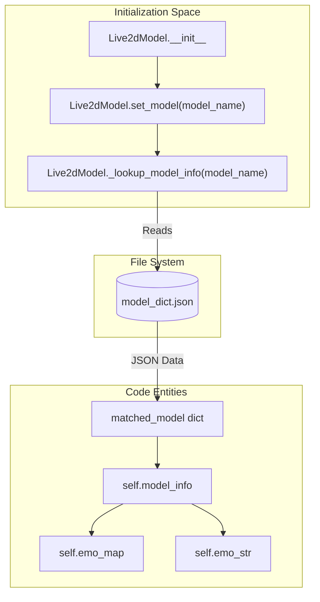
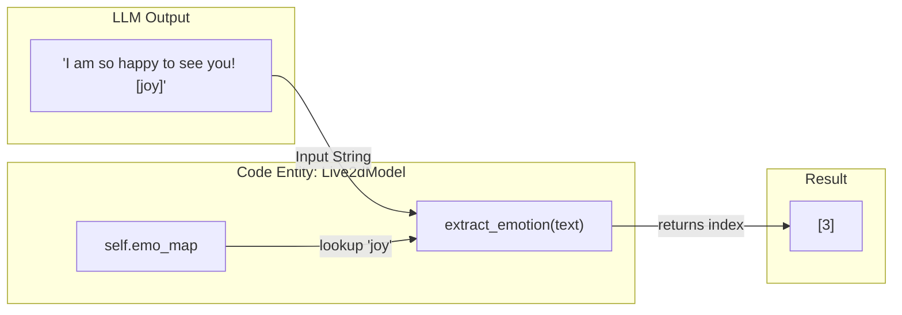

<!-- source: DeepWiki mcp.deepwiki.com · repo Open-LLM-VTuber/Open-LLM-VTuber · page 10.1 Live2D Model Configuration & model_dict.json · fetched 2026-10-30 -->

# Live2D Model Configuration & model_dict.json

<details>
<summary>Relevant source files</summary>

The following files were used as context for generating this wiki page:

- [live2d-models/mao_pro/ReadMe.txt](live2d-models/mao_pro/ReadMe.txt)
- [live2d-models/mao_pro/runtime/expressions/exp_01.exp3.json](live2d-models/mao_pro/runtime/expressions/exp_01.exp3.json)
- [live2d-models/mao_pro/runtime/expressions/exp_02.exp3.json](live2d-models/mao_pro/runtime/expressions/exp_02.exp3.json)
- [live2d-models/mao_pro/runtime/expressions/exp_03.exp3.json](live2d-models/mao_pro/runtime/expressions/exp_03.exp3.json)
- [live2d-models/mao_pro/runtime/expressions/exp_04.exp3.json](live2d-models/mao_pro/runtime/expressions/exp_04.exp3.json)
- [live2d-models/mao_pro/runtime/expressions/exp_05.exp3.json](live2d-models/mao_pro/runtime/expressions/exp_05.exp3.json)
- [live2d-models/mao_pro/runtime/mao_pro.model3.json](live2d-models/mao_pro/runtime/mao_pro.model3.json)
- [model_dict.json](model_dict.json)

</details>


This page details how Live2D models are integrated and configured within the Open-LLM-VTuber system. The configuration is primarily managed through a central `model_dict.json` file, which maps logical model names to their physical assets, scaling parameters, and emotion indices.

## Overview of Model Integration

The system uses the `Live2dModel` class to manage model metadata and facilitate the mapping between LLM-generated text and character expressions.

### Data Flow for Model Loading
The following diagram illustrates how the `Live2dModel` class interacts with the configuration file to initialize a model instance.

**Model Initialization Flow**

Sources: [src/open_llm_vtuber/live2d_model.py:28-54](), [src/open_llm_vtuber/live2d_model.py:84-144]()

## The model_dict.json Schema

The `model_dict.json` file is an array of objects, where each object defines a single Live2D model.

| Key | Type | Description |
| :--- | :--- | :--- |
| `name` | string | Unique identifier used in character configuration files. |
| `url` | string | Relative path to the `.model3.json` file (served via `/live2d-models`). |
| `kScale` | float | Scaling factor for the model in the frontend view. |
| `initialXshift` | number | Initial horizontal shift for model positioning. |
| `initialYshift` | number | Initial vertical shift for model positioning. |
| `kXOffset` | number | Horizontal offset used for centering or specific placement. |
| `idleMotionGroupName` | string | The name of the motion group to play when idle (e.g., "Idle"). |
| `emotionMap` | object | Maps emotion keywords (e.g., "joy") to expression indices. |
| `tapMotions` | object | Defines motions triggered by clicking specific HitAreas. |

**Example Entry (Niziiro Mao Pro):**
```json
{
    "name": "mao_pro",
    "description": "",
    "url": "/live2d-models/mao_pro/runtime/mao_pro.model3.json",
    "kScale": 0.5,
    "initialXshift": 0,
    "initialYshift": 0,
    "kXOffset": 1150,
    "idleMotionGroupName": "Idle",
    "emotionMap": {
        "neutral": 0,
        "anger": 2,
        "disgust": 2,
        "fear": 1,
        "joy": 3,
        "smirk": 3,
        "sadness": 1,
        "surprise": 3
    },
    "tapMotions": {
        "HitAreaHead": { "": 1 },
        "HitAreaBody": { "": 1 }
    }
}
```
Sources: [model_dict.json:1-30]()

## Implementation: Live2dModel Class

The `Live2dModel` class in `src/open_llm_vtuber/live2d_model.py` is responsible for loading the model information and parsing emotions from text.

### Robust File Loading
The class implements `_load_file_content` to handle various file encodings (UTF-8, GBK, etc.) when reading `model_dict.json`, ensuring compatibility across different operating systems and languages [src/open_llm_vtuber/live2d_model.py:55-82]().

### Emotion and Expression Mapping
The `emotionMap` in `model_dict.json` maps natural language emotion keys to integer indices. These indices correspond to the order of expressions defined in the model's `.model3.json` file under `FileReferences.Expressions` [live2d-models/mao_pro/runtime/mao_pro.model3.json:11-44]().

*   **emo_map**: A dictionary where keys are converted to lowercase [src/open_llm_vtuber/live2d_model.py:48-50]().
*   **emo_str**: A formatted string (e.g., `"[neutral], [anger], [disgust], [fear], [joy], [smirk], [sadness], [surprise]"`) used to inform the LLM about available expressions [src/open_llm_vtuber/live2d_model.py:51-53]().

### Keyword Extraction
The `extract_emotion` method scans LLM output for tags like `[joy]` and returns the corresponding indices from the `emo_map` [src/open_llm_vtuber/live2d_model.py:146-172]().

**Natural Language to Expression Index Mapping**

Sources: [src/open_llm_vtuber/live2d_model.py:146-172](), [model_dict.json:11-20]()

## Adding a New Model

To add a new Live2D model to the system, follow these steps:

1.  **Place Assets**: Create a new directory under `live2d-models/` and place your exported Live2D runtime files there. The folder structure should include the `.moc3` file, the `.model3.json` file, and folders for `expressions/` and `motions/` [live2d-models/mao_pro/ReadMe.txt:39-51]().
2.  **Identify Expressions**: Open your model's `.model3.json` to see the list of expressions. The index is the 0-based position in the `Expressions` array [live2d-models/mao_pro/runtime/mao_pro.model3.json:11-44](). For example, `exp_01.exp3.json` at index 0 might represent "neutral" [live2d-models/mao_pro/runtime/expressions/exp_01.exp3.json:1-147]().
3.  **Register in model_dict.json**:
    *   Open `model_dict.json`.
    *   Add a new JSON object to the array [model_dict.json:2-29]().
    *   Set the `name` to your desired character ID.
    *   Set the `url` to point to your `.model3.json` file, starting with `/live2d-models/`.
    *   Define the `emotionMap` using the indices identified in step 2.
    *   (Optional) Define `tapMotions` mapping `HitArea` IDs (from the `.model3.json`) to motion indices [live2d-models/mao_pro/runtime/mao_pro.model3.json:90-99]().
4.  **Configure Character**: Update your character's YAML configuration file (in the `characters/` directory) to set `live2d_model_name` to the `name` you defined in `model_dict.json`.

### Technical Notes
*   **TTS Cleaning**: Several TTS engines (e.g., `gpt_sovits_tts.py`) use regex to remove emotion tags (e.g., `[joy]`) from the text before synthesis to prevent the engine from attempting to "speak" the brackets [src/open_llm_vtuber/tts/gpt_sovits_tts.py:36-39]().
*   **Static Serving**: The `/live2d-models` path is served as a static directory by the FastAPI server, allowing the frontend to fetch model assets directly [src/open_llm_vtuber/live2d_model.py:5-7]().

Sources: [src/open_llm_vtuber/live2d_model.py:103-144](), [src/open_llm_vtuber/tts/gpt_sovits_tts.py:34-48](), [model_dict.json:1-30](), [live2d-models/mao_pro/runtime/mao_pro.model3.json:11-44]()

---

