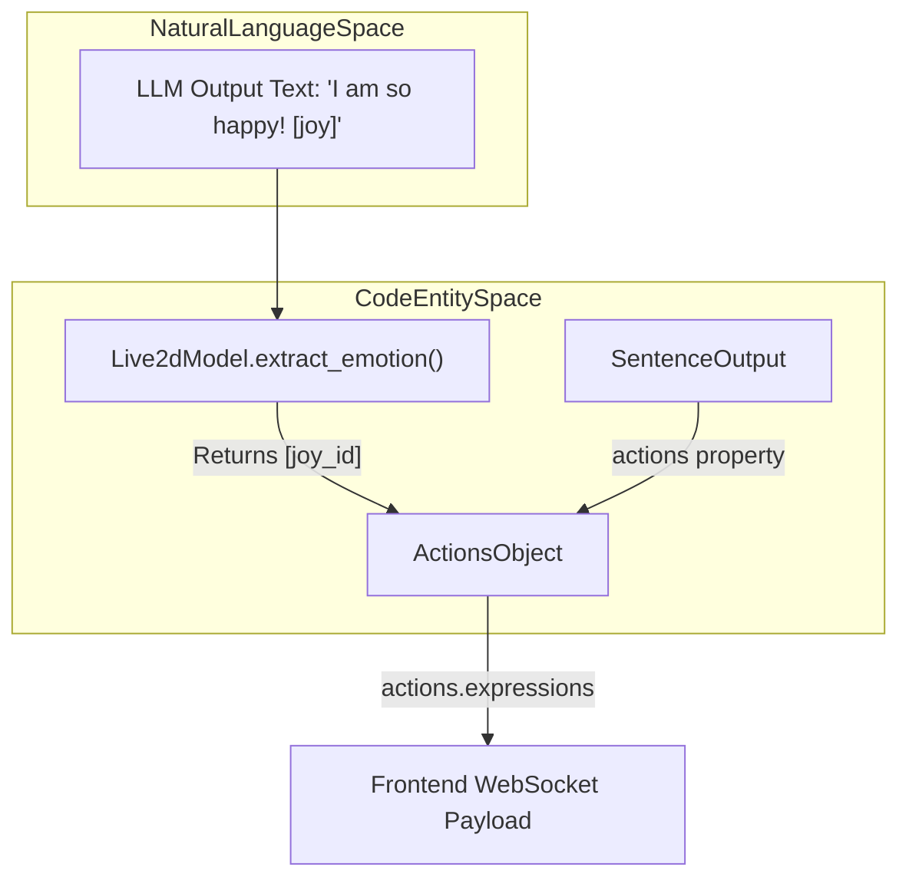
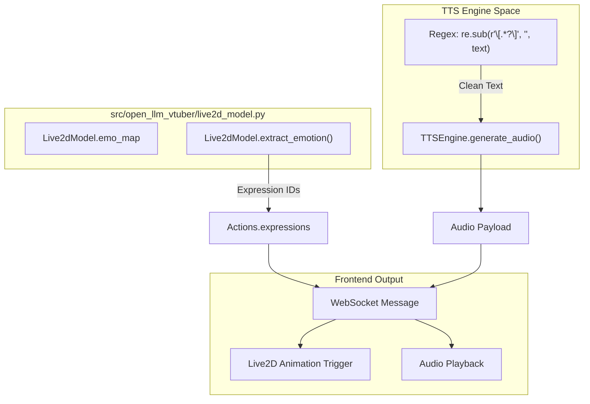

<!-- source: DeepWiki mcp.deepwiki.com · repo Open-LLM-VTuber/Open-LLM-VTuber · page 10.2 Emotion Mapping & Expression Extraction · fetched 2026-10-30 -->

# Emotion Mapping & Expression Extraction

Relevant source files

The following files were used as context for generating this wiki page:

- [prompts/utils/live2d_expression_prompt.txt](prompts/utils/live2d_expression_prompt.txt)
- [prompts/utils/think_tag_prompt.txt](prompts/utils/think_tag_prompt.txt)
- [src/open_llm_vtuber/live2d_model.py](src/open_llm_vtuber/live2d_model.py)
- [src/open_llm_vtuber/tts/cosyvoice_tts.py](src/open_llm_vtuber/tts/cosyvoice_tts.py)
- [src/open_llm_vtuber/tts/fish_api_tts.py](src/open_llm_vtuber/tts/fish_api_tts.py)
- [src/open_llm_vtuber/tts/gpt_sovits_tts.py](src/open_llm_vtuber/tts/gpt_sovits_tts.py)
- [src/open_llm_vtuber/tts/sherpa_onnx_tts.py](src/open_llm_vtuber/tts/sherpa_onnx_tts.py)
- [src/open_llm_vtuber/tts/x_tts.py](src/open_llm_vtuber/tts/x_tts.py)

The emotion mapping and expression extraction system enables the VTuber model to react visually to the LLM's output. It parses the generated text for specific emotion tags, maps them to Live2D expression indices, and synchronizes these animations with the audio playback.

## Emotion Extraction Logic

The core logic for identifying emotions resides in the `Live2dModel` class. It uses a keyword-matching approach based on the configuration defined in `model_dict.json`.

### Implementation Detail
- **`extract_emotion(str_to_check)`**: This method scans a string for tags enclosed in square brackets (e.g., `[joy]`). It iterates through the text and matches identified tags against the `emo_map` [src/open_llm_vtuber/live2d_model.py:146-172]().
- **`emo_map` Construction**: During initialization via `set_model`, the model loads its `emotionMap` from the dictionary and converts keys to lowercase for case-insensitive matching [src/open_llm_vtuber/live2d_model.py:48-50]().
- **`emo_str` Generation**: A string representation of all available tags is created (e.g., `"[fear], [anger], [disgust], [sadness], [joy], [neutral], [surprise]"`) to be injected into LLM prompts [src/open_llm_vtuber/live2d_model.py:51-54]().
- **`remove_emotion_keywords(target_str)`**: This utility removes the tags from the text to ensure they are not displayed or spoken if required [src/open_llm_vtuber/live2d_model.py:174-192]().

### Natural Language to Code Entity Space: Extraction
The following diagram illustrates how raw LLM text containing natural language emotion cues is converted into actionable code objects within the system.

"Emotion Extraction Flow"

Sources: [src/open_llm_vtuber/live2d_model.py:146-172](), [src/open_llm_vtuber/live2d_model.py:48-54]()

## Prompt Injection & Guidelines

To ensure the LLM uses the correct tags, the system injects available emotions into the system prompt using templates.

- **`live2d_expression_prompt.txt`**: This prompt instructs the LLM to use specific keywords provided in the `<insert_emomap_keys>` placeholder [prompts/utils/live2d_expression_prompt.txt:1-15]().
- **`think_tag_prompt.txt`**: Encourages the LLM to express inner thoughts and physical actions (like blushing or lowering head) within `<think>` tags, which can complement the explicit `[expression]` tags [prompts/utils/think_tag_prompt.txt:1-6]().

## Data Structures & Mapping

| Component | Description | Code Reference |
| :--- | :--- | :--- |
| `emo_map` | Dictionary mapping tag strings (e.g., "joy") to Live2D expression IDs. | [src/open_llm_vtuber/live2d_model.py:48-50]() |
| `emo_str` | A comma-separated string of all keys in `emo_map` for prompt injection. | [src/open_llm_vtuber/live2d_model.py:51-54]() |
| `extract_emotion` | Method to parse text and return a list of matching expression values. | [src/open_llm_vtuber/live2d_model.py:146-172]() |

## Audio Synchronization & Payload Construction

While expressions trigger animations, they must be synchronized with the audio stream.

- **Payload Construction**: The system bundles the extracted expressions into a payload that includes the audio data.
- **Lip-sync**: Although `Live2dModel` handles the visual expressions, the frontend uses volume data provided in the payload to perform lip-syncing.

### Code Entity Space: Synchronization
This diagram shows the relationship between the model data and the final payload sent to the client.

"Model to Payload Mapping"

Sources: [src/open_llm_vtuber/live2d_model.py:146-172](), [src/open_llm_vtuber/tts/gpt_sovits_tts.py:34-48]()

## TTS Cleanup

To prevent the TTS engine from reading the emotion tags aloud, various TTS implementations use regex to strip the tags before synthesis.

- **GPT-SoVITS**: Uses `re.sub(r"\[.*?\]", "", text)` to remove tags like `[joy]` from the input string before sending it to the API [src/open_llm_vtuber/tts/gpt_sovits_tts.py:36]().
- **Other Engines**: Engines like `x_tts.py` or `fish_api_tts.py` receive the text for generation; however, the `gpt_sovits_tts.py` implementation explicitly demonstrates the cleaning step [src/open_llm_vtuber/tts/gpt_sovits_tts.py:34-48](), [src/open_llm_vtuber/tts/x_tts.py:19-28](), [src/open_llm_vtuber/tts/fish_api_tts.py:44-54]().

Sources: [src/open_llm_vtuber/tts/gpt_sovits_tts.py:34-40](), [src/open_llm_vtuber/tts/x_tts.py:19-30](), [src/open_llm_vtuber/tts/fish_api_tts.py:44-54]()

---

