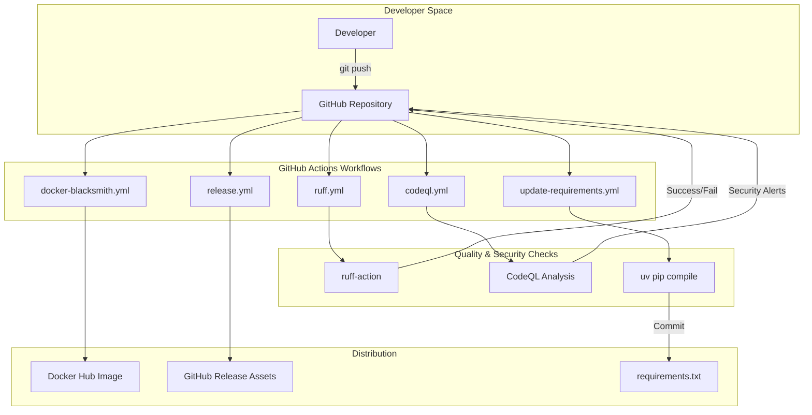
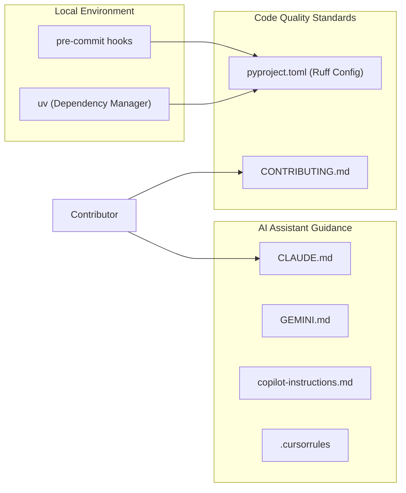

<!-- source: DeepWiki mcp.deepwiki.com · repo Open-LLM-VTuber/Open-LLM-VTuber · page 11 CI/CD & Developer Tooling · fetched 2026-10-30 -->

# CI/CD & Developer Tooling

Relevant source files

The following files were used as context for generating this wiki page:

- [.github/workflows/ruff.yml](.github/workflows/ruff.yml)
- [.github/workflows/update-requirements.yml](.github/workflows/update-requirements.yml)
- [requirements-bilibili.txt](requirements-bilibili.txt)
- [requirements.txt](requirements.txt)

This section provides an overview of the automated systems and developer utilities that ensure code quality, security, and consistent deployment for the Open-LLM-VTuber project. The project leverages GitHub Actions for continuous integration and provides a suite of configuration files to guide both human contributors and AI coding assistants.

### CI/CD Pipeline Overview

The project utilizes GitHub Actions to automate linting, security analysis, dependency synchronization, and distribution. These workflows ensure that every pull request and push to the `main` branch adheres to the project's standards.

#### Automation Workflow Diagram

The following diagram illustrates how code changes interact with the automated CI/CD entities.

**CI/CD Process Flow**

**Sources:**
- [.github/workflows/ruff.yml:1-8]()
- [.github/workflows/update-requirements.yml:1-31]()

---

### GitHub Actions Workflows

The repository includes several specialized workflows to manage the lifecycle of the application:

*   **Linting & Formatting:** The `ruff.yml` workflow uses the `astral-sh/ruff-action` to enforce Python code style and catch common errors [.github/workflows/ruff.yml:1-8]().
*   **Security Scanning:** `codeql.yml` performs advanced static analysis to detect vulnerabilities, specifically targeting the Python codebase.
*   **Dependency Management:** The `update-requirements.yml` workflow automatically synchronizes `requirements.txt` and `requirements-bilibili.txt` with the `pyproject.toml` definition using `uv pip compile` whenever the project configuration changes [.github/workflows/update-requirements.yml:20-23]().
*   **Containerization:** Automated builds for Docker images are handled via `docker-blacksmith.yml`, ensuring the latest version is always available for containerized deployment.

For a deep dive into each workflow's configuration and triggers, see **[GitHub Actions Workflows (#11.1)]()**.

---

### Development Practices & Tooling

To maintain a high-velocity development environment, the project provides specific tools for both local development and AI-assisted coding.

#### Developer Tooling Architecture

This diagram bridges the developer's local environment to the project's quality standards.

**Developer Environment & Tooling**

**Sources:**
- [requirements.txt:258-259]()
- [.github/workflows/update-requirements.yml:18-19]()

#### Key Components
*   **Dependency Management:** The project utilizes `uv` for fast, reproducible dependency resolution. The `requirements.txt` is an autogenerated export from this system [requirements.txt:1-2]().
*   **Contribution Guidelines:** Detailed instructions for setting up the development environment and submitting PRs are found in `CONTRIBUTING.md`.
*   **AI Instructions:** Specialized files (e.g., `CLAUDE.md`, `.cursorrules`) provide context to AI coding assistants about the project's architecture, helping them generate code that follows established patterns.
*   **Code Style:** The project enforces strict linting via `ruff`. Local developers use `pre-commit` to catch formatting issues before they reach the CI pipeline [requirements.txt:258-259]().

For detailed coding conventions and instructions on setting up AI assistants, see **[Development Practices & Code Style (#11.2)]()**.

---

**Sources:**
- [.github/workflows/ruff.yml:1-8]()
- [.github/workflows/update-requirements.yml:1-31]()
- [requirements.txt:1-2]()
- [requirements.txt:258-259]()

---

