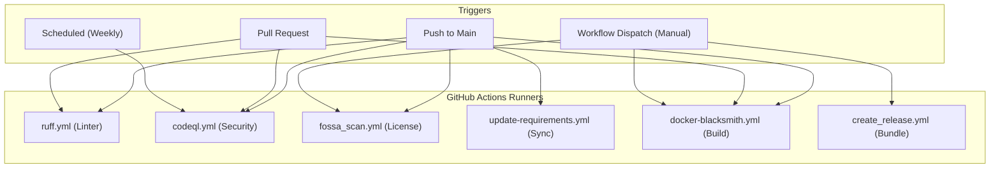
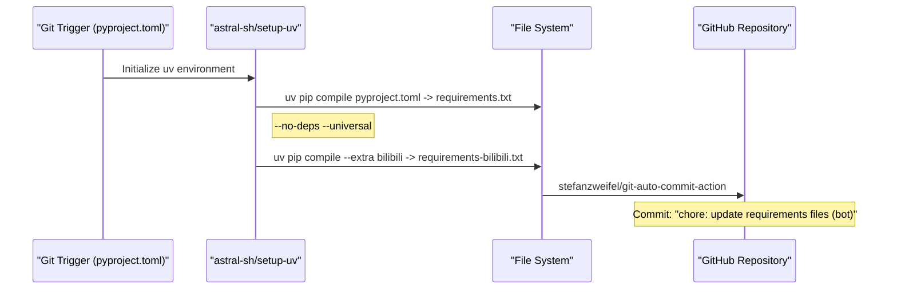
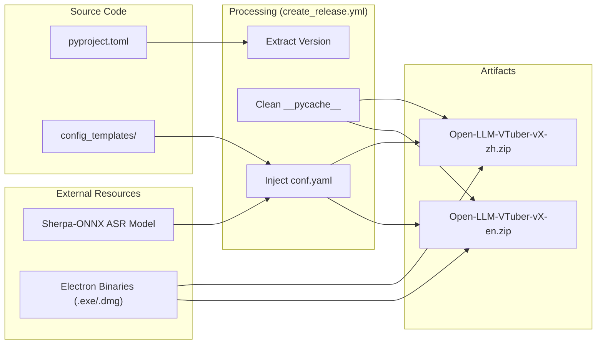

<!-- source: DeepWiki mcp.deepwiki.com · repo Open-LLM-VTuber/Open-LLM-VTuber · page 11.1 GitHub Actions Workflows · fetched 2026-10-30 -->

# GitHub Actions Workflows

Relevant source files

The following files were used as context for generating this wiki page:

- [.dockerignore](.dockerignore)
- [.github/workflows/codeql.yml](.github/workflows/codeql.yml)
- [.github/workflows/create_release.yml](.github/workflows/create_release.yml)
- [.github/workflows/docker-blacksmith.yml](.github/workflows/docker-blacksmith.yml)
- [.github/workflows/fossa_scan.yml](.github/workflows/fossa_scan.yml)
- [.github/workflows/ruff.yml](.github/workflows/ruff.yml)
- [.github/workflows/update-requirements.yml](.github/workflows/update-requirements.yml)
- [dockerfile](dockerfile)
- [requirements-bilibili.txt](requirements-bilibili.txt)
- [requirements.txt](requirements.txt)

The Open-LLM-VTuber project utilizes GitHub Actions to automate code quality enforcement, security auditing, dependency management, multi-architecture containerization, and distribution packaging. These workflows ensure that the codebase remains stable, secure, and easily deployable across various environments.

## CI/CD Pipeline Overview

The automation infrastructure is divided into three primary categories:
1.  **Quality & Security**: Linting (`ruff.yml`), security scanning (`codeql.yml`), and license compliance (`fossa_scan.yml`).
2.  **Dependency Management**: Automatic synchronization of `requirements.txt` from `pyproject.toml` (`update-requirements.yml`).
3.  **Build & Release**: Multi-arch Docker image generation via Blacksmith (`docker-blacksmith.yml`) and manual release bundling (`create_release.yml`).

### Workflow Execution Flow

The following diagram illustrates how different triggers (Push, PR, Manual) activate specific workflow entities within the repository.

**Diagram: Workflow Trigger and Entity Association**

**Sources:** [ .github/workflows/ruff.yml:1-3 ](), [ .github/workflows/codeql.yml:14-20 ](), [ .github/workflows/docker-blacksmith.yml:3-13 ](), [ .github/workflows/update-requirements.yml:3-6 ](), [ .github/workflows/create_release.yml:4-21 ]()

---

## Code Quality and Security

### Ruff Linting
The project uses `ruff` for extremely fast Python linting and formatting. It runs on every push and pull request to ensure code style consistency.
*   **Implementation**: Uses `astral-sh/ruff-action@v3`.
*   **Scope**: Analyzes all Python files in the repository.

### CodeQL Advanced Security
A weekly scheduled and event-driven scan that performs static analysis to detect vulnerabilities.
*   **Implementation**: Configured for Python analysis with `build-mode: none`.
*   **Permissions**: Requires `security-events: write` to upload results to the GitHub Security tab.

### FOSSA License Scanning
Scans dependencies to ensure compliance with open-source licenses.
*   **Implementation**: Uses `fossas/fossa-action` and requires a `fossaApiKey` secret.

**Sources:** [ .github/workflows/ruff.yml:1-8 ](), [ .github/workflows/codeql.yml:22-93 ](), [ .github/workflows/fossa_scan.yml:1-17 ]()

---

## Dependency Management

The `update-requirements.yml` workflow ensures that `requirements.txt` and `requirements-bilibili.txt` are always in sync with the source of truth, `pyproject.toml`. This is critical for users who do not use `uv` directly.

**Diagram: Requirements Synchronization Logic**

| Output File | Command Context | Purpose |
| :--- | :--- | :--- |
| `requirements.txt` | Standard compile | Base dependencies for core functionality. |
| `requirements-bilibili.txt` | `--extra bilibili` | Includes `brotli` and `websocket-client` for Bilibili live support. |

**Sources:** [ .github/workflows/update-requirements.yml:18-31 ](), [ requirements.txt:1-2 ](), [ requirements-bilibili.txt:1-37 ]()

---

## Docker Build & Push (Blacksmith)

The `docker-blacksmith.yml` workflow handles the creation of multi-architecture (`amd64` and `arm64`) Docker images. It uses Blacksmith's high-performance runners to accelerate the build process.

### Build Strategy
1.  **Metadata Extraction**: Uses `docker/metadata-action` to generate tags based on branch names, semver tags (e.g., `v1.0.0`), and Git SHAs.
2.  **Parallel Matrix Build**: Runs two parallel jobs on `blacksmith-8vcpu-ubuntu-2204` (for amd64) and `blacksmith-8vcpu-ubuntu-2204-arm` (for arm64).
3.  **Temporary Tagging**: Pushes intermediate images with architecture suffixes (e.g., `tmp-main-amd64`).
4.  **Manifest Creation**: A final `manifest` job combines the architecture-specific images into a single multi-arch manifest under the final tags (e.g., `latest`).

### Docker Hub and GHCR
Images are simultaneously pushed to:
*   `openllmvtuber/open-llm-vtuber` (Docker Hub)
*   `ghcr.io/open-llm-vtuber/open-llm-vtuber` (GitHub Container Registry)

**Sources:** [ .github/workflows/docker-blacksmith.yml:29-80 ](), [ .github/workflows/docker-blacksmith.yml:149-208 ](), [ dockerfile:1-81 ]()

---

## Release Creation Workflow

The `create_release.yml` is a comprehensive manual workflow used to bundle the application for end-users. It automates the complex task of gathering models, templates, and frontend binaries.

### Key Steps in `build-release-packages`
1.  **Environment Setup**: Extracts the version from `pyproject.toml` or uses a manual override.
2.  **Model Acquisition**: Downloads the `sherpa-onnx-sense-voice` ASR model and extracts it into the `models/` directory.
3.  **Project Sanitization**: Removes `__pycache__` and `.venv` to reduce package size.
4.  **Localization Bundling**:
    *   Creates a Chinese version by copying `config_templates/conf.ZH.default.yaml` to `conf.yaml`.
    *   Creates an English version using `config_templates/conf.default.yaml`.
5.  **Electron Asset Integration**: Uses `curl` to fetch the latest `.exe` (Windows) and `.dmg` (macOS) installers from the `Open-LLM-VTuber-Web` repository.
6.  **Distribution**: Uploads artifacts to GitHub and optionally to Cloudflare R2 using the AWS CLI.

**Diagram: Release Asset Assembly**

**Sources:** [ .github/workflows/create_release.yml:64-128 ](), [ .github/workflows/create_release.yml:168-187 ](), [ .github/workflows/create_release.yml:95-109 ]()

---

