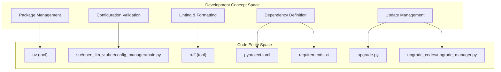
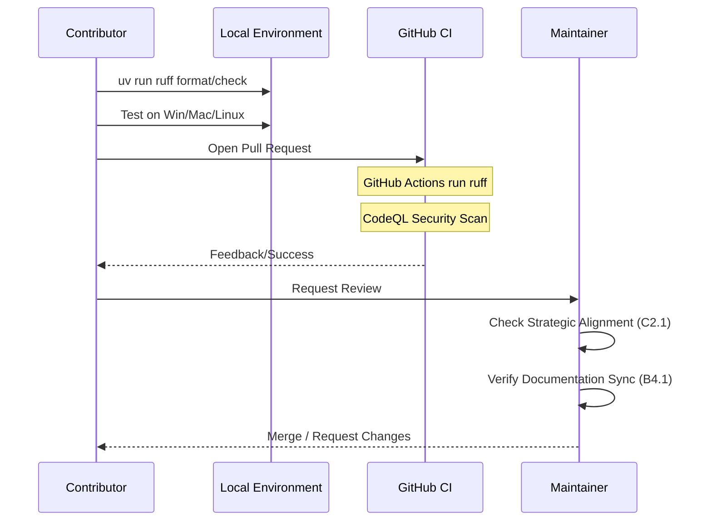
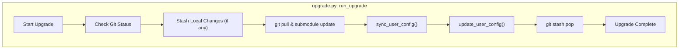

<!-- source: DeepWiki mcp.deepwiki.com · repo Open-LLM-VTuber/Open-LLM-VTuber · page 11.2 Development Practices & Code Style · fetched 2026-10-30 -->

# Development Practices & Code Style

Relevant source files

The following files were used as context for generating this wiki page:

- [.cursor/rules/olv-core-rules.mdc](.cursor/rules/olv-core-rules.mdc)
- [.gemini/GEMINI.md](.gemini/GEMINI.md)
- [.gemini/styleguide.md](.gemini/styleguide.md)
- [.github/copilot-instructions.md](.github/copilot-instructions.md)
- [.pre-commit-config.yaml](.pre-commit-config.yaml)
- [CONTRIBUTING.md](CONTRIBUTING.md)
- [upgrade.py](upgrade.py)
- [upgrade_codes/upgrade_manager.py](upgrade_codes/upgrade_manager.py)

This page outlines the engineering standards, contribution workflows, and automated tooling used in the Open-LLM-VTuber project. Adhering to these practices ensures the codebase remains maintainable, performant (targeting <500ms latency), and accessible to both human contributors and AI assistants.

## Core Engineering Principles

The project is built on several foundational principles that guide architectural decisions and code implementation:

*   **Offline-Ready:** Core functionality must operate without an internet connection. Cloud-based services (ASR/TTS/LLM) are optional modules `[.gemini/GEMINI.md:15-15]()`.
*   **Separation of Concerns:** Strict decoupling between the FastAPI backend and the React-based frontend `[.gemini/GEMINI.md:16-16]()`.
*   **Performance-Critical:** Every component is optimized for low-latency voice interaction, targeting end-to-end latency below 500ms `[.gemini/GEMINI.md:13-13]()`.
*   **Modern Python:** Utilization of Python 3.10+ features, specifically for type safety and asynchronous execution `[.gemini/GEMINI.md:8-10]()`.

### Code Entity to Concept Mapping

The following diagram bridges high-level development concepts to their specific implementations in the codebase.

**System Entity Mapping**

Sources: `[.gemini/GEMINI.md:12-12]()`, `[.gemini/GEMINI.md:29-29]()`, `[.gemini/GEMINI.md:59-60]()`, `[.gemini/GEMINI.md:98-101]()`, `[upgrade.py:5-11]()`, `[upgrade_codes/upgrade_manager.py:11-12]()`

## AI Assistant Guidance

To maintain consistency when using AI coding assistants (GitHub Copilot, Cursor, Gemini, etc.), the repository includes specific instruction files. These files provide the model with project-specific context, such as the preference for `uv` over `pip` and the requirement for modern type hints.

| File | Purpose |
| :--- | :--- |
| `.cursor/rules/olv-core-rules.mdc` | System instructions for the Cursor editor to ensure adherence to core principles `[.cursor/rules/olv-core-rules.mdc:1-112]()`. |
| `.gemini/GEMINI.md` | Context and guidelines for Google Gemini and other LLMs `[.gemini/GEMINI.md:1-107]()`. |
| `.github/copilot-instructions.md` | Instructions for GitHub Copilot to maintain project style `[.github/copilot-instructions.md:1-107]()`. |
| `CLAUDE.md` | Guidance for Anthropic Claude to follow project-specific Python idioms. |

Sources: `[.cursor/rules/olv-core-rules.mdc:1-112]()`, `[.gemini/GEMINI.md:1-107]()`, `[.github/copilot-instructions.md:1-107]()`

## Coding Standards

### Formatting & Linting
The project uses **Ruff** for both linting and formatting. This is enforced via CI and should be run locally before any commit. A pre-commit hook is provided to automate these checks `[.pre-commit-config.yaml:1-8]()`.

*   **Formatting:** `uv run ruff format` `[.gemini/GEMINI.md:59-59]()`.
*   **Linting:** `uv run ruff check` `[.gemini/GEMINI.md:60-60]()`.
*   **Imports:** Must be grouped (stdlib, third-party, local) and sorted alphabetically according to PEP 8 `[.gemini/GEMINI.md:61-61]()`.

### Type Hints
Modern Python 3.10+ type hints are **mandatory** for all function signatures `[.gemini/GEMINI.md:69-76]()`.

*   Use `|` for unions (e.g., `str | None`) instead of `Optional` `[.gemini/GEMINI.md:72-73]()`.
*   Use built-in generics (e.g., `list[int]`) instead of `typing.List` `[.gemini/GEMINI.md:74-75]()`.

### Documentation (Google Style)
All public modules, classes, and functions must include docstrings in English using the **Google Python Style** `[.gemini/GEMINI.md:80-81]()`.

**Required Sections:**
1.  **Summary:** A brief description of the entity.
2.  **Args:** Description of parameters, types, and purposes.
3.  **Returns:** Description of the return value and type.
4.  **Raises:** (Optional) Exceptions thrown by the code.

Sources: `[.gemini/GEMINI.md:57-88]()`, `[.pre-commit-config.yaml:1-10]()`

## Contribution Workflow

The project follows an **Atomic PR** strategy. Each Pull Request must do exactly one thing (e.g., one feature, one bug fix, or one refactor) `[.gemini/styleguide.md:19-27]()`.

### Contributor Checklist
Before submitting a PR, contributors should verify:
1.  **Atomicity:** Does the PR follow the A1 principle? `[.gemini/styleguide.md:49-49]()`
2.  **Local Checks:** Do `ruff format` and `ruff check` pass? `[.gemini/styleguide.md:50-54]()`
3.  **Documentation:** If a feature or config option is added, has the documentation repository been updated? `[.gemini/styleguide.md:68-70]()`
4.  **Cross-Platform:** Does the code run on Windows, macOS, and Linux? `[.gemini/styleguide.md:60-60]()`

### Dependency Management
*   Always use `uv` for managing dependencies: `uv add`, `uv remove`, `uv run` `[.gemini/GEMINI.md:100-100]()`.
*   New dependencies must be added to both `pyproject.toml` and `requirements.txt` `[.gemini/GEMINI.md:101-101]()`.
*   Dependencies must have compatible licenses and be well-maintained `[.gemini/GEMINI.md:99-99]()`.

### Data Flow: Contribution to Codebase
This diagram illustrates the flow of a contribution through the project's quality gates.

**Contribution Pipeline**

Sources: `[.gemini/styleguide.md:34-86]()`, `[.gemini/GEMINI.md:57-62]()`

## Update & Maintenance System

The project includes an automated upgrade utility to handle git-based updates and configuration synchronization.

*   **UpgradeManager:** Orchestrates the upgrade process, including git operations and config syncing `[upgrade_codes/upgrade_manager.py:11-18]()`.
*   **Git Lifecycle:** The `run_upgrade` function in `upgrade.py` checks for local changes, stashes them if necessary, pulls updates, and updates submodules `[upgrade.py:50-137]()`.
*   **Config Synchronization:** The `ConfigSynchronizer` ensures user configurations are migrated or updated to match new templates `[upgrade_codes/upgrade_manager.py:45-49]()`.

**Upgrade Logic Flow**

Sources: `[upgrade.py:9-164]()`, `[upgrade_codes/upgrade_manager.py:45-50]()`

## Configuration Practices
When modifying configuration options, changes must be reflected in three locations to ensure consistency:
1.  **Pydantic Models:** `src/open_llm_vtuber/config_manager/main.py` `[.gemini/GEMINI.md:46-46]()`.
2.  **English Template:** `config_templates/conf.default.yaml` `[.gemini/GEMINI.md:43-43]()`.
3.  **Chinese Template:** `config_templates/conf.ZH.default.yaml` `[.gemini/GEMINI.md:44-44]()`.

Sources: `[.gemini/GEMINI.md:40-47]()`

---

