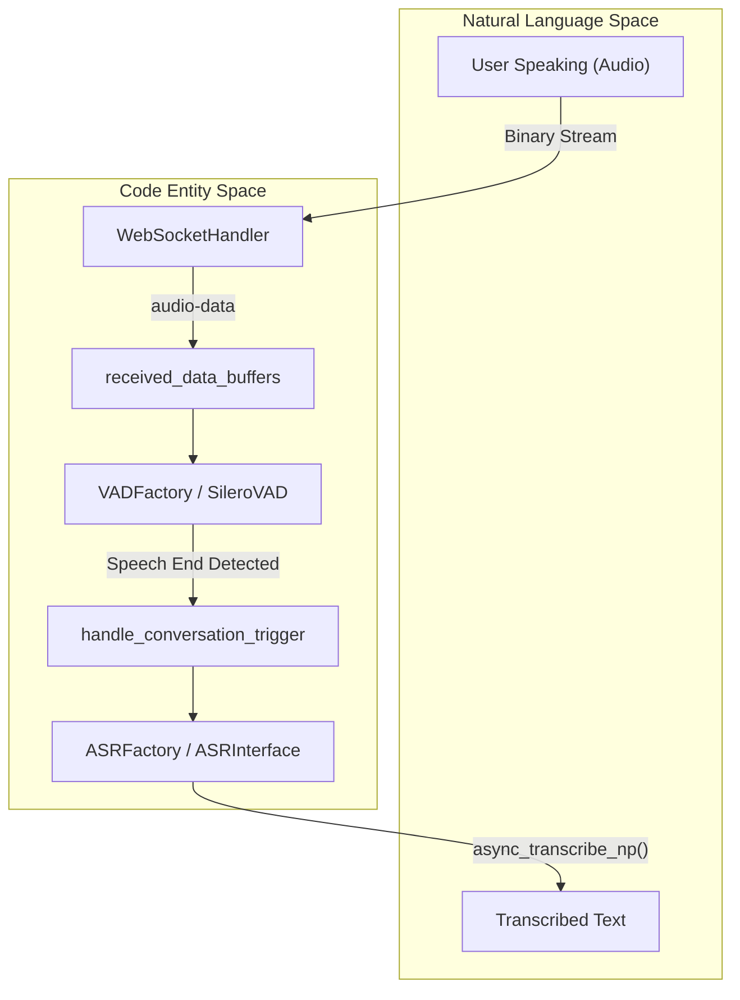
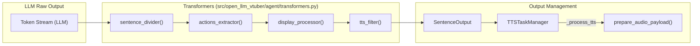

<!-- source: DeepWiki mcp.deepwiki.com · repo Open-LLM-VTuber/Open-LLM-VTuber · page 12 Glossary · fetched 2026-10-30 -->

# Glossary

Relevant source files

The following files were used as context for generating this wiki page:

- [.gitignore](.gitignore)
- [README.CN.md](README.CN.md)
- [README.JP.md](README.JP.md)
- [README.KR.md](README.KR.md)
- [README.md](README.md)
- [assets/banner.cn.jpg](assets/banner.cn.jpg)
- [config_templates/conf.ZH.default.yaml](config_templates/conf.ZH.default.yaml)
- [config_templates/conf.default.yaml](config_templates/conf.default.yaml)
- [mcp_servers.json](mcp_servers.json)
- [src/open_llm_vtuber/agent/agents/basic_memory_agent.py](src/open_llm_vtuber/agent/agents/basic_memory_agent.py)
- [src/open_llm_vtuber/agent/output_types.py](src/open_llm_vtuber/agent/output_types.py)
- [src/open_llm_vtuber/agent/transformers.py](src/open_llm_vtuber/agent/transformers.py)
- [src/open_llm_vtuber/conversations/tts_manager.py](src/open_llm_vtuber/conversations/tts_manager.py)
- [src/open_llm_vtuber/mcpp/mcp_client.py](src/open_llm_vtuber/mcpp/mcp_client.py)
- [src/open_llm_vtuber/mcpp/server_registry.py](src/open_llm_vtuber/mcpp/server_registry.py)
- [src/open_llm_vtuber/mcpp/tool_adapter.py](src/open_llm_vtuber/mcpp/tool_adapter.py)
- [src/open_llm_vtuber/mcpp/tool_executor.py](src/open_llm_vtuber/mcpp/tool_executor.py)
- [src/open_llm_vtuber/mcpp/tool_manager.py](src/open_llm_vtuber/mcpp/tool_manager.py)
- [src/open_llm_vtuber/mcpp/types.py](src/open_llm_vtuber/mcpp/types.py)
- [src/open_llm_vtuber/service_context.py](src/open_llm_vtuber/service_context.py)
- [src/open_llm_vtuber/translate/tencent.py](src/open_llm_vtuber/translate/tencent.py)
- [src/open_llm_vtuber/utils/sentence_divider.py](src/open_llm_vtuber/utils/sentence_divider.py)
- [src/open_llm_vtuber/utils/stream_audio.py](src/open_llm_vtuber/utils/stream_audio.py)

This glossary defines technical terms, architectural concepts, and domain-specific abbreviations used within the Open-LLM-VTuber codebase.

## Core System Concepts

### ServiceContext
The `ServiceContext` is the central dependency injection container for a single client session [src/open_llm_vtuber/service_context.py:41-45](). It encapsulates all the engines (ASR, TTS, LLM Agent, VAD) and configurations required to maintain a VTuber's state. When a new WebSocket connection is established, the `WebSocketHandler` clones a default context to create a session-specific instance. It also manages the lifecycle of **Model Context Protocol (MCP)** components [src/open_llm_vtuber/service_context.py:95-108]().

### Agent System
The `AgentInterface` defines the abstract contract for all AI backends [src/open_llm_vtuber/service_context.py:12](). 
- **BasicMemoryAgent**: The standard implementation that manages short-term chat history in a list and handles tool-calling loops [src/open_llm_vtuber/agent/agents/basic_memory_agent.py:33-35](). It utilizes a `_chat_function_factory` to support different LLM providers like OpenAI or Claude [src/open_llm_vtuber/agent/agents/basic_memory_agent.py:114-117]().
- **Stateless LLM**: A backend that does not store history itself (e.g., OpenAI API, Ollama). The Agent must provide the full history with every request.
- **Specialized Agents**: Includes implementations like `HumeAIAgent` for empathetic voice interaction and `LettaAgent` for advanced memory management [config_templates/conf.default.yaml:82-86]().

### Conversation Pipeline
The logic flow that handles the transition from user input to AI response.
- **Single Conversation**: A direct 1-to-1 interaction between a user and the VTuber.
- **Group Conversation**: A round-robin interaction where multiple AI characters respond to a single user input or interact with each other, managed by `GroupConversationState` [config_templates/conf.default.yaml:16-17]().
- **TTSTaskManager**: Ensures that audio payloads are delivered to the frontend in the correct sequence even when TTS generation happens in parallel [src/open_llm_vtuber/conversations/tts_manager.py:16-28]().

---

## Technical Abbreviations

| Abbreviation | Full Term | Description | Code Pointer |
| :--- | :--- | :--- | :--- |
| **ASR** | Automatic Speech Recognition | Converts user microphone audio into text. | [src/open_llm_vtuber/service_context.py:9]() |
| **TTS** | Text-to-Speech | Converts LLM-generated text into audio waveforms. | [src/open_llm_vtuber/service_context.py:10]() |
| **VAD** | Voice Activity Detection | Detects when a user starts and stops speaking. | [src/open_llm_vtuber/service_context.py:11]() |
| **MCP** | Model Context Protocol | A protocol for connecting LLMs to external tools/data. | [src/open_llm_vtuber/service_context.py:15-19]() |
| **UID** | Unique Identifier | Used for clients (`client_uid`), characters (`conf_uid`), and history (`history_uid`). | [src/open_llm_vtuber/service_context.py:70-73]() |
| **RMS** | Root Mean Square | Used to calculate audio volume for Live2D lip-sync. | [src/open_llm_vtuber/utils/stream_audio.py:17]() |
| **SBD** | Sentence Boundary Disambiguation | Used by `SentenceDivider` (via `pysbd`) to split LLM streams. | [src/open_llm_vtuber/agent/transformers.py:65-66]() |

---

## Data Flow Diagrams

### Audio Input and ASR Trigger
This diagram bridges the natural language event of speech to the internal ASR and Conversation Trigger logic.

**Sources:** [src/open_llm_vtuber/service_context.py:51-55](), [src/open_llm_vtuber/asr/asr_interface.py:9-11](), [config_templates/conf.default.yaml:175-176]().

### LLM Output Transformation Pipeline
This diagram shows how raw LLM tokens are processed through the transformer decorator chain before being queued for TTS.

**Sources:** [src/open_llm_vtuber/agent/transformers.py:12-180](), [src/open_llm_vtuber/conversations/tts_manager.py:16-40](), [src/open_llm_vtuber/utils/stream_audio.py:12]().

---

## Domain Concepts

### Emotion Mapping (`emotionMap`)
A configuration in `model_dict.json` that maps keywords found in LLM output to specific Live2D expressions or motions. The `Live2dModel` class uses `extract_emotion` to parse these from sentences during the `actions_extractor` phase [src/open_llm_vtuber/agent/transformers.py:86-88]().

### Faster First Response
A latency optimization where the system starts TTS synthesis as soon as the first punctuation (comma, period) is encountered in the LLM stream, rather than waiting for the full sentence. This is managed by the `SentenceDivider` [src/open_llm_vtuber/agent/transformers.py:13-14]().

### Think Tag
A mechanism (using `<think>` tags) that allows LLMs to output internal reasoning. The `display_processor` handles these by converting them to parentheses in the UI [src/open_llm_vtuber/agent/transformers.py:135-140](), and the `tts_filter` ensures they are skipped for audio generation [src/open_llm_vtuber/agent/transformers.py:189-190]().

### Tool Call Loop (MCP)
The process where the `BasicMemoryAgent` detects a tool call request (often as JSON) from the LLM via `StreamJSONDetector` [src/open_llm_vtuber/agent/agents/basic_memory_agent.py:69](). It executes the tool via `ToolExecutor` and appends the result to memory to continue the conversation [src/open_llm_vtuber/agent/agents/basic_memory_agent.py:27-30]().

### Translation Pipeline
An optional stage where `TranslateInterface` implementations (like `TMT` or `DeepLX`) translate the LLM's text before it is sent to the TTS engine, allowing the VTuber to speak a different language than the LLM's output [src/open_llm_vtuber/service_context.py:56]().

---
**Sources:** 
- [src/open_llm_vtuber/service_context.py:1-168]()
- [src/open_llm_vtuber/agent/agents/basic_memory_agent.py:33-112]()
- [src/open_llm_vtuber/agent/transformers.py:12-200]()
- [src/open_llm_vtuber/conversations/tts_manager.py:16-183]()
- [config_templates/conf.default.yaml:1-150]()
- [src/open_llm_vtuber/mcpp/tool_manager.py:7-51]()